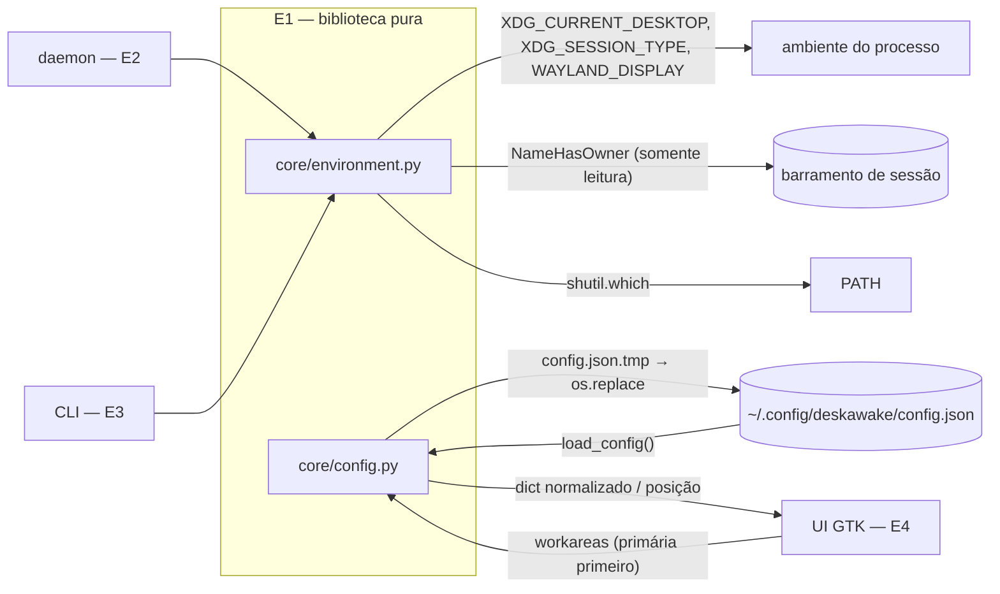

# Design: E1 — Esqueleto, Ambiente e Config

**Feature:** DeskAwake — E1 | **Data:** 2026-11-19 | **Status:** Aprovado
**Referência:** [`spec.md`](spec.md) (decisões 1–33, “Contratos”, “Notas ao implementador”) e [`DELIVERY_MAP.md`](DELIVERY_MAP.md) §E1

> Este design cobre **somente a E1**. Ele não implementa código, não cria processo residente e
> não antecipa E2–E6. Em caso de conflito com a `spec.md`, a `spec.md` vence.

---

## 1. Contexto e limite da entrega

A E1 entrega a base do repositório e as duas primeiras peças **puras** do núcleo: configuração e
detecção de ambiente. O repositório passa a rodar `pytest` e consegue responder “onde estou?” e
“qual é a configuração?” sem tocar no barramento além de consultas de leitura (`NameHasOwner`).

**Inclui (e só isso):**

| Arquivo | Responsabilidade |
|---|---|
| `LICENSE` | MIT já existente; conferido (MIT, 2026, Marcelo Silva) — sem alteração |
| `pyproject.toml` | metadados mínimos + `[tool.pytest.ini_options]`; sem build backend |
| `core/__init__.py` | pacote vazio |
| `core/config.py` | leitura/escrita atômica do JSON, defaults, `.bak`, validação de posição |
| `core/environment.py` | detecção de DE/sessão, backends e ferramentas |
| `tests/unit/test_config.py` | testes de config |
| `tests/unit/test_environment.py` | testes de detecção |

**Explicitamente fora da E1:**

- `core/inhibitors.py`, `core/state.py`, `core/daemon.py`, `core/cli.py`, `bin/deskawake`.
- Qualquer UI (`ui_gtk/`, `plasmoid/`, `assets/`).
- `install.sh`, `uninstall.sh`, `verify.sh`, `data/`, READMEs e checklists de instalação.
- Criação de `config.json` no primeiro uso **pela UI**: a E1 só oferece `load_config()`/
  `save_config()`; o gatilho é da E4.
- Persistência da posição do Plasmoid: é do Plasma (`ItemGeometries`/`appletsrc`), não deste JSON.
- Qualquer chamada de método de backend de inibição, `xdg-screensaver`, `Gtk`/`Gdk` no núcleo.
- `tests/conftest.py`: não é necessário na E1; será criado na E2 quando entrarem os fakes de
  integração.

---

## 2. Arquitetura

### 2.1 Fluxo de dados



O fluxo é unidirecional: a E1 **lê** ambiente e config e **escreve** apenas o JSON de config.
Não há daemon, sinal, timer ou estado residente.

### 2.2 Componentes e camadas

- **`core/config.py`** — fronteira de I/O e validação da configuração.
  - I/O: `pathlib.Path`, `json`, `os.replace`.
  - Regra pura: normalização do schema, recuperação, matemática de posição.
  - Não importa `Gdk`/`Gtk` e não recebe display; `workareas` vêm da UI.
- **`core/environment.py`** — adaptador read-only do ambiente.
  - I/O: `os.environ`, `dbus.SessionBus()`/`NameHasOwner`, `shutil.which`.
  - Regra pura: montar o `Environment`; nenhuma decisão de UI ou de inibição.
  - Nunca chama método de backend; nunca inicia serviço.
- **`pyproject.toml`** — metadados e configuração do `pytest`; não é pacote instalável.
- **`tests/unit/`** — testes headless com `tmp_path`, `monkeypatch` e fakes injetados.

**Pontos de entrada:** não há executável na E1. Os pontos de entrada são as funções públicas de
`core.config` e `core.environment`, consumidas pela E4/E2/E3 e verificadas manualmente por
`python3 -c`.

**Camadas:** toda a I/O fica nas bordas dos dois módulos; a validação/normalização é composta por
funções puras testáveis sem display e sem barramento real.

**Interface:** nenhuma UI nesta entrega. A E4 consumirá `load_config`, `save_config`,
`default_position` e `validate_position`; a E2/E3 consumirão `detect_environment` e `is_wayland`.

---

## 3. Modelo de dados

Não há banco de dados. O “modelo” da E1 é o JSON de configuração e o dataclass `Environment`
em memória.

### 3.1 Schema do arquivo de configuração

Caminho: `~/.config/deskawake/config.json`.

```json
{
  "version": 1,
  "theme": "auto",
  "position": { "x": 1772, "y": 24 }
}
```

- `version`: inteiro, obrigatório, exatamente `1`.
- `theme`: string obrigatória em `{"auto", "light", "dark"}`.
- `position`: opcional; objeto com `x` e `y` inteiros. Ausente = posição padrão.
- Nenhuma outra chave é persistida. **Estado nunca é persistido** (nem `active`, nem `state`).

### 3.2 Máquina de leitura e recuperação

| Entrada encontrada | Classificação | Ação |
|---|---|---|
| Arquivo ausente | normal | Retorna defaults; **não cria** arquivo |
| JSON inválido / UTF-8 inválido | corrupção | Renomeia para `config.json.bak`, grava defaults, retorna defaults |
| Raiz não é objeto | corrupção | Idem |
| `version` ausente ou ≠ `1` | corrupção | Idem |
| `theme` ausente ou fora do conjunto | corrupção | Idem |
| `position` malformada (não-objeto, x/y ausentes ou não-int) | normalização | Descarta `position`, reescreve o JSON válido, **sem** `.bak` |
| Chaves extras (ex.: `"active": true`, inclusive dentro de `position`) | normalização | Remove, reescreve o JSON válido, **sem** `.bak` |
| `OSError` de leitura (permissão/IO) | degradação | Retorna defaults; não renomeia; não levanta exceção |

Regras adicionais:

- `.bak` anterior é sobrescrito; não há versionamento de backups.
- `load_config()` nunca propaga exceção por config quebrada (a UI não vê stack trace).
- Um `version` futuro (> 1) é tratado como corrupção nesta versão. Antes de incrementar o schema,
  uma migration precisará ser implementada; o reset atual é deliberado e não preserva tema/posição.
- `save_config()` é a única escrita; ela sempre grava `version = 1` e apenas as chaves conhecidas.
- Escrita atômica: `config.json.tmp` no **mesmo diretório** → `os.replace()`; sem
  `NamedTemporaryFile` em `/tmp`. Em erro, o `.tmp` é removido em best effort.
- `~/.config/deskawake/` é criado com `mkdir(parents=True, exist_ok=True)` na primeira gravação.
- `fsync` não é exigido: a garantia pedida é **atomicidade** (rename), não durabilidade pós-crash.

### 3.3 Migrations necessárias

Nenhuma. O schema nasce na versão 1. A política de versão desconhecida (`> 1` → `.bak` + defaults)
é a rede de segurança até que exista uma migration real.

### 3.4 Controle de acesso aos dados

Não se aplica multi-tenant. O arquivo é por usuário (`~/.config`), não contém segredos e não
guarda estado. As permissões seguem o `umask` do usuário; a E1 não altera modos nem cria diretórios
compartilhados. O daemon e as UIs rodam na mesma sessão do usuário.

---

## 4. Contratos

### 4.1 `core/config.py`

```python
# core/config.py
from __future__ import annotations

import json
import os
from pathlib import Path

CONFIG_PATH = Path("~/.config/deskawake/config.json").expanduser()
CONFIG_VERSION = 1
DEFAULT_THEME = "auto"          # "auto" | "light" | "dark"
MARGIN = 24                     # px, canto superior direito do monitor primário
PILL_WIDTH = 124                # px, largura lógica da pílula (spec)
PILL_HEIGHT = 42                # px, altura lógica da pílula (spec)

VALID_THEMES = frozenset({"auto", "light", "dark"})

Position = tuple[int, int]                  # (x, y) do canto superior esquerdo
WorkArea = tuple[int, int, int, int]         # (x, y, w, h) da área útil

def load_config() -> dict: ...
    # {"version": 1, "theme": "auto", "position": {"x": int, "y": int} | ausente}
    # arquivo ausente -> defaults, sem criar arquivo
    # corrupção -> .bak + defaults
    # position/chaves extras inválidas -> normaliza sem .bak

def save_config(cfg: dict) -> None: ...
    # grava somente version/theme/position (whitelist), tmp no mesmo diretório + os.replace
    # normaliza theme inválido para DEFAULT_THEME
    # position aceita {"x": int, "y": int} ou sequência (x, y); grava sempre como objeto
    # posição malformada é omitida; pode levantar OSError de escrita (disco/permissão)

def default_position(workareas: list[WorkArea]) -> Position: ...
    # primeira workarea = monitor primário
    # x = max(wx + MARGIN, wx + ww - PILL_WIDTH - MARGIN)
    # y = wy + MARGIN
    # lista vazia -> (MARGIN, MARGIN)

def validate_position(pos: object, workareas: list[WorkArea]) -> Position: ...
    # aceita {"x": int, "y": int} ou tupla/lista de 2 ints
    # qualquer outra coisa -> default_position
    # mantém se o ponto (x, y) cair em [wx, wx+ww) × [wy, wy+wh) de qualquer workarea
    # fora de todos os monitores -> default_position
```

**Semântica de posição:** `position` é o **âncora do canto superior esquerdo** da pílula 124×42.
A validação da E1 confere apenas o ponto, não o retângulo completo; recortes visuais na borda são
responsabilidade da UI, sem mudar este contrato.

**Ordem das workareas:** a primeira entrada é o monitor primário. A E4 deve montar a lista nessa
ordem (primário primeiro, depois os demais). A E1 não recebe um índice de primário.

**Constantes adicionais:** `CONFIG_VERSION`, `VALID_THEMES`, `PILL_WIDTH` e `PILL_HEIGHT` são
derivadas da spec e expostas para reutilização pela E4; não substituem nem alteram
`CONFIG_PATH`, `DEFAULT_THEME` e `MARGIN`, fixados pelo DELIVERY_MAP.

### 4.2 `core/environment.py`

```python
# core/environment.py
from __future__ import annotations

import os
import shutil
from collections.abc import Callable, Mapping
from dataclasses import dataclass

import dbus

@dataclass(frozen=True)
class Environment:
    desktop: str                  # XDG_CURRENT_DESKTOP, valor bruto (ex.: "MATE", "KDE")
    session_type: str             # XDG_SESSION_TYPE em minúsculas ("x11" | "wayland")
    wayland_display: str | None   # WAYLAND_DISPLAY; vazio/ausente -> None
    backends: dict[str, bool]     # {"fdo", "mate", "gsm", "policyagent"}
    tools: dict[str, bool]        # {"kpackagetool6", "gdbus", "systemd-inhibit"}

BACKEND_BUS_NAMES: dict[str, str] = {
    "fdo": "org.freedesktop.ScreenSaver",
    "mate": "org.mate.ScreenSaver",
    "gsm": "org.gnome.SessionManager",
    "policyagent": "org.kde.Solid.PowerManagement",
}

TOOL_NAMES: tuple[str, ...] = ("kpackagetool6", "gdbus", "systemd-inhibit")

def detect_environment(
    env: Mapping[str, str] | None = None,
    bus: "dbus.Connection" | None = None,
    which: Callable[[str], str | None] = shutil.which,
) -> Environment: ...

def is_wayland(env: Environment) -> bool: ...
    # True somente se env.session_type.lower() == "wayland"
```

**Comportamento fixado:**

- `env=None` → lê `os.environ`; `env` injetado é usado integralmente (sem misturar com `os.environ`).
- `desktop` é o valor bruto de `XDG_CURRENT_DESKTOP`, sem normalização (ex.: `"ubuntu:MATE"`
  permanece `"ubuntu:MATE"`).
- `session_type` é `XDG_SESSION_TYPE` em minúsculas; ausente → `""`.
- `wayland_display` é `WAYLAND_DISPLAY`; ausente ou string vazia → `None`.
- `tools[nome] = which(nome) is not None`. `kpackagetool6` ausente é **resultado válido**, não erro.
- `bus=None` → tenta `dbus.SessionBus()`; se falhar (`DBusException`, `OSError`, `KeyError`),
  mantém `bus = None` e todos os `backends` ficam `False`.
- Cada backend é detectado exclusivamente por `bus.name_has_owner(BACKEND_BUS_NAMES[nome])`
  (equivalente read-only a `NameHasOwner`). **Nenhum** método de backend é chamado; nenhum serviço
  é auto-iniciado.
- `policyagent` verifica o dono de `org.kde.Solid.PowerManagement` (o objeto/interface do
  `PolicyAgent` só será usado na E2, após confirmação de que o método existe).
- Falha de `name_has_owner` para um backend não derruba a detecção: aquele backend fica `False`.
- `is_wayland()` olha **somente** `session_type`; `WAYLAND_DISPLAY` é informativo. A regra
  combinada da spec (`XDG_SESSION_TYPE == "wayland"` **ou** `WAYLAND_DISPLAY` definido) é
  política da E3 e deve ser implementada lá, em função própria (ex.: `_wayland_blocked()` no
  `core/cli.py`), sem alterar `is_wayland()`. A E1 não implementa essa regra nem a duplica em
  `environment.py`.
- `environment.py` não importa `Gtk`/`Gdk`, não chama `sys.exit` e não decide aceitar/recusar UI.

**Tipo do barramento:** o contrato do DELIVERY_MAP escreve `bus: "dbus.Connection"`. Em runtime o
objeto real é `dbus.Bus` (subclasse de `dbus.connection.Connection`) e os testes injetam um fake
duck-typed que implementa `name_has_owner`. A E1 usa apenas esse método; não fecha a conexão
(o `SessionBus` do dbus-python é compartilhado e a E2 pode passar a própria conexão). O módulo usa
`from __future__ import annotations` para manter a anotação do contrato como texto e não avaliá-la
em runtime (o nome `dbus.Connection` não existe como atributo público do dbus-python).

### 4.3 `pyproject.toml`

```toml
[project]
name = "deskawake"
version = "0.1.0"
requires-python = ">=3.10"

[tool.pytest.ini_options]
testpaths = ["tests"]
markers = [
  "slow: testes opt-in de ciclo real (debounce/verificação de ~5-6 s)",
]
```

- Sem `[build-system]`, sem `dependencies`, sem `setup.py`/`setup.cfg`.
- O arquivo existe para metadados mínimos e configuração do `pytest`; o repo **não** é instalado
  via `pip` e não há empacotamento de distro.
- `pytest` é dependência **de desenvolvimento** (`apt install python3-pytest`), nunca instalada
  pelo `install.sh`.

### 4.4 Endpoints

Não há endpoints HTTP nem membros D-Bus expostos na E1. A única interação D-Bus é de leitura
(`NameHasOwner`) na conexão de sessão.

---

## 5. Decisões técnicas

### ADR-01: Forma do `pyproject.toml` sem build backend

- **Contexto:** o DELIVERY_MAP exige `requires-python = ">=3.10"` e proíbe build backend de
  distro. `requires-python` pertence a `[project]`, que no PEP 621 exige `name`.
- **Opções consideradas:**
  - A: `[project]` com `name`, `version` e `requires-python`, sem `[build-system]` — Prós: válido
    no PEP 621, mínimo, sem backend declarado. Contras: se alguém rodar `pip install .`, o pip
    assumirá o backend legado do setuptools; o repo não é feito para isso.
  - B: apenas `[tool.pytest.ini_options]` — Prós: mínimo absoluto. Contras: omite
    `requires-python`, contrariando o mapa.
  - C: `[project]` só com `requires-python` — Prós: literal. Contras: inválido no PEP 621.
- **Decisão:** A, confirmada pelo usuário em 2026-11-19.
- **Consequências:** metadados válidos e nenhum build backend; a instalação continua sendo por
  cópia de arquivos (E6), não por `pip`.

### ADR-02: Política de recuperação do `config.json`

- **Contexto:** o mapa lista quatro gatilhos de corrupção (JSON inválido, raiz não-dict, `version`
  desconhecida, `theme` inválido), mas não define o tratamento de `position` malformada, campos
  ausentes ou chaves extras.
- **Opções consideradas:**
  - A: estrita apenas nos quatro gatilhos; `position` malformada e chaves extras são normalizadas
    sem `.bak`. Prós: preserva tema/posição do usuário em desvios benignos; mantém o `.bak` para
    corrupção real. Contras: exige normalização e reescrita silenciosa.
  - B: qualquer desvio vira corrupção. Prós: simples de testar. Contras: agressivo; um campo extra
    apagaria tema e posição.
  - C: tolerante com defaults para campos ausentes. Prós: indulgente. Contras: um arquivo
    truncado poderia parecer válido.
- **Decisão:** A, confirmada pelo usuário em 2026-11-19. `version`/`theme` ausentes contam como
  desconhecidos/inválidos e geram `.bak`; `position` malformada é descartada e chaves extras são
  removidas, com reescrita normalizada sem `.bak`.
- **Consequências:** o usuário não perde tema por uma posição inválida nem por uma chave extra;
  um arquivo parcialmente escrito sem `theme` é resetado. Um futuro `version = 2` exigirá
  migration antes de ser aceito.

### ADR-03: Monitor primário e lista vazia

- **Contexto:** `default_position(workareas)` fala em “monitor primário”, mas a assinatura fixada
  recebe apenas uma lista de workareas, sem índice/flag de primário.
- **Opções consideradas:**
  - A: a primeira workarea é a primária; lista vazia → `(MARGIN, MARGIN)`. Prós: não muda a
    assinatura; fallback seguro. Contras: depende da E4 ordenar a lista corretamente.
  - B: primeira workarea é a primária; lista vazia → `ValueError`. Prós: falha explícita. Contras:
    a UI teria de tratar uma exceção que o mapa não prevê.
  - C: adicionar um índice/flag de primário. Prós: explícito. Contras: altera o contrato fixado.
- **Decisão:** A, confirmada pelo usuário em 2026-11-19. O `x` é limitado a
  `max(wx + MARGIN, wx + ww - PILL_WIDTH - MARGIN)` para não ficar negativo em workareas estreitas.
- **Consequências:** a E4 deve passar a workarea do monitor primário primeiro; a E1 não tenta
  adivinhar o primário pelo conteúdo da lista.

### ADR-04: Semântica de `is_wayland()`

- **Contexto:** a spec usa `XDG_SESSION_TYPE=wayland` **ou** `WAYLAND_DISPLAY` no guard da CLI,
  mas a E1 só precisa detectar a sessão.
- **Opções consideradas:**
  - A: `True` somente se `session_type == "wayland"`; `WAYLAND_DISPLAY` fica informativo. Prós:
    separa detecção (E1) de política de UI (E3); o guard da CLI continua com a regra completa.
  - B: `True` se `session_type == "wayland"` **ou** `wayland_display` definido. Prós: defensivo.
    Contras: mistura a política da E3 na E1 e pode recusar `ui` em cenários híbridos.
- **Decisão:** A, confirmada pelo usuário em 2026-11-19.
- **Consequências:** a E3 é a dona explícita da regra combinada (`XDG_SESSION_TYPE == "wayland"`
  **ou** `WAYLAND_DISPLAY` definido) e deve implementá-la em função própria no `core/cli.py`,
  sem alterar `is_wayland()`. A E1 não duplica essa regra em `environment.py`; se a checagem
  combinada precisar ser compartilhada no futuro, ela nasce como função separada (E3+), e
  `is_wayland()` permanece estável para não divergir.

### ADR-05: Detecção read-only via `NameHasOwner`

- **Contexto:** consultar métodos de backend na detecção pode auto-iniciar `mate-screensaver` ou
  `kscreenlocker`; o mapa exige `NameHasOwner`.
- **Opções consideradas:**
  - A: `bus.name_has_owner(nome)` para cada backend; sem `call_blocking` de backend. Prós:
    leitura barata, sem auto-start, fake simples. Contras: não confirma se o objeto/interface
    existe (a E2 confirma no uso).
  - B: chamar um método de leitura do backend (ex.: `GetInhibitors`). Prós: mais informação.
    Contras: pode acordar o serviço; proibido pela spec.
- **Decisão:** A. `policyagent` mapeia para `org.kde.Solid.PowerManagement`; `fdo`/`mate`/`gsm`
  para os nomes da tabela de backends da spec.
- **Consequências:** `backends[nome] = True` significa “há dono no barramento”, não “o método
  responde”. A E2 deve tratar falha de método como erro de ativação.

### ADR-06: Costuras de teste sem tocar no ambiente real

- **Contexto:** os testes unitários precisam rodar sem escrever em `~/.config` real e sem depender
  de um barramento de sessão real.
- **Opções consideradas:**
  - A: monkeypatch de `core.config.CONFIG_PATH`; `env`/`bus`/`which` injetados; fake bus com
    `name_has_owner` e um `call_blocking` que falha se for usado. Prós: headless, determinístico,
    sem efeitos colaterais. Contras: exige disciplina para não importar o módulo antes do patch.
  - B: subprocessos com `HOME` temporário e `dbus-run-session` também nos unitários. Prós: mais
    fiel. Contras: lento e desnecessário para funções puras.
- **Decisão:** A. Os testes de integração com barramento real ficam na E2 (`dbus-run-session`).
- **Consequências:** `CONFIG_PATH` é global de módulo e deve ser resolvido em tempo de chamada
  (não capturado em default de função); o fake de bus não deve delegar `name_has_owner` ao
  `call_blocking`.

### ADR-07: Validação da posição é do âncora, não do retângulo

- **Contexto:** o mapa diz “posição restaurada somente se o ponto cair dentro da área útil” e fixa
  `validate_position(pos, workareas)`. Não há exigência de o retângulo 124×42 caber inteiro.
- **Opções consideradas:**
  - A: validar apenas o ponto `(x, y)` contra `[wx, wx+ww) × [wy, wy+wh)`. Prós: fiel ao contrato;
    simples; aceita qualquer canto de trabalho. Contras: a pílula pode ficar parcialmente
    recortada na borda direita/inferior.
  - B: validar o retângulo completo (x, y, x+124, y+42). Prós: nunca recorta. Contras: muda a
    regra fixada e rejeitaria posições que a spec considera válidas.
- **Decisão:** A. A UI pode recortar/ajustar visualmente, mas não deve alterar a regra do núcleo.
- **Consequências:** a posição padrão já nasce dentro da área útil; posições antigas salvas em
  monitores maiores podem ser consideradas válidas mesmo que a pílula encoste na borda.

### ADR-08: `save_config` com whitelist de chaves

- **Contexto:** a spec proíbe persistir estado; um chamador futuro pode passar um dict com chaves
  extras (ex.: `"active": true`).
- **Opções consideradas:**
  - A: `save_config` grava apenas `version`, `theme` e `position`; normaliza `theme` inválido para
    `auto` e posição malformada para ausente. Prós: o arquivo nunca ganha estado nem schema
    inválido. Contras: erros do chamador são silenciosos.
  - B: gravar o dict como veio. Prós: transparente. Contras: permite estado no JSON, contrariando
    a decisão 5.
- **Decisão:** A. `version` é sempre `1`; chaves extras são ignoradas. `position` aceita tanto o
  objeto do JSON (`{"x": int, "y": int}`) quanto a tupla `(x, y)` devolvida por
  `default_position`/`validate_position`, e é sempre gravada como objeto.
- **Consequências:** o JSON em disco é sempre compatível com `load_config`; um bug de UI que
  passe posição/tema inválidos é corrigido na escrita, e não vira corrupção no próximo boot. A
  UI pode persistir diretamente o retorno de `validate_position` sem converter o tipo.

---

## 6. Plano de verificação

### 6.1 Automático

Comando da entrega:

```bash
python3 -m pytest tests/unit/test_config.py tests/unit/test_environment.py -v
```

`pytest` é instalado pelo desenvolvedor via `apt install python3-pytest`; o comando usa
`python3 -m pytest` para colocar a raiz do repo no `sys.path`.

**Mapa critério de aceite → teste:**

| Critério E1.4 | Teste |
|---|---|
| `load_config()` sem arquivo ⇒ defaults, sem criar arquivo | `test_load_missing_returns_defaults_without_creating_file` |
| `save_config()` + `load_config()` round-trip; nenhum `.tmp` | `test_save_load_roundtrip` / `test_save_leaves_no_tmp` |
| JSON corrompido ⇒ `.bak`, defaults, `config.json` novo válido | `test_corrupt_json_quarantines_and_recovers` |
| `theme` inválido ⇒ corrupção com `.bak` | `test_invalid_theme_quarantines` |
| `validate_position` dentro/fora/múltiplos monitores | `test_validate_position_inside_keeps`, `test_validate_position_outside_falls_back`, `test_validate_position_accepts_secondary_monitor` |
| `default_position` com `(0,0,1920,1050)` ⇒ `(1772, 24)` | `test_default_position_primary_monitor` |
| `MATE/x11` ⇒ `desktop="MATE"`, `session_type="x11"`, `is_wayland() is False` | `test_mate_x11_detection` |
| `wayland` + `WAYLAND_DISPLAY` ⇒ `is_wayland() is True` | `test_wayland_detection` |
| `which` sem `kpackagetool6` ⇒ `False`, sem exceção | `test_kpackagetool6_absent_is_false_without_exception` |
| `bus` fake sem/com dono de `org.mate.ScreenSaver`; nenhum `call_blocking` de backend | `test_backends_by_name_owner` / `test_detection_only_uses_name_has_owner` |

**Testes adicionais que fixam as ADRs:**

- `test_non_dict_root_quarantines`
- `test_unknown_version_quarantines`
- `test_missing_theme_or_version_quarantines`
- `test_malformed_position_is_dropped_without_bak`
- `test_extra_keys_are_dropped_without_bak`
- `test_save_config_whitelists_keys`
- `test_save_config_normalizes_invalid_theme`
- `test_save_config_accepts_position_tuple`
- `test_validate_position_accepts_position_mapping`
- `test_validate_position_invalid_input_falls_back`
- `test_default_position_empty_workareas`
- `test_wayland_display_empty_is_none`
- `test_desktop_is_raw_value`
- `test_tools_detection`
- `test_no_session_bus_marks_all_backends_false`
- `test_empty_env_defaults`

**Fake de barramento (unitário):** implementa `name_has_owner(nome) -> bool` e um
`call_blocking(...)` que registra a chamada e falha a asserção se for usado. Não é um
`dbus.Bus` real; é duck-typed, como o contrato permite.

**Fora do escopo de testes da E1:** a regra combinada de Wayland do guard da CLI é testada na E3;
a E1 cobre apenas a semântica de `is_wayland()` (ADR-04).

### 6.2 Manual (rápido, nas duas máquinas)

- [ ] Mint 22.3 MATE/X11:
      `python3 -c "from core.config import load_config; print(load_config())"` imprime
      `{'version': 1, 'theme': 'auto'}` (sem criar arquivo).
- [ ] Mint 22.3 MATE/X11:
      `python3 -c "from core.environment import detect_environment as d, is_wayland; e=d(); print(e); print('wayland:', is_wayland(e))"` mostra
      `desktop='MATE'`, `session_type='x11'`, `is_wayland` falso, `backends['mate']=True`,
      `backends['fdo']=False`, `tools['kpackagetool6']=False`.
- [ ] Kubuntu 26.04 / Plasma 6.6 Wayland:
      o mesmo comando mostra `desktop='KDE'`, `session_type='wayland'`,
      `wayland_display='wayland-0'`, `backends['fdo']=True`, `backends['policyagent']=True`,
      `tools['kpackagetool6']=True`.
- [ ] Nenhuma dessas execuções inicia `mate-screensaver`, `kscreenlocker` ou `org_kde_powerdevil`
      como efeito colateral (conferir donos antes/depois, se necessário).

### 6.3 Definição de pronto da E1

- [ ] `python3 -m pytest tests/unit/test_config.py tests/unit/test_environment.py -v` verde.
- [ ] Nenhum `.tmp` remanescente após os testes.
- [ ] `shellcheck` não se aplica (sem scripts na E1).
- [ ] Nenhuma decisão da `spec.md` contrariada; nenhuma dependência nova além de
      `python3-gi`, `python3-dbus`, `systemd` e `pytest` (dev).
- [ ] Nenhum artefato de spec citado em código, comentários, commits ou PRs.

---

## 7. Impacto em features/entregas existentes

| Entrega/componente | Impacto |
|---|---|
| **E2 — inibidores/estado/daemon** | Consome `Environment` e `detect_environment`; os nomes em `BACKEND_BUS_NAMES` servem aos watchers de liveness. Não altera a E1. O daemon deve passar a própria conexão D-Bus quando possível e usar `policyagent` só após a confirmação de métodos da E2. |
| **E3 — CLI** | Usa `is_wayland()` apenas como sinal de sessão. A regra combinada do guard de `ui` (`XDG_SESSION_TYPE == "wayland"` ou `WAYLAND_DISPLAY` definido) é responsabilidade explícita da E3, em função própria, sem alterar `is_wayland()` (ADR-04). `status` usa `NameHasOwner` de `org.local.DeskAwake`, não a detecção de backends. |
| **E4 — widget GTK** | Consumidor principal de `load_config`/`save_config`/`validate_position`/`default_position`. Deve passar as workareas com o monitor primário primeiro (ADR-03), criar o config no primeiro uso e nunca persistir estado. |
| **E5 — Plasmoid** | Sem impacto: posição/tema são do Plasma; não usa `config.json`. |
| **E6 — instalador** | Sem impacto direto: o shell detecta ferramentas por conta própria; `tools` da E1 é informativo para o núcleo, não a fonte de verdade do instalador. |
| **Documentação** | `README.md`/`README.en.md` são da E6; a E1 não os altera. |
| **Sem impacto confirmado** | `LICENSE` (conferido, sem alteração), contratos D-Bus da E2, inibidores, UI GTK/QML, scripts e templates de instalação. O repositório atual só tem docs; não há feature de código a regredir. |

---

## 8. Conformidade com os padrões do projeto

- [x] Python ≥ 3.10; apenas stdlib + `python3-dbus` (já exigido). Nenhuma dependência de runtime
      nova; `pytest` é dev-only e instalado por `apt`, nunca pelo `install.sh`.
- [x] Sem `sudo`, sem empacotamento de distro, sem `.deb`/AUR/Flatpak, sem build backend.
- [x] Sem testes de GUI; comportamento visual fica nas checklists manuais (E4/E5).
- [x] `systemd-inhibit`, backends e estados D-Bus não são tocados na E1.
- [x] Estado nunca é persistido; defaults contêm apenas `version`/`theme`.
- [x] Detecção sem auto-start (`NameHasOwner`); `kpackagetool6` ausente é resultado válido.
- [x] Escrita atômica com `.tmp` no mesmo diretório + `os.replace`; `.bak` para corrupção.
- [x] Núcleo sem `Gtk`/`Gdk`; posição validada por função pura com `workareas` injetadas.
- [x] `xdg-screensaver` não aparece em nenhum caminho.
- [x] Documentação e design em pt-BR; nenhum artefato de spec é citado em código.
- [x] O arquivo `design_e1.md` é versionado em `docs/implementation/`.

---

## 9. Riscos e limites conhecidos

1. **Ordem das workareas (ADR-03):** se a E4 passar a lista fora da ordem, a posição padrão pode
   cair no monitor secundário. Mitigação: contrato explícito e teste da E4 na checklist manual.
2. **Versão futura do config (ADR-02):** `version > 1` hoje reseta para defaults. Antes de
   incrementar o schema, implementar migration; o reset é aceitável apenas enquanto não há
   campos além de tema/posição.
3. **Posição apenas do âncora (ADR-07):** a pílula pode encostar/recortar na borda direita ou
   inferior. A UI pode ajustar visualmente, mas não deve mudar a regra do núcleo.
4. **`save_config` engole schema inválido (ADR-08):** um bug de UI que passe tema/posição
   inválidos é corrigido silenciosamente. Os testes da E4 devem cobrir os valores que ela envia.
5. **`dbus.SessionBus()` sem barramento:** a detecção degrada para todos os backends `False`; não
   é erro fatal. Em ambiente sem sessão gráfica, a E1 continua importável e testável.
6. **`desktop` bruto:** valores compostos (`ubuntu:MATE`) não são normalizados; consumidores que
   precisem comparar devem tratar o valor. A E1 não decide política de DE.
7. **Sem `fsync`:** a escrita é atômica contra interrupção do processo, mas uma queda de energia
   imediatamente após o `os.replace` pode perder a última gravação. Aceitável para tema/posição.

---

## 10. Próximos passos

1. Implementar a E1 exatamente nos contratos acima (sem UI, sem daemon, sem scripts).
2. Rodar `python3 -m pytest tests/unit/test_config.py tests/unit/test_environment.py -v` e as
   verificações manuais nas duas máquinas.
3. Seguir para a E2 somente com a E1 verde.

### 10.1 Fluxo de Git e higiene antes de commit/PR

O fluxo por entrega está definido no `DELIVERY_MAP.md` §0.2: **uma entrega = um branch + um PR**,
merge por merge commit e gate G-E1 verde antes do merge.

- **Branch:** `feat/e1-esqueleto-ambiente-config`, criada a partir da `main` atualizada.
- **PR:** `feat(e1): esqueleto, ambiente e config`, com o corpo no template do mapa (gate,
  comandos/resultado, fora de escopo, riscos residuais).
- **Conteúdo do PR:** apenas `pyproject.toml`, `core/`, `tests/` e o que for estritamente da
  entrega; o design fica fora.
- **Pós-merge:** correções entram por `fix(e1): ...` em novo PR, nunca direto na `main`.

A documentação de implementação (`spec.md`, `DELIVERY_MAP.md`, `design_e*.md`, `tasks_e*.md` e
`visual/`) é versionada em `docs/implementation/`. Ela não entra no PR de entrega de código;
atualizações de docs vão em um PR/commit `docs:` separado.

- Antes de qualquer commit, revisar `git status --short` e `git diff --cached --name-only`.
- Adicionar arquivos de código/testes por caminho explícito; não misturar docs no PR da entrega.
- `spec.md` e `DELIVERY_MAP.md` não são alterados pela entrega.
