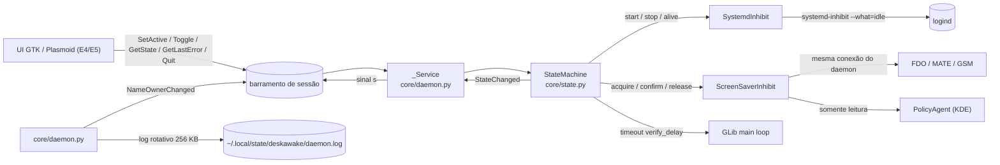
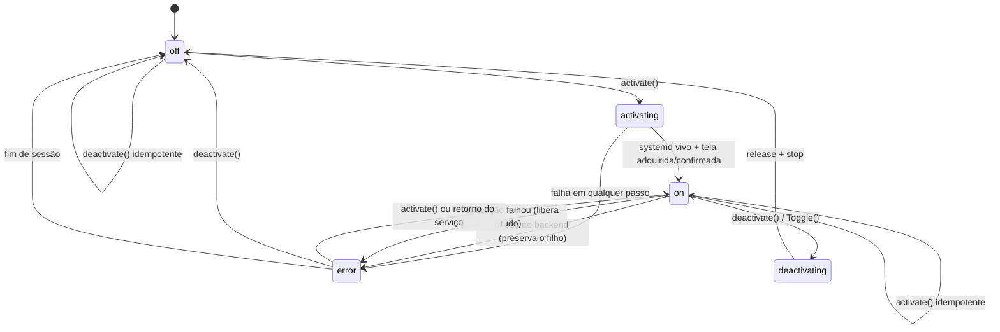

# Design: E2 — Núcleo de inibição, máquina de estados e daemon

**Feature:** DeskAwake — E2 | **Data:** 2026-11-20 | **Status:** Aprovado (2026-11-20)
**Referência:** [`spec.md`](spec.md) (decisões 1–33, “Fluxo alvo”, “Contratos”, “Notas ao implementador”), [`DELIVERY_MAP.md`](DELIVERY_MAP.md) §E2 e [`design_e1.md`](design_e1.md)

> Este design cobre **somente a E2**. Ele não implementa código, não entrega CLI, UI, instalador
> nem documentação de usuário. Em caso de conflito com a `spec.md`, a `spec.md` vence.
> As ambiguidades encontradas foram resolvidas com o usuário em **2026-11-20** e estão registradas
> na §5 (ADRs) e na §10 (desvios).

---

## 1. Contexto e limite da entrega

A E2 entrega o **coração funcional** do DeskAwake: os dois inibidores, a máquina de estados
all-or-nothing e o daemon D-Bus que os orquestra. Ao final existe um processo que pode ser iniciado,
recebe `SetActive(true/false)`, emite `StateChanged` e libera tudo ao sair — **sem CLI e sem UI**.

**Inclui (e só isso):**

| Arquivo | Responsabilidade |
|---|---|
| `core/inhibitors.py` | `SystemdInhibit` e `ScreenSaverInhibit` (cadeia FDO → MATE → GSM + confirmação KDE) |
| `core/state.py` | máquina `off/activating/on/deactivating/error`, all-or-nothing, `last_error` |
| `core/daemon.py` | barramento, objeto D-Bus, sinais, liveness, shutdown, log rotativo |
| `tests/conftest.py` | fixtures comuns da suíte (fakes, barramento privado, daemon) |
| `tests/unit/test_inhibitors.py` | inibidores com fakes |
| `tests/unit/test_state.py` | máquina de estados |
| `tests/integration/fakes/fake_screensaver.py` | FDO/MATE/GSM falsos |
| `tests/integration/fakes/fake_policyagent.py` | `ActiveInhibitions`/`HasInhibition` com debounce configurável |
| `tests/integration/test_daemon_contract.py` | contrato D-Bus |
| `tests/integration/test_backend_chain.py` | ordem e fallback |
| `tests/integration/test_kde_optimistic.py` | ON otimista, verificação e cancelamento |
| `tests/integration/test_lifecycle.py` | SIGTERM/SIGINT/`Quit`/`PDEATHSIG`/`Local.Disconnected` |

**Explicitamente fora da E2:**

- `core/cli.py`, `bin/deskawake` (E3).
- Widget GTK, tema, assets (E4); Plasmoid (E5).
- `data/*.service` e autostart: templates e instalação são da E6. O daemon **deve** funcionar
  quando iniciado por ativação D-Bus, mas o arquivo que a habilita não é entregue aqui.
- `install.sh`/`uninstall.sh`/`verify.sh`, READMEs (E6).
- Persistência de estado/tema/posição: o daemon **não** usa `core/config.py`; estado sempre nasce
  `off`. Configuração é responsabilidade da UI (E4).
- Qualquer regra de UI, tema, spinner ou posição. O contrato D-Bus não ganha estado de verificação.

### 1.1 Decisões resolvidas antes do design

| Tema | Decisão confirmada |
|---|---|
| Injeção no `StateMachine` | parâmetros **keyword-only opcionais** (`systemd`, `screen`, `schedule`, `cancel`), mantendo `on_change`/`verify_delay` posicionais |
| Confirmação KDE | degradar para cookie **somente** quando o mecanismo não existir; mecanismo disponível e negativo ⇒ `confirm() is False` (rota de erro) |
| Liveness | reagir apenas ao backend ativo e aos proxies relevantes (GSM quando MATE; `PolicyAgent` quando FDO); retorno em `error` ⇒ **uma** tentativa quando todos os nomes relevantes que caíram voltarem |
| GSM caindo com backend `gsm` | com estado público `on`, tratar como fim de sessão: parar o filho, `loop.quit()`, exit 0, **sem** `Uninhibit` |
| `debounce` × `verify_delay` | `StateMachine` agenda a verificação; `ScreenSaverInhibit.confirm()` é a checagem; `debounce` é a idade mínima antes de aceitar um negativo |
| `last_error`/`Toggle` | `last_error` existe só em `error`; `Toggle` em `error` tenta ativar; falha repetida atualiza o motivo sem reemitir `StateChanged("error")` |
| Testes em subprocesso | `core.daemon.main(**overrides)` com defaults de produção; sem flags/env novas |

---

## 2. Arquitetura

### 2.1 Fluxo de dados



O fluxo é unidirecional: a UI chama métodos D-Bus; o daemon traduz para a máquina de estados; a
máquina usa os inibidores; mudanças públicas voltam como `StateChanged`. O daemon **não** faz
política de backend; a máquina **não** fala D-Bus nem cria processos.

### 2.2 Componentes e camadas

- **`core/inhibitors.py` — borda de I/O e detalhes de backend**
  - `SystemdInhibit`: `subprocess`, grupo de processos, `PDEATHSIG`, leitura de `stderr`.
  - `ScreenSaverInhibit`: chamadas D-Bus na **conexão recebida**; cadeia de backends; confirmação
    MATE/GSM/KDE; cookie; liberação.
  - Não conhece estado global, não agenda timers e não emite sinais.
- **`core/state.py` — regra de negócio pura/orquestração**
  - Máquina `off/activating/on/deactivating/error`, all-or-nothing, `last_error`, recuperação de
    liveness, agendamento da verificação.
  - Dependências injetadas (duck typing); não importa `dbus`, `subprocess` nem `Gtk`.
  - Usa `GLib` apenas no agendador padrão; testes injetam um agendador falso.
- **`core/daemon.py` — transporte e ciclo de vida**
  - Conexão de sessão, nome, objeto D-Bus, sinais, `NameOwnerChanged`, `Local.Disconnected`,
    SIGTERM/SIGINT, `Quit`, log rotativo.
  - Liga os componentes; não decide backend, confirmação ou transição.
- **`tests/` — unitários headless + integração em barramento privado**
  - Unitários: fakes duck-typed, sem display e sem barramento real.
  - Integração: `dbus-run-session`, fakes reais como serviços D-Bus e daemon em subprocesso.

**Pontos de entrada:**

- D-Bus: `SetActive`, `Toggle`, `GetState`, `GetLastError`, `Quit` em `/org/local/DeskAwake`.
- Processo: `core.daemon.main()` (chamado por `deskawake daemon` na E3).
- Sistema: `SIGTERM`, `SIGINT`, `org.freedesktop.DBus.Local.Disconnected`, `NameOwnerChanged`.

**Camadas:** regra de negócio em `state.py`; detalhes de backend em `inhibitors.py`; transporte e
ciclo de vida em `daemon.py`. Nenhuma camada de cima importa detalhes de baixo além dos contratos.

**Interface:** apenas D-Bus (E4/E5). A E2 não desenha nada e não abre janela.

### 2.3 Máquina de estados

Estados internos (cinco) e estados públicos (três):



`activating`/`deactivating` são **internos** e nunca aparecem no barramento. `GetState()` devolve
somente `on|off|error`; durante `activating`/`deactivating` (inobservável de fora, pois as chamadas
D-Bus são serializadas) o valor público é o estado anterior (`off`/`on`).

| De | Evento | Para | Emite | Efeitos |
|---|---|---|---|---|
| `off` | `activate()` com sucesso | `on` | `on` | sobe `systemd-inhibit`; adquire/confirma tela; agenda verificação se necessário |
| `off` | `activate()` com falha | `error` | `error` | libera o que adquiriu; para o filho se foi iniciado nesta chamada |
| `on` | `deactivate()`/`toggle()` | `off` | `off` | cancela verificação; libera cookie; para o filho |
| `on` | queda de serviço relevante | `error` | `error` | libera cookie; **preserva o filho**; `recovering=True` |
| `on` | verificação falhou | `error` | `error` | libera cookie; para o filho (all-or-nothing) |
| `error` | `deactivate()` | `off` | `off` | libera cookie (se houver); para o filho (idempotente) |
| `error` | `activate()` com sucesso | `on` | `on` | limpa cookie antigo; mantém o filho se vivo ou inicia; adquire tela |
| `error` | `activate()` com falha | `error` | — | atualiza `last_error`; mantém o filho se já existia; falha repetida não reemite |
| `error` | retorno relevante que esvazia `_lost` e `recovering=True` | `on`/`error` | `on` só no sucesso | re-adquire **somente a tela**; uma tentativa por esvaziamento |
| `error` | retorno irrelevante ou `recovering=False` | `error` | — | ignora |
| qualquer | fim de sessão/`Local.Disconnected` | `off` | — | para o filho sem D-Bus; o processo encerra |
| `off` | `deactivate()` | `off` | — | no-op |
| `on` | `activate()` | `on` | — | no-op; verificação pendente continua |

---

## 3. Modelo de dados

Não há banco de dados, schema ou migration. O “modelo” da E2 é o estado em memória do daemon,
o cookie D-Bus e o arquivo de log.

### 3.1 Estado em memória

```python
# core/state.py
class State(Enum):
    OFF = "off"
    ACTIVATING = "activating"
    ON = "on"
    DEACTIVATING = "deactivating"
    ERROR = "error"
```

| Objeto | Campos | Ciclo de vida |
|---|---|---|
| `StateMachine` | `_state: State`, `_last_error: str`, `_verify_source: int \| None`, `_recovering: bool` | um por daemon; nasce `OFF` |
| `SystemdInhibit` | `_proc: subprocess.Popen \| None`, `reason`, `who`, `confirm_delay` | um por daemon; filho nasce no ON e morre no OFF/saída |
| `ScreenSaverInhibit` | `backend: str \| None`, `path: str \| None`, `cookie: int \| None`, `_acquired_at: float` | um por daemon; cookie pertence à conexão |

- **Nada é persistido.** Reiniciar o daemon sempre resulta em `off`.
- **`config.json` não é lido nem escrito** pela E2. Tema/posição continuam exclusivos da E4.
- **`release()`** limpa `cookie` (para não reutilizar um cookie inválido) e mantém `backend`/`path`
  como “último backend conhecido” para a filtragem de liveness (ADR-16).
- O cookie nunca é compartilhado com outra conexão; `ScreenSaverInhibit` usa a conexão recebida e
  nunca abre uma conexão nova para `UnInhibit` (G18).

### 3.2 Log

- Caminho: `~/.local/state/deskawake/daemon.log`.
- Rotação: `RotatingFileHandler(maxBytes=262144, backupCount=1)`; ao passar de **256 KB**, o
  arquivo vira `daemon.log.1` (sobrescrevendo o anterior) e `daemon.log` recomeça.
- Formato: `%(asctime)s %(levelname)s %(message)s` (`%Y-%m-%d %H:%M:%S`), UTF-8.
- Registra: início (PID, DE/sessão, backends detectados), transições públicas, backend escolhido,
  erros com `stderr` do `systemd-inhibit`, liveness, motivo do encerramento.
- **Não** registra credenciais (não há) nem conteúdo de configuração do usuário.
- Se o diretório/arquivo não puder ser aberto, o daemon degrada para `logging.basicConfig()`
  (stderr), registra o erro e continua funcionando (ADR-12).

### 3.3 Migrations

Nenhuma. Não há banco nem schema versionado na E2.

### 3.4 Controle de acesso aos dados

Não se aplica multi-tenant. O daemon roda na sessão do usuário, usa o barramento de sessão e não
chama nada privilegiado. O log fica em `~/.local/state` do próprio usuário; as permissões seguem o
`umask`. O nome D-Bus é por sessão; um segundo daemon na mesma sessão não assume o nome (ADR-09).

---

## 4. Contratos

### 4.1 `core/inhibitors.py`

```python
# core/inhibitors.py
from __future__ import annotations

import dbus

class InhibitError(RuntimeError):
    """Falha ao iniciar/manter um inibidor."""

class SystemdInhibit:
    def __init__(self, reason: str = "DeskAwake active", who: str = "DeskAwake",
                 confirm_delay: float = 0.2) -> None: ...
    def start(self) -> None: ...       # idempotente; levanta InhibitError com stderr
    def stop(self) -> None: ...        # SIGTERM no grupo -> 2 s -> SIGKILL no grupo
    @property
    def alive(self) -> bool: ...
    @property
    def pid(self) -> int | None: ...   # derivado: diagnóstico/testes

class ScreenSaverInhibit:
    def __init__(self, bus, *, who: str = "deskawake",
                 why: str = "DeskAwake active",
                 debounce: float = 5.0, verify_delay: float = 6.0) -> None: ...
    def acquire(self) -> None: ...     # escolhe backend e guarda backend/path/cookie
    def confirm(self) -> bool: ...     # checagem síncrona do backend escolhido
    def release(self) -> None: ...     # UnInhibit (FDO/MATE) ou Uninhibit (GSM); idempotente
    backend: str | None                # "fdo" | "mate" | "gsm" | None
    path: str | None
    cookie: int | None
    @property
    def needs_verification(self) -> bool: ...
```

**Constantes de backend** (nomes reutilizados de `core.environment.BACKEND_BUS_NAMES`):

| Backend | Nome | Objeto | Interface | Métodos usados |
|---|---|---|---|---|
| `fdo` | `org.freedesktop.ScreenSaver` | `/org/freedesktop/ScreenSaver` | `org.freedesktop.ScreenSaver` | `Inhibit(s,s)→u`, `UnInhibit(u)` |
| `mate` | `org.mate.ScreenSaver` | `/org/mate/ScreenSaver` | `org.mate.ScreenSaver` | `Inhibit(s,s)→u`, `UnInhibit(u)`, `GetInhibitors()→as` |
| `gsm` | `org.gnome.SessionManager` | `/org/gnome/SessionManager` | `org.gnome.SessionManager` | `Inhibit(s,u,s,u)→u`, `Uninhibit(u)`, `IsInhibited(u)→b` |
| `policyagent` | `org.kde.Solid.PowerManagement` | `/org/kde/Solid/PowerManagement/PolicyAgent` | `org.kde.Solid.PowerManagement.PolicyAgent` | `HasInhibition(u)→b`, `ActiveInhibitions` (leitura) |

**`SystemdInhibit` — comportamento fixado:**

- Comando: `systemd-inhibit --what=idle --mode=block --who=DeskAwake --why=<reason> sleep infinity`
  (argv, sem shell). **Nunca** `sleep` em `--what`; **nunca** `handle-lid-switch`/`sleep` como
  operação inibida (G6, decisões 1/11/25).
- `Popen(..., stdin=DEVNULL, stdout=DEVNULL, stderr=PIPE, start_new_session=True,
  preexec_fn=_pdeathsig)`.
- `_pdeathsig` (executado no filho, antes do exec): `prctl(PR_SET_PDEATHSIG, SIGTERM)` via
  `ctypes.CDLL(None, use_errno=True)`; em seguida, se `os.getppid() == 1`, `os._exit(1)` (fecha a
  corrida entre o fork e o `prctl`). `start_new_session=True` garante grupo próprio; **não** chamar
  `setsid()` de novo.
- `start()` espera `confirm_delay` (padrão 0,2 s) e verifica `poll()`. Se o filho morreu, lê o
  `stderr` com `communicate()`, fecha o pipe e levanta `InhibitError` com o texto (ou com o código
  de saída, se vazio). `FileNotFoundError`/`OSError` no `Popen` ⇒ `InhibitError`.
- `stop()`: se não há processo ou ele já morreu, apenas reapeia e limpa. Caso contrário,
  `os.killpg(pid, SIGTERM)` (pgid == pid por `start_new_session`), `wait(timeout=2)`; em
  `TimeoutExpired`, `os.killpg(pid, SIGKILL)` e `wait(timeout=2)`. `ProcessLookupError`/
  `PermissionError` são absorvidos; o pipe é fechado. Idempotente.
- `alive` = `proc is not None and proc.poll() is None`.

**`ScreenSaverInhibit` — comportamento fixado:**

- `acquire()` tenta, nesta ordem, `fdo`, `mate`, `gsm`:
  1. Se `bus.name_has_owner(nome)` for falso, pula (consulta read-only; não acorda serviço).
  2. Tenta `Inhibit` com os argumentos do backend:
     - FDO/MATE: `(who, why)`.
     - GSM: `(who, dbus.UInt32(0), why, dbus.UInt32(8))`.
  3. Confirmação síncrona:
     - **FDO**: o cookie é a confirmação disponível (não há `GetInhibitors` no contrato FDO);
       aceita e deixa a confirmação real para `confirm()` quando houver `PolicyAgent`.
     - **MATE**: `GetInhibitors()` deve conter `Application="<who>"`; se o GSM estiver presente,
       `IsInhibited(8)` também deve ser `True`. Se qualquer um falhar, `UnInhibit(cookie)` e tenta
       o GSM **diretamente** (nunca mantém os dois).
     - **GSM**: `IsInhibited(8)` deve ser `True`; se falhar, `Uninhibit(cookie)` e falha.
  4. Se um método `Inhibit` lançar exceção, registra o motivo e tenta o próximo backend.
- Se nenhum backend responder, levanta `InhibitError` com os motivos de cada tentativa (ex.:
  `"nenhum backend de tela disponível: fdo=sem dono; mate=...; gsm=..."`).
- Guarda `backend`, `path`, `cookie` e `_acquired_at = time.monotonic()` após o sucesso.
- `confirm()`:
  - `backend is None` ou `cookie is None` ⇒ `False`.
  - **MATE**: repete `GetInhibitors` + `IsInhibited(8)` (quando o GSM existe). Exceção ⇒ `False`.
  - **GSM**: `IsInhibited(8)`. Exceção ⇒ `False`.
  - **FDO**:
    1. Se `org.kde.Solid.PowerManagement` **não tem dono** ⇒ `True` (cookie; não é KDE).
    2. Se `time.monotonic() - _acquired_at < debounce` ⇒ `True` (ainda dentro do debounce; não
       aceitar negativo prematuro).
    3. Lê `org.freedesktop.DBus.Properties.Get(PA_IFACE, "ActiveInhibitions")`:
       - nossa entrada com `who`/`why` iguais e `flags & 3 == 3` ⇒ `True`;
       - propriedade/interface/método inexistente (`UnknownProperty`, `UnknownInterface`,
         `UnknownMethod`, `InvalidArgs`) ⇒ marca (a) como indisponível e cai para (4);
       - propriedade disponível sem nossa entrada ⇒ marca (a) como **disponível e negativa** e
         cai para (4);
       - erro de transporte/serviço com dono ⇒ `False` (não é confirmação; não degrada).
    4. `HasInhibition(4)`:
       - `True` ⇒ `True`;
       - `False` ⇒ `False` (mecanismo disponível e negativo = falha de confirmação);
       - método inexistente:
         - se (a) estava disponível e negativa ⇒ `False` (a lista é autoritativa; não degrada);
         - se (a) também estava indisponível ⇒ degrada para cookie (`True`) com **warning** no log;
       - erro de transporte/serviço com dono ⇒ `False`.
    5. Só chega a cookie (`True` + **warning**) quando (3) e (4) estão **ambos indisponíveis**
       (PowerDevil antigo/sem as APIs); se qualquer mecanismo disponível indicou negativo, é
       `False` (rota ii).
  - O **guard de debounce** aplica-se somente a FDO; MATE/GSM confirmam imediatamente.
- `needs_verification`: `backend == "fdo" and bus.name_has_owner(PA_NAME)`. Só o KDE precisa da
  verificação assíncrona; MATE/GSM foram confirmados sincronamente no `acquire()`. Falha na
  consulta ao barramento ⇒ `False` (sem verificação; o liveness cobre a queda).
- `release()`:
  - FDO/MATE: `UnInhibit(cookie)`; GSM: `Uninhibit(cookie)` (**“i” minúsculo**, decisão 24).
  - `DBusException`/`OSError` são registrados e absorvidos; a liberação é best-effort.
  - Sempre limpa `cookie` ao final; mantém `backend`/`path` como último backend (ADR-16).
  - Sem cookie/backend ⇒ no-op (idempotente). Argumentos `u` vão como `dbus.UInt32` (cookie,
    `xid`, `flags`, `4`/`8`); argumentos `s` como `str` simples.
- **Nunca** chama `PolicyAgent.AddInhibition`/`ReleaseInhibition` para inibir (decisão 28); o
  `PolicyAgent` é **somente leitura**. **Nunca** usa `CanSuspend` (G17) nem `xdg-screensaver` (G8).
- Todas as chamadas usam a **mesma conexão** recebida no construtor; o daemon passa a conexão dele
  e nunca abre uma conexão nova para liberar o cookie (G18).

### 4.2 `core/state.py`

```python
# core/state.py
from __future__ import annotations

from enum import Enum
from typing import Callable

class State(Enum):
    OFF = "off"
    ACTIVATING = "activating"
    ON = "on"
    DEACTIVATING = "deactivating"
    ERROR = "error"

class StateMachine:
    def __init__(self, on_change: Callable[[str], None],
                 verify_delay: float = 6.0, *,
                 systemd=None, screen=None,
                 schedule: Callable[[float, Callable[[], bool]], int] | None = None,
                 cancel: Callable[[int], None] | None = None) -> None: ...
    @property
    def state(self) -> str: ...          # cinco valores internos
    @property
    def public_state(self) -> str: ...   # "on" | "off" | "error"
    @property
    def last_error(self) -> str: ...     # "" fora de error
    def activate(self) -> str: ...
    def deactivate(self) -> str: ...
    def toggle(self) -> str: ...
    def cancel_pending_verification(self) -> None: ...
    def handle_screen_lost(self, reason: str) -> None: ...
    def handle_screen_returned(self) -> None: ...
    def handle_session_end(self) -> None: ...
```

**Dependências duck-typed** (não importadas em runtime):

- `systemd`: `start()`, `stop()`, `alive` (bool).
- `screen`: `acquire()`, `confirm() -> bool`, `release()`, `needs_verification` (bool),
  `backend` (str | None).
- `schedule(delay_s, callback) -> id` e `cancel(id)`: padrão usa
  `GLib.timeout_add(max(1, int(delay_s * 1000)), callback)` e `GLib.source_remove(id)` (ADR-14).
- Se `systemd`/`screen` forem `None`, `activate()` levanta `RuntimeError` explicando que os
  inibidores não foram injetados (erro de programação, não estado de erro).

**Semântica fixada:**

- `state` expõe os cinco valores internos; `public_state` mapeia `ACTIVATING → "off"` e
  `DEACTIVATING → "on"`; os demais são iguais. O barramento usa **somente** `public_state`.
- `activate()`:
  1. `ON` ⇒ retorna `"on"` sem efeitos (idempotente).
  2. `OFF`/`ERROR` ⇒ `_recovering = False` (ativação explícita assume a tentativa), marca
     `ACTIVATING` internamente, sem emitir. `ACTIVATING`/`DEACTIVATING` são inalcançáveis pelo
     barramento (chamadas D-Bus serializadas); por defensividade, retornam `public_state` sem
     efeitos.
  3. Libera o cookie antigo (`screen.release()`, best-effort) se veio de `ERROR`.
  4. Se `not systemd.alive`, `systemd.start()`; anota se o filho foi iniciado nesta chamada.
  5. `screen.acquire()`.
  6. Sucesso: `ON`, limpa `last_error`, `_recovering = False`, cancela qualquer timer pendente e
     agenda verificação se `screen.needs_verification`, emite `"on"`, retorna `"on"`.
  7. Falha em (3)–(5): libera a tela (best-effort), para o filho **se ele foi iniciado nesta
     chamada** (se já existia por erro de liveness, preserva), grava `last_error`, vai a `ERROR`,
     emite `"error"` somente se o estado público anterior não era `error`, retorna `"error"`.
- `deactivate()`:
  1. `OFF` ⇒ retorna `"off"` sem efeitos.
  2. `ACTIVATING`/`DEACTIVATING` (inalcançáveis pelo barramento) ⇒ retornam `public_state` sem
     efeitos; `ON`/`ERROR` seguem para o passo 3.
  3. Marca `DEACTIVATING` internamente; cancela a verificação; `screen.release()`;
     `systemd.stop()`; vai a `OFF`; limpa `last_error`; `_recovering = False`; emite `"off"`.
  4. Falhas de release/stop são registradas, mas não impedem o `off` (a desativação é idempotente).
- `toggle()`: `ON → deactivate`; `OFF`/`ERROR → activate`; `ACTIVATING`/`DEACTIVATING` (inalcançáveis
  pelo barramento) retornam `public_state` sem efeitos; retorna o novo estado público.
- `cancel_pending_verification()`: remove o source se existir, zera o id; idempotente.
- `handle_screen_lost(reason)`:
  - Só age se `state == ON`; caso contrário ignora.
  - Cancela a verificação pendente; `screen.release()` best-effort; **não** para o filho do
    `systemd-inhibit` (item 13 do mapa); vai a `ERROR`; `last_error = reason`;
    `_recovering = True`; emite `"error"`.
- `handle_screen_returned()`:
  - Só age se `state == ERROR` **e** `_recovering`; caso contrário ignora (erro de ativação/
    verificação não se recupera sozinho).
  - Uma única tentativa: `screen.release()` (cookie antigo), inicia o filho se ele tiver morrido,
    `screen.acquire()`.
  - Sucesso: `ON`, limpa `last_error`, `_recovering = False`, cancela qualquer timer pendente e
    agenda verificação se necessário, emite `"on"`.
  - Falha: permanece `ERROR`, atualiza `last_error`, **não** reemite (o estado não mudou); para o
    filho se ele foi iniciado nesta tentativa; não há retry em loop (cada chamada = uma tentativa).
- `handle_session_end()`: cancela a verificação, para o filho **sem nenhuma chamada D-Bus**, vai a
  `OFF`, limpa `last_error`, `_recovering = False`, **não** emite (o barramento pode estar morto e
  o processo está saindo).
- `on_change` é chamado **somente** em transições públicas (`on`/`off`/`error`), depois de o
  estado interno já estar consistente. `activating`/`deactivating` nunca são emitidos.
- `last_error`: gravado ao entrar em `ERROR`, limpo ao sair para `ON`/`OFF`; `GetLastError()`
  devolve `""` fora de `ERROR`. Falha repetida em `ERROR` atualiza o texto, mas não reemite
  `StateChanged("error")` (ADR-06).
- Um `SetActive(false)` durante a janela de verificação cancela o timer e segue a desativação
  normal; não passa por `ERROR` (rota iii).
- A verificação que falha só rebaixa se o estado ainda for `ON`; se o usuário já desligou, não há
  `StateChanged` novo (item 10 do mapa).

### 4.3 `core/daemon.py`

```python
# core/daemon.py
from pathlib import Path

DBUS_NAME = "org.local.DeskAwake"
OBJECT_PATH = "/org/local/DeskAwake"
INTERFACE = "org.local.DeskAwake"
LOG_PATH = Path("~/.local/state/deskawake/daemon.log").expanduser()
LOG_MAX_BYTES = 256 * 1024
LOG_BACKUP_COUNT = 1
VERIFY_DELAY = 6.0
DEBOUNCE = 5.0
CONFIRM_DELAY = 0.2

def main(*, verify_delay: float = VERIFY_DELAY,
         debounce: float = DEBOUNCE,
         confirm_delay: float = CONFIRM_DELAY,
         log_path: str | Path = LOG_PATH) -> int: ...
```

**Sequência de inicialização:**

1. Configura o log (`RotatingFileHandler`; fallback para stderr) e registra o início.
2. `DBusGMainLoop(set_as_default=True)`; `bus = dbus.SessionBus()` (falha ⇒ log/erro e retorno ≠ 0).
3. **`bus.set_exit_on_disconnect(False)`** — sem isso o dbus-python chama `_exit(1)` quando o
   barramento cai e o requisito “`Local.Disconnected` ⇒ sai 0” é impossível (ADR-10).
4. Cria `SystemdInhibit(confirm_delay=...)`, `ScreenSaverInhibit(bus, debounce=..., verify_delay=...)`,
   o objeto D-Bus (`_Service`) e a `StateMachine` com os inibidores, `verify_delay` e
   `on_change=_on_state_changed` (emite o sinal e limpa `_lost` quando o estado vira `on`/`off`).
5. Exporta o objeto em `OBJECT_PATH` **antes** de pedir o nome (evita `UnknownMethod` em ativação).
6. `bus.request_name(DBUS_NAME, dbus.bus.NAME_FLAG_DO_NOT_QUEUE)`; se a resposta não for
   `PRIMARY_OWNER` nem `ALREADY_OWNER` ⇒ loga “instância já ativa” e retorna **0**.
7. Registra `NameOwnerChanged` dos quatro nomes observados, `Local.Disconnected`, SIGTERM e SIGINT.
8. Loga o ambiente com `detect_environment(bus=bus)` (somente diagnóstico; sem política).
9. `loop.run()`; no `finally`, se o barramento ainda estiver vivo e o estado não for `off`, chama
   `machine.deactivate()` (best-effort); se o barramento morreu, `machine.handle_session_end()`.
10. Retorna 0.

**Objeto D-Bus (`_Service`, interno):**

- `SetActive(b) → s`: loga a chamada; delega a `machine.activate()`/`deactivate()`; loga e retorna
  o estado resultante.
- `Toggle() → s`: delega a `machine.toggle()`.
- `GetState() → s`: retorna `machine.public_state` (nunca `activating`/`deactivating`).
- `GetLastError() → s`: retorna `machine.last_error` (`""` fora de `error`).
- `Quit() → ()`: `machine.deactivate()`; `GLib.idle_add(loop.quit)` para o reply sair antes de
  encerrar; loga.
- `StateChanged(s)`: sinal emitido por `machine` via `on_change=_on_state_changed`; esse wrapper
  emite o sinal e limpa `_lost` quando o estado público vira `on`/`off` (o conjunto só é relevante
  durante a recuperação de `error`).
- Nenhum outro método é exposto pela interface (os métodos padrão de introspecção do
  `dbus.service.Object` continuam existindo, mas não fazem parte do contrato).

**Liveness (`NameOwnerChanged`):**

- Um receiver por nome observado (`arg0`), todos chamando `_on_name_owner_changed(name, old, new)`.
- O daemon mantém `_lost: set[str]` com os nomes relevantes atualmente ausentes (adiciona na queda,
  remove no retorno); o conjunto só é usado para decidir quando tentar a recuperação.
- Relevância (ADR-03):
  - backend `fdo` ⇒ `org.freedesktop.ScreenSaver` **e** `org.kde.Solid.PowerManagement`;
  - backend `mate` ⇒ `org.mate.ScreenSaver` **e** `org.gnome.SessionManager` (proxy GSM);
  - backend `gsm` ⇒ `org.gnome.SessionManager`;
  - backend `None` ⇒ nada é relevante.
- Queda (`new == ""`) de nome relevante:
  - adiciona o nome a `_lost`;
  - se backend `gsm`, o nome é `org.gnome.SessionManager` e `machine.public_state == "on"` ⇒
    `machine.handle_session_end()`, `loop.quit()`, sair **0** (fim de sessão; sem `Uninhibit` —
    ADR-04). Fora de `on` (ex.: já em `error`), não encerra; o `Local.Disconnected` cobre o logout;
  - caso contrário ⇒ `machine.handle_screen_lost(f"serviço {name} desapareceu")` (a máquina ignora
    se não estiver em `on`).
- Retorno (`old == "" and new != ""`) de nome relevante ⇒ remove o nome de `_lost`; só chama
  `machine.handle_screen_returned()` quando `_lost` esvazia. Assim, se FDO e `PolicyAgent` caírem
  juntos, a recuperação espera os dois e faz **uma** tentativa no último retorno. A máquina ignora
  o retorno se não estiver em `error`/`recovering`; cada evento tenta no máximo uma vez.
- O filho do `systemd-inhibit` **não** é reiniciado em queda/retorno (item 13 do mapa).

**Encerramento — caminhos exatos:**

| Evento | Libera tela? | Para o filho? | Emite `StateChanged`? | Exit |
|---|---|---|---|---|
| `SetActive(false)` | sim (`UnInhibit`/`Uninhibit`) | sim | `off` | — |
| `Quit()` | sim | sim | `off` | 0 |
| `SIGTERM` | sim | sim | `off` | 0 |
| `SIGINT` | sim | sim | `off` | 0 |
| `Local.Disconnected` | **não** (barramento morto) | sim | **não** | 0 |
| GSM cai com backend `gsm` | **não** (serviço morto) | sim | **não** | 0 |
| `SIGKILL`/crash | o barramento libera o cookie | `PDEATHSIG` mata o filho | **não** | 137 |

**Sinais:** `GLibUnix.signal_add(priority, SIGTERM/SIGINT, handler)` (fallback
`GLib.unix_signal_add` para PyGObject antigo); o handler chama `machine.deactivate()` (best-effort,
em `try/finally` para garantir `loop.quit()`), registra o motivo e retorna `GLib.SOURCE_REMOVE`.
`Local.Disconnected` usa `add_signal_receiver` em `dbus.LOCAL_IFACE`/`dbus.LOCAL_PATH` (handler
`*args`) e **não** faz chamadas D-Bus. O wrapper `_on_state_changed` absorve/loga exceções do
sinal (`StateChanged`) para uma conexão morta não derrubar a transição.

### 4.4 Contrato D-Bus

Nome: `org.local.DeskAwake` | Objeto: `/org/local/DeskAwake` | Interface: `org.local.DeskAwake`

| Membro | Assinatura | Semântica | Erros |
|---|---|---|---|
| `SetActive` | `b → s` | Aplica e retorna o estado resultante (`on`/`off`/`error`) | Falha operacional vira estado `error`, não erro D-Bus |
| `Toggle` | `→ s` | Inverte (`on→off`, `off/error→on`) e retorna | idem |
| `GetState` | `→ s` | Estado público atual; não altera nada | — |
| `GetLastError` | `→ s` | Motivo do último erro; `""` fora de `error` | — |
| `Quit` | `→ ()` | Desativa (libera tela + filho) e encerra o daemon | — |
| `StateChanged` | `s` | Emitido em cada transição pública; nunca `activating`/`deactivating` | — |

- Aquisição do nome: `DO_NOT_QUEUE`; segunda instância sai **0** sem tomar o nome (ADR-09).
- O daemon **não** implementa auto-start; a ativação por `.service` é da E6.
- `status` da E3 usa `NameHasOwner` antes de `GetState`; a E2 garante que o nome só existe quando
  o daemon está pronto (objeto exportado antes do `request_name`).

### 4.5 Tipos e constantes

```python
# core/inhibitors.py
BACKENDS = ("fdo", "mate", "gsm")
POLICYAGENT_NAME = "org.kde.Solid.PowerManagement"
POLICYAGENT_PATH = "/org/kde/Solid/PowerManagement/PolicyAgent"
POLICYAGENT_IFACE = "org.kde.Solid.PowerManagement.PolicyAgent"
GSM_IDLE_FLAG = 8
POLICYAGENT_CHANGE_SCREEN_SETTINGS = 4
POLICYAGENT_ACTIVE_MASK = 3

# core/daemon.py
WATCHED_NAMES = (
    "org.freedesktop.ScreenSaver",
    "org.mate.ScreenSaver",
    "org.gnome.SessionManager",
    "org.kde.Solid.PowerManagement",
)
```

Os **nomes** dos backends vêm de `core.environment.BACKEND_BUS_NAMES` (E1) para não duplicar a
tabela; os caminhos/interfaces específicos de objeto ficam em `core/inhibitors.py`.

---

## 5. Decisões técnicas (ADRs)

### ADR-01: Injeção keyword-only no `StateMachine`

- **Contexto:** o contrato fixado é `StateMachine(on_change, verify_delay=6.0)`, mas a máquina
  precisa iniciar/parar os inibidores e agendar a verificação.
- **Opções consideradas:**
  - A: acrescentar `*, systemd=None, screen=None, schedule=None, cancel=None` — Prós: mantém a
    assinatura posicional, testes injetam fakes, daemon injeta os objetos reais. Contras: o
    contrato cresce (parâmetros opcionais).
  - B: atributos pós-construção — Prós: assinatura literal. Contras: implícito, fácil de esquecer,
    difícil de testar em isolamento.
  - C: um único objeto “backend” — Prós: coeso. Contras: novo tipo e menos granularidade nos testes.
- **Decisão:** A, confirmada pelo usuário em 2026-11-20. `activate()` sem inibidores injetados
  levanta `RuntimeError` (erro de programação).
- **Consequências:** `StateMachine(on_change)` continua importável/construível; o daemon é o único
  que injeta os objetos reais; os testes usam fakes e um agendador controlável.

### ADR-02: Degradação do `confirm()` no KDE

- **Contexto:** a aceitação diz “ambos ausentes ⇒ `True` com aviso (cookie)”, mas também exige a
  rota (ii) “confirmação falha ⇒ `error`”. “Ausente” precisa ser qualificado.
- **Opções consideradas:**
  - A: degradar **somente** quando o mecanismo não existir (propriedade/método/interface
    indisponível); mecanismo disponível e negativo ⇒ `False`. Prós: preserva a rota (ii) e a
    semântica de `ActiveInhibitions`/`HasInhibition`. Contras: mais ramos de erro.
  - B: degradar sempre que nada confirmar. Prós: simples. Contras: torna a rota (ii) impossível
    fora de exceções; mascararia uma inibição que não existe.
  - C: nunca degradar. Prós: estrito. Contras: quebra o contrato de “cookie + aviso” em
    PowerDevils antigos.
- **Decisão:** A, confirmada pelo usuário em 2026-11-20. Detalhe: se `ActiveInhibitions` existe e
  não tem nossa entrada, ela é autoritativa; se `HasInhibition` não existir, o resultado é
  `False` (não degrada). O cookie só é aceito quando **nenhum** mecanismo está disponível ou
  quando não há `PolicyAgent` (não é KDE).
- **Consequências:** `confirm()` pode falhar de forma determinística com PowerDevil moderno
  (rota ii); o aviso de cookie fica restrito a versões sem as APIs.

### ADR-03: Liveness restrita ao backend ativo e aos proxies

- **Contexto:** o mapa manda observar os quatro nomes; a spec fala do backend ativo e, no KDE,
  também do `PowerDevil`. Observar tudo e reagir a tudo causaria `error` por serviços que não
  participam da inibição atual (ex.: `org.mate.ScreenSaver` aparecendo no KDE).
- **Opções consideradas:**
  - A: reagir apenas ao backend ativo + GSM (proxy do MATE) + `PolicyAgent` (quando FDO). Prós:
    preciso; evita falsos erros; mantém a recuperação relevante. Contras: exige filtro por backend.
  - B: reagir a qualquer um dos quatro. Prós: simples. Contras: falsos `error` e recuperações
    indevidas.
  - C: reagir só ao nome do backend ativo. Prós: mínimo. Contras: perde a queda do GSM por trás do
    proxy MATE e a do PowerDevil por trás do FDO no KDE.
- **Decisão:** A, confirmada pelo usuário em 2026-11-20. Os quatro nomes continuam observados;
  o filtro decide a relevância. O daemon mantém `_lost` e só tenta a recuperação quando **todos**
  os nomes relevantes que caíram voltarem (uma tentativa por esvaziamento, não por nome).
- **Consequências:** queda/retorno de serviço não relevante é ignorada; uma tentativa por evento
  de esvaziamento; sem rajada de retries. Se FDO e `PolicyAgent` caírem juntos, a recuperação
  espera os dois em vez de ir a `on` com o PowerDevil ainda ausente.

### ADR-04: Queda do GSM com backend `gsm` = fim de sessão

- **Contexto:** a spec diz que, se o backend ativo é o GSM e o `mate-session` termina, o daemon
  encerra junto com a sessão. O mapa não repete essa saída.
- **Opções consideradas:**
  - A: encerrar 0, parando só o filho e sem `Uninhibit` (o serviço morreu). Prós: cumpre a spec;
    evita erro inútil durante logout. Contras: se o GSM reiniciar sem a sessão terminar, o daemon
    já saiu.
  - B: tratar como `error` + recuperação. Prós: mantém o daemon vivo. Contras: contraria a spec.
  - C: encerrar sem parar o filho. Prós: simples. Contras: deixa o filho até o `PDEATHSIG`.
- **Decisão:** A, confirmada pelo usuário em 2026-11-20. Com estado público `on`, `handle_session_end()`
  para o filho, `loop.quit()`, exit 0. Em `error`/`off`, a queda do GSM não encerra; o
  `Local.Disconnected` cobre o logout.
- **Consequências:** no MATE, a queda do GSM durante o ON é logout; no KDE (backend FDO), a queda
  do GSM não é relevante e é ignorada.

### ADR-05: `debounce` como guarda; `verify_delay` agenda no `StateMachine`

- **Contexto:** ambos os parâmetros aparecem em `ScreenSaverInhibit` e `verify_delay` também na
  `StateMachine`; `cancel_pending_verification()` está na máquina. Sem uma divisão clara, um dos
  parâmetros vira código morto.
- **Opções consideradas:**
  - A: `StateMachine` agenda em `verify_delay`; `confirm()` é a checagem; `debounce` é a idade
    mínima desde o acquire para aceitar um negativo (antes disso, otimista `True`); verifica só
    quando `needs_verification` (FDO + `PolicyAgent`). Prós: um timer, `debounce` com papel,
    `verify_delay` no agendamento, não bloqueia o `SetActive`. Contras: um guard a mais.
  - B: `StateMachine` agenda; `debounce` sem uso. Prós: simples. Contras: parâmetro morto.
  - C: `ScreenSaverInhibit` agenda após `debounce` e a máquina consulta no `verify_delay`. Prós:
    usa os dois. Contras: dois timers, mais estados e corrida.
- **Decisão:** A, confirmada pelo usuário em 2026-11-20. O guard de `debounce` só se aplica a FDO;
  MATE/GSM confirmam na hora.
- **Consequências:** o ON no KDE é otimista e a confirmação ocorre em `verify_delay` (6 s); o
  `SetActive` não bloqueia por 6 s; `verify_delay` em `ScreenSaverInhibit` fica reservado ao
  contrato/log (o agendamento é da máquina).

### ADR-06: `last_error`, `GetLastError()` e `Toggle` em `error`

- **Contexto:** a spec diz “motivo do último erro; vazio se não houver”, mas não define quando
  limpar nem o que `Toggle` faz em `error` (“toggle respeita on/off/error”).
- **Opções consideradas:**
  - A: `last_error` só existe em `error`, limpo ao ir para `on`/`off`; `Toggle` em `error` ativa;
    falha repetida atualiza o motivo sem reemitir `StateChanged("error")`. Prós: coerente com o
    tooltip (“limpar ao sair de error”) e com o rótulo `Ativar` da UI; evita sinais redundantes.
  - B: histórico até o próximo sucesso; reemitir a cada falha. Prós: histórico. Contras: tooltip
    velho e sinais redundantes.
  - C: `Toggle` em `error` vai para `off`. Prós: “limpa” o erro. Contras: o rótulo da UI em `error`
    é `Ativar`, então o clique desligaria — contraditório.
- **Decisão:** A, confirmada pelo usuário em 2026-11-20.
- **Consequências:** a UI lê o motivo no `StateChanged("error")`; depois de sair de `error`,
  `GetLastError()` volta a `""`; uma nova tentativa falha atualiza o texto sem flicker.

### ADR-07: Overrides de `main()` para testes de integração

- **Contexto:** os testes em subprocesso precisam de timeouts curtos e de um caminho de log
  controlado; a CLI (`deskawake daemon`) não tem flags e a spec não define env vars.
- **Opções consideradas:**
  - A: `main(*, verify_delay=..., debounce=..., confirm_delay=..., log_path=...)` com defaults de
    produção; testes usam um runner `python3 -c`. Prós: sem superfície pública nova; defaults
    intactos; funciona em subprocesso. Contras: assinatura interna maior.
  - B: env vars `DESKAWAKE_*`. Prós: útil para diagnóstico. Contras: superfície nova não prevista
    na spec.
  - C: monkeypatch de constantes antes de `main()`. Prós: `main()` intocado. Contras: runner mais
    frágil e menos explícito.
- **Decisão:** A, confirmada pelo usuário em 2026-11-20. A E3 chama `main()` sem argumentos.
- **Consequências:** testes de integração rodam em segundos, sem `-m slow`; o ciclo real de 5–6 s
  fica no teste `slow` opt-in.

### ADR-08: Origem do erro e preservação do filho

- **Contexto:** “error” pode significar falha de ativação/verificação (nada deve sobrar) ou queda
  de backend (o filho do `systemd-inhibit` deve sobreviver — item 13 do mapa).
- **Opções consideradas:**
  - A: distinguir `_recovering`; erro de liveness preserva o filho e só re-adquire a tela no
    retorno; erro de ativação/verificação libera tudo e não se recupera sozinho. Prós: cumpre os
    dois requisitos; evita ativação automática não solicitada. Contras: estado interno extra.
  - B: sempre liberar tudo. Prós: simples. Contras: viola “o filho só morre no SetActive(false),
    Quit e shutdown”.
  - C: sempre preservar o filho. Prós: simples. Contras: viola all-or-nothing na falha de
    ativação/verificação e deixa backstop sem tela.
- **Decisão:** A.
- **Consequências:** `handle_screen_returned()` só age quando `_recovering`; um `SetActive(true)`
  explícito zera `_recovering` (o usuário assumiu a tentativa).

### ADR-09: Aquisição do nome e segunda instância

- **Contexto:** o mapa exige `DO_NOT_QUEUE` e saída 0 se já houver dono; o objeto precisa estar
  exportado antes de o nome ser visível.
- **Opções consideradas:**
  - A: exportar o objeto e depois `bus.request_name(...)`; aceitar `PRIMARY_OWNER` (1) e
    `ALREADY_OWNER` (4); qualquer outro resultado ⇒ log e retorno 0. Prós: ordem segura, detecção
    direta. Contras: usa a API de baixo nível em vez de `BusName`.
  - B: `dbus.service.BusName(..., do_not_queue=True)`. Prós: idiomático. Contras: em dbus-python
    1.4.0 **não** levanta quando o nome está ocupado; não dá para distinguir a segunda instância.
- **Decisão:** A.
- **Consequências:** a segunda instância não toca no log de estado (apenas uma linha informativa) e
  sai 0; a primeira mantém o nome até o processo encerrar.

### ADR-10: `set_exit_on_disconnect(False)` e `Local.Disconnected`

- **Contexto:** o libdbus, por padrão, chama `_exit(1)` quando a conexão cai. Sem desativar isso, o
  requisito “`Local.Disconnected` ⇒ exit 0” é impossível; o handler nem chega a rodar até o fim.
- **Opções consideradas:**
  - A: `bus.set_exit_on_disconnect(False)` logo após conectar; tratar `Local.Disconnected` com
    `add_signal_receiver`, parar o filho sem D-Bus, `loop.quit()`, exit 0. Prós: cumpre a spec;
    testável. Contras: exige lembrar da chamada (documentada e testada).
  - B: confiar no default. Prós: nada a fazer. Contras: exit 1 e nenhum cleanup — reprovado.
- **Decisão:** A. O `finally` do `main()` consulta um flag `_bus_dead` para não chamar D-Bus.
- **Consequências:** o teste de `Local.Disconnected` usa um barramento dedicado; o processo de
  teste também deve usar conexão privada com `set_exit_on_disconnect(False)` para não morrer junto.

### ADR-11: `SystemdInhibit` — grupo, `PDEATHSIG` e `stderr`

- **Contexto:** matar só o PID deixa `sleep infinity` órfão; o filho precisa morrer com o daemon e
  a falha de inicialização precisa ser diagnosticável.
- **Opções consideradas:**
  - A: `start_new_session=True` + `preexec_fn` com `prctl(PR_SET_PDEATHSIG, SIGTERM)` e checagem
    de `getppid()==1`; `stderr=PIPE`; `stop()` com `killpg` SIGTERM → 2 s → SIGKILL. Prós: cumpre
    todos os requisitos; testável com fakes. Contras: `preexec_fn` é Linux-only e não seguro com
    threads (o daemon é single-threaded).
  - B: só `terminate()` no PID. Prós: simples. Contras: deixa órfão.
  - C: `shell=True`/`sh -c`. Prós: curto. Contras: injeção/quoting e grupo imprevisível.
- **Decisão:** A. `reason`/`who` são constantes internas; nenhum shell.
- **Consequências:** `PDEATHSIG` é validado por integração (SIGKILL no daemon); unitários cobrem a
  sequência de sinais com fakes.

### ADR-12: Rotação de log com `RotatingFileHandler`

- **Contexto:** o mapa fixa 256 KB e `daemon.log.1`; não define biblioteca nem comportamento em
  falha de I/O.
- **Opções consideradas:**
  - A: `logging.handlers.RotatingFileHandler(maxBytes=262144, backupCount=1)`. Prós: stdlib,
    rotação atômica o suficiente; sobrescreve `.1`; testável. Contras: decide a rotação no emit
    (tamanho + registro), não exatamente “antes de escrever se > 256 KB”.
  - B: rotação manual antes de cada escrita. Prós: literal. Contras: reinventa o handler e mais
    código.
- **Decisão:** A. Em `OSError` ao abrir, cai para `basicConfig()` e continua; registra o problema.
- **Consequências:** o teste de integração pré-preenche o log acima de 256 KB e inicia o daemon;
  a primeira linha rotaciona.

### ADR-13: Cadeia de backends e fallback

- **Contexto:** a ordem FDO → MATE → GSM e as confirmações específicas (MATE proxy, KDE
  `PolicyAgent`) precisam de uma regra única para “o primeiro que responder vence”.
- **Opções consideradas:**
  - A: pular backend sem dono; tentar `Inhibit`; confirmar conforme o backend; em falha, liberar o
    cookie parcial e tentar o próximo; erro final agrega os motivos. Prós: cobre FDO ausente no
    MATE, FDO soft no master e falhas parciais. Contras: mais chamadas em cenários de falha.
  - B: escolher o backend apenas por `name_has_owner` e não fazer fallback em falha de método.
    Prós: simples. Contras: um FDO “fantasma” impediria o MATE.
  - C: tentar os três em paralelo. Prós: rápido. Contras: múltiplos cookies e liberação complexa.
- **Decisão:** A.
- **Consequências:** `acquire()` pode fazer até três tentativas; o erro final é diagnóstico; a
  confirmação MATE nunca deixa um cookie MATE órfão quando cai para GSM.

### ADR-14: Agendamento em milissegundos

- **Contexto:** `GLib.timeout_add_seconds` trunca valores fracionários; os testes de integração
  precisam de timeouts curtos (ex.: 0,2 s) para rodar rápido.
- **Opções consideradas:**
  - A: `GLib.timeout_add(max(1, int(delay*1000)), callback)` no agendador padrão. Prós: aceita
    frações; produção continua com 6 s; testável. Contras: não é literalmente
    `timeout_add_seconds`.
  - B: `timeout_add_seconds(int(delay))` e testes com 1 s mínimo. Prós: literal. Contras: suíte
    mais lenta e valores < 1 s impossíveis.
- **Decisão:** A. O agendador é injetável; o teste pode usar um fake síncrono.
- **Consequências:** `verify_delay` é sempre segundos (float); o arredondamento mínimo é 1 ms.

### ADR-15: Fakes de integração e isolamento do `systemd-inhibit --list`

- **Contexto:** os testes precisam de FDO/MATE/GSM/PolicyAgent reais no barramento privado,
  debounce controlável e não podem confundir um DeskAwake real da máquina com o da suíte.
- **Opções consideradas:**
  - A: `fake_screensaver.py` (FDO/MATE/GSM em um processo, com flag de KDE que encaminha
    `Inhibit` ao `PolicyAgent.AddInhibition`) + `fake_policyagent.py` (debounce via GLib e
    `ActiveInhibitions`); log JSONL por chamada; `systemd-inhibit --list` filtrado pelo PID do
    filho do daemon de teste (baseline/diff), não por `WHO` global. Prós: fiel ao KDE/MATE,
    determinístico e isolado. Contras: harness maior.
  - B: fakes em processo (threads). Prós: menos processos. Contras: GLib/dbus em threads é frágil;
    não exercita `PDEATHSIG`/sinais.
  - C: usar os serviços reais do sistema. Prós: fidelidade. Contras: não roda em CI, polui a
    sessão, não controla o debounce.
- **Decisão:** A. O fake FDO só chama `AddInhibition` no modo KDE (o daemon nunca chama); o fake
  MATE simula o proxy GSM `IDLE=8`.
- **Consequências:** os testes verificam contadores/ordem pelo JSONL; o filho do `systemd-inhibit`
  é identificado por `ps --ppid` e conferido na tabela do logind.

### ADR-16: `release()` mantém o último backend e limpa o cookie

- **Contexto:** após uma queda, a liveness precisa saber qual backend era o ativo para filtrar os
  eventos; reutilizar o cookie antigo é proibido.
- **Opções consideradas:**
  - A: `release()` limpa `cookie`, mantém `backend`/`path` como “último backend conhecido”.
    Prós: filtro de liveness estável; sem reutilização de cookie. Contras: `backend` não significa
    “adquirido” após o release (documentado).
  - B: limpar tudo. Prós: semântica óbvia. Contras: a liveness perde a referência e não sabe o que
    observar após o erro.
  - C: guardar o backend em outro lugar. Prós: limpo. Contras: duplica estado.
- **Decisão:** A.
- **Consequências:** `needs_verification` e `confirm()` checam `cookie is None` antes de agir;
  `acquire()` sobrescreve backend/path.

### ADR-17: Idempotência e ativação explícita a partir de `error`

- **Contexto:** a UI pode chamar `SetActive(true)` em `error` (rótulo `Ativar`), e chamadas
  repetidas não devem duplicar inibidores/sinais.
- **Opções consideradas:**
  - A: `activate()` em `ON` é no-op; `deactivate()` em `OFF` é no-op; a partir de `ERROR`,
    `activate()` limpa o cookie antigo, preserva o filho se vivo, adquire a tela e, se falhar,
    mantém o filho pré-existente e atualiza o motivo sem reemitir. Prós: seguro e previsível.
    Contras: regra de posse do filho um pouco sutil.
  - B: recriar sempre o filho. Prós: simples. Contras: viola o item 13 e perde o backstop.
  - C: proibir `activate()` em `error`. Prós: simples. Contras: o menu “Ativar” não funcionaria.
- **Decisão:** A.
- **Consequências:** `SetActive(false)` continua sendo o caminho de limpeza total; `Quit` idem;
  `Toggle` em `error` usa `activate()`.

### ADR-18: Mensagens em pt-BR e identificadores fixos

- **Contexto:** `GetLastError()` aparece em tooltip de usuário; `who`/`why` são contrato D-Bus.
- **Opções consideradas:**
  - A: mensagens de erro/log em pt-BR; `who="deskawake"` e `why="DeskAwake active"` fixos em
    inglês, como na spec/decisão 29; `--who=DeskAwake` no `systemd-inhibit` como G6.
  - B: mensagens em inglês. Prós: consistência com o código. Contras: tooltip em inglês para um
    produto pt-BR.
- **Decisão:** A.
- **Consequências:** os testes não dependem do texto exato (exceto `who`/`why`); o log é legível
  para o usuário.

---

## 6. Impacto em features/entregas existentes

| Entrega/componente | Impacto |
|---|---|
| **E1 — config/environment** | `core/config.py` **não** é usado pelo daemon. `core/environment.BACKEND_BUS_NAMES` é reutilizado para os nomes; `detect_environment(bus=bus)` é chamado apenas para log. Nenhum contrato da E1 muda. |
| **E3 — CLI/launcher** | `deskawake daemon` chama `core.daemon.main()` sem argumentos (defaults de produção). `status` usa `NameHasOwner` e `GetState` como já previsto; a E2 garante que o nome só aparece com o objeto pronto. `on/off/toggle` consomem os retornos `s`. |
| **E4 — widget GTK** | Consome `StateChanged`, `GetState`, `GetLastError`, `SetActive`, `Toggle`. Não vê estados internos. O tooltip lê o motivo no `StateChanged("error")`; após sair de `error`, `GetLastError()` volta vazio. Spinner da UI é local; a E2 não adiciona estado de verificação. |
| **E5 — Plasmoid** | Mesmo contrato D-Bus. O spinner durante a verificação de ~6 s é um timer local da UI (decisão 33); a E2 mantém o estado público `on` durante a janela. A recuperação após queda do PowerDevil chega como `error` → `on`. |
| **E6 — instalador/verify** | `verify.sh` liga/desliga e confere `systemd-inhibit --list` (WHO `DeskAwake`), `GetState`, e no KDE espera ~6 s por `ActiveInhibitions`/`HasInhibition(4)`. A E2 entrega exatamente esse comportamento/log. O `.service` chama `deskawake daemon` sem flags; `main()` tem defaults. |
| **Documentação** | READMEs são da E6; a E2 não os altera. |
| **Sem impacto confirmado** | `LICENSE`, `pyproject.toml`, schema do `config.json`, UI GTK/QML, assets, scripts de instalação, `xdg-screensaver` (proibido), `CanSuspend` (não usado). O repositório na E1 não tem daemon; não há feature residente a regredir. |

---

## 7. Conformidade com os padrões do projeto

- [x] Python ≥ 3.10; stdlib + `python3-dbus` + `python3-gi` (GLib). Nenhuma dependência de runtime
      nova além das já exigidas (`python3-gi`, `python3-dbus`, `systemd`); `pytest` é dev-only.
- [x] Sem `sudo`, sem empacotamento de distro, sem `.deb`/AUR/Flatpak, sem build backend.
- [x] Sem testes de GUI; a validação visual continua nas checklists manuais (E4/E5).
- [x] `systemd-inhibit --what=idle --mode=block --who=DeskAwake`; `sleep` **nunca** é inibido (G6,
      decisões 1/11/25).
- [x] Backend de tela na ordem FDO → MATE → GSM, na **mesma conexão** do daemon (G7); sem
      `xdg-screensaver` (G8); sem `CanSuspend` (G17).
- [x] Cookie usado somente na conexão que o obteve; nenhuma conexão nova para `UnInhibit` (G18).
- [x] `PolicyAgent` é somente leitura; nunca `AddInhibition`/`ReleaseInhibition` pelo daemon
      (decisão 28).
- [x] Estados públicos `on|off|error`; `activating`/`deactivating` nunca no barramento (G4,
      decisão 33).
- [x] Estado nunca é persistido; o daemon não lê/escreve `config.json` (G9, decisão 5).
- [x] Log em `~/.local/state/deskawake/daemon.log`, rotação em 256 KB para `daemon.log.1` (G10).
- [x] `DO_NOT_QUEUE` na aquisição do nome; segunda instância sai 0 (mapa E2.3 item 15).
- [x] Shutdown em `Local.Disconnected` sem chamadas D-Bus; `PDEATHSIG` cobre o filho (decisão 32).
- [x] Documentação/design em pt-BR; nenhum artefato de spec em código, comentários, commits ou PRs.
- [x] `design_e2.md` é versionado em `docs/implementation/`.

---

## 8. Plano de verificação

### 8.1 Automático — unitário

```bash
python3 -m pytest tests/unit/test_inhibitors.py tests/unit/test_state.py -v
```

`pytest` é instalado pelo desenvolvedor via `apt install python3-pytest`; o comando usa
`python3 -m pytest` para colocar a raiz do repo no `sys.path`.

**Mapa critério de aceite → teste:**

| Critério E2.4 (unitário) | Teste |
|---|---|
| Comando com `--what=idle`, `--mode=block`, `--who=DeskAwake`; sem `sleep` em `--what` | `test_systemd_command_has_exact_args` |
| Filho morre antes de 200 ms ⇒ `start()` levanta erro com `stderr` | `test_start_raises_with_stderr_when_child_dies` |
| `stop()` SIGTERM no grupo → 2 s → SIGKILL no grupo | `test_stop_kills_process_group_in_order` |
| Cadeia FDO → MATE → GSM (backend escolhido) | `test_backend_chain_fdo`, `test_backend_chain_mate`, `test_backend_chain_gsm` |
| MATE confirmado ⇒ nenhum `Inhibit` no GSM | `test_mate_confirmed_does_not_inhibit_gsm` |
| MATE sem `IsInhibited(8)` ⇒ `UnInhibit` MATE + GSM | `test_mate_proxy_failure_falls_back_to_gsm` |
| `release()` usa `UnInhibit` (FDO/MATE) e `Uninhibit` (GSM) | `test_release_uses_correct_method_names` |
| KDE: `ActiveInhibitions` correto ⇒ `True`; fallback `HasInhibition(4)` ⇒ `True`; ambos indisponíveis ⇒ `True` com aviso | `test_confirm_kde_active_inhibitions`, `test_confirm_kde_has_inhibition_fallback`, `test_confirm_kde_cookie_fallback_with_warning` |
| KDE: mecanismo disponível e negativo ⇒ `False` | `test_confirm_kde_available_negative_is_false` |
| `needs_verification` só com FDO + PolicyAgent | `test_needs_verification_only_for_kde_fdo` |
| Guard de `debounce` (antes ⇒ `True`; depois aceita negativo) | `test_confirm_debounce_guard` |
| Máquina: `off → activating → on`; falha ⇒ `error` + `last_error`; `error + deactivate` ⇒ `off`; `toggle` em `on`/`off`/`error` | `test_activate_emits_only_public_states`, `test_activation_failure_cleans_up`, `test_error_deactivate_goes_off`, `test_toggle_matrix` |
| Verificação que falha com estado `on` ⇒ `error`; com estado `off` ⇒ nenhum sinal | `test_verification_failure_while_on`, `test_verification_failure_while_off_is_silent` |
| `cancel_pending_verification()` idempotente | `test_cancel_verification_is_idempotent` |
| Liveness preserva o filho; retorno re-adquire uma vez; falha repetida não reemite | `test_liveness_loss_preserves_child`, `test_liveness_return_single_attempt`, `test_liveness_return_failure_no_signal` |
| `last_error` limpo ao sair de `error` | `test_last_error_cleared_on_off_and_on` |

**Testes adicionais que fixam as ADRs:**

- `test_activation_idempotent_when_on`
- `test_deactivation_idempotent_when_off`
- `test_activate_from_error_keeps_live_child`
- `test_activate_from_error_starts_child_if_dead`
- `test_session_end_stops_child_without_dbus`
- `test_explicit_activate_clears_recovering`
- `test_public_state_mapping`
- `test_invalid_dependencies_raise_runtime_error`
- `test_confirm_without_cookie_is_false`
- `test_release_keeps_last_backend_and_clears_cookie`
- `test_acquire_releases_partial_mate_cookie_before_gsm`
- `test_fdo_inhibit_failure_falls_through_to_mate`
- `test_mate_get_inhibitors_matches_application`
- `test_gsm_uses_xid_zero_and_flags_eight`

**Fakes unitários:**

- `FakeBus` com `name_has_owner(name)` e `get_object(name, path)` devolvendo um `FakeProxy` cujo
  `get_dbus_method(member, iface)` retorna o callable do fake (permite usar `dbus.Interface` real
  sobre um proxy falso).
- `FakeSystemd` (`start`, `stop`, `alive`) e `FakeScreen` (`acquire`, `confirm`, `release`,
  `needs_verification`, `backend`).
- `FakeScheduler` (`schedule`, `cancel`, `fire`) para a verificação assíncrona.
- `FakeProcess` para `SystemdInhibit` (`poll`, `wait`, `communicate`, `stderr`, `pid`), com
  `monkeypatch` de `subprocess.Popen` e `os.killpg`.

### 8.2 Automático — integração (barramento privado)

```bash
dbus-run-session -- python3 -m pytest tests/integration -v
```

**Mapa critério de aceite → teste:**

| Critério E2.4 (integração) | Teste |
|---|---|
| `SetActive(true)` ⇒ `GetState()=="on"`; `systemd-inhibit --list` contém o filho | `test_set_active_true_reports_on_and_creates_lock` |
| `SetActive(false)` ⇒ `off`; lock ausente | `test_set_active_false_reports_off_and_removes_lock` |
| `Toggle()` retorna o novo estado e equivale a `SetActive(not current)` | `test_toggle_matches_set_active_inverse` |
| `GetLastError()` vazio em operação normal; preenchido após falha forçada | `test_get_last_error_empty_when_healthy`, `test_get_last_error_after_forced_failure` |
| `StateChanged` em cada transição, só `on/off/error` | `test_state_changed_only_public_states` |
| ON otimista com debounce longo ⇒ `on` antes da confirmação | `test_on_is_optimistic_before_confirmation` |
| Rota (i): confirmação dentro da janela ⇒ permanece `on` | `test_confirmation_within_window_stays_on` |
| Rota (ii): confirmação falha ⇒ `error` + `StateChanged("error")` | `test_confirmation_failure_goes_error` |
| Rota (iii): `SetActive(false)` na janela ⇒ `off`, sem `error` | `test_set_active_false_during_window_cancels` |
| Queda do PowerDevil com `on` ⇒ `error`; retorno ⇒ `on` com uma tentativa quando `_lost` esvazia | `test_powerdevil_drop_and_return` |
| Filho do `systemd-inhibit` mantém o mesmo PID na queda/retorno | `test_systemd_child_pid_preserved` |
| `SIGTERM` libera os dois e sai 0; `SIGINT` idem | `test_sigterm_releases_and_exits_zero`, `test_sigint_releases_and_exits_zero` |
| `Quit()` libera, encerra e o nome some | `test_quit_releases_and_name_disappears` |
| `PDEATHSIG`: SIGKILL no daemon ⇒ nenhum filho órfão | `test_pdeathsig_no_orphan` |
| `Local.Disconnected`: fecha o barramento ⇒ exit 0 sem `UnInhibit` | `test_local_disconnected_exits_zero_without_uninhibit` |
| Segunda instância sai 0 sem tomar o nome | `test_second_instance_exits_zero` |
| Rotação: > 256 KB ⇒ `daemon.log.1` e `daemon.log` recomeça | `test_log_rotation_creates_backup` |

**Harness de integração:**

- `dbus-run-session` fornece o barramento privado; todos os subprocessos herdam
  `DBUS_SESSION_BUS_ADDRESS`.
- `fake_screensaver.py`: dono configurável de FDO/MATE/GSM; `Inhibit`/`UnInhibit`/`GetInhibitors`/
  `IsInhibited`; MATE cria o proxy GSM `IDLE=8`; no modo KDE, FDO encaminha `Inhibit` para
  `PolicyAgent.AddInhibition(4, who, why)` e `UnInhibit` para `ReleaseInhibition`, como o
  `kscreenlocker`. Log JSONL (uma linha por chamada) em `--log`.
- `fake_policyagent.py`: `HasInhibition(4)` e `ActiveInhibitions` (`a(ssssu)`) com debounce
  configurável via GLib; `AddInhibition`/`ReleaseInhibition` só para o fake FDO. A propriedade é
  exposta via `org.freedesktop.DBus.Properties.Get` (`out_signature="v"`, valor
  `dbus.Array(..., signature="(ssssu)")`). Log JSONL. O **debounce do fake** é independente do
  `debounce` injetado no daemon: a rota (i) usa fake curto; a rota (ii) usa fake longo (ou
  `--fail`) com o guard do daemon curto, para que a checagem veja o mecanismo disponível e
  negativo.
- Falha forçada de ativação: `PATH` com um `systemd-inhibit` falso (script que imprime erro no
  `stderr` e sai 1), para `GetLastError()` conter o texto sem depender de logind real.
- Daemon de teste: `python3 -c "import core.daemon as d; raise SystemExit(d.main(verify_delay=..., debounce=..., confirm_delay=..., log_path=...))"`
  com `cwd` na raiz do repo e `HOME` temporário.
- Espera de prontidão: `name_has_owner("org.local.DeskAwake")` com timeout; nunca `sleep` fixo.
- `systemd-inhibit --list`: filtro pelo **PID do filho** do daemon de teste (obtido por
  `ps --ppid`), não pelo `WHO` global, para não colidir com um DeskAwake real da máquina.
- `Local.Disconnected`: barramento dedicado (`dbus-daemon --session --nofork --print-address`),
  fakes + daemon com `DBUS_SESSION_BUS_ADDRESS` próprio; conexão de controle do teste via
  `dbus.bus.BusConnection(address)` com `set_exit_on_disconnect(False)`; o bus é morto com SIGTERM.
  Fakes também usam `set_exit_on_disconnect(False)` e registram `bus_disconnected` no JSONL; o teste
  confere que nenhum `uninhibit` aparece depois desse marcador.
- Fixtures garantem `finally`/`terminate`/`kill` de todos os processos; nenhum teste pode vazar
  daemon, fake ou filho do `systemd-inhibit`.

### 8.3 Opcional (opt-in)

```bash
python3 -m pytest tests/integration -m slow -v
```

- [ ] Ciclo real de ~5–6 s com `PolicyAgent` de verdade (Kubuntu) fecha em `on` e depois `off`.
- O teste faz `skip` quando `detect_environment` não é KDE/PolicyAgent; não roda por padrão.

### 8.4 Manual (rápido, Kubuntu)

```bash
systemd-inhibit --what=idle --mode=block --who=DeskAwake --why=probe sleep 3
systemd-inhibit --list | grep -i deskawake   # aparece durante os 3 s
```

### 8.5 Definição de pronto / gate G-E2

- [ ] `python3 -m pytest tests/unit/test_inhibitors.py tests/unit/test_state.py -v` verde.
- [ ] `dbus-run-session -- python3 -m pytest tests/integration -v` verde.
- [ ] `SIGTERM`/`SIGINT`/`Quit`/`PDEATHSIG`/`Local.Disconnected` comprovados; nenhum órfão.
- [ ] `systemd-inhibit --list` contém o filho apenas durante o ON e o mesmo PID sobrevive à queda
      do PowerDevil.
- [ ] `GetLastError()` vazio fora de `error` e preenchido após falha forçada.
- [ ] Nenhuma decisão da `spec.md` contrariada; nenhuma dependência nova além de `python3-gi`,
      `python3-dbus`, `systemd` e `pytest` (dev).
- [ ] `shellcheck` não se aplica (sem scripts na E2).
- [ ] Nenhum artefato de spec citado em código, comentários, commits ou PRs.

---

## 9. Riscos e limites conhecidos

1. **Debounce real do PowerDevil (~5,3 s observado):** a verificação em 6 s tem margem curta. Se
   o PowerDevil demorar mais, a rota (ii) pode gerar `error` falso. Mitigação: `verify_delay`
   injetável e teste `slow` no Kubuntu; o usuário pode religar.
2. **`systemd-inhibit --list` global:** em uma máquina com DeskAwake real rodando, o `WHO` não é
   suficiente para isolar. Mitigação: filtrar pelo PID do filho do daemon de teste (ADR-15).
3. **`dbus-python` e `_exit(1)`:** o default `exit_on_disconnect=True` derruba o processo antes do
   cleanup. Mitigação: `set_exit_on_disconnect(False)` (ADR-10) e teste dedicado.
4. **Singleton de `dbus.SessionBus()` nos testes:** fechar a conexão compartilhada quebra o resto
   da suíte. Mitigação: `BusConnection(address)`/`private=True` nos testes que matam o barramento.
5. **`preexec_fn` + threads:** o daemon é single-threaded; se a GLib criar threads internas
   durante o `Popen`, o `preexec_fn` ainda é o mecanismo pedido pela spec. Não mover o spawn para
   uma thread.
6. **MATE `GetInhibitors` é textual:** o match depende de `Application="<who>"`. Mudanças de
   formato no `mate-screensaver` podem exigir ajuste; a confirmação por `IsInhibited(8)` cobre o
   proxy.
7. **FDO “soft” no MATE master:** a cadeia tenta FDO primeiro; se o nome existir mas o método
   falhar, o fallback para MATE cobre (ADR-13).
8. **Erro de liveness com filho preservado:** é um `error` com o filho vivo (por design). A UI vê
   `error`; `SetActive(false)`/`Quit` limpam. Não confundir com falha de ativação (que libera
   tudo).
9. **GSM caindo no MATE:** se o `mate-session` reiniciar durante o ON, o daemon já terá saído
   (ADR-04). É o comportamento pedido pela spec.
10. **Rotação de log:** `RotatingFileHandler` decide no emit (tamanho + registro), não exatamente
    “antes de escrever se > 256 KB”; a diferença é de um registro. Aceitável para o requisito.
11. **Sem detecção de morte silenciosa do filho do `systemd-inhibit`:** o filho só é verificado no
    `start()`; se ele morrer com o daemon em `on`, o backstop some até o próximo toggle. A spec
    não exige watcher do filho; documentado como limite.
12. **`error` e `SystemdInhibit` preservado:** a alocação do filho não é persistida; reiniciar o
    daemon sempre começa `off` e sem filho.

---

## 10. Desvios e decisões vs. `spec.md` / `DELIVERY_MAP.md`

Esta seção resume o que foi **explicitado** nesta fase. Nenhuma decisão de produto da spec é
contrariada; onde a spec já decidia, apenas foi fixada a leitura adotada.

| # | Ponto | Spec/mapa dizia | Leitura fixada | Onde registrar |
|---|---|---|---|---|
| 1 | Injeção da `StateMachine` | contrato só com `on_change`/`verify_delay` | keyword-only opcionais (`systemd`, `screen`, `schedule`, `cancel`); contrato posicional preservado | design (ADR-01); docs/mapa |
| 2 | Degradação do `confirm()` KDE | “ambos ausentes ⇒ True com aviso” e rota (ii) | degrada só quando o mecanismo não existe; disponível e negativo ⇒ `False` | design (ADR-02); adendo na spec |
| 3 | Liveness | observar os quatro nomes; spec fala do ativo/PowerDevil | reagir só ao ativo + GSM (proxy MATE) + PolicyAgent (FDO); uma tentativa quando todos os que caíram voltarem | design (ADR-03); adendo na spec |
| 4 | GSM cai com backend `gsm` | spec manda encerrar; mapa não repete | com estado público `on`, `handle_session_end()` + exit 0, sem `Uninhibit`; em `error`, não encerra | design (ADR-04); adendo na spec |
| 5 | `debounce` × `verify_delay` | ambos no contrato, sem divisão | `StateMachine` agenda; `confirm()` checa; `debounce` é guarda; verifica só FDO+PolicyAgent | design (ADR-05); docs/mapa |
| 6 | `last_error`/`Toggle`/reemissão | “motivo do último erro”; “toggle respeita error” | `last_error` só em `error`, limpo ao sair; `Toggle` em `error` ativa; falha repetida não reemite | design (ADR-06); adendo na spec |
| 7 | Testes em subprocesso | timeouts injetáveis, sem mecanismo definido | `main(**overrides)` com defaults; sem flags/env novas | design (ADR-07); docs/mapa |
| 8 | `Local.Disconnected` | tratar o sinal e sair 0 | `set_exit_on_disconnect(False)` obrigatório; sem D-Bus no caminho | design (ADR-10); docs/mapa |
| 9 | Erro de liveness vs. all-or-nothing | “error libera o que adquiriu” + “preservar o filho” | erro de liveness preserva o filho; ativação/verificação libera tudo | design (ADR-08); docs/mapa |
| 10 | `release()` e liveness | não define o que fica após liberar | mantém `backend`/`path` como último; limpa `cookie` | design (ADR-16); docs/mapa |
| 11 | Testes do `systemd-inhibit` | `--list` contém `deskawake` | filtro pelo PID do filho do daemon de teste (isolamento) | design (ADR-15); docs/mapa |
| 12 | Mensagens | não define idioma | `last_error`/log em pt-BR; `who`/`why` fixos em inglês | design (ADR-18); docs/mapa |

**Observação de processo:** conforme o `DELIVERY_MAP.md` §0.2, a documentação de implementação
(`spec.md`, `DELIVERY_MAP.md`, `design_e*.md`, `tasks_e*.md`) fica versionada em
`docs/implementation/` e **não entra no PR da E2**; atualizações de docs vão em um PR `docs:`
separado. A `spec.md` não é alterada pelo PR da entrega; o adendo desta rodada é registrado à parte.

---

## 11. Próximos passos

1. **Implementar a E2 exatamente nos contratos acima** (sem CLI, sem UI, sem scripts).
2. Rodar:
   ```bash
   python3 -m pytest tests/unit/test_inhibitors.py tests/unit/test_state.py -v
   dbus-run-session -- python3 -m pytest tests/integration -v
   python3 -m pytest tests/integration -m slow -v   # opt-in, Kubuntu
   ```
3. Validar o gate G-E2 (unit + integração + lifecycle + nenhum órfão) antes do PR.
4. Seguir para a E3 somente com a E2 verde.

### 11.1 Fluxo de Git e higiene antes de commit/PR

- **Branch:** `feat/e2-inibidores-estado-daemon`, criada a partir de
  `feat/e1-esqueleto-ambiente-config` (empilhamento **E2 → E1**; a E3 será empilhada sobre a E2, a
  E4 sobre a E3 e a E5 sobre a E3, em paralelo à E4; a E6 só abre depois de E4 e E5 mergeadas).
- **PR:** `feat(e2): inibidores, máquina de estados e daemon`, com base em
  `feat/e1-esqueleto-ambiente-config` e o corpo no template do mapa (gate, comandos/resultado, fora
  de escopo, riscos residuais). Não retargetar para `main` sem confirmação.
- **Conteúdo do PR:** apenas `core/inhibitors.py`, `core/state.py`, `core/daemon.py`,
  `tests/` e o que for estritamente da entrega; o design fica fora.
- **Pós-merge:** correções entram por `fix(e2): ...` em novo PR, nunca direto na `main`.
- A documentação de implementação fica versionada em `docs/implementation/` e não entra no PR da
  entrega; atualizações de docs vão em um PR/commit `docs:` separado.
- Antes de qualquer commit, revisar `git status --short` e `git diff --cached --name-only` e
  adicionar arquivos de código/testes por caminho explícito, sem misturar docs no PR da entrega.
