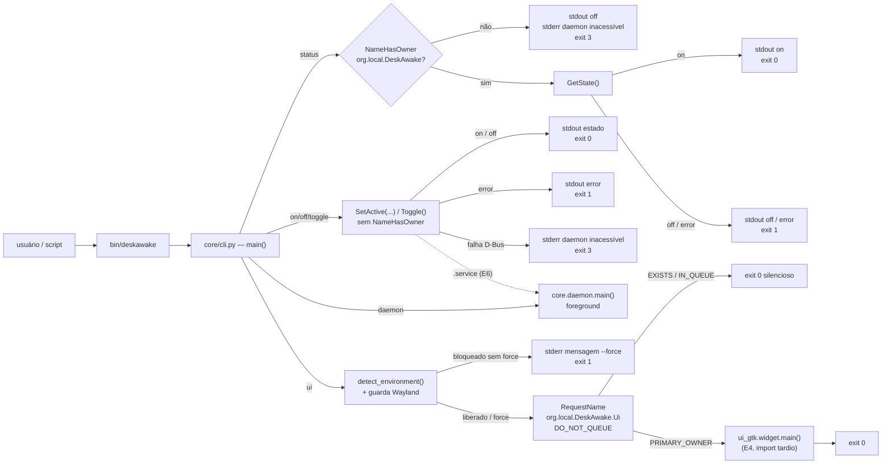

# Design: E3 — CLI e Launcher

**Feature:** DeskAwake — E3 | **Data:** 2026-11-20 | **Status:** Aprovado (2026-11-20)
**Referência:** [`spec.md`](spec.md) (decisões 1–33, “Contratos → CLI”, “Notas ao implementador”), [`DELIVERY_MAP.md`](DELIVERY_MAP.md) §E3, [`design_e1.md`](design_e1.md) (ADR-04) e [`design_e2.md`](design_e2.md) (contrato D-Bus e `core.daemon.main`)

> Este design cobre **somente a E3**. Ele não implementa código, não desenha UI, não instala
> artefatos e não altera o núcleo da E2. Em caso de conflito com a `spec.md`, a `spec.md` vence.
> As ambiguidades encontradas foram resolvidas com o usuário em **2026-11-20** e estão registradas
> na §1.1, na §5 (ADRs) e na §11 (desvios).

---

## 1. Contexto e limite da entrega

A E3 entrega o **ponto de entrada único** `deskawake`: roteamento dos subcomandos, códigos de saída
estáveis, guarda de Wayland, instância única da UI e o launcher portátil. A E3 **não** desenha nada;
o widget GTK é da E4 e o Plasmoid é da E5. Até a E4 existir, o caminho `ui` só é exercitado com um
fake nos testes.

**Inclui (e só isso):**

| Arquivo | Responsabilidade |
|---|---|
| `core/cli.py` | subcomandos, códigos de saída, guarda Wayland, single-instance da UI, `main()` |
| `bin/deskawake` | launcher executável; resolve `sys.path` a partir de `__file__` |
| `tests/unit/test_cli.py` | testes com barramento/daemon/UI falsos, sem display e sem `ui_gtk` |

**Explicitamente fora da E3:**

- Implementação da janela GTK (`ui_gtk/widget.py`, `ui_gtk/theme.py`, assets) — E4.
- Plasmoid e qualquer QML — E5.
- `install.sh`/`uninstall.sh`/`verify.sh`, `data/*.service`, autostart e READMEs — E6.
- Persistência de tema/posição e criação do `config.json` — E4. A E3 não lê nem escreve
  `~/.config/deskawake/config.json`.
- Qualquer mudança em `core/inhibitors.py`, `core/state.py`, `core/daemon.py`,
  `core/environment.py` ou `core/config.py`.
- Qualquer membro novo no contrato D-Bus do daemon (os métodos/sinal da E2 são consumidos como
  estão).
- Qualquer regra de backend, inibição, tema, spinner ou aparência.
- Testes de GUI; a interface `ui` é validada manualmente na E4.
- Novas dependências de runtime; `pytest` continua sendo dependência de desenvolvimento.

### 1.1 Decisões resolvidas antes do design

| Tema | Decisão confirmada em 2026-11-20 |
|---|---|
| Exit de `on/off/toggle` em falha de comunicação | **3** — “daemon inacessível”, incluindo barramento indisponível ou `ServiceUnknown`; mensagem em `stderr`, sem `stdout`. |
| Exit de `on/off/toggle` com resultado `error` | **1** — o estado `error` é impresso em `stdout`; resultados `on`/`off` saem **0**. |
| Exit de `ui` recusada ou com falha de inicialização | **1** — recusa Wayland e falha ao iniciar a UI; execução normal e segunda instância saem **0**. |
| Ativação do daemon nas ações | `on/off/toggle` chamam o método D-Bus **direto**, permitindo que o `.service` da E6 ative o daemon sob demanda. **Somente** `status` usa `NameHasOwner` e nunca ativa. |
| Erros de uso do `argparse` | Mantêm o exit **2** padrão do `argparse`; são erros de invocação, **fora** dos códigos de estado/resultado `0/1/3`. Não há caminho de estado que retorne `2`. |

---

## 2. Arquitetura

### 2.1 Fluxo de dados



O fluxo é unidirecional: o launcher só ajusta o `sys.path` e chama `core.cli.main()`. A CLI roteia,
fala D-Bus e decide códigos de saída; ela não conhece backend, estado interno, GTK ou regras de
inibição. O daemon (E2) continua sendo o único que fala com os backends.

### 2.2 Componentes e camadas

- **`core/cli.py` — política de acesso e roteamento**
  - Traduz argumentos em comandos fixos; não usa flags além de `--force` em `ui`.
  - Aplica os códigos de saída, a guarda Wayland e o single-instance da UI.
  - Fala com o daemon somente pelos métodos públicos da E2 (`SetActive`, `Toggle`, `GetState`) e
    com o barramento por `NameHasOwner`/`RequestName`.
  - Importa `ui_gtk.widget` de forma **tardia**, somente depois da guarda Wayland e da aquisição do
    nome de instância única. Nenhum `Gtk`/`Gdk` é importado no carregamento de `core.cli`.
  - Não **roda** um GLib main loop; as chamadas D-Bus da CLI são síncronas e curtas. No caminho
    `ui`, registra `DBusGMainLoop(set_as_default=True)` antes de `_detect_environment()`, para que
    o `SessionBus` singleton criado pela detecção já esteja integrado ao GLib quando a E4 o
    reutilizar para os sinais `StateChanged`.
- **`bin/deskawake` — bootstrap**
  - Calcula a raiz a partir de `Path(__file__).resolve().parent.parent`, insere no `sys.path` e
    chama `main()`. Não contém regra de negócio, não lê CWD nem `PYTHONPATH`.
- **`core/environment.py` — detecção reutilizada**
  - `detect_environment()` e `is_wayland()` vêm da E1, sem alteração.
  - A regra combinada da guarda (`XDG_SESSION_TYPE=wayland` **ou** `WAYLAND_DISPLAY` definido) é uma
    função nova em `core/cli.py`, conforme o ADR-04 da E1; `is_wayland()` permanece com a semântica
    antiga.
- **`core/daemon.py` — contrato consumido**
  - `DBUS_NAME`, `OBJECT_PATH` e `INTERFACE` são importados de `core.daemon` para não duplicar a
    tabela. `core.daemon.main()` é chamado pelo subcomando `daemon` sem argumentos.
- **`ui_gtk/widget.py` (E4) — dependência futura**
  - Deve expor `main()` sem argumentos, que roda o loop GTK e retorna ao fechar. A E3 chama essa
    função; não implementa nem testa a janela.
- **`tests/unit/test_cli.py` — testes headless**
  - Fakes duck-typed para o barramento, o daemon e a UI; `capsys` para `stdout`/`stderr`;
    `monkeypatch` para as seams internas; subprocesso apenas para o launcher `--help`.

**Pontos de entrada:**

- Processo: `bin/deskawake` → `core.cli.main(argv)`.
- D-Bus consumido: `NameHasOwner`, `SetActive`, `Toggle`, `GetState`; `RequestName` para a UI.
- UI: `ui_gtk.widget.main()` (E4), chamado somente pelo caminho `ui`.

**Camadas:** política de CLI em `core/cli.py`; detecção em `core/environment.py`; contrato do daemon
em `core/daemon.py`; UI em `ui_gtk/` (E4). Nenhuma camada de cima duplica a regra de backend.

### 2.3 Roteamento da CLI

| Comando | Chamada D-Bus | Saída | Exit |
|---|---|---|---|
| `on` | `SetActive(true)` | estado resultante em `stdout` | 0/1/3 |
| `off` | `SetActive(false)` | estado resultante em `stdout` | 0/1/3 |
| `toggle` | `Toggle()` | estado resultante em `stdout` | 0/1/3 |
| `status` | `NameHasOwner` e, só com dono, `GetState()` | `on`/`off`/`error` em `stdout`; `off` + aviso em `stderr` se inacessível | 0/1/3 |
| `daemon` | — (delega a `core.daemon.main()`) | nada da CLI; o daemon usa o log | código do daemon |
| `ui` | `RequestName("org.local.DeskAwake.Ui", DO_NOT_QUEUE)` | nada em caso normal; erro em `stderr` | 0/1 |

`on/off/toggle` **não** checam `NameHasOwner`: a chamada ao método é o gatilho de ativação do
`.service` na E6. Sem `.service` (E3), a chamada falha com `ServiceUnknown` e a CLI retorna 3.

---

## 3. Modelo de dados

Não há banco de dados, schema ou migration. A E3 também **não** persiste nada.

### 3.1 Estado em memória

| Objeto | Campos | Ciclo de vida |
|---|---|---|
| `args` | `command`, `force` (apenas em `ui`) | uma invocação |
| `Environment` | `desktop`, `session_type`, `wayland_display`, `backends`, `tools` (E1) | uma invocação de `ui` |
| `bus` | conexão de sessão (`dbus.Bus`) | uma invocação; permanece viva durante `ui_main()` |
| nome `org.local.DeskAwake.Ui` | propriedade do barramento | do `RequestName` até a saída do processo |

- O `config.json` **não** é lido nem escrito pela E3. Tema e posição continuam exclusivos da E4.
- Nenhum estado do daemon é cacheado pela CLI; `status` sempre pergunta ao daemon.
- Nenhum cookie de inibição passa pela CLI.

### 3.2 Migrations

Nenhuma. Não há banco nem schema versionado.

### 3.3 Controle de acesso aos dados

Não se aplica multi-tenant. A CLI roda na sessão do usuário, usa o barramento de sessão e não faz
chamadas privilegiadas. O nome `org.local.DeskAwake.Ui` é por sessão; um segundo processo do mesmo
usuário não abre outra UI. Nenhum dado do usuário é lido ou gravado.

---

## 4. Contratos

### 4.1 Gramática da CLI

```
deskawake on|off|toggle|status
deskawake daemon
deskawake ui [--force]
deskawake --help
```

- Subcomandos fixos; `--force` existe **somente** em `ui`. Nenhuma outra flag é introduzida.
- `--help` global é fornecido pelo `argparse` e documenta os códigos de saída no epílogo.
- `DESKAWAKE_FORCE_UI=1` equivale a `--force`. Somente o valor exato `1` liga o escape; `0`, vazio
  ou qualquer outro valor não ligam.
- `status` não aceita flags; `daemon` não aceita flags; `on/off/toggle` não aceitam flags.

### 4.2 Códigos de saída

| Comando | 0 | 1 | 3 |
|---|---|---|---|
| `status` | estado `on` | estado `off` **ou** `error` | daemon inacessível |
| `on` / `off` / `toggle` | resultado `on` ou `off` | resultado `error` | falha de comunicação/daemon inacessível |
| `ui` | executou ou já havia instância | recusa Wayland ou falha ao iniciar a UI | — |
| `daemon` | saída limpa do daemon | falha do daemon (ex.: barramento indisponível) | — |
| uso inválido | — | — | — (`argparse` usa **2**, fora do contrato de estado) |

- `status` inacessível: imprime `off` em `stdout` e `deskawake: daemon inacessível` em `stderr`.
- Ações em falha de comunicação: nenhum `stdout`; apenas `stderr`; exit 3.
- Ações com resultado `error`: imprime `error` em `stdout`; exit 1.
- `ui` recusada: nenhum `stdout`; mensagem em `stderr`; exit 1.
- Não há caminho de estado que retorne `2`.

### 4.3 `core/cli.py`

```python
# core/cli.py
from __future__ import annotations

import argparse
import os
import sys
from collections.abc import Callable, Sequence

import dbus
from dbus.mainloop.glib import DBusGMainLoop

from core.environment import Environment, detect_environment, is_wayland
from core.daemon import DBUS_NAME, INTERFACE, OBJECT_PATH

EXIT_OK = 0
EXIT_ERROR = 1
EXIT_UNREACHABLE = 3

PUBLIC_STATES = frozenset({"on", "off", "error"})
UI_NAME = "org.local.DeskAwake.Ui"
FORCE_UI_ENV = "DESKAWAKE_FORCE_UI"

BUS_ERRORS = (dbus.DBusException, OSError, KeyError)
CALL_ERRORS = (dbus.DBusException, OSError)

MSG_DAEMON_UNREACHABLE = "deskawake: daemon inacessível"
MSG_SESSION_BUS = "deskawake: barramento de sessão indisponível"
MSG_UI_FAILED = "deskawake: falha ao iniciar a UI"
MSG_INVALID_STATE = "deskawake: resposta inválida do daemon"
MSG_WAYLAND = (
    "deskawake: a UI GTK não é suportada em Wayland; "
    "use o Plasmoid do KDE ou repita com --force (ou DESKAWAKE_FORCE_UI=1) "
    "para depuração"
)

def main(argv: Sequence[str] | None = None) -> int: ...
def _build_parser() -> "argparse.ArgumentParser": ...

# seams internas (testáveis; não são flags nem variáveis de ambiente novas)
def _session_bus() -> "dbus.Connection": ...
def _detect_environment() -> Environment: ...
def _load_ui_main() -> Callable[[], object]: ...
def _daemon_main() -> int: ...

def _wayland_blocked(environment: Environment) -> bool: ...
def _run_status(bus: "dbus.Connection") -> int: ...
def _run_action(bus: "dbus.Connection", action: str) -> int: ...
def _run_ui(bus: "dbus.Connection", *,
            ui_loader: Callable[[], Callable[[], object]]) -> int: ...
```

**Contrato de `main`:**

- `argv=None` → `argparse` lê `sys.argv[1:]`; caso contrário, usa a sequência recebida.
- Retorna um `int` em todos os caminhos normais. **Não** chama `sys.exit`; o launcher faz
  `raise SystemExit(main())`.
- `--help` e erros de uso do `argparse` continuam lançando `SystemExit` (0 e 2 respectivamente),
  como é padrão da biblioteca. A CLI não intercepta esses dois caminhos.
- `main(["daemon"])` chama `_daemon_main()` e devolve o código do daemon; não abre barramento na CLI.
- `main(["ui", ...])` executa `DBusGMainLoop(set_as_default=True)` **antes** de
  `_detect_environment()` e da guarda Wayland; se bloqueado, não adquire o nome da UI e não importa
  `ui_gtk` (a detecção pode usar o `SessionBus` apenas para leituras de `NameHasOwner`, sem
  auto-start). Assim, o `SessionBus` singleton usado por `detect_environment` já nasce integrado ao
  GLib e pode ser reutilizado pela E4.
- Nos demais comandos, `main()` não registra GLib main loop; as chamadas D-Bus são síncronas.

### 4.4 `bin/deskawake`

```python
#!/usr/bin/env python3
from __future__ import annotations

import sys
from pathlib import Path

ROOT = Path(__file__).resolve().parent.parent
if str(ROOT) not in sys.path:
    sys.path.insert(0, str(ROOT))

from core.cli import main

if __name__ == "__main__":
    raise SystemExit(main())
```

- Executável (`chmod +x`), shebang `#!/usr/bin/env python3`.
- No repositório: `<repo>/bin/deskawake` → raiz `<repo>`.
- Instalado: `~/.local/share/deskawake/bin/deskawake` → raiz `~/.local/share/deskawake`.
- Funciona a partir de qualquer CWD e sem `PYTHONPATH`.
- O wrapper `~/.local/bin/deskawake` é gerado pela E6 com caminho absoluto; **não** é symlink para o
  repositório.
- Nenhuma lógica além do bootstrap e do `SystemExit`.

### 4.5 D-Bus consumido

| Uso | Chamada | Quando |
|---|---|---|
| Existência do daemon | `bus.name_has_owner(DBUS_NAME)` | somente `status`, antes de qualquer método |
| Estado | `GetState()` em `DBUS_NAME`/`OBJECT_PATH`/`INTERFACE` | `status`, se houver dono |
| Ligar | `SetActive(dbus.Boolean(True))` | `on` |
| Desligar | `SetActive(dbus.Boolean(False))` | `off` |
| Alternar | `Toggle()` | `toggle` |
| Instância única da UI | `bus.request_name(UI_NAME, dbus.bus.NAME_FLAG_DO_NOT_QUEUE)` | `ui`, depois da guarda |

- A CLI **não** chama `StartServiceByName` em nenhum caminho.
- A CLI **não** chama `GetLastError`; o motivo do erro continua disponível para a UI e para o log.
- A CLI **não** chama métodos de backend (FDO/MATE/GSM/PolicyAgent); isso é exclusivo do daemon.
- O contrato D-Bus do daemon (E2) não muda.

### 4.6 Mensagens e saídas

| Situação | `stdout` | `stderr` | Exit |
|---|---|---|---|
| `status` com dono, estado `on` | `on\n` | — | 0 |
| `status` com dono, estado `off` | `off\n` | — | 1 |
| `status` com dono, estado `error` | `error\n` | — | 1 |
| `status` sem dono | `off\n` | `deskawake: daemon inacessível\n` | 3 |
| `status` com falha em `NameHasOwner`/`GetState` | `off\n` | `deskawake: daemon inacessível\n` | 3 |
| `status` com resposta fora de `on|off|error` | `off\n` | `deskawake: resposta inválida do daemon\n` | 3 |
| `on/off/toggle` com resultado `on`/`off` | `<estado>\n` | — | 0 |
| `on/off/toggle` com resultado `error` | `error\n` | — | 1 |
| `on/off/toggle` com falha D-Bus | — | `deskawake: daemon inacessível\n` | 3 |
| `on/off/toggle` com resposta inválida | — | `deskawake: resposta inválida do daemon\n` | 1 |
| `ui` bloqueada em Wayland sem force | — | mensagem com `--force` e “Plasmoid” | 1 |
| `ui` com barramento indisponível | — | `deskawake: barramento de sessão indisponível\n` | 1 |
| `ui` com segunda instância | — | — | 0 |
| `ui` com falha de import/inicialização | — | `deskawake: falha ao iniciar a UI: <motivo>\n` | 1 |
| `daemon` | — | — (o daemon loga) | código do daemon |

- Os tokens de estado são sempre `on`, `off`, `error` (em inglês), mesmo com mensagens em pt-BR.
- `stdout` é reservado ao estado; `stderr` é reservado a diagnóstico.
- A mensagem de Wayland é exatamente:

  ```
  deskawake: a UI GTK não é suportada em Wayland; use o Plasmoid do KDE ou repita com --force (ou DESKAWAKE_FORCE_UI=1) para depuração
  ```

- O epílogo de `--help` documenta os códigos:

  ```
  Códigos de saída:
    status         0 = on, 1 = off ou error, 3 = daemon inacessível
    on|off|toggle  0 = sucesso (on/off), 1 = resultado error, 3 = daemon inacessível
    ui             0 = executou ou já havia instância, 1 = recusada ou falhou
    daemon         código de saída do daemon (0 = saída limpa)
  ```

### 4.7 Seams internas de teste

As seams existem para testar a política sem barramento real, sem display e sem `ui_gtk`; elas não
são flags de CLI nem variáveis de ambiente novas.

| Seam | Padrão de produção | Uso em teste |
|---|---|---|
| `_session_bus()` | `dbus.SessionBus()` | devolve um fake; pode lançar `dbus.DBusException` |
| `_detect_environment()` | `detect_environment(env=os.environ)` | devolve um `Environment` construído à mão |
| `_load_ui_main()` | importa `ui_gtk.widget.main` | devolve um fake que registra a chamada |
| `_daemon_main()` | chama `core.daemon.main()` | devolve 0/1 ou levanta erro controlado |
| `_wayland_blocked(environment)` | função pura | testada com matriz de `Environment` |
| `_run_status(bus)` | lógica de `status` | recebe `FakeBus` |
| `_run_action(bus, action)` | lógica das ações | recebe `FakeBus` |
| `_run_ui(bus, ui_loader=...)` | `RequestName` + UI | recebe `FakeUiBus` e loader fake |

- `_run_ui` recebe um `ui_loader` (fábrica), não a função já importada. Assim, `ui_gtk` só é
  importado depois da guarda e do `RequestName`; a segunda instância nem importa o módulo.
- `core/cli.py` é importável sem display. O import de `ui_gtk` acontece dentro de
  `_load_ui_main()`, nunca no topo do módulo.
- No caminho `ui`, `main()` registra `DBusGMainLoop(set_as_default=True)` **antes** de
  `_detect_environment()`; o registro é idempotente e a E4 pode repeti-lo antes de `Gtk.main()`.

### 4.8 Tipos e constantes

```python
# core/cli.py
PUBLIC_STATES = frozenset({"on", "off", "error"})
UI_NAME = "org.local.DeskAwake.Ui"
FORCE_UI_ENV = "DESKAWAKE_FORCE_UI"

EXIT_OK = 0
EXIT_ERROR = 1
EXIT_UNREACHABLE = 3

BUS_ERRORS = (dbus.DBusException, OSError, KeyError)
CALL_ERRORS = (dbus.DBusException, OSError)

def _wayland_blocked(environment: Environment) -> bool:
    return is_wayland(environment) or environment.wayland_display is not None

def _session_bus() -> "dbus.Connection": ...
def _detect_environment() -> Environment: ...
def _load_ui_main() -> Callable[[], object]: ...
def _daemon_main() -> int: ...
def _run_status(bus: "dbus.Connection") -> int: ...
def _run_action(bus: "dbus.Connection", action: str) -> int: ...
def _run_ui(bus: "dbus.Connection", *,
            ui_loader: Callable[[], Callable[[], object]]) -> int: ...
```

- `DBUS_NAME`, `OBJECT_PATH` e `INTERFACE` vêm de `core.daemon`; não são redefinidos.
- `BUS_ERRORS` inclui `KeyError` porque `dbus.SessionBus()` pode falhar assim quando
  `DBUS_SESSION_BUS_ADDRESS` está ausente/inválido (mesmo tratamento da E1).
- `CALL_ERRORS` cobre `ServiceUnknown`, `NoReply`, `Disconnected` e erros de socket nas chamadas.
- O tipo real do barramento é `dbus.Bus` (subclasse de `dbus.connection.Connection`); os fakes são
  duck-typed.

---

## 5. Decisões técnicas (ADRs)

### ADR-01: Códigos de saída da CLI

- **Contexto:** o mapa fixa `status` (0/1/3) e exige `≠ 0` para falhas de ações e para a recusa da
  UI; não fixa os códigos das ações/UI. Também pede para não introduzir `2` nem um quarto código.
- **Opções consideradas:**
  - A: `3` para qualquer indisponibilidade de daemon/barramento em `status` e ações; `1` para
    resultado `error` e para recusa/falha da UI. Prós: um único código para “daemon inacessível”,
    coerente com `status`; `1` sempre significa “não ligado/erro”; nenhum código novo. Contras:
    ações e `status` compartilham o 3 com semânticas ligeiramente diferentes (consulta × ação).
  - B: `1` genérico para falha de ações; `3` só em `status`. Prós: separa consulta de ação.
    Contras: duas semânticas para “daemon inacessível” e menos útil para scripts.
  - C: espelhar 0=on, 1=off em todas as ações. Contras: `deskawake off` bem-sucedido sairia 1.
- **Decisão:** A, confirmada pelo usuário em 2026-11-20. `status` e ações usam `0`/`1`/`3`; `ui` usa
  `0`/`1`; `daemon` devolve o código do daemon. Erros de uso do `argparse` mantêm o **2** padrão,
  porque são erros de invocação e não códigos de estado/resultado (também confirmado).
- **Consequências:** scripts podem tratar `3` como “daemon indisponível” em qualquer comando;
  `status` continua sendo o único que consulta sem ativar. O `2` do `argparse` deve ser documentado
  como erro de uso, não como estado.

### ADR-02: `status` é somente leitura e nunca ativa o daemon

- **Contexto:** a decisão 6 da spec e o mapa exigem que `status` use `NameHasOwner` antes de
  `GetState` e não dispare auto-start; o `.service` da E6 é fallback de ativação.
- **Opções consideradas:**
  - A: `NameHasOwner` → se não houver dono, sair 3 sem chamar `GetState` nem `StartServiceByName`.
    Prós: não acorda o daemon, barato, cumpre a decisão 6. Contras: em uma sessão sem autostart, o
    primeiro `status` retorna 3 até alguém ligar o daemon.
  - B: chamar `GetState` direto (ou `StartServiceByName`) e deixar o D-Bus ativar. Contras:
    contraria a decisão 6 e o custo de acordar o daemon em uma consulta.
- **Decisão:** A. `status` chama somente `NameHasOwner` e, com dono, `GetState`. Não há
  `StartServiceByName` em `core/cli.py`.
- **Consequências:** `status` é seguro para polling/diagnóstico; `on/off/toggle` são os comandos que
  podem ativar o daemon via `.service` na E6.

### ADR-03: Ações chamam D-Bus direto e permitem ativação sob demanda

- **Contexto:** o `.service` da E6 é o fallback de ativação (decisão 3). Se as ações checassem
  `NameHasOwner` antes, a ativação nunca aconteceria.
- **Opções consideradas:**
  - A: chamar `SetActive`/`Toggle` direto, sem `NameHasOwner`. Prós: o D-Bus ativa o daemon via
    `.service` quando o arquivo existir; uma única ida ao barramento; comportamento natural de
    cliente D-Bus. Contras: sem `.service` (E3), a chamada falha com `ServiceUnknown` e vira 3.
  - B: `NameHasOwner` antes e falhar se não houver dono. Prós: mensagem imediata. Contras: impede a
    ativação sob demanda e torna o `.service` inútil para as ações.
- **Decisão:** A, confirmada pelo usuário em 2026-11-20. Somente `status` consulta `NameHasOwner`.
- **Consequências:** na E3, sem `.service`, ações exigem o daemon já rodando; a integração real de
  ativação é validada na E6. Nenhuma mudança no daemon é necessária.

### ADR-04: Guarda Wayland combinada em `core/cli.py`

- **Contexto:** a E1 decidiu (ADR-04) que `is_wayland()` olha somente `session_type`, e que a regra
  combinada (`XDG_SESSION_TYPE=wayland` **ou** `WAYLAND_DISPLAY`) é política da E3.
- **Opções consideradas:**
  - A: `_wayland_blocked(environment) = is_wayland(environment) or environment.wayland_display is not None`.
    Prós: reutiliza a detecção da E1, cobre os dois sinais da spec, não altera `is_wayland()`.
    Contras: uma função a mais na CLI.
  - B: mudar `is_wayland()` para incluir `WAYLAND_DISPLAY`. Contras: contraria a ADR-04 da E1 e mistura
    detecção com política de UI.
  - C: ler `os.environ` diretamente no `core/cli.py`. Contras: duplica a detecção e espalha
    `os.environ`, como o mapa proíbe.
- **Decisão:** A. A função é pura, recebe um `Environment` e é testada com a matriz
  `session_type` × `wayland_display`.
- **Consequências:** o `ui` é recusado em Wayland e em sessões híbridas com `WAYLAND_DISPLAY`
  definido; `--force`/`DESKAWAKE_FORCE_UI=1` são os únicos escapes. `status`/ações não usam a guarda.

### ADR-05: Single-instance da UI e import tardio do GTK

- **Contexto:** o mapa exige `RequestName("org.local.DeskAwake.Ui", DO_NOT_QUEUE)` e saída 0
  silenciosa na segunda invocação. A E3 não tem `ui_gtk`; o import não pode acontecer em Wayland,
  na segunda instância nem no `--help`.
- **Opções consideradas:**
  - A: `RequestName` com `DO_NOT_QUEUE`; `EXISTS`/`IN_QUEUE` → 0 silencioso; `PRIMARY_OWNER`/
    `ALREADY_OWNER` → importar a UI e chamar `main()`. Prós: atômico, sem janela de corrida, não
    importa GTK à toa. Contras: o nome fica preso à conexão da CLI.
  - B: checar `NameHasOwner` e depois `RequestName`. Contras: duas idas ao barramento e corrida
    entre checagem e aquisição.
  - C: importar `ui_gtk` no topo do módulo. Contras: quebra `--help`/Wayland/segunda instância sem
    GTK e sem E4.
- **Decisão:** A. O nome é mantido pela conexão da CLI durante toda a execução de `ui_main()`; a
  liberação acontece quando o processo termina. `ui_loader` é chamado só depois do `RequestName`
  bem-sucedido.
- **Consequências:** uma segunda invocação não abre janela nem imprime nada; `ui` pode ser testado
  com um `ui_loader` fake antes da E4. O nome é por sessão/usuário.

### ADR-06: Launcher portátil por `__file__`

- **Contexto:** `bin/deskawake` deve funcionar no repositório (`./bin/deskawake`) e instalado
  (`~/.local/share/deskawake/bin/deskawake`), sem depender de CWD ou `PYTHONPATH`.
- **Opções consideradas:**
  - A: `ROOT = Path(__file__).resolve().parent.parent`; inserir `ROOT` no `sys.path`; importar
    `core.cli`. Prós: funciona nos dois layouts, resolve symlinks, não depende do CWD. Contras:
    assume que o launcher está sempre um nível abaixo da raiz (contrato da árvore).
  - B: usar `sys.path[0]`/CWD. Contras: quebra quando chamado por caminho absoluto de `/tmp` ou por
    ativação D-Bus.
  - C: instalar um `.pth`/pacote. Contras: dependência de instalação e packaging proibido.
- **Decisão:** A. O script é executável, com shebang `#!/usr/bin/env python3`.
- **Consequências:** `python3 /caminho/absoluto/bin/deskawake --help` funciona de qualquer diretório;
  o wrapper absoluto da E6 só executa esse launcher.

### ADR-07: Seams de teste sem flags/env novas

- **Contexto:** os testes precisam de barramento/daemon/UI falsos; o mapa proíbe inventar flags e a
  E2 evitou variáveis de ambiente novas.
- **Opções consideradas:**
  - A: funções finas privadas (`_session_bus`, `_detect_environment`, `_load_ui_main`,
    `_daemon_main`) e funções de lógica (`_run_status`, `_run_action`, `_run_ui`) testáveis com
    fakes. Prós: sem superfície pública nova, sem flags, testes rápidos e headless. Contras: o
    teste usa `monkeypatch` de nomes privados.
  - B: parâmetros keyword-only em `main()` (`bus=`, `ui_main=`, ...). Prós: seams explícitas.
    Contras: amplia a assinatura pública e mistura injeção de teste com contrato.
  - C: variáveis de ambiente de teste. Contras: proibido pelo espírito do mapa e arriscado em
    produção.
- **Decisão:** A. `main(argv)` permanece o contrato público; as seams privadas são documentadas e
  usadas apenas em `tests/unit/test_cli.py`.
- **Consequências:** nenhuma flag nova; o `--help` continua com a gramática exata da spec.

### ADR-08: Mensagens em pt-BR e tokens de estado em inglês

- **Contexto:** a E2 fixou mensagens/log em pt-BR, mas os estados públicos são `on|off|error`.
- **Opções consideradas:**
  - A: mensagens de diagnóstico em pt-BR; `stdout` sempre com os tokens `on`/`off`/`error`. Prós:
    consistente com a CLI e o restante do produto; fácil de parsear. Contras: mistura de idiomas na
    mesma saída (estado em inglês, erro em português), aceitável por contrato.
  - B: traduzir os estados (`ligado`/`desligado`). Contras: contraria G4 e o contrato D-Bus.
- **Decisão:** A. As strings exatas estão na §4.6 e são fixadas em teste.
- **Consequências:** scripts podem comparar `stdout.strip()` com `on|off|error`; mensagens de erro
  ficam em `stderr`.

### ADR-09: `argparse` mínimo e erros de uso

- **Contexto:** o mapa pede “sem `argparse` exagerado”, subcomandos fixos e `--force` só em `ui`;
  o `--help` precisa funcionar a partir de `/tmp`. O `argparse` usa exit 2 para erros de uso.
- **Opções consideradas:**
  - A: `argparse` com `prog="deskawake"`, subparsers fixos, `--force` apenas no subparser `ui` e um
    epílogo documentando os códigos. Prós: `--help` e validação grátis, código pequeno. Contras:
    exit 2 em uso inválido.
  - B: parser manual. Prós: controle total do exit. Contras: mais código, mais superfície de bug,
    sem ganho de produto.
  - C: `argparse` com `add_help=False` e erros convertidos para 1. Contras: mais código para
    esconder um código que não é de estado.
- **Decisão:** A, com a leitura confirmada pelo usuário: o **2** do `argparse` é erro de invocação,
  não código de estado/resultado; os caminhos de `on/off/toggle/status/ui/daemon` nunca retornam 2.
  Nenhuma flag além de `--force` é criada.
- **Consequências:** `deskawake --help` sai 0; `deskawake` sem subcomando/flag inválida sai 2 com
  mensagem do `argparse`; o epílogo documenta `error` = 1.

### ADR-10: Respostas inválidas e falhas de comunicação

- **Contexto:** o daemon só retorna `on|off|error`, mas uma versão futura/daemon quebrado pode
  retornar outra coisa; a CLI não deve imprimir lixo no `stdout` nem estourar traceback.
- **Opções consideradas:**
  - A: validar o retorno contra `PUBLIC_STATES`; `status` inválido → `off` + `stderr` + 3; ação
    inválida → `stderr` + 1. Prós: `stdout` sempre parseável, sem traceback. Contras: um caso
    defensivo a mais.
  - B: imprimir o retorno cru. Contras: quebra o contrato de `stdout` e pode confundir scripts.
- **Decisão:** A. Falhas de comunicação (`CALL_ERRORS`) em ações/status viram 3 com a mensagem de
  “daemon inacessível”; `ui` usa 1 e a mensagem de barramento/UI.
- **Consequências:** nenhum traceback cru de D-Bus chega ao usuário; o contrato de `stdout` fica
  restrito a `on|off|error` (ou `off` no caso inacessível de `status`).

### ADR-11: `daemon` delega sem daemonizar

- **Contexto:** o mapa exige foreground e delegação a `core.daemon`; o `.service`/autostart da E6
  cuidam do resto.
- **Opções consideradas:**
  - A: `_daemon_main()` chama `core.daemon.main()` sem argumentos e devolve o `int`; sem
    double-fork, sem flags. Prós: reaproveita todo o ciclo de vida da E2, logs e sinais. Contras:
    nada.
  - B: daemonizar no CLI. Contras: quebra `systemd --user`/logs e contraria o mapa.
- **Decisão:** A. A CLI não abre barramento para o comando `daemon`; o daemon faz a própria conexão.
- **Consequências:** `deskawake daemon` é o `Exec=` natural do `.service` e do autostart.

### ADR-12: Reuso das constantes do daemon

- **Contexto:** `DBUS_NAME`, `OBJECT_PATH` e `INTERFACE` já existem em `core/daemon.py`; duplicar
  esses valores na CLI criaria divergência silenciosa.
- **Opções consideradas:**
  - A: importar de `core.daemon` e reutilizar. Prós: fonte única, testável por identidade. Contras:
    `core/cli.py` importa o módulo do daemon (e `gi`/GLib) no topo; `--help` exige as dependências
    de runtime.
  - B: redefinir as constantes em `core/cli.py`. Contras: duplicação e risco de divergência.
  - C: criar `core/constants.py`. Contras: módulo novo fora da árvore aprovada.
- **Decisão:** A. Requisitos de runtime (`python3-dbus`, `python3-gi`) já são obrigatórios; o
  instalador da E6 verifica as dependências. A UI GTK continua com import tardio.
- **Consequências:** qualquer mudança futura nos nomes D-Bus é feita em um lugar só; a CLI e o
  daemon não podem divergir.

### ADR-13: Conexão de sessão preparada para o GLib antes da UI

- **Contexto:** `detect_environment()` (E1) cria `dbus.SessionBus()` quando `bus=None`, e
  `dbus.SessionBus()` é singleton no processo. Se a CLI criar essa conexão antes de registrar o
  `DBusGMainLoop`, a E4 pode herdar uma conexão não integrada ao GLib e não receber
  `StateChanged` em tempo real. O daemon da E2 já registra `DBusGMainLoop(set_as_default=True)`
  antes de `SessionBus()`.
- **Opções consideradas:**
  - A: no caminho `ui`, registrar `DBusGMainLoop(set_as_default=True)` antes de
    `_detect_environment()` e `_session_bus()`. Prós: a conexão singleton nasce integrada; a E4
    reutiliza o mesmo `SessionBus`; uma linha e nenhum loop extra na CLI. Contras: o registro
    também acontece quando a guarda vai recusar Wayland (inofensivo).
  - B: usar uma `BusConnection` privada só para o nome da UI. Prós: não interfere no singleton.
    Contras: precisa do endereço, tratamento de `KeyError` e fechamento explícito; mais código.
  - C: deixar a E4 criar a própria conexão e contar com o singleton não ter sido criado antes.
    Contras: a detecção já cria o singleton antes; o sinal pode não chegar.
- **Decisão:** A. `main()` registra o GLib antes da detecção no caminho `ui`; `status`/ações não
  precisam de GLib e não o registram.
- **Consequências:** a E4 pode chamar `DBusGMainLoop(set_as_default=True)` de novo (idempotente) e
  usar `dbus.SessionBus()`/`Gtk.main()` normalmente. Nenhuma dependência nova (GLib já é
  obrigatório para o daemon).

---

## 6. Fluxos detalhados

### 6.1 `status`

1. O parser entrega `command="status"`.
2. Abrir a conexão de sessão (`_session_bus()`). Se falhar (`BUS_ERRORS`): `stdout` `off`, `stderr`
   `deskawake: daemon inacessível`, exit 3.
3. `bus.name_has_owner(DBUS_NAME)`.
   - `False` → `stdout` `off`, `stderr` `deskawake: daemon inacessível`, exit 3. **Nenhum**
     `GetState` e **nenhum** `StartServiceByName`.
   - Exceção → mesmo tratamento (inacessível, 3).
4. Com dono, obter o objeto `DBUS_NAME`/`OBJECT_PATH` e chamar `GetState()`.
   - `"on"` → `stdout` `on`, exit 0.
   - `"off"` → `stdout` `off`, exit 1.
   - `"error"` → `stdout` `error`, exit 1.
   - Exceção → `stdout` `off`, `stderr` inacessível, exit 3.
   - Valor fora de `PUBLIC_STATES` → `stdout` `off`, `stderr` `deskawake: resposta inválida do
     daemon`, exit 3.
5. Não dorme, não faz polling, não inicia o daemon.

### 6.2 `on` / `off` / `toggle`

1. Abrir a conexão de sessão (`_session_bus()`). Se falhar: `stderr` `deskawake: daemon
   inacessível`, exit 3 (sem `stdout`).
2. Obter o objeto/interface e chamar:
   - `on` → `SetActive(dbus.Boolean(True))`
   - `off` → `SetActive(dbus.Boolean(False))`
   - `toggle` → `Toggle()`
3. Sem `NameHasOwner` antes: a chamada pode ativar o daemon via `.service` na E6.
4. Resultado:
   - `"on"`/`"off"` → imprimir o estado em `stdout`, exit 0.
   - `"error"` → imprimir `error` em `stdout`, exit 1.
   - Exceção D-Bus → `stderr` inacessível, exit 3.
   - Valor inválido → `stderr` resposta inválida, exit 1 (sem `stdout`).
5. Não chama `GetLastError` e não imprime o motivo do erro; o diagnóstico detalhado continua no
   daemon/log e na UI.

### 6.3 `daemon`

1. `_daemon_main()` chama `core.daemon.main()` sem argumentos.
2. O daemon faz sua própria conexão, adquire o nome, instala sinais, escreve o log e roda o loop
   (E2).
3. A CLI devolve o `int` retornado (0 em saída limpa; 1 se o barramento não estiver disponível).
4. A CLI não faz double-fork, não redireciona `stdout` e não instala sinais próprios.

### 6.4 `ui`

1. Registrar `DBusGMainLoop(set_as_default=True)` **antes** de qualquer detecção/conexão, para que
   o `SessionBus` singleton criado por `detect_environment` já esteja integrado ao GLib.
2. `_detect_environment()` → `Environment` (E1); `_wayland_blocked(environment)` aplica a regra
   combinada.
3. Se bloqueado e nem `--force` nem `DESKAWAKE_FORCE_UI=1` estiverem ativos: `stderr` com a
   mensagem que cita `--force` e o Plasmoid; exit 1. Não adquire o nome da UI e não importa
   `ui_gtk`; a detecção do passo 2 pode ter aberto o `SessionBus` somente para leituras de
   `NameHasOwner` (sem auto-start).
4. Abrir a conexão de sessão. Se falhar: `stderr` `deskawake: barramento de sessão indisponível`,
   exit 1.
5. `bus.request_name(UI_NAME, dbus.bus.NAME_FLAG_DO_NOT_QUEUE)`:
   - `EXISTS` ou `IN_QUEUE` → exit 0 silencioso (outra instância; não importa `ui_gtk`).
   - `PRIMARY_OWNER` ou `ALREADY_OWNER` → continuar.
   - Qualquer outro valor → `stderr` `deskawake: falha ao iniciar a UI`, exit 1.
6. `ui_loader()` importa `ui_gtk.widget` e devolve `main`; chamar `main()`.
   - Exceção (incluindo `ImportError` antes da E4) → `stderr` `deskawake: falha ao iniciar a UI:
     <motivo>`, exit 1.
   - Retorno normal → exit 0.
7. O nome `org.local.DeskAwake.Ui` permanece com a conexão da CLI até o processo terminar; não é
   liberado antes de `main()` retornar. `--force` só ignora a guarda Wayland; não ignora o
   single-instance.

### 6.5 `--help` e erros de uso

1. `argparse` monta o parser com `prog="deskawake"`, os seis subcomandos e `--force` apenas em
   `ui`.
2. `--help` / `-h` imprime a ajuda em `stdout` e sai 0 (comportamento do `argparse`), incluindo o
   epílogo com os códigos de saída.
3. Subcomando ausente, subcomando desconhecido ou argumento extra → mensagem do `argparse` em
   `stderr` e exit 2. Esse 2 é erro de invocação, não código de estado; nenhum caminho de
   `on/off/toggle/status/ui/daemon` o utiliza.
4. Nenhuma flag além de `--force` é aceita; `--force` fora de `ui` é erro de uso (exit 2).

---

## 7. Impacto em features/entregas existentes

| Entrega/componente | Impacto |
|---|---|
| **E1 — config/environment** | Reutiliza `Environment`, `detect_environment` e `is_wayland`; a regra combinada da guarda nasce em `core/cli.py` conforme a ADR-04 da E1. Nenhum campo ou contrato da E1 muda. |
| **E2 — daemon/inibidores/estado** | Nenhuma mudança. A CLI consome `SetActive`/`Toggle`/`GetState` e reutiliza `DBUS_NAME`/`OBJECT_PATH`/`INTERFACE`; `daemon` chama `core.daemon.main()` sem argumentos. |
| **E4 — widget GTK** | Deve expor `ui_gtk.widget.main()` sem argumentos, que roda o loop e retorna. A CLI entrega a guarda Wayland, o `--force` e o single-instance; a E4 não duplica essas regras. A E4 reutiliza o `SessionBus` singleton já integrado ao GLib e pode chamar `DBusGMainLoop(set_as_default=True)` de novo (idempotente) antes de `Gtk.main()`. Até a E4, `ui` só roda em teste com loader fake. |
| **E5 — Plasmoid** | Sem impacto: o Plasmoid fala D-Bus direto com o daemon e não usa a CLI. |
| **E6 — instalador/verify/docs** | O `.service` (`Exec=` absoluto com `daemon`) passa a ativar o daemon nas ações, porque elas não checam `NameHasOwner`. `status` continua sem ativar. `install.sh` instala `bin/deskawake` em `~/.local/share/deskawake/bin/` e gera o wrapper absoluto em `~/.local/bin/`. `verify.sh` usa os códigos 0/1/3. Os READMEs documentam a CLI (E6). |
| **`config.json` / tema / posição** | Sem impacto: a E3 não lê nem escreve. A posição/tema continuam na E4. |
| **Testes E1/E2** | Sem alteração; a E3 adiciona `tests/unit/test_cli.py` e não mexe no conftest. |
| **Sem impacto confirmado** | `LICENSE`, `pyproject.toml`, `assets/`, `plasmoid/`, `ui_gtk/` (E4), `install.sh`/`uninstall.sh`/`verify.sh` (E6), `core/inhibitors.py`, `core/state.py`, `core/daemon.py` e o contrato D-Bus. |

---

## 8. Conformidade com os padrões do projeto

- [x] Python ≥ 3.10; stdlib + `python3-dbus` + `python3-gi` (já exigidos). Nenhuma dependência nova;
      `pytest` continua dev-only.
- [x] Sem `sudo`, sem empacotamento de distro, sem `.deb`/AUR/Flatpak, sem build backend.
- [x] Sem testes de GUI; `ui` é testada com loader fake e validada manualmente na E4.
- [x] Nome/objeto/interface D-Bus reutilizados de `core.daemon` (G3); estados públicos somente
      `on|off|error` (G4).
- [x] `status` usa `NameHasOwner` antes de `GetState` e nunca chama `StartServiceByName` (decisão 6
      e mapa E3.3 item 1).
- [x] `ui` recusa `XDG_SESSION_TYPE=wayland` **ou** `WAYLAND_DISPLAY` definido, salvo
      `--force`/`DESKAWAKE_FORCE_UI=1` (decisão 6).
- [x] Single-instance via `org.local.DeskAwake.Ui` com `DO_NOT_QUEUE`; segunda invocação sai 0
      silenciosamente.
- [x] Launcher portátil por `__file__`; sem CWD/`PYTHONPATH`; shebang `#!/usr/bin/env python3`.
- [x] `daemon` em foreground, sem double-fork, delegando a `core.daemon.main()`.
- [x] Nenhuma flag além de `--force` em `ui`; sem `argparse` exagerado.
- [x] Falha de conexão não vira traceback cru; mensagem em `stderr` e exit ≠ 0.
- [x] No caminho `ui`, `DBusGMainLoop(set_as_default=True)` é registrado antes da detecção; a CLI
      não roda loop GLib próprio e nenhuma dependência nova é introduzida.
- [x] Mensagens em pt-BR; tokens de estado em inglês; documentação/design em pt-BR (G19).
- [x] Nenhum artefato de spec/design em código, comentários, commits ou PRs.
- [x] `design_e3.md` é versionado em `docs/implementation/`.

---

## 9. Plano de verificação

### 9.1 Automático — unitário

```bash
python3 -m pytest tests/unit/test_cli.py -v
python3 -m pytest tests/unit -q
```

`pytest` é instalado pelo desenvolvedor via `apt install python3-pytest`; o comando usa
`python3 -m pytest` para colocar a raiz do repo no `sys.path`. A suíte da E3 não abre barramento
real, display ou `ui_gtk`; todas as dependências externas são fakes.

### 9.2 Mapa critério de aceite → teste

| Critério E3.4 | Teste |
|---|---|
| `status` sem dono ⇒ exit 3, zero `GetState`/`StartServiceByName` | `test_status_without_owner_is_unreachable_without_getstate` |
| `status` com `GetState()=="on"` ⇒ exit 0, stdout `on` | `test_status_on` |
| `status` com `"off"` ⇒ exit 1, stdout `off` | `test_status_off` |
| `status` com `"error"` ⇒ exit 1, stdout `error` | `test_status_error` |
| `status` com falha em `GetState` ⇒ exit 3, stdout `off`, stderr inacessível | `test_status_getstate_failure_is_unreachable` |
| `status` com barramento indisponível ⇒ exit 3, stdout `off` | `test_status_bus_failure_is_unreachable` |
| `status` nunca chama `StartServiceByName` | `test_status_never_calls_start_service_by_name` |
| `on` chama `SetActive(True)` e imprime o retorno | `test_on_calls_set_active_true` |
| `off` chama `SetActive(False)` e imprime o retorno | `test_off_calls_set_active_false` |
| `toggle` chama `Toggle()` e imprime o retorno | `test_toggle_calls_toggle` |
| Ações com resultado `error` ⇒ exit 1, stdout `error` | `test_action_error_state_exits_one` |
| Ações com falha D-Bus ⇒ exit 3, stderr inacessível | `test_action_bus_failure_exits_unreachable` |
| `daemon` delega a `core.daemon.main()` e propaga o int | `test_daemon_delegates_to_core_daemon` |
| Matriz da guarda Wayland | `test_wayland_blocked_matrix` |
| `ui` com `XDG_SESSION_TYPE=wayland` ⇒ exit ≠ 0, menciona `--force`, UI não chamada | `test_ui_refuses_wayland` |
| `ui` com `WAYLAND_DISPLAY` definido e sem `--force` ⇒ recusa | `test_ui_refuses_wayland_display` |
| `ui --force` ⇒ chama `main()` fake, sem abrir janela | `test_ui_force_calls_main` |
| `DESKAWAKE_FORCE_UI=1` ⇒ equivale a `--force` | `test_ui_force_env_calls_main` |
| Segunda instância da UI (`RequestName` `EXISTS`) ⇒ exit 0, UI não chamada | `test_ui_second_instance_exits_zero` |
| `RequestName` usa `org.local.DeskAwake.Ui` + `DO_NOT_QUEUE` | `test_ui_request_name_uses_do_not_queue` |
| `ui` com barramento indisponível ⇒ exit 1 | `test_ui_bus_failure_exits_one` |
| `ui` com falha no import da UI ⇒ exit 1 sem traceback | `test_ui_loader_failure_exits_one` |
| `--help` documenta os códigos e não abre barramento | `test_help_documents_exit_codes` |
| `python3 bin/deskawake --help` a partir da raiz | `test_launcher_help_from_repo_root` |
| `python3 bin/deskawake --help` a partir de `/tmp` (caminho absoluto, sem `PYTHONPATH`) | `test_launcher_help_from_tmp_without_pythonpath` |
| `bin/deskawake` é executável | `test_launcher_is_executable` |

**Fakes e seams usados nos testes:**

- `FakeBus`/`FakeMethod` de `tests/conftest.py` para `status` e ações; o `FakeBus` já implementa
  `name_has_owner`, `get_object` e `get_dbus_method`.
- `TrackingStatusBus` local (subclasse de `FakeBus`) com `start_service_by_name_calls` para provar
  que `StartServiceByName` nunca é chamado.
- `FakeUiBus` local com `request_name` e `request_name_calls`, retornando
  `PRIMARY_OWNER`/`EXISTS`/`IN_QUEUE`/outro.
- `Environment` construído diretamente para a matriz de Wayland; `monkeypatch` em
  `_detect_environment`, `_session_bus`, `_load_ui_main` e `_daemon_main`.
- `capsys` para `stdout`/`stderr`; `tmp_path` + `subprocess` para o launcher.
- Nenhum teste fecha a conexão compartilhada de `dbus.SessionBus()`; os fakes são locais.

### 9.3 Launcher

```bash
# da raiz do repo
python3 bin/deskawake --help

# de qualquer diretório, por caminho absoluto e sem PYTHONPATH
cd /tmp
env -u PYTHONPATH python3 /caminho/para/deskawake/bin/deskawake --help
```

Ambos devem sair 0 e mostrar os subcomandos e o epílogo com os códigos. O teste automatizado faz o
mesmo via `subprocess` e remove `PYTHONPATH` do ambiente.

### 9.4 Manual (rápido, Mint)

Usar `./bin/deskawake` na E3 (depois da E6, o wrapper `deskawake` em `~/.local/bin`):

```bash
./bin/deskawake status; echo $?        # 3 se o daemon não estiver rodando
./bin/deskawake daemon                 # em outro terminal, em foreground
./bin/deskawake on; echo $?            # 0, imprime on
./bin/deskawake status; echo $?        # 0, imprime on
./bin/deskawake off; echo $?           # 0, imprime off
./bin/deskawake status; echo $?        # 1, imprime off
./bin/deskawake ui                     # abre após E4; no Kubuntu deve recusar
./bin/deskawake ui --force             # só depuração; no Kubuntu tenta abrir
```

- Na E3, `on/off/toggle` sem o daemon rodando e sem `.service` retornam 3; o teste manual inicia o
  daemon primeiro.
- A recusa Wayland deve mencionar `--force` e o Plasmoid; nenhuma janela é aberta.
- O `--help` deve ser legível e documentar `status` 0/1/3 e `error` = 1.

### 9.5 Definição de pronto / gate G-E3

- [ ] `python3 -m pytest tests/unit/test_cli.py -v` verde.
- [ ] `python3 -m pytest tests/unit -q` verde (sem regressão nas E1/E2).
- [ ] `python3 bin/deskawake --help` verde a partir da raiz e de `/tmp`, sem `PYTHONPATH`.
- [ ] `bin/deskawake` tem bit executável e shebang correto.
- [ ] `status` sem daemon retorna 3 **sem** `GetState`/`StartServiceByName`; com daemon, 0/1/1
      para `on`/`off`/`error`.
- [ ] `on/off/toggle` chamam o método certo, imprimem o estado e retornam 0/1/3 conforme a §4.2.
- [ ] `ui` recusa Wayland sem force e chama o loader fake com `--force`/`DESKAWAKE_FORCE_UI=1`;
      segunda instância sai 0 silenciosamente.
- [ ] Nenhuma dependência nova; `pytest` continua dev-only.
- [ ] Nenhuma decisão da `spec.md` contrariada; nenhum artefato de spec em código/comentários.
- [ ] `docs/implementation/` fora do PR de código (vai em PR/commit `docs:` separado).

---

## 10. Riscos e limites conhecidos

1. **E3 sem `.service`:** `on/off/toggle` só funcionam com o daemon já rodando; sem ele, retornam 3.
   Isso é esperado e fecha na E6, quando o `.service` habilita a ativação sob demanda. O teste
   manual da E3 inicia o daemon antes.
2. **Timing da ativação D-Bus (E6):** a primeira ação pode bloquear enquanto o daemon sobe; o
   timeout padrão do dbus-python (25 s) é aceitável. A CLI não implementa retry nem backoff.
3. **Singleton de `dbus.SessionBus()` nos testes:** fechar a conexão compartilhada quebra a suíte.
   Os testes da E3 injetam fakes e não fecham a conexão global.
4. **`--help` importa `core.daemon`:** por reuso das constantes, o `--help` exige `python3-gi` e
   `python3-dbus` (dependências de runtime já exigidas). O instalador da E6 verifica essas
   dependências; não é um requisito novo.
5. **Corrida em `status`:** o dono pode desaparecer entre `NameHasOwner` e `GetState`; o caminho de
   exceção trata como inacessível (3), sem traceback.
6. **`ui --force` em Wayland:** o escape só remove a guarda; se o GTK/XWayland não conseguir abrir
   uma janela, a E4 falha e a CLI retorna 1. A validação real é manual na E4.
7. **Nome da UI preso à conexão:** se `ui_gtk.widget.main()` retornar antes de a janela fechar (bug
   da E4), o nome pode ser liberado e uma segunda instância abrir. O contrato da E4 é bloquear até
   o fechamento; a E3 não tenta contornar.
8. **Morte do barramento durante a UI:** o `dbus-python` pode encerrar o processo pelo default de
   `exit_on_disconnect`; em logout isso é aceitável. A E2 desativa esse comportamento apenas no
   daemon; a E3 não o altera.
9. **`DESKAWAKE_FORCE_UI`:** só o valor exato `1` liga o escape; `true`/`yes` não ligam. É a
   leitura literal da spec; documentar no README (E6).
10. **Respostas inválidas:** tratadas defensivamente (status 3, ações 1); não há teste de contrato
    com um daemon real fora de `on|off|error` porque a E2 garante o conjunto.
11. **`status` não acorda o daemon:** em uma sessão sem autostart e sem daemon, o primeiro `status`
    retorna 3; é o comportamento pedido, não um bug. O README da E6 deve explicar.

---

## 11. Desvios e decisões vs. `spec.md` / `DELIVERY_MAP.md`

Nenhuma decisão de produto da spec é contrariada; onde a spec/mapa deixava um ponto aberto, a
leitura foi fixada com o usuário em 2026-11-20.

| # | Ponto | Spec/mapa dizia | Leitura fixada | Onde registrar |
|---|---|---|---|---|
| 1 | Exit de ações em falha de comunicação | apenas “≠ 0” | **3** (daemon inacessível), incluindo barramento indisponível; stderr; sem stdout | design (ADR-01/ADR-10); docs/mapa |
| 2 | Exit de ações com resultado `error` | não fixava | **1**; `on`/`off` resultam 0 | design (ADR-01); docs/mapa |
| 3 | Exit da UI recusada | apenas “≠ 0” | **1** para recusa Wayland e falha de inicialização | design (ADR-01); docs/mapa |
| 4 | Ativação nas ações | `.service` é fallback; `status` não ativa | ações chamam D-Bus direto e permitem ativação via `.service`; só `status` usa `NameHasOwner` | design (ADR-02/ADR-03); docs/mapa |
| 5 | Exit 2 do `argparse` | “não introduzir `2` nem um quarto código” | **2** apenas para erro de uso do `argparse`, fora dos códigos de estado/resultado; nenhum caminho de estado retorna 2 | design (ADR-01/ADR-09); docs/mapa |
| 6 | Mensagens exatas | “daemon inacessível”; mensagem que mencione `--force` e o Plasmoid | strings fixas na §4.6, em pt-BR, com tokens de estado em inglês | design (ADR-08); testes |
| 7 | Resposta inválida do daemon | não fixava | `status` → 3 com `off`; ações → 1, sem stdout | design (ADR-10); testes |

**Observação de processo:** conforme o `DELIVERY_MAP.md` §0.2, a documentação de implementação
(`spec.md`, `DELIVERY_MAP.md`, `design_e*.md`, `tasks_e*.md`) fica versionada em
`docs/implementation/` e **não entra no PR da E3**. A `spec.md` também não é alterada pela entrega;
atualizações de docs vão em um PR/commit `docs:` separado.

---

## 12. Próximos passos

1. **Implementar a E3 exatamente nos contratos acima** (`core/cli.py`, `bin/deskawake`,
   `tests/unit/test_cli.py`), sem UI, sem instalador e sem mudanças no daemon.
2. Rodar:
   ```bash
   python3 -m pytest tests/unit/test_cli.py -v
   python3 -m pytest tests/unit -q
   python3 bin/deskawake --help
   ```
3. Validar o gate G-E3 (unit + launcher + manual Mint) antes do PR.
4. Seguir para a E4 (widget GTK) ou E5 (Plasmoid), ambas empilhadas sobre a E3.

### 12.1 Fluxo de Git e higiene antes de commit/PR

- **Branch:** `feat/e3-cli-launcher`, criada a partir de `feat/e2-inibidores-estado-daemon`
  (empilhamento **E3 → E2**; a E4 empilha sobre a E3 e a E5 também sobre a E3, em paralelo; a E6 só
  abre depois de E4 e E5 mergeadas).
- **PR:** `feat(e3): CLI e launcher`, com base em `feat/e2-inibidores-estado-daemon` e o corpo no
  template do mapa (gate, comandos/resultado, fora de escopo, riscos residuais). Não retargetar para
  `main` sem confirmação.
- **Conteúdo do PR:** apenas `core/cli.py`, `bin/deskawake` (com bit executável) e
  `tests/unit/test_cli.py`; o design fica fora.
- **Pós-merge:** correções entram por `fix(e3): ...` em novo PR, nunca direto na `main`.
- A documentação de implementação fica versionada em `docs/implementation/` e não entra no PR da
  entrega; atualizações de docs vão em um PR/commit `docs:` separado.
- Antes de qualquer commit, revisar `git status --short` e `git diff --cached --name-only` e
  adicionar arquivos de código/testes por caminho explícito, sem misturar docs no PR da entrega.
