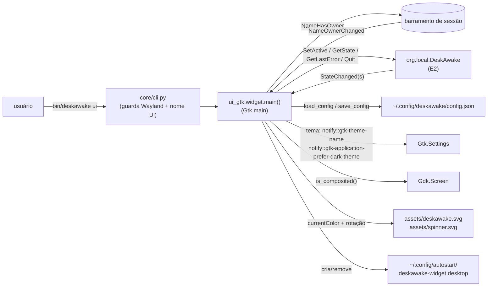

# Design: E4 — UI GTK3 (MATE / X11)

**Feature:** DeskAwake — E4 | **Data:** 2026-11-20 | **Status:** Aprovado (2026-11-20)
**Referência:** [`spec.md`](spec.md) (decisões 1–33, “Fluxo alvo”, “Contratos”, “Aparência” e “Notas ao implementador”), [`DELIVERY_MAP.md`](DELIVERY_MAP.md) §E4, [`design_e1.md`](design_e1.md) (config, posição e ADR-03), [`design_e2.md`](design_e2.md) (contrato D-Bus), [`design_e3.md`](design_e3.md) (guardas, single-instance e `ui_gtk.widget.main()`) e [`visual/design_visual_aprovado.md`](visual/design_visual_aprovado.md) (forma visual e animação aprovadas)

> Este design cobre **somente a E4**. Ele não implementa código de produção, não instala artefatos,
> não altera o daemon, a CLI, a configuração ou o Plasmoid. Em caso de conflito com a `spec.md`, a
> `spec.md` vence. As ambiguidades encontradas foram resolvidas com o usuário em **2026-11-20** e
> estão registradas na §1.1, nas ADRs e na §11.
>
> A forma visual do símbolo, do spinner e o contrato de animação são definidos em
> [`visual/design_visual_aprovado.md`](visual/design_visual_aprovado.md), aprovado em 2026-11-20.
> Neste documento, caminhos `visual/...` são relativos a `docs/implementation/`.
> Este design incorpora esse contrato: os SVGs de `visual/assets/` são a fonte geométrica de verdade
> e devem ser copiados verbatim para `assets/` na implementação. Em conflito, a ordem de autoridade
> é: `spec.md` > `design_e4.md` (arquitetura/comportamento) > `visual/design_visual_aprovado.md`
> (apenas forma visual e movimento).
>
> **Atualização E6/E7 (2026-11-21):** a antiga “E6 — instalador” foi dividida. **E6 = UI GTK/MATE**
> (ajustes A1/A6, paridade visual, créditos e versão) e **E7 = instalação/verificação/READMEs**.
> Onde este documento diz “E6” para instalador, autostart, `.service`, wrapper ou READMEs, leia
> **E7**. A checklist §9.3 foi corrigida: A1 agora tenta correção observando `_NET_SHOWING_DESKTOP`
> com fallback documentado; A2 preserva o filho do `systemd-inhibit` na queda de backend; A3 usa
> `GetInhibitors`/`mate-screensaver-command` em vez de `IsInhibited(8)`. O design da E6 está em
> [`design_e6.md`](design_e6.md).
>
> **Aprovação:** design aprovado pelo usuário em **2026-11-20**, incluindo as seis decisões da
> §1.1, as ADRs 01–15 e a incorporação do pacote visual `visual/design_visual_aprovado.md`.

---

## 1. Contexto e limite da entrega

A E4 entrega o **widget GTK3** que vive na área de trabalho do MATE: pílula 124×42 sem decoração,
atrás das janelas, fora de `Alt+Tab`/barra/pager, arrastável, com menu completo, tema reativo,
posição persistida e feedback de progresso/erro. É a única UI do Mint e a única forma de validar
visualmente o núcleo no X11.

**Inclui (e só isso):**

| Arquivo | Responsabilidade |
|---|---|
| `ui_gtk/__init__.py` | marcador do pacote (vazio) |
| `ui_gtk/widget.py` | janela, hints EWMH, arrasto, toggle, menu, tooltip, posição, tema, conexão D-Bus e loop GTK |
| `ui_gtk/theme.py` | funções puras de decisão de variante, CSS das 3 variantes, paleta, fonte e helpers de SVG |
| `assets/deskawake.svg` | cópia verbatim de `visual/assets/deskawake.svg`: dois arcos circulares abertos + ponto central, 22×22, em `currentColor` |
| `assets/spinner.svg` | cópia verbatim de `visual/assets/spinner.svg`: dois arcos com pontas de seta sólidas + ponto central, 22×22, em `currentColor` |
| `tests/unit/test_theme.py` | testes puros de `resolve_variant`, CSS, paleta e helpers de SVG |
| `tests/unit/test_ui_assets.py` | testes estáticos dos SVGs, dos imports e da ausência de `Gdk` em `core/` |

**Explicitamente fora da E4:**

- Plasmoid e qualquer QML — E5.
- Instalação, `data/*.service`, `.desktop` de autostart, `install.sh`/`uninstall.sh`/`verify.sh` e
  READMEs — E6.
- Wayland: a UI continua bloqueada pela E3; `--force`/`DESKAWAKE_FORCE_UI=1` são apenas depuração.
- Persistência da posição do Plasmoid — não existe; a posição do Plasma é do `appletsrc`.
- Qualquer mudança em `core/config.py`, `core/environment.py`, `core/inhibitors.py`,
  `core/state.py`, `core/daemon.py` ou `core/cli.py`.
- Qualquer membro novo no contrato D-Bus; a E4 consome os métodos/sinais da E2 como estão.
- Qualquer regra de backend, inibição, `systemd-inhibit`, `sleep` ou lógica de estado do daemon.
- Testes automatizados de GUI (a spec proíbe); a validação visual é a checklist manual da §9.3.
- Redesenhar, simplificar ou reinterpretar os SVGs aprovados; eles são copiados verbatim de
  `visual/assets/`.
- Novas dependências de runtime. `pytest` continua sendo dependência de desenvolvimento.

### 1.1 Decisões resolvidas antes do design

As seis decisões abaixo foram confirmadas pelo usuário em **2026-11-20**. Elas fixam pontos que a
spec/mapa deixavam abertos ou em conflito; nenhuma altera as decisões 1–33 sem registro na §11.

| # | Tema | Decisão confirmada |
|---|---|---|
| 1 | Layout 124×42 | **Nome em 10 px semibold**, porque “DeskAwake” em 12 px semibold mede 65–68 px e não cabe com símbolo 22 + toggle 32 + respiro/margens. O layout exato está na §2.4; o texto completo continua visível na fonte Ubuntu/Inter/Noto/Cantarell e só elide no fallback DejaVu. |
| 2 | Variante clara | **Paleta clara espelhada**: superfície `#F0F3F5` a 88% (translúcida) e texto `#20252B`; a variante escura mantém o grafite `#20252B` e o texto `#F0F3F5` da spec. Cores de estado continuam fixas. |
| 3 | Spinner | **O spinner ocupa o lugar do símbolo (22×22)** durante `Toggle`/`SetActive` em voo; o toggle permanece visível e desabilitado. |
| 4 | “Iniciar com o sistema” | **Controla somente o widget**: `~/.config/autostart/deskawake-widget.desktop`. Usa o template da E6 quando existir, garantindo `Exec` absoluto; senão sintetiza uma entrada mínima. O daemon continua sob demanda via `.service`. |
| 5 | Criação do `config.json` | **Na primeira abertura da UI**: se o arquivo não existir, cria com `theme=auto` e a posição padrão resolvida pelas workareas atuais. |
| 6 | Fim do arrasto | **`begin_move_drag` + debounce de 250 ms após o último `configure-event`**: o WM consome o `button-release` durante o movimento; a posição é salva quando o movimento estabiliza e a flag de drag é resetada no mesmo ponto. Se o `button-release` chegar, salva na hora e cancela o debounce. |

A especificação visual aprovada confirma, sem alteração, o layout da §2.4 (nome em 10 px
semibold, slot de 58 px, espaçamento 4 px, margem 1 px, borda 1 px e raio 12 px), a paleta
clara/escura da §4.1, o spinner no slot do símbolo e a regra de que apenas o toggle usa as cores
de estado. A forma exata dos SVGs e o contrato de animação (24 quadros, 15° por quadro, 40 ms,
960 ms por volta, ponto central imóvel) vêm do pacote visual e estão incorporados na §4.8 e na
ADR-11.

---

## 2. Arquitetura

### 2.1 Fluxo de dados



O fluxo é unidirecional: a CLI entrega o processo já com o nome de instância única e o
`SessionBus` integrado ao GLib; o widget é um cliente D-Bus e um consumidor de `core/config.py`.
Ele não fala com backends de tela, não lê cookies e não altera o estado por conta própria — toda
mudança de inibição passa pelo daemon da E2.

### 2.2 Componentes e camadas

- **`ui_gtk/widget.py` — UI e política local**
  - Cria a janela, aplica os hints, monta o layout, trata clique/arrasto/menu e mantém o estado
    visual.
  - Fala D-Bus **somente** pelo contrato público da E2: `NameHasOwner` (leitura de existência),
    `GetState`, `GetLastError`, `SetActive` e `Quit`; assina `StateChanged` e
    `NameOwnerChanged` do daemon.
  - Lê/grava tema e posição via `core/config.py`; nunca escreve estado do daemon no JSON.
  - Carrega os SVGs de `assets/` relativos à raiz calculada por `__file__`.
  - Não faz chamadas de backend, não chama `StartServiceByName` no startup e não bloqueia o loop
    GTK com a verificação assíncrona do KDE (que é do daemon).
- **`ui_gtk/theme.py` — decisão visual pura**
  - Não importa `Gtk`, `Gdk` nem `dbus`; pode reutilizar as constantes puras de `core.config`
    (`PILL_WIDTH`/`PILL_HEIGHT`). Pode ser testado sem display e sem barramento.
  - Expõe `resolve_variant`, `build_css`, `icon_color`, `svg_with_color` e `spinner_frame`,
    além das constantes de paleta, fonte, dimensões e animação (24 quadros/15°/40 ms/960 ms).
  - Gera o CSS completo a cada mudança de variante/compositor; nenhum `@font-face` e nenhuma
    escrita em `gtk-application-prefer-dark-theme`.
- **`assets/deskawake.svg` e `assets/spinner.svg`**
  - São cópias verbatim do pacote visual aprovado (`visual/assets/`) e a fonte única do desenho;
    usam `currentColor` em vez de cores fixas.
  - O símbolo tem dois arcos e o ponto central; o spinner tem os dois arcos com pontas de seta
    **preenchidas** e o ponto central.
  - O widget substitui `currentColor` pela cor de texto da variante ativa. No spinner, gera 24
    quadros com rotação de 15° por quadro (0–345°) em torno de `(11, 11)`; o `<circle>` central é
    mantido **fora** do grupo transformado para não girar (detalhes na §4.8).
- **`core/config.py` (E1) — persistência**
  - Reutilizado sem alteração; a UI é a dona do gatilho de primeiro uso e da validação contra as
    workareas atuais.
- **`core/daemon.py` (E2) — contrato consumido**
  - `DBUS_NAME`, `OBJECT_PATH` e `INTERFACE` são importados de `core.daemon` para não duplicar a
    tabela. `StateChanged` chega com apenas `on|off|error`.
- **`core/cli.py` (E3) — ponto de entrada**
  - `bin/deskawake ui` já registra `DBusGMainLoop(set_as_default=True)`, recusa Wayland e adquire
    `org.local.DeskAwake.Ui` antes de chamar `ui_gtk.widget.main()`.
  - A E4 **não** duplica a guarda Wayland, o `--force`, o `DESKAWAKE_FORCE_UI` nem o
    `RequestName`; ela reutiliza o `SessionBus` singleton da CLI.

**Pontos de entrada:**

- Processo: `bin/deskawake ui` → `core.cli.main(["ui"])` → `ui_gtk.widget.main()`.
- D-Bus consumido: `NameHasOwner`, `GetState`, `GetLastError`, `SetActive`, `Quit`;
  `StateChanged` e `NameOwnerChanged`.
- Arquivos: `~/.config/deskawake/config.json` (leitura/escrita) e
  `~/.config/autostart/deskawake-widget.desktop` (criação/remoção idempotente).

**Camadas:** decisão visual pura em `ui_gtk/theme.py`; política de janela/interação/D-Bus em
`ui_gtk/widget.py`; persistência em `core/config.py`; contrato do daemon em `core/daemon.py`; UI
não conhece backend, cookie ou máquina de estados interna.

### 2.3 Árvore de widgets

```
Gtk.Window  (class: deskawake-window, 124×42, sem decoração)
└── Gtk.Box  (class: deskawake-pill, orientação horizontal, spacing 4,
    │         margem esquerda/direita 1, borda CSS 1)
    ├── Gtk.Stack  (22×22, alinhamento vertical CENTER)
    │   ├── Gtk.Image  (deskawake.svg, 22×22)
    │   └── Gtk.Image  (24 quadros derivados de spinner.svg, 22×22,
    │                   visível só em chamada; ponto central fora da rotação)
    ├── Gtk.Label  (class: deskawake-name, 58×altura natural, texto “DeskAwake”,
    │              10 px semibold, width_chars 8, ellipsize END, alinhamento CENTER)
    └── Gtk.Switch  (32×18, alinhamento vertical CENTER, o único indicador de estado)
```

O menu é um `Gtk.Menu` separado, aberto por clique direito; não faz parte da árvore visual da
pílula. O símbolo e o nome são **neutros**; o track do switch é o único elemento que muda de cor
conforme `on`/`off`/`error`. O `Gtk.Stack` é o componente recomendado pela §5.1 do pacote visual;
as duas páginas são imagens de 22×22 e a troca não redimensiona nem desloca o nome ou o toggle.

### 2.4 Layout exato de 124×42

O conflito aritmético foi fechado com o nome em 10 px semibold. A conta horizontal, incluindo
borda e margens, fecha exatamente em 124 px:

```
margem 1 | borda 1 | símbolo 22 | gap 4 | nome 58 | gap 4 | toggle 32 | borda 1 | margem 1
   1     +   1     +    22      +   4   +   58   +   4   +    32    +   1     +   1    = 124
```

Verticalmente, a área interna é 40 px (42 − 2 de borda); o símbolo de 22 px fica centralizado com
**9 px de respiro acima e abaixo** (1 px de borda + 9 px internos de cada lado). Os 9 px originais
da spec, portanto, permanecem como respiro vertical; horizontalmente, o nome em 10 px permite 4 px
de gap e 1 px de margem. Essa é a leitura confirmada na §1.1.

| Constante | Valor | Origem |
|---|---|---|
| `PILL_WIDTH` / `PILL_HEIGHT` | 124 / 42 | `core.config` / G11 |
| `SYMBOL_SIZE` | 22 | spec / mapa |
| `TOGGLE_WIDTH` / `TOGGLE_HEIGHT` | 32 / 18 | spec / mapa |
| `NAME_SLOT_WIDTH` | 58 | derivado da conta acima |
| `BOX_SPACING` | 4 | derivado (10 px semibold + 124 px) |
| `SIDE_MARGIN` | 1 | derivado (borda + margem) |
| `BORDER_WIDTH` | 1 | “borda fina” |
| `CORNER_RADIUS` | 12 | “cantos arredondados” |
| `NAME_FONT_SIZE` | 10 px | decisão confirmada §1.1 |
| `NAME_FONT_WEIGHT` | 600 (semibold) | spec (peso preservado) |

O rótulo do nome tem `width_request=58`, `width_chars=8` (para a largura natural não estourar o
slot), `ellipsize=END` e `single_line_mode=True`. Na máquina Mint validada, a fonte efetiva é
Ubuntu 10 semibold (54 px) e o texto fica centralizado com 2 px de folga em cada lado; se
Inter/Noto/Cantarell forem usadas, o texto mede 58 px e ocupa a largura inteira; só o fallback
DejaVu Sans (65 px) elide. O texto nunca quebra linha nem empurra o toggle.

O switch recebe `width_request=32`, `height_request=18` e CSS `min-width/min-height`; o slider
interno é 14×14 com raio 7. A pílula tem raio 12 e borda de 1 px, sem gradiente, sombra ou
animação contínua.

### 2.5 Janela e camada Z

- Tipo: `Gtk.WindowType.TOPLEVEL`, `Gdk.WindowTypeHint.UTILITY`, `set_decorated(False)`,
  `set_resizable(False)`, `set_default_size(124, 42)`, `set_size_request(124, 42)`.
- `set_keep_below(True)`, `set_skip_taskbar_hint(True)`, `set_skip_pager_hint(True)` e `stick()`
  são aplicados **antes** de `show_all()` e reaplicados em `realize` e `map`.
- `WindowTypeHint.DESKTOP` é proibido: no Marco ele quebra clique e arrasto.
- `set_accept_focus(False)` e `set_focus_on_map(False)` evitam que o widget roube foco ao ser
  clicado; o contrato da E4 é mouse (clique/arrasto/menu), não teclado.
- Com compositor (`Gdk.Screen.is_composited()` e `get_rgba_visual()` não nulo):
  `set_app_paintable(True)` e visual RGBA; a janela fica transparente e a pílula desenha o fundo
  translúcido com cantos arredondados antialiasados.
- Sem compositor: janela opaca, fundo sólido, sem RGBA; a pílula continua legível e os cantos
  ficam retos (limitação registrada na §10).

### 2.6 Menu

Aberto por clique direito (botão 3) em qualquer ponto da pílula, inclusive sobre o switch; é
reconstruído/atualizado antes de cada `popup_at_pointer`.

| Item | Tipo | Comportamento |
|---|---|---|
| `Ativar` / `Desativar` | `Gtk.MenuItem` | Rótulo dinâmico: `Desativar` quando `on`; `Ativar` quando `off`/`error`. Chama `SetActive(true/false)` de forma assíncrona. |
| `Tema ▸` | submenu | `Automático`, `Claro`, `Escuro` como `Gtk.RadioMenuItem`; marca o valor atual (`auto`/`light`/`dark`), persiste no `config.json` e reaplica o CSS. |
| `Iniciar com o sistema` | `Gtk.CheckMenuItem` | Marcado conforme o arquivo de autostart do widget; cria/remove o `.desktop` de forma idempotente. |
| `Sair` | `Gtk.MenuItem` | `SetActive(false)` → `Quit()` → fecha a UI; se o daemon já caiu, apenas fecha. |

O item de estado e o `Sair` ficam desabilitados enquanto uma chamada D-Bus de estado está em voo;
os itens locais (tema/autostart) continuam disponíveis. O menu recebe a classe
`deskawake-menu` para herdar a `FONT_STACK` do widget. O menu nunca dispara
`StartServiceByName`; as ações chamam `SetActive` direto, permitindo a ativação sob demanda pelo
`.service` da E6.

### 2.7 Fluxo de tema

1. `theme.py` resolve `auto`/`light`/`dark` em `light`/`dark` com
   `resolve_variant(theme, gtk_theme_name, prefer_dark)`.
2. `widget.py` lê `Gtk.Settings.get_default().props.gtk_theme_name` e
   `gtk_application_prefer_dark_theme`, gera o CSS com `build_css(variant, composited)` e o aplica
   a um único `Gtk.CssProvider` no `Gdk.Screen`.
3. O widget assina `notify::gtk-theme-name`, `notify::gtk-application-prefer-dark-theme` e
   `composited-changed`; qualquer um reaplica o CSS **sem reiniciar** e sem escrever
   `gtk-application-prefer-dark-theme` no settings global.
4. O seletor `Tema ▸` muda o valor persistido; `auto` volta a seguir o tema GTK, `light`/`dark`
   forçam a variante.

---

## 3. Modelo de dados

Não há banco, schema, migration ou endpoint HTTP. O “modelo” da E4 é o JSON de configuração
(herdado da E1) e o estado em memória do widget.

### 3.1 Arquivo de configuração

Caminho: `~/.config/deskawake/config.json`, schema da E1:

```json
{
  "version": 1,
  "theme": "auto",
  "position": { "x": 1772, "y": 24 }
}
```

Regras da E4:

- `load_config()` é chamado na abertura. Se `CONFIG_PATH.exists()` for **falso**, a UI cria o
  arquivo imediatamente com `theme=auto` e a posição padrão resolvida pelas workareas atuais
  (monitor primário primeiro, margem 24 px).
- Se o arquivo já existir sem `position`, a UI usa a posição padrão em memória e só grava
  `position` no primeiro arrasto; não inventa uma posição silenciosamente.
- Se o arquivo for corrompido, a E1 cria `.bak` e defaults; a E4 usa os defaults e não reescreve
  por cima além do que a E1 já fez.
- Troca de tema grava `theme` + a posição atual **se** ela validar contra as workareas; se não
  validar, grava somente o tema. O estado do daemon nunca é gravado.
- Arrasto grava a posição somente se `validate_position(pos, workareas) == pos` (ponto dentro de
  algum monitor); caso contrário, não grava e a próxima abertura volta ao padrão.
- Falha de escrita (`OSError`) é ignorada pela UI: o widget continua funcionando em memória.
- Nenhuma chave extra é escrita; a E4 usa `save_config`, que já faz a whitelist e a escrita
  atômica (`tmp` no mesmo diretório + `os.replace`).

### 3.2 Estado em memória

| Objeto | Campos principais | Ciclo de vida |
|---|---|---|
| `DeskAwakeWidget` | janela, pill, símbolo, spinner, nome, switch, menu, provider CSS | da abertura ao fechamento |
| estado visual | `state` (`on`/`off`/`error`), `last_error` | atualizado por `GetState`, `StateChanged`, `NameOwnerChanged` e respostas de ação |
| chamada em voo | `call_pending`, `call_generation`, `spinner_source` | do clique até o reply/erro/timeout; a geração descarta callbacks atrasados |
| tema | `theme_setting` (`auto`/`light`/`dark`), `variant` (`light`/`dark`) | `theme_setting` vem do config; `variant` é derivado |
| compositor | `composited` | lido no startup e em `composited-changed` |
| arrasto | `press_root`, `dragged`, `drag_timeout`, `pending_position` | do `button-press` ao fim do arrasto |
| menu | `toggle_item`, `theme_items`, `autostart_item`, `quit_item` | uma vez; atualizado antes do popup |
| autostart | `AUTOSTART_PATH`, `TEMPLATE_PATH` | constante; arquivo criado/removido sob demanda |
| assets | pixbufs do símbolo e 24 quadros do spinner por variante | cacheados; descartados/regenerados na troca de variante |

Nenhum cookie de inibição, backend ou estado interno do daemon é copiado para a UI. A UI acredita
no estado público (`on|off|error`) e no `GetLastError`.

### 3.3 Migrations

Nenhuma. O schema do `config.json` nasce na versão 1 e continua sob responsabilidade da E1.

### 3.4 Controle de acesso aos dados

Não se aplica multi-tenant. O widget roda na sessão do usuário, usa o barramento de sessão e lê/
grava apenas `~/.config/deskawake/config.json` e `~/.config/autostart/deskawake-widget.desktop`,
ambos do próprio usuário. Nenhum dado sensível, credencial ou cookie é persistido. O nome
`org.local.DeskAwake.Ui` é por sessão e já é adquirido pela E3.

---

## 4. Contratos

### 4.1 `ui_gtk/theme.py` (puro, sem GTK)

```python
# ui_gtk/theme.py
from __future__ import annotations

from core.config import PILL_HEIGHT, PILL_WIDTH

SYMBOL_SIZE = 22
TOGGLE_WIDTH = 32
TOGGLE_HEIGHT = 18
NAME_SLOT_WIDTH = 58
BOX_SPACING = 4
SIDE_MARGIN = 1
BORDER_WIDTH = 1
CORNER_RADIUS = 12
NAME_FONT_SIZE = 10
NAME_FONT_WEIGHT = 600

FONT_STACK = (
    '"Inter", "Ubuntu", "Cantarell", "Noto Sans", "DejaVu Sans", sans-serif'
)

STATE_COLORS = {
    "on": "#80D9A4",
    "off": "#929DA5",
    "error": "#E47F7F",
}

SURFACE = {"light": "#F0F3F5", "dark": "#20252B"}
TEXT = {"light": "#20252B", "dark": "#F0F3F5"}
BORDER_SOLID = {"light": "#C9CED3", "dark": "#3A4148"}
BORDER_COMPOSITED = {
    "light": "rgba(32, 37, 43, 0.16)",
    "dark": "rgba(240, 243, 245, 0.18)",
}
BORDER_HOVER_SOLID = {"light": "#AEB6BD", "dark": "#4A525A"}
BORDER_HOVER_COMPOSITED = {
    "light": "rgba(32, 37, 43, 0.28)",
    "dark": "rgba(240, 243, 245, 0.30)",
}
OPACITY = 0.88

SPINNER_FRAME_COUNT = 24
SPINNER_STEP_DEGREES = 15
SPINNER_INTERVAL_MS = 40
SPINNER_PERIOD_MS = SPINNER_FRAME_COUNT * SPINNER_INTERVAL_MS  # 960 ms
SPINNER_ANGLES = tuple(
    index * SPINNER_STEP_DEGREES for index in range(SPINNER_FRAME_COUNT)
)

def resolve_variant(theme: str, gtk_theme_name: str | None,
                    prefer_dark: bool) -> str: ...
def build_css(variant: str, composited: bool) -> str: ...
def icon_color(variant: str) -> str: ...
def svg_with_color(svg: str, color: str) -> str: ...
def spinner_frame(svg: str, angle: float, color: str) -> str: ...
```

As constantes de dimensão acima são a fonte única do layout: `ui_gtk/widget.py` importa
`SYMBOL_SIZE`, `TOGGLE_WIDTH`, `TOGGLE_HEIGHT`, `NAME_SLOT_WIDTH`, `BOX_SPACING`, `SIDE_MARGIN`,
`BORDER_WIDTH`, `CORNER_RADIUS`, `NAME_FONT_SIZE` e `NAME_FONT_WEIGHT` de `ui_gtk/theme.py`, e
`PILL_WIDTH`/`PILL_HEIGHT` continuam vindo de `core.config`.

**`resolve_variant`:**

- `theme="light"` → `"light"`; `theme="dark"` → `"dark"`.
- `theme="auto"` (ou valor inválido/ausente, por defesa) →
  `"dark"` se `prefer_dark` for verdadeiro **ou** `"dark"` aparecer em
  `gtk_theme_name.lower()`; senão `"light"`.
- `gtk_theme_name=None`/vazio conta como tema claro.
- A comparação é case-insensitive, como o mapa exige (`"my-darkish"` → dark).

**`build_css`:**

- Recebe uma variante já resolvida (`light`/`dark`) e `composited: bool`; variante inválida é erro
  de programação (`ValueError`).
- Gera **todo** o CSS do widget, sem `@font-face` e sem o literal
  `gtk-application-prefer-dark-theme` (nem em comentário).
- Com compositor: superfície em `rgba(SURFACE, 0.88)` e borda em `rgba`; sem compositor:
  superfície e borda em cores sólidas (`#F0F3F5`/`#20252B` e `BORDER_SOLID`), sem `rgba` de
  superfície.
- Inclui a fonte `FONT_STACK`, o nome em 10 px/600, o switch 32×18, o slider 14×14, o raio 12,
  as cores de estado e o hover sutil.
- O CSS do menu usa a mesma `FONT_STACK`, sem impor tamanho.

**`icon_color`:** retorna `TEXT[variant]`, garantindo que símbolo e spinner fiquem neutros e
acompanhem o tema, sem cores fixas de estado.

**`svg_with_color`:** substitui todas as ocorrências de `currentColor` pela cor informada, sem
tocar em outras cores.

**`spinner_frame`:** parte do SVG aprovado do spinner e produz **um quadro** com o giro apenas
das duas setas/arcos. Implementação de referência com `xml.etree.ElementTree` (stdlib):

1. identifica o `<circle>` central (`cx="11"`, `cy="11"`, `r="1.45"`) e o remove temporariamente
   do conjunto que gira;
2. envolve todos os demais elementos (o `<g>` dos arcos e os dois `<path>` das pontas) em
   `<g transform="rotate(angle 11 11)">`;
3. reanexa o `<circle>` **fora** desse `<g>`, depois do grupo;
4. aplica `svg_with_color` com a cor da variante.

O SVG resultante continua válido, com viewBox `0 0 22 22`, e o ponto central não participa da
rotação. `SPINNER_ANGLES` gera os 24 quadros (0°, 15°, …, 345°), em sentido horário; o ponto
central é idêntico em todos eles.

### 4.2 `ui_gtk/widget.py`

```python
# ui_gtk/widget.py
from __future__ import annotations

def main() -> int: ...

class DeskAwakeWidget:
    def __init__(self) -> None: ...
    def show(self) -> None: ...
    # construção/aplicação
    def _build_window(self) -> None: ...
    def _build_menu(self) -> None: ...
    def _apply_theme(self) -> None: ...
    def _apply_window_hints(self) -> None: ...
    # spinner (24 quadros, 15°, 40 ms)
    def _start_spinner(self) -> None: ...
    def _stop_spinner(self) -> None: ...
    def _advance_spinner_frame(self) -> bool: ...
    # D-Bus
    def _subscribe_signals(self) -> None: ...
    def _sync_initial_state(self) -> None: ...
    def _request_state(self) -> None: ...
    def _request_last_error(self) -> None: ...
    def _send_set_active(self, active: bool) -> None: ...
    def _on_state_changed(self, state: str) -> None: ...
    def _on_name_owner_changed(self, name, old_owner, new_owner) -> None: ...
    def _on_call_reply(self, generation: int, state: str) -> None: ...
    def _on_call_error(self, generation: int, error) -> None: ...
    # interação
    def _on_switch_state_set(self, switch, desired: bool) -> bool: ...
    def _on_button_press(self, widget, event) -> bool: ...
    def _on_motion_notify(self, widget, event) -> bool: ...
    def _on_button_release(self, widget, event) -> bool: ...
    def _on_configure(self, widget, event) -> bool: ...
    def _finish_drag(self) -> None: ...
    def _on_popup_menu(self, widget, event) -> bool: ...
    # tema/autostart/posição
    def _on_gtk_theme_changed(self, *args) -> None: ...
    def _on_composited_changed(self, *args) -> None: ...
    def _workareas(self) -> list[tuple[int, int, int, int]]: ...
    def _load_and_initialize_config(self) -> tuple[str, tuple[int, int]]: ...
    def _save_position(self, pos: tuple[int, int]) -> None: ...
    def _save_theme(self, theme: str) -> None: ...
    def _autostart_enabled(self) -> bool: ...
    def _set_autostart(self, enabled: bool) -> None: ...
    # saída
    def _quit(self) -> None: ...
    def _close(self) -> None: ...
```

**`main()`:**

- Chama `DBusGMainLoop(set_as_default=True)` (idempotente; a E3 já chamou), `Gtk.init_check()`,
  cria o widget, mostra e roda `Gtk.main()`.
- `Gtk.init_check()` é lido de forma compatível com as versões do PyGObject (retorno booleano ou
  `(bool, argv)`); se o display não abrir, levanta `RuntimeError` em vez de abortar. Falhas de
  inicialização são propagadas para a E3, que as converte em
  `deskawake: falha ao iniciar a UI` e exit 1.
- Retorna `0` ao fechar normalmente.
- **Não** adquire `org.local.DeskAwake.Ui`; o nome pertence à CLI (E3) e fica preso à conexão
  durante todo o `Gtk.main()`.
- Reutiliza o `SessionBus` singleton criado pela E3; se chamado diretamente, cria o seu.

### 4.3 D-Bus consumido

| Uso | Chamada | Quando | Política |
|---|---|---|---|
| Existência do daemon | `bus.name_has_owner(DBUS_NAME)` | startup e antes de decidir se pode chamar `GetState` | leitura barata; **não** dispara auto-start |
| Estado inicial | `GetState()` | startup, somente se houver dono | assíncrono, timeout 2 s |
| Motivo do erro | `GetLastError()` | ao entrar em `error`, ao reabrir o menu em `error` e ao reaparecer o daemon | assíncrono, timeout 2 s |
| Ligar/desligar | `SetActive(dbus.Boolean(...))` | clique no switch, item do menu | assíncrono, timeout 5 s; permite ativação via `.service` |
| Sair | `Quit()` | item `Sair` e `delete-event` | assíncrono, timeout 2 s; o daemon desativa e encerra |
| Mudança de estado | sinal `StateChanged(s)` | sempre | valores válidos: `on`, `off`, `error` |
| Liveness | sinal `NameOwnerChanged` filtrado por `DBUS_NAME` | sempre | dono sumiu → `off` visual; dono voltou → ressincroniza |

- A UI **não** chama `Toggle` (usa `SetActive` com o estado desejado), **não** chama
  `StartServiceByName` e **não** chama métodos de backend.
- A UI assina `StateChanged` e `NameOwnerChanged` **antes** de `NameHasOwner`/`GetState`, para não
  perder uma transição entre a consulta e a assinatura.
- Se o daemon não existir no startup, a UI mostra `off` e **não** chama `GetState`; a próxima ação
  chama `SetActive` direto e deixa o `.service` da E6 ativar o daemon.
- Toda chamada assíncrona carrega uma `generation`; callbacks de gerações antigas (daemon caiu,
  nova ação, `Quit`) são descartados.
- Se uma ação falhar, a UI não mostra stack trace: se ainda houver dono, ressincroniza com
  `GetState`; se não houver, aplica `off` imediatamente.

### 4.4 Mapeamento de estado

| Estado do daemon | Switch ativo | Switch sensível | Classe da pílula | Rótulo do menu | Tooltip | Spinner |
|---|---|---|---|---|---|---|
| `off` | `False` | sim (se não houver chamada) | `state-off` | `Ativar` | limpo | oculto |
| `on` | `True` | sim (se não houver chamada) | `state-on` | `Desativar` | limpo | oculto |
| `error` | `False` | sim (se não houver chamada) | `state-error` | `Ativar` | `GetLastError()` | oculto |
| chamada em voo | estado atual | **não** | estado atual | item de estado desabilitado | atual | visível no lugar do símbolo |

- O switch é o **único** indicador de estado: track menta (`#80D9A4`) em `on`, cinza
  (`#929DA5`) em `off`, vermelho (`#E47F7F`) em `error`. O símbolo e o nome permanecem neutros.
- Em `error` o switch fica desligado (`False`) e vermelho; um clique tenta ativar de novo
  (`SetActive(true)`), coerente com `Toggle` em `error` na E2.
- `state-set` **sempre retorna `True`**: o widget não deixa o GTK mudar o switch sozinho; ele
  decide quando aplicar o estado, após o reply ou o `StateChanged`. Isso elimina a alternância
  indevida no fim de um arrasto.
- Durante a chamada em voo, o switch **preserva o último estado conhecido**; o widget não
  antecipa o estado desejado. A mudança visual só ocorre quando o reply ou o `StateChanged`
  chegam.
- O spinner só existe durante a chamada em voo; não há animação contínua em repouso, não há
  âmbar e não há estado de verificação na UI GTK (a verificação de ~6 s é do daemon/KDE).

### 4.5 Interação: clique, arrasto e menu

**Clique esquerdo:**

1. `button-press` grava `(x_root, y_root)`, `dragged=False` e se o press começou sobre o switch.
2. Movimento com o botão pressionado:
   - enquanto a distância euclidiana for **≤ 5 px**, nada acontece;
   - ao passar de 5 px, `dragged=True` e `window.begin_move_drag(button, x_root, y_root, time)`.
3. `button-release`:
   - se `dragged`, suprime a alternância, finaliza o arrasto e retorna `True`;
   - se não houve drag e o press foi sobre o switch, deixa o `Gtk.Switch` emitir `state-set`;
   - se não houve drag e o press foi fora do switch, não faz nada.
4. `state-set`:
   - se `dragged` ou `call_pending`, ignora e retorna `True`;
   - se o estado desejado coincide com o estado atual, retorna `True`;
   - caso contrário, chama `SetActive(desired)` e retorna `True`.
5. `activate` (teclado) é guardado pela mesma flag; teclado não é um requisito da E4, mas não pode
   alternar durante um drag.
6. Os handlers de press/motion/release são ligados à janela **e** ao `Gtk.Switch`; no switch, um
   clique curto retorna `False` para o handler padrão emitir `state-set`, enquanto um drag retorna
   `True` e suprime a alternância. Fora do switch, a janela trata o arrasto e o clique curto não
   dispara ação.

**Arrasto e persistência:**

1. `begin_move_drag` entrega o movimento ao window manager; o cliente normalmente não recebe o
   `button-release` durante o grab.
2. Cada `configure-event` com `dragged=True` cancela o timer anterior e agenda
   `GLib.timeout_add(250, _finish_drag)`.
3. `_finish_drag` lê `window.get_position()`; se `validate_position(pos, workareas) == pos`, grava
   `position` junto com o tema atual; em qualquer caso, reseta `dragged`, `press_on_switch` e
   reaplica o estado visual ao switch. Se o `button-release` chegar antes do timer, salva na hora
   e cancela o timer.
4. A posição só é gravada no fim do arrasto; `configure-event` não grava a cada pixel.

**Menu:**

- Clique direito em qualquer ponto (inclusive switch) abre o menu; o handler retorna `True` para
  não iniciar arrasto nem alternar.
- Antes do popup, a UI atualiza o rótulo `Ativar/Desativar`, marca o tema atual, relê o autostart
  e, se o estado for `error`, atualiza o `GetLastError()`.
- Durante uma chamada em voo, o item de estado e o `Sair` ficam desabilitados; os itens locais
  permanecem utilizáveis.

### 4.6 Posição e workareas

```python
# ui_gtk/widget.py (contrato)
def _workareas(self) -> list[tuple[int, int, int, int]]:
    # Gdk.Screen.get_primary_monitor() primeiro,
    # depois todos os demais monitores em ordem de índice;
    # cada item é Gdk.Screen.get_monitor_workarea(i) -> (x, y, w, h)
    ...

def _load_and_initialize_config(self) -> tuple[str, tuple[int, int]]:
    # 1. load_config()
    # 2. se CONFIG_PATH não existia: save_config({"theme": "auto",
    #    "position": {"x": x, "y": y}}) com default_position(workareas)
    # 3. devolve (theme, validate_position(config.get("position"), workareas))
    ...
```

- A lista de workareas é montada com o **monitor primário primeiro**, conforme a ADR-03 da E1;
  `default_position` usa a primeira entrada.
- A posição é a âncora do **canto superior esquerdo** da pílula; a validação confere o ponto, não
  o retângulo inteiro (contrato da E1).
- A janela é movida para a posição antes de `show_all()`.
- Na troca de tema, a posição só entra no JSON se validar; no arrasto, idem.
- Se um monitor for desconectado, a posição antiga não valida na próxima abertura e o widget volta
  ao padrão (canto superior direito do primário, margem 24 px).

### 4.7 Autostart do widget

```python
# ui_gtk/widget.py (contrato)
AUTOSTART_PATH = Path("~/.config/autostart/deskawake-widget.desktop").expanduser()
TEMPLATE_PATH = Path(__file__).resolve().parent.parent / "data/deskawake-widget.desktop"

def _autostart_enabled(self) -> bool:
    # arquivo ausente -> False
    # Hidden=true ou X-GNOME-Autostart-enabled=false -> False
    # caso contrário -> True
    ...

def _set_autostart(self, enabled: bool) -> None:
    # enabled=False -> unlink(missing_ok=True)
    # enabled=True  -> lê TEMPLATE_PATH se existir; substitui a linha Exec= por
    #                  Exec=<ROOT>/bin/deskawake ui (caminho absoluto);
    #                  remove Hidden=true e garante X-GNOME-Autostart-enabled=true;
    #                  se o template não existir, sintetiza a entrada mínima:
    #                  [Desktop Entry] Type=Application Name=DeskAwake
    #                  Comment=Widget DeskAwake Exec=.../bin/deskawake ui
    #                  Terminal=false X-GNOME-Autostart-enabled=true
    # escrita atômica (tmp no mesmo diretório + os.replace)
    ...
```

- O item controla **somente o widget**. O daemon tem o seu próprio autostart instalado pela E6 e
  continua sendo ativado sob demanda pelo `.service`; desmarcar este item não impede o daemon de
  subir por outro caminho.
- O template da E6, quando existir e for legível, é usado como base, mas o `Exec=` é sempre
  reescrito para um caminho absoluto da raiz atual (`Path(__file__).resolve().parent.parent`),
  para funcionar tanto no repositório quanto em `~/.local/share/deskawake/`. Caminhos com espaços
  são citados com aspas duplas na linha `Exec=`, conforme o formato Desktop Entry; `Hidden=true`
  é removido e `X-GNOME-Autostart-enabled=true` é garantido. Template ilegível cai na síntese.
- Criar/remover é idempotente: marcar duas vezes mantém um arquivo válido; desmarcar duas vezes
  não falha.
- Falha de escrita/remoção reverte o estado visual do checkbox e não abre diálogo; o widget
  continua funcionando.

### 4.8 SVGs e animação do spinner

**Fonte e forma.** Os arquivos `assets/deskawake.svg` e `assets/spinner.svg` são **cópias
verbatim** de `visual/assets/deskawake.svg` e `visual/assets/spinner.svg`, aprovados em
2026-11-20. Não redesenhar, simplificar ou reinterpretar as formas.

| Origem aprovada | Destino na E4 | Uso |
|---|---|---|
| `visual/assets/deskawake.svg` | `assets/deskawake.svg` | símbolo-base exibido em `off`/`on`/`error` |
| `visual/assets/spinner.svg` | `assets/spinner.svg` | base geométrica dos 24 quadros do spinner |
| `visual/preview/*.gif` | — | validação visual; não é lido em runtime |

- `deskawake.svg`: raiz 22×22, viewBox `0 0 22 22`; dois arcos circulares abertos de espessura
  uniforme (raio 8, `stroke-width` 2,2, extremidades arredondadas), dois vãos iguais de **26°**
  em diagonal oposta (simetria de 180°) e um ponto central (`r=1,45`) independente; tudo em
  `currentColor`; **sem** setas.
- `spinner.svg`: raiz 22×22; os mesmos arcos, agora com **duas pontas de seta sólidas**
  (`fill="currentColor"`, sem `stroke`) integradas às extremidades, simétricas por 180°, e o
  ponto central; sem cores de estado.
- Os dois arquivos não têm filtros, sombras, gradientes, fontes ou cores hardcoded de estado.

**Renderização.** O widget lê o SVG, aplica `svg_with_color` com `icon_color(variant)` e carrega
o resultado em `GdkPixbuf.PixbufLoader`. Nada de `Rsvg`/Cairo/PIL.

**Animação aprovada.**

| Parâmetro | Valor |
|---|---|
| Elementos móveis | as duas setas/arcos como um único conjunto |
| Elemento imóvel | ponto central |
| Centro de rotação | `(11, 11)` |
| Incremento por quadro | 15° |
| Quadros | 24 (0°, 15°, …, 345°) |
| Intervalo entre quadros | 40 ms |
| Duração de uma volta | 960 ms |
| Movimento | rotação contínua e linear, sentido horário (ângulos crescentes; eixo Y do SVG para baixo) |
| Cor | neutra, `icon_color(variant)` |
| Slot | 22×22 px |

- Os 24 quadros são gerados por `spinner_frame(spinner_svg, angle, color)` e cacheados por
  variante; o `<circle>` central é reanexado **fora** do `<g transform="rotate(...)">`, portanto
  não gira, não translada e não oscila.
- Um `GLib.timeout_add(40, ...)` cicla os 24 quadros enquanto `call_pending` for verdadeiro;
  o timer começa no frame 0 e avança 15° por tick, completando 960 ms por volta. Ao receber
  reply/erro/timeout, na queda do daemon ou ao fechar a UI, o timer é removido e o
  `Gtk.Stack` volta ao símbolo-base. Não há desaceleração artificial nem animação em repouso.
- A troca símbolo ↔ spinner não redimensiona o slot, não desloca o nome/toggle e não muda a cor;
  ambos usam `icon_color(variant)`.
- Os GIFs em `visual/preview/` são artefatos de validação visual, não dependências de runtime;
  o widget não os lê.

**Não fazer (forma visual):** não colorir o símbolo/spinner com cores de estado; não mover, girar
ou animar o ponto central; não substituir as setas sólidas por contornos; não alterar a inclinação
diagonal dos vãos; não fechar os vãos; não transformar o símbolo em círculo completo; não adicionar
texto, barra, halo ou pulsação; não animar quando não houver chamada pendente.

**Fallback.** O carregamento usa o loader SVG do GdkPixbuf já presente no stack GTK/librsvg das
máquinas validadas; nenhuma dependência nova é instalada. Se o loader falhar, o widget usa uma
imagem vazia e continua funcionando (sem traceback); o defeito fica visível apenas como ausência
do símbolo/spinner.

### 4.9 Mensagens e tratamento de erro

| Situação | Comportamento |
|---|---|
| `error` do daemon | aplica `state-error`, desliga o switch, tooltip com `GetLastError()` (fallback `DeskAwake: erro sem detalhes` se vazio) e limpa ao sair de `error` |
| `GetLastError` falha | mantém o motivo anterior; se não houver, usa o fallback |
| resposta de estado inválida | ignora o valor, mantém o estado atual e para o spinner; sem traceback |
| falha D-Bus em ação | para o spinner; se o dono ainda existe, ressincroniza com `GetState`; senão aplica `off` |
| daemon ausente no startup | `off` visual; não chama `GetState`; próxima ação tentará `SetActive` via `.service` |
| daemon ausente durante a sessão | `NameOwnerChanged` aplica `off`, limpa erro, para o spinner e invalida callbacks pendentes |
| daemon reaparece | ressincroniza `GetState` e, se `error`, `GetLastError` |
| falha ao salvar config/autostart | ignora/silencia; UI continua; no autostart, o checkbox reverte |
| `kill -9` no daemon | o widget recebe `NameOwnerChanged`, vai para `off` e não fica preso no spinner |

Mensagens de diagnóstico em pt-BR; tokens de estado sempre `on`/`off`/`error`.

---

## 5. Decisões técnicas (ADRs)

### ADR-01: Layout 124×42 com nome em 10 px semibold

- **Contexto:** “DeskAwake” em 12 px semibold mede 65–68 px (Ubuntu 65, Inter/Noto/Cantarell 68,
  DejaVu 77). Com símbolo 22 + toggle 32, sobram 70 px; não há espaço para 9 px de respiro e
  margens.
- **Opções consideradas:**
  - A: manter 12 px e alargar a pílula — mantém a tipografia, mas contraria G11/124×42.
  - B: manter 12 px e elidir — mantém o tamanho, mas trunca o nome do produto em 100%.
  - C: reduzir para 10 px semibold — mantém 124×42, o semibold e o nome completo com Ubuntu/
    Inter/Noto/Cantarell; reduz o respiro horizontal para 4 px. **Confirmada pelo usuário.**
  - D: 10 px normal — mantém 9 px de respiro, mas perde o semibold.
- **Decisão:** C, confirmada em 2026-11-20. O nome fica em 10 px/600 em um slot de 58 px; os 9 px
  de respiro permanecem verticalmente ao redor do símbolo.
- **Consequências:** o texto elide apenas no fallback DejaVu; a conta fecha exatamente em 124 px
  (borda 1 + margem 1 + 22 + 4 + 58 + 4 + 32 + margem 1 + borda 1). A checklist manual valida a
  legibilidade.

### ADR-02: Paleta da variante clara

- **Contexto:** a spec só fixa a superfície grafite `#20252B` e o texto `#F0F3F5`, que são a
  variante escura. No Mint validado, `gtk-theme=Squared` e `prefer-dark=false`, então `auto`
  resolve para `light`; sem uma paleta clara, a variante ficaria indefinida.
- **Opções consideradas:**
  - A: espelhar a paleta — superfície `#F0F3F5`, texto `#20252B`, borda neutra; mantém as cores
    de estado fixas e o contraste. **Confirmada pelo usuário.**
  - B: herdar superfície/texto do tema GTK — mais integrado, mas imprevisível e sem garantia de
    contraste.
  - C: manter o grafite nas duas variantes — as três opções de tema quase não teriam efeito.
- **Decisão:** A, confirmada em 2026-11-20. Opacidade de 88% (dentro da faixa 82–90%) quando há
  compositor; cores sólidas quando não há. Bordas sólidas derivadas: `#C9CED3` (clara) e
  `#3A4148` (escura); bordas translúcidas `rgba(32,37,43,0.16)` e `rgba(240,243,245,0.18)`.
- **Consequências:** `auto` no Mint com `Squared` mostra a variante clara; `Mint-Y-Dark` e
  `prefer-dark=true` mostram a escura. As cores de estado continuam iguais nas duas, para o
  estado ser inequívoco.

### ADR-03: Spinner no lugar do símbolo

- **Contexto:** a pílula tem 124 px e o toggle é o único indicador de estado. O spinner precisa
  aparecer apenas durante a chamada em voo, sem redimensionar a pílula e sem esconder o toggle.
- **Opções consideradas:**
  - A: no lugar do símbolo (22×22) — preserva o toggle visível e desabilitado e usa um espaço
    neutro. **Confirmada pelo usuário.**
  - B: no lugar do toggle — o estado atual some durante a chamada.
  - C: sobre o toggle — visualmente carregado em 32×18.
  - D: ao lado do nome — exigiria elidir o nome.
- **Decisão:** A, confirmada em 2026-11-20 e ratificada pela especificação visual. O `Gtk.Stack`
  troca símbolo ↔ spinner; o switch fica insensível durante a chamada e preserva o último estado
  conhecido; o spinner é o asset aprovado, com pontas sólidas e ponto central imóvel.
- **Consequências:** o estado atual continua visível no track do toggle; o spinner é neutro
  (cor do texto) e não usa âmbar. A animação usa **24 quadros de 15°**, intervalo de **40 ms** e
  **960 ms por volta**, em sentido horário, com o ponto central fora do grupo rotacionado.

### ADR-04: Chamadas D-Bus assíncronas

- **Contexto:** o mapa aceita chamadas síncronas curtas, mas exige que o spinner anime durante
  `Toggle`/`SetActive` e que a UI nunca espere os ~6 s de verificação. Uma chamada síncrona no
  thread do GTK congela o loop e o spinner não anima.
- **Opções consideradas:**
  - A: `dbus.Interface` com `reply_handler`/`error_handler` integrados ao GLib — o loop continua,
    o spinner anima, o toggle fica bloqueado; exige geração de chamada para descartar callbacks
    atrasados. **Escolhida.**
  - B: thread de trabalho + `GLib.idle_add` — mais código e risco de concorrência com o GTK.
  - C: chamada síncrona — simples, mas congela o loop e não cumpre “o spinner anima”.
- **Decisão:** A. Timeouts: `SetActive` 5 s; `GetState`/`GetLastError`/`Quit` 2 s. A UI mantém
  `call_pending` e `call_generation`; callbacks de geração antiga são ignorados.
- **Consequências:** o `DBusGMainLoop` precisa estar registrado antes de criar/usar o `SessionBus`
  (a E3 já faz; a E4 repete de forma idempotente). A UI não bloqueia o loop e o spinner é real.

### ADR-05: Janela UTILITY com hints antes de `show_all`

- **Contexto:** a spec exige `keep_below`, `skip_taskbar`, `skip_pager` e `stick()` antes de
  `show_all()`, reforçados em `realize`/`map`; `DESKTOP` quebra clique/arrasto no Marco.
- **Opções consideradas:**
  - A: `TOPLEVEL` + `WindowTypeHint.UTILITY` + os quatro hints — semântica de widget de desktop,
    sem `DESKTOP`. **Escolhida.**
  - B: janela normal + hints — também válida, mas menos explícita.
  - C: `DESKTOP` — proibida no Marco.
- **Decisão:** A, com `set_accept_focus(False)` e `set_focus_on_map(False)` para não roubar foco;
  `realize`/`map` reaplicam os hints. `stick()` é chamado antes de `show_all()` e de novo no
  `map`.
- **Consequências:** o widget não aparece em `Alt+Tab`/taskbar/pager e fica atrás de janelas
  normais. Teclado não faz parte do contrato; o menu e o switch funcionam por mouse.

### ADR-06: Arrasto com threshold e fim por debounce

- **Contexto:** o mapa exige threshold de 5 px, `begin_move_drag` e supressão de `state-set`/
  `activate` até o release. O WM consome o release durante o `begin_move_drag`; salvar só no
  `button-release` pode nunca acontecer.
- **Opções consideradas:**
  - A: `begin_move_drag` + debounce de 250 ms após o último `configure-event`; salva quando o
    movimento estabiliza e reseta a flag no mesmo ponto. Salva na hora se o release chegar.
    **Confirmada pelo usuário.**
  - B: arrasto manual no motion — recebe o release, mas pode tremer e ignora o WM.
  - C: salvar no próximo release/focus — pode nunca salvar.
- **Decisão:** A, confirmada em 2026-11-20. A flag `dragged` é consultada por `state-set` e
  `activate`; o switch volta ao estado do daemon ao final. A gravação só ocorre se a posição
  validar.
- **Consequências:** arrastar sobre o toggle não alterna; clique curto no toggle alterna; a
  posição é salva uma vez por arrasto, não a cada pixel.

### ADR-07: Posição, monitor primário e primeiro uso

- **Contexto:** a E1 fixa `default_position(workareas)` com a primeira workarea como primária e
  não cria o `config.json`; o mapa diz que o gatilho de primeiro uso é da E4.
- **Opções consideradas:**
  - A: criar o config na primeira abertura, com tema `auto` e posição padrão já resolvida.
    **Confirmada pelo usuário.**
  - B: criar somente na primeira alteração (tema/arrasto).
  - C: criar na primeira abertura, só com tema, sem posição.
- **Decisão:** A, confirmada em 2026-11-20. A lista de workareas é montada com
  `get_primary_monitor()` primeiro. Se o arquivo já existia sem posição, a posição padrão fica em
  memória e só é gravada no primeiro arrasto.
- **Consequências:** o primeiro uso deixa um `config.json` válido e reproduzível; a posição
  sobrevive ao logout e é revalidada contra os monitores atuais.

### ADR-08: Autostart do widget com template da E6

- **Contexto:** o menu tem `Iniciar com o sistema`, mas o template `data/deskawake-widget.desktop`
  só nasce na E6. O daemon tem autostart separado e o `.service` cobre a ativação sob demanda.
- **Opções consideradas:**
  - A: controlar só o widget; usar o template da E6 quando existir e sintetizar quando não;
    reescrever o `Exec` para um caminho absoluto. **Confirmada pelo usuário.**
  - B: controlar widget + daemon — desmarcar também tira o daemon do login.
  - C: controlar só o daemon.
- **Decisão:** A, confirmada em 2026-11-20. Arquivo
  `~/.config/autostart/deskawake-widget.desktop`; escrita atômica; remoção idempotente;
  `Hidden=true`/`X-GNOME-Autostart-enabled=false` contam como desabilitado.
- **Consequências:** o menu é útil antes da E6 e continua válido depois; a E6 pode instalar o
  template e o autostart, e o menu apenas reflete/edita o arquivo. O daemon permanece
  independente.

### ADR-09: Tema `auto` e sinais de runtime

- **Contexto:** a decisão 13 fixa `auto` por nome do tema/prefer-dark; o MATE 1.26 não tem
  `color-scheme`; o widget precisa reagir sem reiniciar e sem alterar o tema global.
- **Opções consideradas:**
  - A: ler `Gtk.Settings` e assinar `notify::gtk-theme-name` e
    `notify::gtk-application-prefer-dark-theme`; nunca escrever no settings. **Escolhida.**
  - B: ler apenas no startup — não cumpre “Mint-Y ↔ Mint-Y-Dark sem reiniciar”.
  - C: usar `color-scheme`/chaves do MATE — não existe no MATE 1.26.
- **Decisão:** A. `theme.py` é puro e recebe os valores; `widget.py` só lê e reaplica o CSS.
- **Consequências:** a troca de tema do sistema atualiza a pílula em runtime; `light`/`dark`
  escolhidos no menu ignoram o tema do sistema até o usuário voltar para `auto`.

### ADR-10: Compositor, translucidez e cantos

- **Contexto:** o mapa manda translucidez só com `Gdk.Screen.is_composited()` e superfície opaca
  sem compositor; a pílula tem cantos arredondados.
- **Opções consideradas:**
  - A: com compositor, visual RGBA + janela transparente + CSS `rgba`; sem compositor, janela
    opaca + CSS sólido; cantos retos no fallback. **Escolhida.**
  - B: máscara de forma sempre — mantém cantos arredondados sem compositor, mas com bordas
    serrilhadas e mais código.
  - C: usar `set_opacity()` na janela — proibido pelo mapa (apaga o texto).
- **Decisão:** A. O visual é escolhido no startup; `composited-changed` reaplica o CSS. Se o
  compositor for ligado depois de o widget já estar com visual opaco, a translucidez pode exigir
  reiniciar o widget; a superfície continua sólida e legível.
- **Consequências:** com o Marco compondo (caso validado), a pílula é translúcida e arredondada;
  sem compositor, é sólida e legível, com cantos retos. Não se usa `set_opacity()`.

### ADR-11: SVG com `currentColor` e 24 quadros com ponto central imóvel

- **Contexto:** o símbolo e o spinner precisam acompanhar a cor de texto da variante; os assets
  aprovados usam `currentColor` e não podem ter cores fixas de estado. GTK3 não tem `@font-face`
  nem transformação CSS; `GdkPixbuf` só gira em passos de 90°, e o ponto central não pode girar.
- **Opções consideradas:**
  - A: ler o SVG aprovado, separar o `<circle>` central com `xml.etree.ElementTree`, envolver o
    restante em `<g transform="rotate(angle 11 11)">`, reanexar o círculo fora do grupo e
    pré-renderizar 24 quadros de 15°. **Escolhida e ratificada pela especificação visual.**
  - B: `Gtk.IconTheme` com `FORCE_SYMBOLIC` — depende de nomes `-symbolic` e do tema de ícones.
  - C: desenhar com Cairo — exige dependência/foreign types e duplica o asset.
- **Decisão:** A. Nada de `Rsvg`/Cairo/PIL; o asset aprovado continua sendo a fonte única e o
  teste pode verificar `currentColor`, a rotação e a posição do `<circle>` como XML.
- **Consequências:** a cor acompanha `light`/`dark`; o spinner anima com 24 quadros (15°/40 ms,
  960 ms por volta); o ponto central fica fora do grupo transformado; o loader SVG do GdkPixbuf
  (librsvg já presente no stack GTK) é a única infraestrutura usada.
- **Por que não construir o desenho do zero:** desenhar os arcos/setas em Cairo ou em código
  duplicaria a geometria aprovada, exigiria uma dependência nova (`pycairo`/Cairo não está na
  lista de runtime), dificultaria os testes estáticos e faria a fidelidade visual depender de
  código. O asset é a fonte única; a construção programática fica restrita a **transformar** o
  asset (cor, rotação e cache dos 24 quadros), não a redesenhar a forma.

### ADR-12: Sincronização e liveness sem auto-start

- **Contexto:** a decisão 6/§“Sincronização das UIs” exige `StateChanged` e `NameOwnerChanged`;
  o `status` da CLI não dispara auto-start. A UI não pode acordar o daemon só para desenhar.
- **Opções consideradas:**
  - A: assinar os sinais antes de qualquer consulta; no startup, `NameHasOwner` e só chamar
    `GetState` se houver dono; ações chamam `SetActive` direto para permitir o `.service`.
    **Escolhida.**
  - B: chamar `GetState` direto no startup — poderia ativar o daemon sem necessidade.
  - C: polling — proibido pela spec.
- **Decisão:** A. `NameOwnerChanged` sem dono aplica `off` imediato; com novo dono, ressincroniza.
- **Consequências:** abrir o widget em uma sessão sem daemon não inicia nada; a primeira ação
  reativa via `.service` na E6; a UI reflete mudanças de outros clientes em tempo real.

### ADR-13: `Sair` e fechamento da janela como kill switch

- **Contexto:** a decisão 4 define `Sair` = `SetActive(false)` → `Quit()` → fechar. A janela não
  tem decoração, mas o WM ainda pode enviar `delete-event` (ex.: `Alt+F4`); o problema da spec
  exige nunca deixar o sistema preso depois que o usuário fecha o controle.
- **Opções consideradas:**
  - A: `delete-event` executa o mesmo caminho de `Sair` (kill switch). **Escolhida.**
  - B: fechar só a UI, mantendo o daemon e o estado `on` — deixaria a tela presa sem controle
    visível no MATE.
  - C: ignorar `delete-event` — o usuário não teria como fechar pelo WM.
- **Decisão:** A. Se o daemon já caiu, fecha direto; se existe, tenta `SetActive(false)` (timeout
  de 5 s) e `Quit()` (timeout de 2 s) assíncronos, e fecha de qualquer forma.
- **Consequências:** fechar o widget libera os inibidores (o `Quit` do daemon desativa); a UI não
  trava se o daemon estiver morto. `Sair` e `delete-event` compartilham o mesmo código.

### ADR-14: Rótulos do menu em pt-BR

- **Contexto:** a spec lista `Tema ▸` (`auto`/`light`/`dark`), que são os valores do config, não
  necessariamente os rótulos exibidos; a convenção do projeto é pt-BR para conteúdo escrito.
- **Opções consideradas:**
  - A: rótulos `Automático`, `Claro`, `Escuro`, mantendo `auto`/`light`/`dark` no JSON.
    **Escolhida.**
  - B: rótulos literais `auto`, `light`, `dark` — menos natural para o usuário.
- **Decisão:** A. `Ativar`/`Desativar`, `Tema`, `Iniciar com o sistema` e `Sair` ficam em pt-BR,
  como o resto da UI.
- **Consequências:** o valor persistido continua estável para a E1; a UI fala a língua do produto.

### ADR-15: Testes puros, sem GUI

- **Contexto:** a spec proíbe testes automatizados de GUI, mas o gate G-E4 exige testes puros de
  tema/CSS e a verificação de imports.
- **Opções consideradas:**
  - A: concentrar a lógica testável em `theme.py` (sem GTK) e testar CSS/SVG/`resolve_variant` em
    `tests/unit/test_theme.py`; testar assets/imports em `tests/unit/test_ui_assets.py`; não
    instanciar `Gtk.Window`. **Escolhida.**
  - B: usar `GDK_BACKEND=dummy` e instanciar a janela — ainda seria teste de GUI, proibido.
- **Decisão:** A. `theme.py` só usa stdlib; `widget.py` importa GTK mas não é inicializado nos
  testes. O import é verificado em subprocesso.
- **Consequências:** a suíte roda headless e rápido; a aparência real fica na checklist manual.

---

## 6. Fluxos detalhados

### 6.1 Abertura

1. A E3 já registrou `DBusGMainLoop`, recusou Wayland (salvo force), adquiriu
   `org.local.DeskAwake.Ui` e chamou `ui_gtk.widget.main()`.
2. `main()` registra `DBusGMainLoop` de novo (idempotente), chama `Gtk.init_check()` e cria o
   widget.
3. O widget obtém o `SessionBus` singleton, assina `StateChanged` e `NameOwnerChanged` antes de
   qualquer consulta.
4. Monta a janela (hints antes de `show_all`), o layout, o menu e o provider CSS.
5. Lê o config; se o arquivo não existia, cria com tema `auto` e posição padrão.
6. Move a janela para a posição validada contra as workareas e mostra.
7. Se `NameHasOwner(DBUS_NAME)` for falso → estado `off`, sem `GetState`. Se verdadeiro →
   `GetState` assíncrono; se `error`, `GetLastError`.
8. Entra em `Gtk.main()`.

### 6.2 Clique no toggle

1. Press esquerdo sobre o switch; a UI registra o ponto e `dragged=False`.
2. Se o usuário soltar sem mover > 5 px, o `Gtk.Switch` emite `state-set(desired)`.
3. `state-set` retorna `True` (o GTK não muda sozinho), marca `call_pending`, desabilita o switch,
   troca o símbolo pelo spinner (24 quadros de 15°/40 ms, ponto central imóvel) e chama
   `SetActive(desired)` com timeout de 5 s. O switch mantém o último estado conhecido; o estado
   desejado não é antecipado.
4. `StateChanged` pode chegar antes do reply; a UI aplica o estado visual, mas mantém o spinner
   até o callback.
5. No reply válido: para o spinner, reabilita o switch, aplica o estado retornado; se `error`,
   busca `GetLastError` e liga o tooltip.
6. No erro/timeout: para o spinner, reabilita; se o daemon ainda existe, ressincroniza com
   `GetState`; senão aplica `off`.

### 6.3 Arrasto

1. Press em qualquer ponto (inclusive switch); guarda `(x_root, y_root)`.
2. Motion > 5 px: `dragged=True`, `begin_move_drag`.
3. `state-set`/`activate` são ignorados enquanto `dragged`.
4. Cada `configure-event` reagenda o timer de 250 ms; o release (se chegar) salva na hora.
5. `_finish_drag` lê a posição, valida contra as workareas, grava `position` + tema se válido,
   reseta as flags e reaplica o estado ao switch.
6. Clique curto fora do toggle não altera nada; clique curto no toggle chama `SetActive`.

### 6.4 Menu

1. Clique direito em qualquer ponto abre o menu; a UI atualiza rótulo/checks e, em `error`,
   atualiza `GetLastError`.
2. `Ativar`/`Desativar` chama `SetActive` (assíncrono) e fecha o menu.
3. `Tema ▸` grava o novo tema no config, reaplica o CSS e fecha.
4. `Iniciar com o sistema` cria/remove o `.desktop` do widget; falha reverte o check.
5. `Sair` segue o fluxo da §6.5.

### 6.5 Sair / fechar

1. `_quit()`: se o daemon não existe, fecha imediatamente.
2. Se existe, chama `SetActive(false)`; no reply ou no erro, chama `Quit()`.
3. No reply/erro do `Quit` (ou após 2 s), `Gtk.main_quit()`.
4. `delete-event` chama `_quit()` e retorna `True`; não há caminho que feche a UI deixando o daemon
   `on` sem intenção.
5. A E3 recupera o retorno de `main()` e sai 0; o nome `org.local.DeskAwake.Ui` é liberado quando
   o processo termina.

### 6.6 Daemon ausente e retorno

- Startup sem dono: `off` visual, sem `GetState`, sem auto-start.
- Dono desaparece durante a sessão: `NameOwnerChanged` aplica `off`, limpa tooltip, para o
  spinner, invalida callbacks pendentes.
- Dono reaparece: a UI ressincroniza com `GetState` e, se `error`, com `GetLastError`.
- A próxima ação chama `SetActive` direto; com o `.service` da E6, o daemon é ativado sob demanda.

### 6.7 Tema e compositor em runtime

- `notify::gtk-theme-name`/`notify::gtk-application-prefer-dark-theme`: relê os valores, resolve a
  variante e reaplica o CSS e os pixbufs.
- `composited-changed`: relê `is_composited()` e reaplica o CSS; o visual RGBA é escolhido no
  startup (a translucidez pode exigir reinício se o compositor for ligado depois).
- O widget nunca escreve `gtk-application-prefer-dark-theme`; só lê.

### 6.8 Autostart

- Antes do popup, o checkbox é marcado se o arquivo existe e não está desabilitado.
- Marcar: lê o template (se houver), reescreve o `Exec` absoluto, garante
  `X-GNOME-Autostart-enabled=true` e grava atomicamente.
- Desmarcar: remove o arquivo; ausência não é erro.
- O item não altera o autostart do daemon nem o `.service`.

---

## 7. Impacto em features/entregas existentes

| Entrega/componente | Impacto |
|---|---|
| **E1 — config/environment** | Reutiliza `load_config`, `save_config`, `default_position`, `validate_position`, `PILL_WIDTH`, `PILL_HEIGHT` e `MARGIN`. A E4 passa as workareas com o primário primeiro (ADR-03 da E1) e é a dona do primeiro uso. Nenhum contrato da E1 muda. |
| **E2 — daemon/inibidores/estado** | Nenhuma mudança. A E4 consome `NameHasOwner`, `GetState`, `GetLastError`, `SetActive`, `Quit`, `StateChanged` e `NameOwnerChanged`; não conhece backend/cookie. |
| **E3 — CLI/launcher** | `ui_gtk.widget.main()` passa a existir e roda o loop; a E3 continua dona da guarda Wayland, do force e do single-instance. A UI reutiliza o `SessionBus` singleton e não pede o nome de novo. |
| **E5 — Plasmoid** | Sem impacto; o Plasmoid é independente e não usa `ui_gtk` nem o `config.json` para posição. |
| **E6 — instalador/docs** | Instala `ui_gtk/` e `assets/` em `~/.local/share/deskawake/`; o template `data/deskawake-widget.desktop` e o autostart do widget passam a existir. A E4 funciona sem o template (sintetiza) e sem `.service` (ações falham com daemon ausente, como esperado). |
| **`core/config.py`** | Sem alteração. O JSON continua com `version`, `theme` e `position`; estado nunca é persistido. |
| **Testes existentes** | Sem alteração; a E4 adiciona `tests/unit/test_theme.py` e `tests/unit/test_ui_assets.py`, sem tocar no conftest. |
| **Sem impacto confirmado** | `LICENSE`, `pyproject.toml`, `plasmoid/`, `data/`, `install.sh`/`uninstall.sh`/`verify.sh`, `core/inhibitors.py`, `core/state.py`, `core/daemon.py`, `core/cli.py`, contrato D-Bus e a árvore de backend. |

---

## 8. Conformidade com os padrões do projeto

- [x] Python ≥ 3.10; stdlib + `python3-gi`/GTK3 + `python3-dbus` já exigidos. Nenhuma dependência
      nova; `pytest` continua dev-only.
- [x] Sem `sudo`, sem empacotamento de distro, sem `.deb`/AUR/Flatpak, sem build backend.
- [x] Sem testes de GUI; a validação visual é a checklist manual da §9.3.
- [x] Pílula 124×42, sem gradiente/sombra, sem animação contínua (G11).
- [x] Forma do símbolo/spinner e animação conforme `visual/design_visual_aprovado.md`:
      assets copiados verbatim, 24 quadros, 15°/40 ms/960 ms, ponto central imóvel.
- [x] Cores de estado fixas: `#80D9A4` (on), `#929DA5` (off), `#E47F7F` (error) (G12).
- [x] Fonte `"Inter", "Ubuntu", "Cantarell", "Noto Sans", "DejaVu Sans", sans-serif` com
      `sans-serif` no fim; sem `@font-face` (G13/G14).
- [x] Persistência só de tema e posição; estado sempre nasce `off` (G9).
- [x] Hints antes de `show_all()` e reforçados em `realize`/`map`; nunca `DESKTOP` (G8 da spec).
- [x] Translucidez somente com `is_composited()`; sem compositor, superfície sólida e legível.
- [x] `Sair`/fechamento executam o kill switch `SetActive(false)` → `Quit()` → fecha.
- [x] Nenhuma chamada a backend/FDO/MATE/GSM/PolicyAgent; nenhum cookie; nenhum
      `xdg-screensaver`.
- [x] Wayland continua bloqueado pela E3; `--force` é só depuração.
- [x] Mensagens/diagnóstico em pt-BR; estados públicos em `on|off|error`.
- [x] Nenhum artefato de spec/design em código, comentários, commits ou PRs; `design_e4.md` é
      versionado em `docs/implementation/`.
- [x] Nenhuma flag de CLI ou variável de ambiente nova; a UI não altera a gramática da E3.

---

## 9. Plano de verificação

### 9.1 Automático

```bash
python3 -m pytest tests/unit/test_theme.py tests/unit/test_ui_assets.py -v
python3 -m pytest tests/unit -q
GDK_BACKEND=dummy python3 -c "import ui_gtk.widget, ui_gtk.theme"
grep -rn "Gdk" core/ || true
```

- `pytest` é instalado pelo desenvolvedor via `apt install python3-pytest` e executado com
  `python3 -m pytest`.
- A suíte da E4 não abre display, não cria janela e não fala com o barramento real.
- `GDK_BACKEND=dummy` é usado apenas no import; `Gtk.init()` não é chamado.
- `grep` em `core/` deve sair vazio (nenhum `Gdk` no núcleo).

### 9.2 Mapa critério de aceite → teste

| Critério E4.4 | Teste |
|---|---|
| `resolve_variant("auto", "Mint-Y-Dark", False) == "dark"` | `test_resolve_variant_dark_name` |
| `resolve_variant("auto", "my-darkish", False) == "dark"` (case-insensitive) | `test_resolve_variant_dark_case_insensitive` |
| `resolve_variant("auto", "Mint-Y", True) == "dark"` | `test_resolve_variant_prefer_dark` |
| `theme="light"` força light | `test_resolve_variant_forced_light` |
| `theme="dark"` força dark | `test_resolve_variant_forced_dark` |
| `auto` com tema claro e sem prefer-dark ⇒ light | `test_resolve_variant_auto_light` |
| CSS gerado não contém `@font-face` | `test_css_has_no_font_face` |
| CSS contém a stack com `sans-serif` no fim | `test_css_font_stack` |
| CSS não escreve `gtk-application-prefer-dark-theme` | `test_css_does_not_touch_prefer_dark` |
| CSS escuro contém as três cores de estado | `test_css_state_colors` |
| CSS claro/escuro contém as superfícies e textos corretos | `test_css_variants` |
| CSS sem compositor é sólido (sem `rgba` de superfície) | `test_css_non_composited_is_opaque` |
| `deskawake.svg` é XML válido, 22×22, com `currentColor`, dois arcos, ponto central e sem cores de estado | `test_symbol_svg` |
| `spinner.svg` é XML válido, 22×22, com `currentColor`, duas pontas sólidas (`fill`, sem `stroke`) e ponto central | `test_spinner_svg` |
| Assets não têm filtros, sombras, gradientes ou cores de estado | `test_assets_have_no_effects` |
| `ui_gtk.widget` e `ui_gtk.theme` importam sem display | `test_modules_import_headless` |
| Nenhum `Gdk` em `core/` | `test_core_has_no_gdk` |
| `svg_with_color` substitui `currentColor` sem tocar nas demais cores | `test_svg_with_color` |
| `spinner_frame` gera XML válido com `rotate(...)` | `test_spinner_frame_rotation` |
| `spinner_frame` mantém o `<circle>` central fora do grupo transformado | `test_spinner_frame_keeps_dot_static` |
| Contrato de animação: 24 quadros, 15°, 40 ms, 960 ms | `test_spinner_animation_contract` |
| `icon_color` acompanha a variante | `test_icon_color` |

### 9.3 Manual — Mint 22.3 MATE/X11 (obrigatório)

Pré-condição: daemon da E2 rodando (`./bin/deskawake daemon` em outro terminal ou o autostart da
E6); a UI é aberta com `./bin/deskawake ui` (depois da E6, `deskawake ui`).

- [ ] Abre no canto superior direito, 24 px de margem, sem decoração.
- [ ] Nome `DeskAwake` aparece completo na fonte Ubuntu, com símbolo 22×22 e toggle 32×18
      alinhados dentro de 124×42.
- [ ] Não aparece em `Alt+Tab`, barra de tarefas nem pager; aparece em **todos** os workspaces
      (criar um segundo workspace).
- [ ] Fica atrás de janelas normais. **“Mostrar área de trabalho” (Ctrl+Alt+D):** a E6 tenta manter o
      widget visível observando `_NET_SHOWING_DESKTOP` e reexibindo-o uma vez; se o WM reocultar,
      houver flicker ou o arrasto quebrar, a limitação é documentada no README (E7).
- [ ] Arrasta de qualquer ponto, **inclusive sobre o toggle**; arrastar > 5 px **não** alterna.
- [ ] Clique no toggle alterna; clique fora não altera.
- [ ] Durante `Toggle`/`SetActive`: spinner de duas flechas, toggle bloqueado, sem âmbar.
- [ ] Compositor do Marco desligado ⇒ superfície sólida e legível; ligado ⇒ translucidez.
- [ ] Posição sobrevive a logout; desconectar monitor externo volta ao padrão.
- [ ] Menu: `Ativar/Desativar`, `Tema ▸`, `Iniciar com o sistema`, `Sair`.
- [ ] `Sair` com ON libera imediatamente (`systemd-inhibit --list` sem `deskawake`;
      `GetInhibitors` vazio; se `mate-screensaver-command` existir, `-q` sem `deskawake`).
      `IsInhibited(8)` **não** é usado (ausente no mate-screensaver 1.26.2).
- [ ] `kill -9` no daemon não deixa `systemd-inhibit` órfão nem tela presa.
- [ ] Com idle/lock do `mate-screensaver` habilitados, ON impede blanking/bloqueio; OFF restaura.
- [ ] Com `Tema ▸ Automático`, `Mint-Y` ↔ `Mint-Y-Dark` atualiza o widget sem reiniciar.
- [ ] Com Inter ausente, usa Ubuntu/Noto Sans sem erro de `@font-face`; o nome não elide nesses
      fallbacks.
- [ ] `error` (ex.: matar `mate-screensaver`) mostra tooltip com título e motivo e **preserva** o
      filho do `systemd-inhibit` (o inibidor MATE é liberado); falha de ativação/verificação libera
      tudo.
- [ ] Suspensão manual funciona com ON (teste destrutivo, **opcional**).
- [ ] Fechar a tampa suspende com ON (requer notebook; a máquina Mint é desktop; **opcional**).

#### 9.3.1 Critérios visuais aprovados (do pacote `visual/`)

**Símbolo-base**

- [ ] Renderiza em 22×22 px sem clipping.
- [ ] Exibe dois segmentos circulares iguais.
- [ ] Exibe dois vãos iguais em orientação diagonal oposta.
- [ ] Exibe o ponto central no centro geométrico.
- [ ] As extremidades dos arcos são arredondadas.
- [ ] O desenho permanece neutro em ON, OFF e ERROR.

**Spinner**

- [ ] Exibe duas setas curvas com preenchimento sólido.
- [ ] As pontas não são desenhadas como linhas ou contornos.
- [ ] Cada ponta está integrada ao eixo do arco correspondente.
- [ ] As duas setas são simétricas e opostas por 180°.
- [ ] Os vãos diagonais continuam visualmente perceptíveis.
- [ ] O ponto central permanece imóvel durante toda a animação.
- [ ] As setas giram como um único conjunto, sem dessincronização.
- [ ] O giro é horário, contínuo e linear; 24 quadros/15°/40 ms/960 ms por volta.

**Widget e estados**

- [ ] A troca de símbolo para spinner não altera a geometria da pílula.
- [ ] O spinner ocupa exatamente o slot de 22×22 px.
- [ ] O toggle continua visível e desabilitado durante a chamada pendente.
- [ ] O toggle preserva o último estado conhecido durante a chamada.
- [ ] Somente o toggle usa as cores de estado (`#80D9A4`, `#929DA5`, `#E47F7F`).
- [ ] As variantes clara e escura alteram apenas as cores neutras conforme a paleta definida.

### 9.4 Gate G-E4

- [ ] `python3 -m pytest tests/unit/test_theme.py tests/unit/test_ui_assets.py -v` verde.
- [ ] `python3 -m pytest tests/unit -q` verde (sem regressão E1–E3).
- [ ] `GDK_BACKEND=dummy python3 -c "import ui_gtk.widget, ui_gtk.theme"` exit 0.
- [ ] `grep -rn "Gdk" core/` vazio.
- [ ] Itens não-destrutivos da checklist manual MATE executados; destrutivos marcados como
      opcionais.
- [ ] Critérios visuais aprovados da §9.3.1 verificados (símbolo, spinner, ponto central imóvel,
      toggle preservando o estado e somente o toggle colorido).
- [ ] Nenhuma dependência nova; `pytest` dev-only.
- [ ] Nenhuma decisão da `spec.md` contrariada; desvios registrados na §11.
- [ ] `docs/implementation/` fora do PR de código (vai em PR/commit `docs:` separado).

### 9.5 O que não é testado automaticamente

- Geometria real, empilhamento do Marco, `Alt+Tab`, `stick()`, arrasto, translucidez, troca de
  tema do sistema, switch 32×18, fidelidade visual dos assets, animação de 24 quadros, ponto
  central imóvel e tooltip. Tudo isso é checklist manual, conforme a decisão 19, o mapa e o
  pacote visual; nenhum teste de GUI é criado.

---

## 10. Riscos e limites conhecidos

1. **Switch 32×18:** o `Gtk.Switch` pode impor um mínimo maior que o CSS; se isso ocorrer, o
   layout pode estourar os 124 px. A checklist manual mede o resultado e a implementação pode
   ajustar o CSS/margens sem mudar o produto.
2. **Hints no Marco:** `UTILITY` + `keep_below` + `stick()` + `skip_*` precisam ser confirmados
   na máquina Mint; a spec já declara esse comportamento como manual.
3. **`stick()` com 1 workspace:** a máquina de validação tem apenas um workspace; o teste exige
   criar o segundo.
4. **Fonte DejaVu:** no fallback extremo, “DeskAwake” mede 65 px e elide no slot de 58 px. É o
   último fallback; nos alvos validados (Ubuntu) não ocorre.
5. **Sem compositor:** a janela é sólida e os cantos ficam retos; a checklist exige apenas
   superfície sólida e legível.
6. **Compositor ligado depois:** o visual RGBA é escolhido no startup; a translucidez pode exigir
   reiniciar o widget. A superfície continua legível.
7. **Release do WM:** o `begin_move_drag` pode consumir o `button-release`; a posição é salva
   pelo debounce de 250 ms. O teste manual confirma que a posição sobrevive ao logout.
8. **`state-set` do GtkSwitch:** o comportamento do sinal é a base da supressão; o retorno `True`
   é testado na checklist manual (arrastar sobre o toggle não alterna).
9. **Sinais de tema do MATE:** `notify::gtk-theme-name`/`prefer-dark` podem não disparar em
   configurações antigas; a troca manual Mint-Y ↔ Mint-Y-Dark é o teste.
10. **`accept_focus(False)`:** teclado não faz parte do contrato; se o menu nativo exigir foco, a
    implementação pode ajustar sem mudar o produto.
11. **Template da E6 ausente:** a E4 sintetiza a entrada de autostart; o `Exec` é sempre absoluto.
12. **`.service` ausente na E4:** com o daemon parado, as ações falham e a UI fica em `off`; isso
    é esperado até a E6 instalar o `.service`.
13. **`GetLastError` repetido:** a E2 atualiza o motivo sem reemitir `StateChanged`; a E4 relê o
    erro ao reabrir o menu em `error`, mas o tooltip pode ficar defasado até lá.
14. **Barramento morre durante a UI:** o default do dbus-python pode encerrar o processo; em
    logout isso é aceitável (mesmo risco já registrado na E3).
15. **Loader SVG:** depende do loader SVG do GdkPixbuf/librsvg já presente no stack GTK das
    máquinas validadas; nenhuma dependência é instalada.
16. **Nome em 10 px:** é um desvio visual confirmado; se a legibilidade não for aceitável na
    checklist, a decisão precisa ser revisitada antes do merge (não silenciosamente).
17. **Animação de 24 quadros:** o timer de 40 ms pode perder frames em máquinas carregadas; o
    detalhe de frame perdido fica na implementação, desde que preserve 15° por quadro, 960 ms
    por volta, sentido horário e ausência de desaceleração. O ponto central precisa continuar
    fora do grupo transformado.
18. **Assets aprovados:** os SVGs de `assets/` são cópias verbatim de `visual/assets/`; qualquer
    redesenho, simplificação ou alteração de geometria exige nova aprovação visual. A prévia em
    `visual/preview/` não é dependência de runtime.

---

## 11. Desvios e decisões vs. `spec.md` / `DELIVERY_MAP.md`

Nenhuma decisão de backend, estado, inibição ou contrato D-Bus é alterada. Os pontos abaixo foram
fechados com o usuário em **2026-11-20** ou são consequência direta do design.

| # | Ponto | Spec/mapa dizia | Leitura fixada | Onde registrar |
|---|---|---|---|---|
| 1 | Nome do widget | 12 px semibold | **10 px semibold** para caber em 124×42; 9 px de respiro preservados na vertical; slot de 58 px | ADR-01; docs/mapa |
| 2 | Respiro horizontal | 9 px | **4 px de gap + 1 px de margem**; a conta fecha em 124 | ADR-01 |
| 3 | Variante clara | só a superfície grafite/texto claro | **`#F0F3F5` + `#20252B`** na variante light; grafite permanece no dark | ADR-02; docs |
| 4 | Spinner | “spinner de duas flechas” | **no slot do símbolo (22×22)**; toggle visível e desabilitado | ADR-03; docs |
| 5 | Autostart | “o `.desktop` de autostart” | **somente o widget** (`deskawake-widget.desktop`); template E6 + síntese; `Exec` absoluto | ADR-08; docs |
| 6 | Primeiro uso do config | gatilho da E4 | **cria na primeira abertura** com tema `auto` e posição padrão | ADR-07; docs |
| 7 | Fim do arrasto | salvar no `button-release` | **debounce de 250 ms** após o último `configure-event`; release antecipado salva na hora | ADR-06; docs |
| 8 | Tipo de janela | `UTILITY`/janela normal | **`UTILITY`** + `accept_focus(False)`/`focus_on_map(False)` | ADR-05 |
| 9 | Chamadas D-Bus | síncronas curtas aceitáveis | **assíncronas** para o spinner animar e o loop não congelar | ADR-04 |
| 10 | Fechamento da janela | `Sair` = kill switch | **`delete-event` também é kill switch** | ADR-13 |
| 11 | Rótulos do tema | `auto`/`light`/`dark` | **`Automático`/`Claro`/`Escuro`** na UI; valores estáveis no JSON | ADR-14 |
| 12 | Cantos sem compositor | cantos arredondados | **retos no fallback opaco**; arredondados/translúcidos com compositor | ADR-10; §10 |
| 13 | Localização do design | `design.md` na pasta do tema (skill) | **`docs/implementation/design_e4.md`**, conforme a instrução do usuário e o padrão E1–E3 | este arquivo |
| 14 | Forma do símbolo/spinner | spec descrevia “círculo aberto com ponto de luz” e “duas flechas circulares” | **assets aprovados em `visual/assets/`**: dois arcos + ponto central; spinner com pontas de seta sólidas + ponto central; 24 quadros/15°/40 ms/960 ms, ponto imóvel | design visual; ADR-03/ADR-11; §4.8 |

A especificação visual aprovada em `visual/design_visual_aprovado.md` é a autoridade para a forma
do símbolo, do spinner e o contrato de animação. Em conflito, a ordem é: `spec.md` >
`design_e4.md` (arquitetura/comportamento) > `visual/design_visual_aprovado.md` (apenas forma e
movimento). Os SVGs aprovados são copiados verbatim; qualquer mudança de geometria exige nova
aprovação visual.

**Observação de processo:** a documentação de implementação (`spec.md`, `DELIVERY_MAP.md`,
`design_e*.md`, `tasks_e*.md` e `visual/`) fica versionada em `docs/implementation/`; ela não é
citada em código/PR de entrega e não é alterada pela E4.

---

## 12. Próximos passos

1. **Design aprovado em 2026-11-20**: as seis decisões da §1.1, as ADRs 01–15 e a incorporação
   do pacote visual estão fechadas.
2. Implementar a E4 exatamente nos contratos acima:
   - `ui_gtk/theme.py` (puro) + testes, incluindo `spinner_frame` com 24 quadros e ponto central
     fora da rotação;
   - `ui_gtk/widget.py` + `ui_gtk/__init__.py`;
   - copiar verbatim `docs/implementation/visual/assets/deskawake.svg` e
     `docs/implementation/visual/assets/spinner.svg` para `assets/`;
   - `tests/unit/test_theme.py` e `tests/unit/test_ui_assets.py`.
3. Rodar o gate G-E4, a checklist manual do Mint e os critérios visuais da §9.3.1.
4. Seguir para a E5 (Plasmoid) ou E6 (instalador/docs), respeitando o empilhamento de branches do
   `DELIVERY_MAP.md`.
