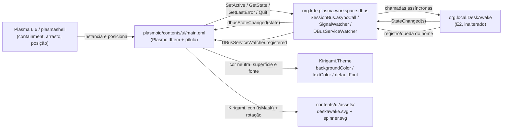
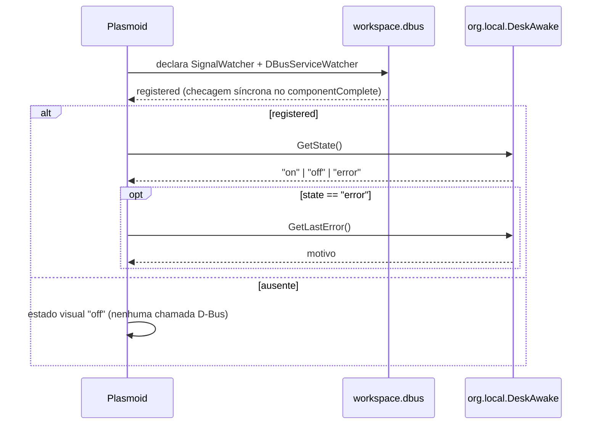

# Design: E5 — Plasmoid KDE Plasma 6.6

**Feature:** DeskAwake — E5 | **Data:** 2026-11-20 | **Status:** Parcialmente superado pelo spec de repaginação de 2026-11-21 (geometria, anatomia, menu e chip adaptativo); o contrato D-Bus, liveness, estados e testes daqui permanecem válidos.

> **Contrato visual/layout a partir de 2026-11-21:** a repaginação do Plasmoid (2026-11-21) está
> consolidada neste design e na `spec.md` — geometria ajustável 168×44→300×84,
> hamburguer com menu, chip adaptativo ao wallpaper e `preview.png` de pacote. As partes deste
> design que descrevem geometria, anatomia, tokens, árvore QML, menu e chip (por exemplo §1.1–1.2,
> §2.1–2.5, §4.2, §4.6, §4.9, §6.4, §9, os ADRs 01/05/06/07/08/09 e as menções a 124×42 na §11)
> permanecem como **histórico do desenho original**. Permanecem válidos o contrato D-Bus (§4.3),
> liveness (§2.6/§4.8), estados/tempos (§4.4–4.5) e os testes estáticos (ADR-10). O
> `design_visual_aprovado.md` (E4) não é alterado.

**Referência:** [`spec.md`](spec.md) (decisões 1–33, “Fluxo alvo”, “Contratos”, “Aparência”, “Notas ao
implementador” e “Variações por distro”), [`DELIVERY_MAP.md`](DELIVERY_MAP.md) §E5,
[`design_e2.md`](design_e2.md) (contrato D-Bus e liveness), [`design_e3.md`](design_e3.md)
(`deskawake ui` é independente do Plasmoid), [`design_e4.md`](design_e4.md) (pílula, tokens e
spinner) e [`visual/design_visual_aprovado.md`](visual/design_visual_aprovado.md) (forma visual e
animação aprovadas).

> Este design cobre **somente a E5**. Ele não implementa código de produção, não instala artefatos,
> não altera o daemon, os inibidores, o backend KDE, a CLI, o `config.json` nem o widget GTK. Em
> caso de conflito com a `spec.md`, a `spec.md` vence. As quatro decisões que a spec/mapa deixavam
> abertas foram confirmadas pelo usuário em **2026-11-20** e estão registradas na §1.1.
>
> **Restrição explícita desta rodada:** a máquina desta sessão é **Ubuntu 26.04.1 LTS + Plasma
> 6.6.7, sessão Wayland** (não mais Mint/MATE). `kpackagetool6` 2.0 e `plasmawindowed` estão
> presentes, então o pacote pode ser instalado, carregado e removido localmente para smoke; a
> validação visual, o arrasto, o tema, o spinner e o backend KDE continuam na checklist manual da
> §9.2, executada pelo usuário nesta máquina. `qmllint` não está instalado. Nenhuma alteração em
> `core/` é permitida ou necessária para a E5.

---

## 1. Contexto e limite da entrega

A E5 entrega o **Plasmoid nativo do Plasma 6.6** que substitui o widget GTK no Kubuntu/Wayland:
pílula redimensionável (168×44→300×84) com hamburguer/menu e chip adaptativo ao wallpaper, mesmo
contrato D-Bus da E2, transporte nativo
`org.kde.plasma.workspace.dbus`, arrasto nativo do containment e menu enxuto. Nenhuma linha de QML
pode depender de `Plasma5Support`, `gdbus`, `DataSource` ou polling.

**Inclui (e só isso):**

| Arquivo | Responsabilidade |
|---|---|
| `plasmoid/metadata.json` | Metadados do pacote KPackage, requisito de Plasma ≥ 6.4 e identidade do applet |
| `plasmoid/contents/ui/main.qml` | UI redimensionável 168×44→300×84, chip adaptativo, menu hamburguer, transporte D-Bus, liveness, spinner e estados |
| `plasmoid/contents/ui/assets/deskawake.svg` | Cópia **verbatim** de `docs/implementation/visual/assets/deskawake.svg` (símbolo aprovado) |
| `plasmoid/contents/ui/assets/spinner.svg` | Cópia **verbatim** de `docs/implementation/visual/assets/spinner.svg` (spinner aprovado) |
| `tests/unit/test_plasmoid_assets.py` | Verificação estática (não-GUI) de metadados, proibições, tokens e assets |

**Explicitamente fora da E5:**

- GTK, MATE e X11 — a E4 permanece intocada.
- Qualquer mudança em `core/config.py`, `core/environment.py`, `core/inhibitors.py`,
  `core/state.py`, `core/daemon.py` ou `core/cli.py`.
- Backend KDE (FDO/PowerDevil), cadeia de inibição, cookie, `systemd-inhibit` ou máquina de estados
  do daemon — já entregues na E2 e **não são reabertos** aqui.
- Qualquer membro novo no contrato D-Bus; a E5 consome `SetActive`, `GetState`, `GetLastError`,
  `Quit` e `StateChanged` exatamente como a E2 os expõe.
- `kpackagetool6` (instalação/upgrade com `-t Plasma/Applet`), `install.sh`, `uninstall.sh`,
  `verify.sh`, `.service` e autostart — a instalação é da E6; o Plasmoid só é instalado manualmente
  para validação.
- `config.json`, posição persistida pelo app, `Tema ▸` e `Iniciar com o sistema` no Plasmoid.
- Testes automatizados de GUI (a spec proíbe); a validação visual é manual.
- Traduções (`Messages.sh`/`.po`) e página de configuração (`config.qml`/KConfigXT).

### 1.1 Decisões resolvidas antes do design

As quatro decisões abaixo foram confirmadas pelo usuário em **2026-11-20**. Elas fixam pontos que a
spec/mapa deixavam abertos; nenhuma altera as decisões 1–33 do produto.

| # | Tema | Decisão confirmada |
|---|---|---|
| 1 | Assets do Plasmoid | **Copiar os SVGs aprovados para o pacote** em `plasmoid/contents/ui/assets/` (verbatim de `docs/implementation/visual/assets/`) e renderizar com `Kirigami.Icon` (`isMask: true` + `color`). São dois arquivos novos além da tabela da E5, mas o pacote fica autocontido e a geometria aprovada não é redesenhada. |
| 2 | Fonte do nome | **10→14 px semibold, com a família de `Kirigami.Theme.defaultFont`** (repaginado em 21/11/2026). Sem slot fixo; o nome é dimensionado por interpolação e usa `elide` apenas como segurança para fontes de fallback mais largas. |
| 3 | Superfície da pílula | **Chip adaptativo ao wallpaper** (escuro `#20252B` / claro `#F0F3F5`, a 88% com histerese 0,42/0,58), com borda derivada da tinta e fallback para `Kirigami.Theme.backgroundColor`/`textColor` quando não há amostra válida (repaginado em 21/11/2026). |
| 4 | Spinner de verificação | **Somente após um ON iniciado pelo próprio widget**: timer local de 6000 ms depois de `SetActive(true)` responder `"on"`. Mudanças externas (`StateChanged("on")` de outro cliente) não mostram o spinner de verificação. |

### 1.2 Decisões derivadas (sem alterar produto)

Estas escolhas são consequência direta da spec/mapa, do contrato da E2 ou da aritmética da pílula;
ficam registradas para revisão, mas não são decisões de produto novas.

| Tema | Leitura adotada | Base |
|---|---|---|
| Raiz do Plasmoid | `PlasmoidItem` é a própria `fullRepresentation` (sem `compactRepresentation`), com as seis restrições `Layout.minimum/preferred/maximumWidth/Height` = 168×44 / 184×48 / 300×84 | Decisão 16 (repaginada em 21/11/2026) |
| Fundo do applet | `Plasmoid.backgroundHints: PlasmaCore.Types.NoBackground` | A pílula desenha a própria superfície; o fundo nativo adicionaria sombra/forma |
| Ação de estado | A UI chama `SetActive(bool)`, nunca `Toggle` | Coerente com a E4; idempotente e seguro se outro cliente mudar o estado |
| Menu | `Plasmoid.contextualActions` com `PlasmaCore.Action` **e** `PlasmaComponents.Menu` no hamburguer, reutilizando os mesmos objetos de ação; itens nativos do Plasma não são recriados nem removidos | Decisão 16 (repaginada em 21/11/2026) e E5.3 do mapa |
| `Sair` | `SetActive(false)` → `Quit()`; **não remove o widget** da área de trabalho; se o daemon já caiu, apenas fecha o menu | E5.3 item 9 e E5.4 (“Remover o widget não desliga o estado de outros clientes”) |
| Tooltip | `PlasmaCore.ToolTipArea` na pílula; motivo do erro via `GetLastError()`; `PlasmoidItem.toolTip*` só alimenta o painel | Decisão 12/16; o containment de desktop não consome `PlasmoidItem.toolTip*` |
| Configuração | Sem `config.qml`/KConfigXT; “Configurar” nativo aparece, mas sem categorias | Fora de escopo; a spec pede o item e a limitação será documentada na E6 |
| Metadados | `Icon: preferences-system-power-management`, `Category: System Information`, `License: MIT`, `Version: 0.1.0` | E5 exige os campos, não fixa valores; escolha visual neutra |
| Verificação | Constante local `verifyWindowMs = 6000`, igual a `VERIFY_DELAY` da E2; sem sinal D-Bus novo | Decisão 33 (“o spinner é visual (timer/estado local na UI)”) |

### 1.3 Hidratação contra o Plasma 6.6.7 instalado (2026-11-20)

Esta rodada foi executada em **Ubuntu 26.04.1 LTS + Plasma 6.6.7, sessão Wayland**. Além da leitura
do código-fonte do Plasma 6.6.7 (`libplasma` e `plasma-workspace`), foi instalado e removido um
pacote-sonda temporário `org.local.deskawake.probe` com `kpackagetool6`, carregado com
`plasmawindowed`. Nenhum arquivo do daemon, do GTK ou do desktop foi alterado.

**Ambiente verificado:** `plasmashell 6.6.7`; `plasma-workspace 6.6.7`; `plasma-desktop 6.6.6`;
`libplasma7`/`libplasmaquick7` 6.6.7; `kpackagetool6 2.0`; `plasmawindowed` presente; `qmllint`
ausente; Kirigami 6.24; Qt 6.10.2. `python3 -m pytest tests/unit` = **192 passed** antes da
implementação e **219** depois dos 27 testes novos nesta branch
(E5 sobre E3); os **233**/**260** só aparecem com a E4 mergeada (`test_theme.py`/`test_ui_assets.py`;
verificado por `git archive` da branch E4).

| Achado | Evidência | Efeito neste design |
|---|---|---|
| `Plasmoid.toolTipMainText`/`Plasmoid.toolTipSubText` não existem no objeto anexado | `toolTip*` está em `PlasmoidItem` (`plasmoidplugin.qmltypes`); `applet.h` tem TODO explícito; applets instalados usam `toolTipMainText`/`toolTipSubText` sem prefixo | Corrigido para `toolTipMainText`, `toolTipSubText` e `toolTipTextFormat: Text.PlainText` |
| `busType: Session` não resolve | O enum é `BusType` no módulo; o exemplo-fonte usa `BusType.Session`; com alias, `DBus.BusType.Session` | Corrigido nos dois watchers |
| `Rectangle` não tem `hovered`; `PlasmoidItem.toolTip*` não é consumido pelo containment de desktop | Hover vem de `ToolTipArea.containsMouse`; no painel, `CompactApplet.qml`/`DefaultCompactRepresentation.qml` consomem `toolTip*`; `BasicAppletContainer.qml` (desktop) não tem `ToolTipArea` | Pílula envolvida por `PlasmaCore.ToolTipArea`; a borda usa `pillToolTip.containsMouse`; `toolTip*` do `PlasmoidItem` fica só para painel/compatibilidade |
| Slots 22/58/32 sem limites | A aritmética de 124 depende de larguras fixas; `RowLayout` pode crescer o `Text` | Adicionadas restrições min/pref/max aos três slots |
| `kpackagetool6 -i ./plasmoid` **sem `-t`** não instala como Plasmoid | Teste real: foi para `~/.local/share/kpackage/generic/`; com `-t Plasma/Applet` foi para `~/.local/share/plasma/plasmoids/` | Todos os comandos passam a usar `-t Plasma/Applet` (inclusive `--upgrade`/`-r`); a E6 deve ser ajustada |
| `Configurar` aparece sem `config.qml` e abre configuração sem categorias | Sonda: `visible=true`, `enabled=true`, `hasConfigurationInterface=true`; `AppletPrivate::init` liga a flag | Mantido (a spec pede o item); limitação documentada nas §4.6/§11 e na E6 |
| `plasmawindowed` não prova 124×42 | Ele abriu 500×500 e esticou o applet; `Layout.minimumWidth` lido foi 124 | Usado só como smoke de carregamento; a pílula é fixada em 124×42 dentro da célula do containment e validada na checklist |
| Célula do containment de desktop maior que a pílula | Teste real: `ItemGeometries=Applet-134:96,1056,128,96` e `root.width/height=128/96`; o `AppletsLayout` usa `minimumItemHeight = gridUnit*3` | A pílula visível é fixada em 124×42 e centralizada no `PlasmoidItem`; as seis restrições `Layout.*` continuam na raiz para painel/compatibilidade |
| `StateChanged` chega como objeto `String` | Com `applyState(state)` estrito, o handler registrava `on` mas `applyState` saía antes de atualizar; o valor é um objeto do motor JS | `dbusStateChanged` e `applyState` normalizam com `String(...)` antes de comparar |
| Baseline 233 não vale nesta branch | `tests/unit` = 192; 233 é E4+E5 | Gate da E5 usa 219 (192 + 27 testes novos); se a E4 for mergeada antes, 260 |
| `qmllint` ausente | `command -v qmllint` vazio | Smoke local via `plasmawindowed`; sem dependência nova |
| Assets aprovados estão em `docs/` | `docs/implementation/visual/assets/*.svg` são a referência aprovada | Teste compara bytes quando presentes e valida SHA-256 dos assets do pacote como piso independente de docs |

**Confirmado sem mudança:**

- `PlasmoidItem` com conteúdo direto e **sem** `fullRepresentation` é suportado:
  `AppletQuickItem::init()` comenta que “the only representation available are whatever items
  defined directly inside PlasmoidItem” e `appletShouldBeExpanded()` retorna `true` nesse caso.
- As seis restrições `Layout.*` na raiz são lidas pelo `BasicAppletContainer.qml`, mas o
  `AppletsLayout` do desktop impõe uma célula mínima maior (observado 128×96); por isso a pílula
  visível é fixada em 124×42 dentro da célula.
- `DBusServiceWatcher` faz a checagem inicial síncrona em `componentComplete()`; `SignalWatcher`
  conecta em `componentComplete()` e o handler é `dbus` + nome do sinal (`dbusStateChanged`).
- O handler do `SignalWatcher` recebe o argumento como objeto `String` do motor JS; a normalização
  com `String(...)` é obrigatória antes das comparações estritas com `on`/`off`/`error`.
- `SessionBus.asyncCall(message, resolve, reject)` existe; o callback recebe `DBusPendingReply` e a
  forma callback não exige `destroy()` (a forma com `finished` exige).
- `PlasmaCore.Action` (export 2.0) é aceito em `Plasmoid.contextualActions`; `Kirigami.Icon.isMask`
  e `Kirigami.Theme.defaultFont` existem; o ícone `preferences-system-power-management` existe no
  Breeze; `X-Plasma-API-Minimum-Version` é chave de topo do `metadata.json`.
- `PlasmaCore.ToolTipArea` carregou como contêiner da pílula no probe, com `textFormat:
  Text.PlainText`, `active` e `containsMouse` disponíveis; o `childMouseEventFilter` do fonte
  apenas esconde o tooltip no press, sem consumir o clique.
- O pacote-sonda com `KPackageStructure: "Plasma/Applet"` instalou, carregou e foi removido com
  `kpackagetool6 -t Plasma/Applet`; `DBusServiceWatcher.registered` ficou `false` sem daemon.

---

## 2. Arquitetura

### 2.1 Fluxo de dados



O fluxo é unidirecional: o Plasmoid é um cliente D-Bus do daemon e um consumidor do tema do
Plasma. Ele **não** fala com backends de tela, não lê cookies, não inibe nada e não grava
`config.json`. Toda a lógica de inibição continua na E2.

### 2.2 Componentes e camadas

- **`plasmoid/metadata.json` — identidade do pacote**
  - `KPackageStructure: "Plasma/Applet"`; `KPlugin.Id` = `org.local.deskawake`;
    `X-Plasma-API-Minimum-Version: "6.4"` (por causa de `SignalWatcher`).
  - Nome, descrição pt-BR, ícone, categoria e licença MIT. Sem `package/` (prefixo de repo-fonte do
    KDE, não do pacote instalado).
- **`plasmoid/contents/ui/main.qml` — UI e política local**
  - Declara os watchers **antes** de qualquer consulta; mantém o estado visual `on|off|error`,
    `lastError`, `callPending` e `verifying`.
  - Fala D-Bus somente pelo módulo nativo do Plasma e pelo contrato público da E2.
  - Desenha a pílula dentro de um `PlasmaCore.ToolTipArea`, além do símbolo/spinner, do nome e do
    toggle; não desenha o fundo nativo do applet.
  - Não faz chamadas de backend, não chama `StartServiceByName` e não bloqueia o loop do Plasma.
- **`plasmoid/contents/ui/assets/*.svg` — forma aprovada**
  - Cópias verbatim de `docs/implementation/visual/assets/`; nenhum redesenho, recoloração fixa ou
    edição de caminhos.
  - São carregadas com `Qt.resolvedUrl("assets/...")`, então continuam válidas depois de
    `kpackagetool6 -t Plasma/Applet -i` (o pacote inteiro é copiado para
    `~/.local/share/plasma/plasmoids/org.local.deskawake/`).
- **`core/daemon.py` (E2) — contrato consumido**
  - `DBUS_NAME`, `OBJECT_PATH` e `INTERFACE` não são importáveis em QML; os valores são repetidos
    como constantes somente leitura no topo do `main.qml` (`org.local.DeskAwake`,
    `/org/local/DeskAwake`, `org.local.DeskAwake`).
  - `StateChanged` chega com apenas `on|off|error`; a UI não conhece `activating`/`deactivating`.
- **Plasma/containment — comportamento nativo**
  - Posição do widget: `ItemGeometries-<W>x<H>` no `appletsrc` (não é do app).
  - Arrasto: `AfterPressAndHold` do containment; “Widgets travados” (`Plasmoid.immutable`) impede o
    movimento e não deve ser contornado.
  - Menu nativo: “Remover widget”, “Configurar” e itens do containment; a E5 só adiciona
    `Ativar/Desativar` e `Sair`.

**Pontos de entrada:**

- Instalação/visualização: `kpackagetool6 -t Plasma/Applet -i ./plasmoid` → plasmashell carrega
  `contents/ui/main.qml` como applet. Sem `-t Plasma/Applet`, o `kpackagetool6` 2.0 instala como
  `KPackage/Generic` em `~/.local/share/kpackage/generic/` (testado nesta máquina); o tipo é
  obrigatório.
- Smoke local de carregamento: `plasmawindowed org.local.deskawake` (janela própria; não valida o
  containment do desktop nem o tamanho fixo — ver §9.2).
- D-Bus consumido: `SessionBus.asyncCall` para `SetActive`, `GetState`, `GetLastError` e `Quit`;
  `SignalWatcher` para `StateChanged`; `DBusServiceWatcher` para liveness.
- Arquivos: apenas os SVGs do próprio pacote. Nenhum `config.json`.

**Camadas:** decisão visual e de interação local no `main.qml`; tema/fonte no `Kirigami.Theme`;
contrato de inibição no daemon (E2); transporte no módulo `org.kde.plasma.workspace.dbus`.
O Plasmoid não tem camada de persistência.

### 2.3 Árvore de itens QML

```
PlasmoidItem  (raiz; fullRepresentation implícita; 124×42 via Layout)
└── PlasmaCore.ToolTipArea  (id: pillToolTip; anchors.fill: parent;
    │                        mainText “DeskAwake”; subText lastError em error;
    │                        textFormat: Text.PlainText; active: state === "error")
    └── Rectangle  (id: pill; anchors.fill: parent; raio 12; borda 1;
        │           superfície do tema a 88%; borda neutra com pillToolTip.containsMouse)
        └── RowLayout  (anchors.fill; margens laterais 1; spacing 4)
            ├── Item  (slot fixo 22×22; min/pref/max = 22; alinhado ao centro)
            │   ├── Kirigami.Icon  (deskawake.svg, 22×22, isMask + cor do texto)
            │   └── Kirigami.Icon  (spinner.svg, 22×22, isMask + cor do texto,
            │                       RotationAnimator 0→360°, 960 ms linear;
            │                       visível só em callPending/verifying)
            ├── Text  (slot fixo 58 px; “DeskAwake”; 10 px semibold;
            │          elide END; centralizado; min/pref/max = 58)
            └── Item  (toggle fixo 32×18; min/pref/max = 32×18;
                │       opacidade 0,6 durante callPending)
                ├── Rectangle  (trilho 32×18, raio 9, cor do estado)
                ├── Rectangle  (botão 14×14, raio 7, cor de fundo do tema;
                │              x = 1 (off/error) ou 17 (on); y = 2)
                └── MouseArea  (só botão esquerdo; enabled: !callPending;
                                cursorShape: PointingHandCursor;
                                onClicked → requestActive(state !== "on"))
```

O menu é um `Plasmoid.contextualActions`; não faz parte da árvore visual. O símbolo, o nome e o
spinner usam a cor de texto do tema; o **trilho do toggle é o único elemento que muda de cor por
estado**. O spinner ocupa o slot do símbolo, sem deslocar nome ou toggle.

### 2.4 Layout exato de 124×42

O layout reaproveita a aritmética aprovada na E4/visual. A conta horizontal, incluindo borda e
margens, fecha exatamente em 124 px:

```
1 (borda) + 1 (margem) + 22 (símbolo) + 4 + 58 (nome) + 4 + 32 (toggle) + 1 (margem) + 1 (borda) = 124
```

- Altura: 42 px; borda 1 px; conteúdo centralizado verticalmente
  (`Layout.alignment: Qt.AlignVCenter` em cada filho do `RowLayout`); raio da pílula 12 px.
- `Layout.minimumWidth`, `Layout.preferredWidth` e `Layout.maximumWidth` = **124**.
- `Layout.minimumHeight`, `Layout.preferredHeight` e `Layout.maximumHeight` = **42**.
- Os três slots internos também são fixos, com `Layout.minimum/preferred/maximum` iguais:
  símbolo **22×22**, nome **58 px** de largura e toggle **32×18**. Sem esses limites, o
  `RowLayout` pode distribuir a sobra e estourar a conta dos 124 px.
- Hover e tooltip vêm do `PlasmaCore.ToolTipArea` que envolve a pílula (`pillToolTip`); a borda
  usa `pillToolTip.containsMouse` (não existe `Rectangle.hovered`) e o tooltip de erro usa
  `mainText`/`subText`/`textFormat` do `ToolTipArea`.
- Nada de `width: 124` solto no `PlasmoidItem`; o containment sobrescreve a raiz, por isso a pílula
  visível tem tamanho próprio (124×42). O conteúdo interno usa `implicitWidth`/`implicitHeight`
  naturais e `elide` no nome.
- No desktop do Plasma 6.6.7, o `AppletsLayout` impõe uma célula mínima maior que 42 px (observado
  128×96). A pílula visível é um `PlasmaCore.ToolTipArea` de 124×42 centralizado no `PlasmoidItem`
  (`anchors.centerIn: parent`, `root.pillWidth`/`root.pillHeight`); as seis restrições `Layout.*`
  continuam na raiz para painel/compatibilidade e o restante da célula fica transparente.
- Em escala fracionária (125%/150%), o slot do nome continua com 58 px lógicos e o texto elide; o
  tamanho total não é recalculado pelo texto.

### 2.5 Tema e cores

| Elemento | Regra |
|---|---|
| Superfície | `Qt.rgba(Kirigami.Theme.backgroundColor.r/g/b, 0.88)`; sem gradiente/sombra |
| Borda | `Kirigami.Theme.textColor` com alpha 0,18; 0,28 quando `pillToolTip.containsMouse` |
| Texto/símbolo/spinner | `Kirigami.Theme.textColor` (o símbolo usa `isMask: true`) |
| Fonte | família de `Kirigami.Theme.defaultFont`; 10 px semibold; `elide: Text.ElideRight` |
| Trilho do toggle | `on` `#80D9A4`; `off` `#929DA5`; `error` `#E47F7F` |
| Botão do toggle | `Kirigami.Theme.backgroundColor` (opaco); raio 7; 14×14 |
| Estado `error` | trilho vermelho, botão à esquerda, tooltip com `GetLastError()` |
| Chamada em voo | toggle preserva o último estado; opacidade 0,6; spinner no slot do símbolo |
| Verificação | trilho `on` (menta), botão à direita, spinner no slot; clique aceito |
| Tooltip | `PlasmaCore.ToolTipArea` (`pillToolTip`): `mainText` “DeskAwake”, `subText` `lastError` em `error`, `textFormat: Text.PlainText`; `active: state === "error"` |
| Fundo do applet | `PlasmaCore.Types.NoBackground` |

Não há leitura de `gtk-theme`, `gtk-application-prefer-dark-theme` ou `color-scheme` no Plasmoid; o
tema é 100% do Plasma. As cores de estado são literais e não dependem do tema.

### 2.6 Watchers e liveness

- `SignalWatcher` (`busType: DBus.BusType.Session`, `service/path/iface` do daemon) com handler
  `function dbusStateChanged(state)`: toda transição pública chega aqui, inclusive a primeira.
- `DBusServiceWatcher` (`watchedService: "org.local.DeskAwake"`, `busType:
  DBus.BusType.Session`) expõe `registered`; a checagem inicial do módulo é síncrona em
  `componentComplete`, então `Component.onCompleted` já pode ler o valor.
- O enum é `BusType` no namespace do módulo; como o import é `as DBus`, a forma correta é
  `DBus.BusType.Session` (não `Session` solto). O handler do `SignalWatcher` é prefixado com
  `dbus` + o nome do sinal (`dbusStateChanged`), conforme o código-fonte do Plasma 6.6.7.
- Declaração dos dois watchers **antes** das funções e do `Component.onCompleted`; o teste estático
  verifica a ordem textual como heurística.
- Queda do nome → visual `off` imediato, sem chamada D-Bus. Retorno → `GetState` + (se `error`)
  `GetLastError`, uma vez por evento, sem polling e sem rajada.
- O primeiro `SetActive` permite a ativação via `.service` da E6; `GetState` **nunca** é chamado
  sem dono, para não acordar o daemon.

---

## 3. Modelo de dados

### 3.1 Schema

Não há schema, tabela, migration ou arquivo de persistência novo. O Plasmoid mantém somente estado
em memória:

```qml
// plasmoid/contents/ui/main.qml (contrato de estado)
property string state: "off"        // "on" | "off" | "error"
property string lastError: ""       // só exibido em error
property bool callPending: false    // SetActive/Quit em voo; bloqueia o toggle
property bool verifying: false      // janela local de ~6 s após ON próprio
property int callToken: 0           // descarta callbacks de gerações antigas
```

- `state` nasce `off` em toda carga; o daemon também nasce `off` (decisão 5).
- `lastError` é limpo ao sair de `error`; `GetLastError()` só é consultado ao entrar em `error` ou
  após uma ação que retorne `error`.
- `callPending` e `verifying` são ortogonais ao estado público e não existem no barramento.

### 3.2 Migrations

Nenhuma. A E5 não toca `~/.config/deskawake/config.json`; a posição do Plasmoid é do Plasma
(`ItemGeometries-<W>xH` no `appletsrc`) e não é migrada nem validada pelo app.

### 3.3 Controle de acesso aos dados

Não se aplica a multi-tenant. O barramento é de sessão, privado do usuário; qualquer cliente da
mesma sessão pode chamar o daemon, mas o Plasmoid só consome o contrato público da E2. Não há
credenciais, cookies ou dados sensíveis no QML.

---

## 4. Contratos

### 4.1 `plasmoid/metadata.json`

```json
{
  "KPackageStructure": "Plasma/Applet",
  "KPlugin": {
    "Id": "org.local.deskawake",
    "Name": "DeskAwake",
    "Description": "Impede que a tela bloqueie ou a máquina suspenda por inatividade.",
    "Icon": "preferences-system-power-management",
    "Category": "System Information",
    "License": "MIT",
    "Version": "0.1.0"
  },
  "X-Plasma-API-Minimum-Version": "6.4"
}
```

- `KPackageStructure` é obrigatório para o `kpackagetool6`.
- `X-Plasma-API-Minimum-Version: "6.4"` é o piso de `SignalWatcher`; no Plasma 6.6.7 desta máquina
  é atendido.
- Sem `X-Plasma-API` legado, sem `package/`, sem `X-Plasma-NotificationArea` (não é widget de
  bandeja).
- Nome/descrição não usam `.po`; a UI é pt-BR, como o restante do produto.

### 4.2 `main.qml` — superfície interna

```qml
// plasmoid/contents/ui/main.qml (contrato; a implementação segue este desenho)
pragma ComponentBehavior: Bound

import QtQuick
import QtQuick.Layouts
import org.kde.plasma.plasmoid
import org.kde.plasma.core as PlasmaCore
import org.kde.kirigami as Kirigami
import org.kde.plasma.workspace.dbus as DBus

PlasmoidItem {
    id: root

    readonly property string serviceName: "org.local.DeskAwake"
    readonly property string objectPath: "/org/local/DeskAwake"
    readonly property string ifaceName: "org.local.DeskAwake"
    readonly property int verifyWindowMs: 6000

    property string state: "off"          // "on" | "off" | "error"
    property string lastError: ""
    property bool callPending: false
    property bool verifying: false
    property int callToken: 0

    Layout.minimumWidth: 124
    Layout.preferredWidth: 124
    Layout.maximumWidth: 124
    Layout.minimumHeight: 42
    Layout.preferredHeight: 42
    Layout.maximumHeight: 42

    Plasmoid.backgroundHints: PlasmaCore.Types.NoBackground
    toolTipMainText: "DeskAwake"
    toolTipSubText: root.state === "error" ? root.lastError : ""
    toolTipTextFormat: Text.PlainText
    // No desktop, o tooltip real é o PlasmaCore.ToolTipArea; as três propriedades acima
    // alimentam apenas o CompactApplet/painel.

    // 1. DBus.SignalWatcher + DBus.DBusServiceWatcher (antes de qualquer GetState);
    //    ambos com busType: DBus.BusType.Session
    // 2. Timer de verificação (verifyWindowMs)
    // 3. PlasmaCore.ToolTipArea + pílula e filhos (slots fixos)
    // 4. Plasmoid.contextualActions
    // 5. funções: syncFromDaemon, applyState, requestActive, quitDaemon,
    //    requestLastError, startVerification, stopVerification, invalidateCalls
    //    + onRegisteredChanged
    // 6. Component.onCompleted: registrado? sync : applyState("off")
}
```

Contratos das funções internas (sem código de implementação nesta fase):

| Função | Contrato |
|---|---|
| `syncFromDaemon()` | se não houver dono, `applyState("off")`; senão `GetState` uma vez; em `error`, pedir `GetLastError`; ignora resposta de token antigo |
| `applyState(state)` | aceita somente `on`/`off`/`error`; atualiza trilho/rótulo/tooltip; sai de `error` limpando `lastError`; entrada em `error`/`off` para os spinners |
| `requestLastError()` | `GetLastError` somente com dono; preenche `lastError`; nunca exibe diálogo |
| `requestActive(active)` | ignora se `callPending`; cancela verificação; `SetActive` com `"(b)"`; no reply, aplica o estado e, se `active && state == "on"`, inicia a verificação |
| `quitDaemon()` | sem dono, retorna; senão `SetActive(false)` e, ao terminar (sucesso ou erro), `Quit()` se ainda houver dono |
| `startVerification()` | só após ON próprio; `verifying = true` e reinicia o Timer |
| `stopVerification()` | `verifying = false` e para o Timer; idempotente |
| `invalidateCalls()` | incrementa `callToken`, zera `callPending` e `verifying`; usado na queda do daemon |

### 4.3 D-Bus consumido

| Uso | Chamada | Campos da mensagem | Quando | Política |
|---|---|---|---|---|
| Existência | `DBusServiceWatcher.registered` | `watchedService: "org.local.DeskAwake"`, `busType: DBus.BusType.Session` | sempre | leitura barata; **não** dispara auto-start |
| Estado inicial/retorno | `GetState` | `service`, `path`, `iface`, `member: "GetState"`; sem args e sem `signature` | startup e ao registrar o nome | uma vez por evento; só com dono |
| Motivo do erro | `GetLastError` | idem, `member: "GetLastError"` | ao entrar em `error` e após ação que retorne `error` | uma vez; sem polling |
| Ligar/desligar | `SetActive(bool)` | `signature: "(b)"`, `arguments: [new DBus.bool(active)]` | toggle, item de menu e `Sair` | assíncrono; permite ativação via `.service` |
| Sair | `Quit` | sem args e sem `signature` | depois de `SetActive(false)` no `Sair` | assíncrono; ignora falha |
| Mudança de estado | `SignalWatcher` | `busType: DBus.BusType.Session`, `service`, `path`, `iface`; handler `dbusStateChanged(state)` | sempre | valores válidos: `on`, `off`, `error` |
| Liveness | `DBusServiceWatcher` | `watchedService`, `busType: DBus.BusType.Session` | sempre | dono sumiu → `off` visual; dono voltou → sincroniza |

Notas de contrato:

- O campo `signature` do módulo `org.kde.plasma.workspace.dbus` descreve a **assinatura de entrada**
  usada para codificar `arguments`; para uma chamada com um booleano é `"(b)"`, com
  `new DBus.bool(...)`. Chamadas sem argumentos não precisam de `signature` (evita introspecção).
- A forma escolhida é `SessionBus.asyncCall(message, resolve, reject)` (callbacks); o reply é
  gerenciado pelo motor JS e **não** deve ser destruído no callback. A forma que retorna
  `DBusPendingReply` exigiria `destroy()` manual e não é usada.
- A UI **não** chama `Toggle`, `StartServiceByName` nem métodos de backend. O estado desejado é
  sempre explícito em `SetActive`.
- `StateChanged` e o registro do nome são assinados **antes** de `GetState`; o `SignalWatcher`
  conecta no `componentComplete`, e os watchers são declarados como filhos antes do
  `Component.onCompleted`.
- O argumento de `StateChanged` chega ao QML como objeto `String` do motor JS, não como string
  primitiva; `dbusStateChanged` normaliza com `String(state)` e `applyState` com `String(newState)`
  antes das comparações estritas. Sem isso, `on`/`off`/`error` eram descartados.
- Respostas atrasadas de uma geração anterior (daemon caiu, nova ação, `Quit`) são descartadas pelo
  `callToken`.
- `busType` não aceita `Session` solto: o enum é `BusType` do módulo e, com `import ... as DBus`,
  a forma correta é `DBus.BusType.Session`. Confirmado no `qmltypes` e no exemplo-fonte do
  `DBusServiceWatcher`/`SignalWatcher` do Plasma 6.6.7.
- `DBusServiceWatcher` executa `isServiceRegistered` de forma síncrona em `componentComplete()`;
  `SignalWatcher` conecta no mesmo ponto. Declarar os dois antes do `Component.onCompleted` continua
  sendo o contrato (o handler é `dbus` + nome do sinal).

### 4.4 Mapeamento de estado

| Situação | Trilho do toggle | Botão | Rótulo do menu | Tooltip | Slot 22×22 |
|---|---|---|---|---|---|
| `off` | `#929DA5` | esquerda | `Ativar` | vazio | símbolo |
| `on` | `#80D9A4` | direita | `Desativar` | vazio | símbolo |
| `error` | `#E47F7F` | esquerda | `Ativar` | `lastError` | símbolo |
| `callPending` | último estado | último estado | item desabilitado | atual | spinner |
| `verifying` | `#80D9A4` | direita | `Desativar` | vazio | spinner |

- O toggle é o **único** indicador de estado: símbolo, nome e spinner permanecem neutros.
- `error` mantém o toggle desligado e vermelho; um clique tenta ativar de novo (`SetActive(true)`).
- Durante `callPending`, o toggle preserva o último estado conhecido e fica com opacidade 0,6; não há
  antecipação do estado desejado.
- Durante `verifying`, o toggle está em `on` (menta), habilitado, e o clique de desligar é aceito.
- O estado público nunca inclui `activating`/`deactivating`/`verifying`.

### 4.5 Tempos e duas fases de progresso

| Flag | Quando liga | Quando desliga | Bloqueia o toggle? | Spinner? |
|---|---|---|---|---|
| `callPending` | clique em `Ativar/Desativar`, `Sair`, ou reação que chame `SetActive` | reply/erro de `SetActive` (ou queda do daemon) | **sim** | sim, no slot do símbolo |
| `verifying` | reply `"on"` de um `SetActive(true)` iniciado pelo widget | 6000 ms, `StateChanged` `off/error`, nova ação, `Sair` ou queda do daemon | **não** | sim, no slot do símbolo |

- O daemon confirma o KDE de forma assíncrona em ~6 s (`VERIFY_DELAY` da E2); a UI **não** bloqueia
  o loop nem espera a confirmação.
- `SetActive(false)` durante a verificação cancela o spinner de verificação **imediatamente**, antes
  do reply do daemon; o spinner de chamada assume e bloqueia até a resposta.
- Uma falha de confirmação chega como `StateChanged("error")`; a UI para o spinner, pinta o trilho
  de vermelho e mostra o motivo no tooltip. Se o Timer local expirar um instante antes, isso não é
  erro: o estado `on` continua até o daemon se manifestar.
- Não há animação contínua em repouso, âmbar, barra de progresso, texto de “carregando” ou halo.

### 4.6 Menu

- `Ativar/Desativar` (rótulo dinâmico: `Desativar` com `state == "on"`, `Ativar` com
  `off`/`error`), desabilitado enquanto `callPending`.
- `Sair`, desabilitado enquanto `callPending`; se o daemon já caiu, o clique apenas fecha o menu,
  sem diálogo e sem stack trace. Antes do `SetActive(false)`, `quitDaemon()` chama
  `stopVerification()` para o spinner de verificação não sobreviver ao encerramento.
- **Sem** `Tema ▸` e **sem** `Iniciar com o sistema` — exclusivos do menu GTK.
- Itens nativos (`Remover widget`, `Configurar`) vêm do containment; não são recriados nem
  removidos. Não chamar `Plasmoid.removeInternalAction("configure")`.
- `Configurar` **aparece** mesmo sem `config.qml`: a flag `hasConfigurationInterface` nasce
  `true` em `AppletPrivate::init` (sonda: `visible=true`, `enabled=true`). Como não há
  `config.qml`/`main.xml`, a janela de configuração nativa fica sem categorias. Isso é uma
  limitação de UX aceita na E5 (a spec pede o item) e deve ser documentada na E6; a alternativa de
  remover a ação contrariaria a spec e não é adotada.
- O `Sair` **não remove** o widget da área de trabalho; ele desliga o estado e encerra o daemon.
  Remover o Plasmoid manualmente também não desliga o estado de outros clientes.

### 4.7 Assets e spinner

- `deskawake.svg` e `spinner.svg` são cópias **byte a byte** de
  `docs/implementation/visual/assets/`; não redesenhar, simplificar ou recolorir os arquivos.
- O teste estático compara os bytes com `docs/implementation/visual/assets/` quando esse diretório
  existe e, como piso independente de docs, valida o SHA-256 dos dois SVGs do pacote contra os
  hashes aprovados gravados no teste.
- Renderização com `Kirigami.Icon`:
  - `source: Qt.resolvedUrl("assets/deskawake.svg")` ou `"assets/spinner.svg"`;
  - `isMask: true` e `color: Kirigami.Theme.textColor` (ícone monocromático recolorido pelo tema);
  - tamanho 22×22; o `spinner` só fica visível em `callPending || verifying`.
- Rotação do spinner: `RotationAnimator` de 0° a 360°, `duration: 960`, `easing.type:
  Easing.Linear`, `loops: Animation.Infinite`, `running: callPending || verifying`,
  `transformOrigin: Item.Center`. Isso reproduz o ciclo aprovado (24 quadros × 40 ms = 960 ms) de
  forma contínua e linear no QML.
- O ponto central do `spinner.svg` é um círculo centrado em (11, 11); girar o conjunto em torno do
  centro mantém o ponto visualmente imóvel (um círculo centrado é invariante à rotação). Se a
  validação manual exigir separação física, a correção futura seria uma camada estática, fora do
  escopo da E5.
- A troca símbolo ↔ spinner não altera a geometria, o nome nem o toggle.

### 4.8 Erros, ausência e retorno do daemon

- Nenhum caminho mostra diálogo, stack trace ou `console.error` cru; falhas de chamada são
  silenciosas para o usuário e registradas com `console.warn` para diagnóstico.
- Se uma ação falhar e o daemon ainda existir, a UI ressincroniza com `GetState` (uma vez); se não
  existir, aplica `off`.
- Queda do nome: `invalidateCalls()` + `applyState("off")` + `lastError = ""`; nenhuma chamada
  D-Bus. A próxima ação chama `SetActive` direto e reativa o daemon via `.service` da E6.
- Retorno do nome: uma sincronização por evento (`GetState`, e `GetLastError` se `error`), sem
  polling e sem retry em rajada.
- `Component.onDestruction` não chama D-Bus; remover o widget não é kill switch. O `Sair` é o kill
  switch explícito.

### 4.9 Ordem do arquivo (para o teste heurístico)

`main.qml` segue esta ordem para que o teste estático consiga provar a regra “watchers antes de
`GetState`”:

1. `pragma ComponentBehavior: Bound` e imports;
2. `PlasmoidItem` e constantes/propriedades de estado;
3. as seis restrições `Layout.*` e as propriedades `Plasmoid.*`;
4. `DBus.SignalWatcher`;
5. `DBus.DBusServiceWatcher`;
6. `Timer` de verificação;
7. árvore visual (`PlasmaCore.ToolTipArea`, pílula, símbolo/spinner, nome, toggle);
8. `Plasmoid.contextualActions`;
9. funções internas;
10. `Component.onCompleted`.

O teste é **heurístico e documentado como tal**: ele verifica a ordem textual dos tokens, não a
execução.

---

## 5. Decisões técnicas (ADRs)

### ADR-01: `PlasmoidItem` como full representation, com tamanho fixo e sem fundo nativo

- **Contexto:** é um widget de área de trabalho fixo em 124×42, sem decoração, sombra ou
  redimensionamento; o containment posiciona e desenha o fundo nativo por padrão.
- **Opções consideradas:**
  - A: `PlasmoidItem` raiz, sem `compactRepresentation`/`fullRepresentation`, com seis restrições
    `Layout.minimum/preferred/maximum` e `NoBackground`. **Escolhida.**
  - B: `fullRepresentation: Item { ... }` separado — adiciona uma camada sem benefício para um
    widget que só existe no desktop.
  - C: `compactRepresentation` — reservada a painel; o produto é um widget de desktop.
  - D: manter o fundo nativo (`StandardBackground`) — adiciona sombra/forma que contraria a pílula.
- **Decisão:** A. As três larguras = 124 e as três alturas = 42; `Plasmoid.backgroundHints:
  PlasmaCore.Types.NoBackground`; conteúdo com `implicitWidth/Height` e `elide`.
- **Validação no Plasma 6.6.7:** o `AppletQuickItem::init()` confirma que, sem
  `fullRepresentation`, “the only representation available are whatever items defined directly
  inside PlasmoidItem”; `appletShouldBeExpanded()` retorna `true` nesse caso. O
  `BasicAppletContainer.qml` lê `applet.Layout.minimum/preferred/maximumWidth/Height` da raiz,
  então as seis restrições valem no desktop.
- **Consequências:** o tamanho é fixo em todos os monitores/escalas; o widget não é adequado a
  painel; a posição é do Plasma; o teste estático pode provar as seis restrições.

### ADR-02: Transporte nativo com `SetActive`, assinatura de entrada explícita e callbacks

- **Contexto:** a decisão 7 proíbe `Plasma5Support`, `gdbus` e polling; o módulo nativo
  `org.kde.plasma.workspace.dbus` chegou no Plasma 6.2 e o `SignalWatcher` no 6.4. O contrato da E2
  aceita `SetActive(b) → s` e `Toggle() → s`.
- **Opções consideradas:**
  - A: `SessionBus.asyncCall` com `SetActive` e `signature: "(b)"`, em callbacks. **Escolhida.**
  - B: `Toggle()` — depende do estado no momento do processamento e é menos previsível com outro
    cliente; a E4 também usa `SetActive`.
  - C: `gdbus`/shell — proibido pela spec e acopla o widget a um processo externo.
  - D: `Plasma5Support.DataSource` — quebra no Plasma 6.
- **Decisão:** A. A assinatura de entrada é explícita (`"(b)"`) para evitar a introspecção e o
  round-trip extra; chamadas sem argumentos omitem `signature`. Usar a forma
  `asyncCall(message, resolve, reject)`; não destruir o reply no callback.
- **Consequências:** a UI nunca bloqueia; a ativação via `.service` da E6 funciona no primeiro
  `SetActive`; o estado desejado é sempre explícito.

### ADR-03: Watchers antes de consultar, geração de chamadas e liveness sem rajada

- **Contexto:** o `StateChanged` inicial pode ser perdido se a consulta vier antes da assinatura; o
  daemon pode cair no meio de uma chamada; `GetState` não pode acordar o daemon.
- **Opções consideradas:**
  - A: declarar `SignalWatcher` e `DBusServiceWatcher` como filhos antes do `Component.onCompleted`;
    consultar `GetState` somente com `registered`; token por requisição. **Escolhida.**
  - B: consultar `GetState` no startup sem checar o dono — ativaria o daemon sem necessidade.
  - C: polling — proibido.
- **Decisão:** A. `callToken` invalida callbacks de gerações antigas; a queda do nome zera
  `callPending`/`verifying` e aplica `off` sem D-Bus; o retorno sincroniza uma vez por evento.
- **Validação no Plasma 6.6.7:** o `DBusServiceWatcher::componentComplete()` chama
  `checkServiceRegistered()` de forma síncrona; o `SignalWatcher::componentComplete()` conecta os
  sinais e o handler é `dbus` + membro (`dbusStateChanged`). `busType` deve ser
  `DBus.BusType.Session`.
- **Consequências:** abrir o Plasmoid em sessão sem daemon não inicia nada; a primeira ação reativa
  via `.service`; mudanças de outros clientes aparecem em tempo real; sem loops de retry.

### ADR-04: Spinner de verificação local, em duas flags

- **Contexto:** a decisão 33 exige spinner na chamada em voo (bloqueando) e na verificação de ~6 s
  (sem bloquear); o daemon não expõe um sinal de “verificação pendente”, e adicionar um membro novo
  violaria o contrato da E2. A spec diz que o spinner é visual e local.
- **Opções consideradas:**
  - A: timer local de 6000 ms após ON próprio; duas flags (`callPending`, `verifying`).
    **Escolhida.**
  - B: novo sinal D-Bus — mudaria o contrato da E2 e o escopo da E5.
  - C: inferir de `StateChanged("on")` de qualquer origem — mostraria verificação onde ela pode não
    existir.
  - D: um único `busy` — não distingue bloquear de não bloquear e contradiz a decisão 33.
- **Decisão:** A. Só ON iniciado pelo widget inicia a verificação; `SetActive(false)` durante a
  janela para o spinner na hora; `StateChanged` `off/error`, nova ação ou queda do daemon também
  param.
- **Consequências:** a constante `6000` acompanha `VERIFY_DELAY` da E2; alterações futuras no tempo
  do daemon exigem atualizar o QML; a UI nunca bloqueia os 6 s.

### ADR-05: Toggle customizado, MouseArea só no toggle e arrasto nativo

- **Contexto:** o toggle precisa ser 32×18 com cores fixas e o arrasto do Plasmoid é nativo
  (`AfterPressAndHold`); um `MouseArea` na superfície inteira consumiria o press e quebraria o
  arrasto do containment.
- **Opções consideradas:**
  - A: `Item` 32×18 + trilho/botão desenhados + `MouseArea` só no toggle, botão esquerdo.
    **Escolhida.**
  - B: `PlasmaComponents3.Switch` — difícil de fixar em 32×18 e nas cores exatas.
  - C: `MouseArea` na pílula inteira — quebra o arrasto nativo e o menu de contexto.
- **Decisão:** A. A área do toggle consome o clique esquerdo; o restante da pílula é transparente a
  eventos e deixa o containment arrastar. Botão direito no toggle não é consumido, para o menu
  nativo continuar funcionando.
- **Consequências:** o arrasto funciona na pílula, **não garantidamente sobre o toggle** (área de
  32×18); a checklist manual deixa isso explícito. “Widgets travados” continua impedindo o arrasto
  sem contorno.

### ADR-06: Tema do Plasma para superfície/texto/fonte, estado fixo e nome em 10 px

- **Contexto:** a spec exige superfície/texto/fonte do tema no Plasmoid, mas as cores de estado são
  fixas; o nome precisa caber no slot de 58 px e a forma/opacidade da pílula deve ser preservada.
- **Opções consideradas:**
  - A: `Kirigami.Theme.backgroundColor` a 0,88, `textColor` para texto/borda/símbolo, família de
    `defaultFont`, `pixelSize: 10`, semibold. **Escolhida.**
  - B: fundo opaco — perde a translucidez de 82–90% da spec.
  - C: tamanho padrão do tema — “DeskAwake” elide no slot de 58 px.
  - D: cores de estado no símbolo/nome — proibido (“o toggle é o único indicador”).
- **Decisão:** A. A borda é `textColor` com alpha (0,18; 0,28 quando `pillToolTip.containsMouse`);
  o hover vem do `PlasmaCore.ToolTipArea` que envolve a pílula, porque `Rectangle` não tem
  propriedade `hovered` e o containment de desktop não fornece tooltip; o botão do toggle usa
  `backgroundColor` opaco; o trilho usa estritamente `#80D9A4`/`#929DA5`/`#E47F7F`.
- **Consequências:** o Plasmoid acompanha BreezeDark/claro em runtime sem reiniciar; o estado é
  inequívoco nos dois temas; o nome fica completo na fonte Ubuntu/Inter/Noto e elide só em
  fallback; a validação visual é manual.

### ADR-07: Assets copiados e recoloridos por máscara, com rotação de 960 ms

- **Contexto:** a geometria aprovada é obrigatória; o pacote instalado não enxerga `assets/` do
  repositório; `currentColor` não é resolvido de forma confiável por `Image` no Qt; o spinner
  precisa de cor neutra e ciclo aprovado.
- **Opções consideradas:**
  - A: copiar os SVGs para `contents/ui/assets/` e usar `Kirigami.Icon` com `isMask: true` +
    `color`. **Escolhida.**
  - B: desenhar inline com `Shape`/`Canvas` — reimplementa a geometria, proibido.
  - C: caminho relativo ao repo — quebra após `kpackagetool6`.
  - D: ícone do sistema — diverge do símbolo aprovado.
- **Decisão:** A. Cópias verbatim de `docs/implementation/visual/assets/`; `isMask` +
  `Kirigami.Theme.textColor`; `RotationAnimator` 0→360° em 960 ms linear, apenas quando
  `callPending || verifying`.
- **Consequências:** o pacote fica autocontido; o teste estático compara os bytes com
  `docs/implementation/visual/assets/` quando presentes e valida o SHA-256 dos SVGs do pacote como
  piso; a recolorização e o ponto central são validados na checklist manual. Se `isMask` não
  funcionar no Plasma 6.6, a correção futura é uma variante de asset, não um redesenho silencioso.

### ADR-08: Menu via `contextualActions`; `Sair` é kill switch sem remover o widget

- **Contexto:** o menu nativo do containment já oferece “Remover widget”/“Configurar”; a spec pede
  só `Ativar/Desativar` e `Sair`, e o `Sair` não pode deixar o sistema preso.
- **Opções consideradas:**
  - A: `Plasmoid.contextualActions` com dois `PlasmaCore.Action`; `Sair` = `SetActive(false)` →
    `Quit()`. **Escolhida.**
  - B: recriar o menu inteiro com `PlasmaExtras`/PopupMenu — duplicaria itens nativos.
  - C: `Sair` remove o applet da área de trabalho — mudaria o comportamento da UI GTK e não é o que
    a spec pede.
- **Decisão:** A. Rótulo dinâmico; ações desabilitadas durante `callPending`; daemon morto → apenas
  fecha o menu; item `Sair` não remove o widget. Não chamar `removeInternalAction("configure")`.
- **Consequências:** o menu é enxuto e nativo; “Configurar” aparece (a flag nasce `true`), mas sem
  `config.qml` a janela fica sem categorias; remover o widget não desliga o estado de outros
  clientes.

### ADR-09: Tooltip nativo via `PlasmaCore.ToolTipArea` no desktop

- **Contexto:** a decisão 12 exige `GetLastError()` visível em `error`; a UI não tem menu de
  contexto próprio para “reabrir e reler”. No Plasma 6.6.7, `PlasmoidItem.toolTipMainText/SubText`
  são consumidos apenas pelo `CompactApplet`/painel e pelo `DefaultCompactRepresentation`; o
  `BasicAppletContainer.qml` do desktop **não** cria `ToolTipArea`. Portanto, o tooltip nativo do
  `PlasmoidItem` não aparece no widget de desktop.
- **Opções consideradas:**
  - A: envolver a pílula em `PlasmaCore.ToolTipArea`, com `mainText`/`subText` e
    `textFormat: Text.PlainText`. **Escolhida.**
  - B: `toolTipItem` customizado — mais código visual e sem requisito de estilo.
  - C: usar só `PlasmoidItem.toolTip*` — não aparece no desktop (só no painel).
  - D: sem tooltip — falha a aceitação de erro.
- **Decisão:** A. `pillToolTip.mainText` = `"DeskAwake"`; `subText` = `lastError` somente em
  `error`; `textFormat: Text.PlainText`; `active: root.state === "error"`; `location:
  Plasmoid.location`. O `containsMouse` do `ToolTipArea` alimenta a borda de hover. As propriedades
  `toolTipMainText`/`toolTipSubText`/`toolTipTextFormat` do `PlasmoidItem` continuam sendo
  preenchidas para o caso de painel/compacto, mas não são a fonte do tooltip no desktop. As
  propriedades não existem no objeto anexado `Plasmoid` (o `applet.h` do Plasma 6.6.7 registra um
  TODO explícito para tooltips no applet).
- **Consequências:** o tooltip segue o estilo do Plasma; não há polling; a validação do conteúdo é
  manual; a pílula ganha um item de contêiner (`ToolTipArea`) que não consome cliques (o
  `childMouseEventFilter` apenas esconde o tooltip no press).

### ADR-10: Testes estáticos; nenhuma GUI automatizada

- **Contexto:** a spec proíbe testes de GUI; a máquina desta rodada é Ubuntu + Plasma 6.6.7, mas o
  gate G-E5 admite verificação estática + checklist manual. O smoke com `plasmawindowed` é manual e
  não vira teste automatizado.
- **Opções consideradas:**
  - A: teste pytest de texto/JSON + checklist manual + smoke `plasmawindowed`. **Escolhida.**
  - B: `qmllint` obrigatório — não está instalado nesta máquina e não valida comportamento.
  - C: harness Qt/Plasma automatizado — seria teste de GUI e contraria a spec.
- **Decisão:** A. `tests/unit/test_plasmoid_assets.py` lê `metadata.json`/`main.qml` como texto,
  valida tokens proibidos/obrigatórios, cores, as seis restrições de layout, os slots 22/58/32, a
  ordem heurística e os assets (bytes contra `docs/...` quando existirem + SHA-256 como piso). Nada
  executa QML.
- **Consequências:** a suíte roda headless no Ubuntu; a linha de base desta branch (E5 sobre E3) é
  **192 passed** antes da implementação e **219** com os 27 testes novos; 233/260 com a E4 mergeada.
  A aparência real, o arrasto, o tema e o backend só fecham na checklist do Plasma (§9.2);
  `plasmawindowed` serve como smoke de carregamento, não como prova de tamanho.

### ADR-11: Metadados neutros e mínimo de API 6.4

- **Contexto:** a spec fixa a estrutura do `metadata.json`, mas não os valores de `Icon`/`Category`;
  o requisito de Plasma é ≥ 6.4 por causa do `SignalWatcher`.
- **Opções consideradas:**
  - A: `Icon: preferences-system-power-management`, `Category: System Information`, `License: MIT`,
    `Version: 0.1.0`, mínimo 6.4. **Escolhida.**
  - B: ícone customizado no pacote — mais um asset sem requisito de produto.
  - C: mínimo 6.0 — `SignalWatcher` não existe em 6.0/6.2/6.3 e o widget falharia silenciosamente.
- **Decisão:** A. Descrição em pt-BR; `Name` fixo “DeskAwake”; sem `X-Plasma-API` legado.
- **Validação no Plasma 6.6.7:** o ícone `preferences-system-power-management` existe no Breeze;
  `X-Plasma-API-Minimum-Version` é chave de topo do `metadata.json`; o pacote-sonda instalou e
  carregou com `kpackagetool6 -t Plasma/Applet` (sem `-t`, foi para o pacote genérico).
- **Consequências:** o widget aparece em “Adicionar widgets” com ícone de energia; em Plasma < 6.4
  não é oferecido; a E6 instala o pacote via `kpackagetool6 -t Plasma/Applet`.

### ADR-12: Strings pt-BR literais, sem catálogo de tradução e sem config UI

- **Contexto:** o produto é pt-BR; a spec fixa os rótulos; não há infraestrutura de `.po` e a E5
  não inclui `config.qml`.
- **Opções consideradas:**
  - A: strings literais em pt-BR; sem `Messages.sh`/`.po`; sem config. **Escolhida.**
  - B: `i18n()` com catálogo vazio — mesma saída, mais infraestrutura sem tradução real.
  - C: config UI só para habilitar “Configurar” — escopo novo sem valor de produto.
- **Decisão:** A. `Ativar`, `Desativar`, `Sair` e a descrição em pt-BR; nenhuma página de
  configuração; o item “Configurar” nativo aparece (a flag nasce `true`), mas sem `config.qml` abre
  a configuração sem categorias — limitação aceita e documentada na E6.
- **Consequências:** a UI não muda com o locale; a E6 documenta a limitação; não há arquivos de
  tradução no pacote.

---

## 6. Fluxos detalhados

### 6.1 Abertura



1. O QML é instanciado; os watchers são criados como filhos e conectam antes do
   `Component.onCompleted`.
2. `registered` já reflete o barramento no `componentComplete` do watcher.
3. Se houver dono, `GetState`; se não, `off` imediato. **Nunca** `StartServiceByName`.
4. Em `error`, `GetLastError` preenche o tooltip. Em `off`/`on`, `lastError = ""`.
5. Nenhuma posição, tema ou estado é lido/gravado em disco pelo app.

### 6.2 Clique no toggle

1. `MouseArea` só aceita botão esquerdo e só dispara se `!callPending`.
2. `requestActive(state !== "on")`:
   - incrementa `callToken`, liga `callPending`, para a verificação;
   - envia `SetActive(active)` com `"(b)"`.
3. Enquanto o reply não chega: spinner no slot do símbolo, toggle preservando o último estado e
   desabilitado (opacidade 0,6).
4. Reply válido:
   - `callPending = false`;
   - `applyState(reply.value)` (o estado só muda quando o daemon confirma);
   - se `active && reply.value == "on"`, `startVerification()`;
   - se `reply.value == "error"`, `requestLastError()`.
5. Reply inválido/erro: `callPending = false`; se houver dono, `syncFromDaemon()`; senão, `off`;
   `console.warn` para diagnóstico; sem diálogo.
6. Clique fora do toggle não alterna nada; press-and-hold fora do toggle é do containment.

### 6.3 Verificação assíncrona (três rotas)

- **Rota (i) — confirmação dentro da janela:** o daemon permanece `on`; o Timer local expira em
  6000 ms e `verifying = false`; trilho continua menta, sem `error`.
- **Rota (ii) — confirmação falha:** `StateChanged("error")` chega; `applyState("error")` para o
  spinner, pinta o trilho de vermelho, pede `GetLastError` e atualiza o tooltip. O estado público é
  `error`; nenhum spinner fica animando.
- **Rota (iii) — usuário desliga durante a janela:** o clique em `Desativar` chama
  `requestActive(false)`, que **para o spinner de verificação imediatamente** e inicia o spinner de
  chamada; o daemon cancela o timer pendente e responde `off`; nenhum `error` é mostrado.
- Outros cancelamentos: nova ação, `Sair`, queda do daemon (`registered == false`) ou
  `StateChanged("off")` param o spinner na hora.
- O Timer é local; a UI não espera os 6 s para responder ao usuário.

### 6.4 Menu

1. Clique direito no applet abre o menu do containment (nativo), com os itens de
   `Plasmoid.contextualActions` no topo/ordem do Plasma.
2. `Ativar/Desativar` usa o mesmo caminho do toggle; `Sair` usa `quitDaemon()`.
3. Durante `callPending`, as duas ações ficam desabilitadas; durante `verifying`, ficam habilitadas
   (`Desativar` cancela a verificação).
4. O rótulo é um binding com `state`; não é recalculado em polling.
5. Itens nativos (`Remover widget`, `Configurar`) não são tocados.

### 6.5 `Sair`

1. Se `!registered`, retorna: o menu fecha e nada acontece (daemon já morto).
2. Se `callPending`, retorna (ação desabilitada).
3. `stopVerification()` e `SetActive(false)` com spinner de chamada; ao terminar (sucesso ou erro),
   se o daemon ainda estiver registrado, envia `Quit`.
4. `Quit` desativa e encerra o daemon (E2); `DBusServiceWatcher` leva o visual para `off`.
5. O widget **permanece** na área de trabalho; não há remoção automática nem diálogo.

### 6.6 Daemon ausente e retorno

- `registered == false`:
  - `invalidateCalls()` (incrementa token, zera `callPending`/`verifying`);
  - `applyState("off")` e `lastError = ""`;
  - nenhuma chamada `UnInhibit`/`GetState`/`Quit` é feita; a inibição morre com a conexão do daemon
    (E2).
- `registered == true` (retorno):
  - uma sincronização: `GetState`; se `error`, `GetLastError`;
  - sem retry em rajada; se a sincronização falhar, mantém o último estado conhecido e tenta de novo
    somente no próximo evento de registro.
- A próxima ação do usuário chama `SetActive` e deixa o `.service` da E6 reativar o daemon.

### 6.7 Remoção do widget e fim de sessão

- Remover o Plasmoid não faz chamada D-Bus e não desliga o estado de outros clientes (decisão 16).
- No logout/desligamento do Plasma, o daemon trata `org.freedesktop.DBus.Local.Disconnected` (E2);
  o Plasmoid apenas é destruído com a sessão. Nenhum caminho do QML faz chamadas no barramento morto.
- `PDEATHSIG` do `systemd-inhibit` continua sendo responsabilidade da E2, não da UI.

---

## 7. Impacto em features/entregas existentes

| Área | Impacto |
|---|---|
| `core/config.py` (E1) | **Nenhum.** O Plasmoid não lê nem grava `config.json`; tema e estado são próprios. |
| `core/environment.py` (E1) | **Nenhum.** O Plasmoid não detecta DE/backend. |
| `core/inhibitors.py`, `core/state.py` (E2) | **Nenhum.** Nenhuma linha alterada; contrato consumido como está. Backend KDE intocado. |
| `core/daemon.py` (E2) | **Nenhum.** Nenhum membro/sinal novo; `Quit`/`SetActive`/`GetState`/`GetLastError` usados como publicados. |
| `core/cli.py` e `bin/deskawake` (E3) | **Nenhum.** `deskawake ui` continua recusando Wayland; o Plasmoid é independente da CLI. |
| `ui_gtk/*` e `assets/` (E4) | **Nenhum.** Nenhuma edição no GTK nem nos assets de `assets/`; as cópias do Plasmoid são somente leitura. |
| `tests/unit` existentes | **Nenhum.** Apenas um arquivo novo. Nesta branch (E5 sobre E3), a linha de base é **192 passed** e **219** com os 27 testes novos; **233**/**260** só aparecem com a E4 mergeada (`test_theme.py`/`test_ui_assets.py`). |
| E6 (`install.sh`, `verify.sh`) | O instalador passa a empacotar também `plasmoid/contents/ui/assets/`; **precisa usar `kpackagetool6 -t Plasma/Applet -i/--upgrade`** (e `-t Plasma/Applet -r` no uninstall). Sem `-t`, o `kpackagetool6` 2.0 instala como `KPackage/Generic` em `~/.local/share/kpackage/generic/`; o `verify.sh` deve checar o diretório de plasmoids, não o genérico. |
| READMEs (E6) | A E6 documenta que o Plasmoid é adicionado manualmente e que o arrasto/tema são validados por checklist. |

Áreas verificadas e confirmadas sem impacto: backend FDO/MATE/GSM, `systemd-inhibit`, cookie,
`PolicyAgent`, liveness do daemon, máquina de estados, CLI, autostart e `.service`.

---

## 8. Conformidade com padrões do projeto

- [x] Decisão 7 (transporte nativo `org.kde.plasma.workspace.dbus`, `asyncCall`, `SignalWatcher`,
      `DBusServiceWatcher`; sem `Plasma5Support`/`gdbus`/polling).
- [x] Decisão 13/15 (tema do Plasma para superfície/texto/fonte; estado fixo; sem `@font-face`; fonte
      do tema no Plasmoid).
- [x] Decisão 16 (pílula 124×42; raiz com `Layout.minimum/preferred/maximum`; conteúdo contido +
      `elide`; posição do Plasma; menu `Ativar/Desativar` + `Sair` + nativos; sem `Tema ▸`/autostart).
- [x] Decisão 17 (arrasto nativo por press-and-hold; clique rápido no toggle alterna e não move;
      “Widgets travados” não é contornado).
- [x] Decisão 22 (`metadata.json` + `contents/ui/main.qml`, Plasma ≥ 6.4, `KPackageStructure`).
- [x] Decisão 33 (spinner de duas fases; chamada bloqueia; verificação não bloqueia; sem âmbar).
- [x] G3 (nome/objeto/interface `org.local.DeskAwake`), G4 (`on|off|error`), G11/G12 (pílula e
      cores), G15/G16 (transporte nativo e Plasma ≥ 6.4), G19 (conteúdo pt-BR).
- [x] Nenhuma dependência nova de runtime; nenhum teste de GUI; nenhum `sudo`.
- [x] Nenhuma exceção não documentada aos padrões; a única extensão de arquivos está na §11 e foi
      aprovada na §1.1.
- [x] Núcleo KDE e daemon intocados; a validação visual/de sistema continua manual. Nesta rodada,
      `kpackagetool6 -t Plasma/Applet` instalou/removeu uma sonda e `plasmawindowed` a carregou sem
      erros de QML; `tests/unit` fechou em **219 passed** (192 + 27 novos).
- [x] Achados desta rodada (`PlasmaCore.ToolTipArea` no desktop, `DBus.BusType.Session`, slots
      fixos, célula do containment 128×96 com pílula fixa em 124×42, `StateChanged` normalizado com
      `String(...)`, `kpackagetool6 -t`, baseline 219 e `Configurar` sem categorias) estão registrados
      na §1.3 e nas §4.6/§7/§9/§10/§11.

---

## 9. Plano de verificação

### 9.1 Automático (o que é possível sem Plasma/GUI)

```bash
python3 -m pytest tests/unit/test_plasmoid_assets.py -v
python3 -m pytest tests/unit -q          # E5 sobre E3: 219 (192 + 27 novos); com E4: 260
```

Cobertura mínima do arquivo novo:

- [ ] `metadata.json` é JSON válido; `KPackageStructure == "Plasma/Applet"`;
      `KPlugin.Id == "org.local.deskawake"`; `X-Plasma-API-Minimum-Version` ≥ `6.4`;
      `KPlugin.License == "MIT"`; `Icon`/`Category`/`Name`/`Description` não vazios.
- [ ] `main.qml` não contém `Plasma5Support`, `gdbus`, `DataSource`, `callBlocking`, `setInterval`
      de polling nem `config.json`.
- [ ] `main.qml` contém `org.kde.plasma.workspace.dbus`, `SessionBus.asyncCall`, `SignalWatcher` e
      `DBusServiceWatcher`.
- [ ] `main.qml` contém as três cores exatas `#80D9A4`, `#929DA5`, `#E47F7F`.
- [ ] `main.qml` contém as seis restrições: `Layout.minimumWidth: 124`,
      `Layout.preferredWidth: 124`, `Layout.maximumWidth: 124`, `Layout.minimumHeight: 42`,
      `Layout.preferredHeight: 42`, `Layout.maximumHeight: 42` (regex tolerante a espaços).
- [ ] A ordem textual de `SignalWatcher` e `DBusServiceWatcher` precede `GetState` (teste
      heurístico documentado como tal).
- [ ] `Plasmoid.backgroundHints: PlasmaCore.Types.NoBackground` presente.
- [ ] `toolTipMainText`/`toolTipSubText`/`toolTipTextFormat: Text.PlainText` presentes e **sem**
      o prefixo `Plasmoid.` (as propriedades são do `PlasmoidItem`).
- [ ] `busType: DBus.BusType.Session` presente nos dois watchers; `busType: Session` ausente.
- [ ] `PlasmaCore.ToolTipArea` presente envolvendo a pílula; a borda referencia
      `pillToolTip.containsMouse`; o tooltip usa `textFormat: Text.PlainText` e
      `active: root.state === "error"`.
- [ ] Os slots têm min/pref/max iguais: símbolo `22`, nome `58`, toggle `32×18`.
- [ ] A pílula visível é fixada em 124×42 e centralizada no `PlasmoidItem` (`pillWidth`/`pillHeight`);
      as seis restrições `Layout.*` continuam na raiz.
- [ ] `applyState` normaliza o payload de `StateChanged` com `String(newState)` antes das
      comparações; o handler pede `GetLastError()` ao entrar em `error`.
- [ ] Rótulos `Ativar`/`Desativar`/`Sair` presentes; `Tema` e `Iniciar com o sistema` ausentes.
- [ ] `plasmoid/contents/ui/assets/{deskawake,spinner}.svg` são XML válido e **byte a byte**
      idênticos a `docs/implementation/visual/assets/` quando o diretório existir; em qualquer caso,
      o SHA-256 dos dois arquivos do pacote bate com os hashes aprovados gravados no teste.
- [ ] `main.qml` não importa GTK, não lê `config.json` e não contém `StartServiceByName`.

O teste não executa QML, não abre display, não fala com o barramento real e não depende de
`kpackagetool6`/Plasma instalados.

### 9.2 Manual — Ubuntu 26.04.1 + Plasma 6.6.7 Wayland (obrigatório, nesta máquina)

> Esta é a única validação real do Plasmoid. A máquina desta sessão é o próprio alvo
> (Ubuntu 26.04.1 + Plasma 6.6.7 Wayland); o usuário executa a checklist. `plasmawindowed` serve
> como smoke de carregamento, **não** como prova de 124×42: ele abriu uma janela 500×500 e esticou
> o applet. O `AppletsLayout` do desktop impõe uma célula mínima maior (observado 128×96); a pílula
> desenhada é fixada em 124×42 e é isso que a checklist valida. Itens destrutivos estão marcados.

**Instalação e pacote**

- [ ] `kpackagetool6 -t Plasma/Applet -i ./plasmoid` instala em
      `~/.local/share/plasma/plasmoids/org.local.deskawake/`; `-t Plasma/Applet -u ./plasmoid`
      atualiza; reexecutar `./install.sh --all` (E6) não falha. **Sem `-t`**, o pacote vai para
      `~/.local/share/kpackage/generic/` e não vira Plasmoid.
- [ ] `plasmawindowed org.local.deskawake` carrega o QML sem erros no stderr (smoke); a janela não
      é prova de tamanho.
- [ ] O Plasmoid aparece em “Adicionar widgets” e pode ser adicionado à área de trabalho.
- [ ] `contents/ui/assets/` chega ao diretório instalado; símbolo e spinner aparecem.

**Visual e layout**

- [ ] Pílula desenhada em 124×42 (a célula invisível do containment pode ser maior), cantos
      arredondados, borda fina, sem gradiente/sombra; atrás das janelas e visível com a área de
      trabalho à mostra.
- [ ] Símbolo 22×22, nome “DeskAwake” completo em 10 px semibold, toggle 32×18; nada estoura com
      escala 100%, 125% e 150%.
- [ ] Símbolo/spinner permanecem neutros em `on`/`off`/`error`; só o trilho do toggle usa
      menta/cinza/vermelho.
- [ ] Tema BreezeDark ↔ claro: superfície, texto e fonte acompanham; as cores de estado continuam
      fixas e legíveis.
- [ ] Hover na pílula aumenta a borda (alpha ~0,28) via `pillToolTip.containsMouse`, sem consumir
      clique nem impedir o arrasto.
- [ ] Tooltip em `error` (no desktop): `PlasmaCore.ToolTipArea` mostra “DeskAwake” + motivo, com
      `textFormat: Text.PlainText`; `PlasmoidItem.toolTip*` não é o que aparece no desktop.

**Interação**

- [ ] Press-and-hold na pílula move o widget (comportamento nativo); “Widgets travados” impede o
      movimento. A célula invisível do containment pode ser maior que a pílula; o arrasto é garantido
      no restante da pílula, e a área do toggle consome o clique esquerdo.
- [ ] Clique rápido no toggle alterna e **não** move; clique fora do toggle não altera.
- [ ] Toggle reflete `on/off/error` em tempo real via `StateChanged`, sem polling (payload
      normalizado para string).
- [ ] Menu: `Ativar/Desativar` (rótulo dinâmico), `Sair` e itens nativos do Plasma; sem `Tema ▸` e
      sem `Iniciar com o sistema`.
- [ ] `Configurar` aparece; sem `config.qml`, abre a janela nativa sem categorias. Registrar a
      página vazia como limitação na E6 (decisão da §4.6).
- [ ] `Sair` com ON libera imediatamente (`systemd-inhibit --list` sem `deskawake`;
      `ActiveInhibitions` sem `deskawake`); o widget continua na área de trabalho.
- [ ] Remover o Plasmoid não desliga o estado de outros clientes.

**Spinner e verificação**

- [ ] Durante `Toggle`/`SetActive`: spinner de duas flechas no slot do símbolo, toggle bloqueado e
      preservando o último estado, sem âmbar.
- [ ] Durante a verificação de ~6 s: trilho `on` (menta), spinner no slot, toggle **habilitado**;
      desligar antes dos 6 s cancela sem `error`.
- [ ] Falha após ~6 s vira `error` + trilho vermelho + tooltip com `GetLastError()`.
- [ ] Não há animação contínua em repouso.

**Backend KDE (não alterado pela E5; confirmação de integração)**

- [ ] Com ON, a suspensão automática por inatividade fica bloqueada; `ActiveInhibitions` contém a
      entrada após ~6 s e `HasInhibition(4)` vira `true`. **Não** usar `CanSuspend`.
- [ ] Tampa e suspensão manual continuam suspendendo com ON. *(destrutivo; notebook)*
- [ ] Cookie: outra conexão consegue `UnInhibit`; derrubar o daemon libera a inibição. Teste de
      isolamento não se aplica ao KDE.
- [ ] `systemctl --user restart plasma-powerdevil` com ON ⇒ `error` + `StateChanged`; ao voltar,
      re-adquire e volta a `on` após ~6 s, sem rajada.
- [ ] `deskawake ui` recusa Wayland com mensagem; `--force` abre para depuração.
- [ ] Estado `error` (ex.: inibição bloqueada no PowerDevil) mostra motivo no tooltip e libera o
      `systemd-inhibit`.

### 9.3 Gate G-E5

| Condição | Evidência |
|---|---|
| `python3 -m pytest tests/unit/test_plasmoid_assets.py -v` verde | saída colada no PR |
| `python3 -m pytest tests/unit -q` sem regressão (219 nesta branch: 192 + 27 novos; 260 com E4) | saída colada no PR |
| `kpackagetool6 -t Plasma/Applet -i ./plasmoid` instala; sem `-t` não conta | saída colada no PR (manual do usuário) |
| `plasmawindowed org.local.deskawake` carrega sem erro de QML (smoke, não gate visual) | stderr colado no PR |
| Checklist manual do Plasma nesta máquina (§9.2) executada, com itens não-destrutivos marcados | checklist colada no PR |
| Nenhuma alteração em `core/` | `git diff -- core/` vazio |

A E5 **não** pode declarar a GUI “pronta” sem a checklist do Plasma nesta máquina. O gate só fecha
com o resultado do usuário; o teste estático é condição necessária, não suficiente.

### 9.4 O que não é testado automaticamente

- Renderização real do QML, `Kirigami.Icon`/`isMask`, `RotationAnimator`, hover, sombra/opacidade.
- Arrasto nativo, “Widgets travados” e clique sobre o toggle.
- Tamanho fixo no containment: `plasmawindowed` estica o applet (500×500 na sonda); a prova é o
  `BasicAppletContainer.qml` + checklist no desktop.
- Tema dinâmico Breeze (claro/escuro), escala fracionária e métricas de fonte.
- `Plasmoid.contextualActions`, a ordem dos itens nativos e a página de `Configurar` sem categorias.
- O tooltip de desktop via `PlasmaCore.ToolTipArea` (o nativo do `PlasmoidItem` é só painel).
- Tipo de pacote do `kpackagetool6`: o teste estático não instala; a checklist exige `-t Plasma/Applet`.
- Verificação real de ~6 s do PowerDevil, liveness do backend e suspensão por inatividade.
- Tampa/suspensão manual (destrutivo) e cookie no KDE.
- `qmllint` (ausente); `plasmawindowed` cobre apenas erros de carregamento do QML.

---

## 10. Riscos e limites conhecidos

| Risco | Mitigação / onde fecha |
|---|---|
| API do módulo `org.kde.plasma.workspace.dbus` divergir do esperado | Contratos conferidos no `qmltypes` e no código do Plasma 6.6.7 (`asyncCall`, `SignalWatcher`, `DBusServiceWatcher`, `DBus.bool`); smoke com `plasmawindowed` e checklist manual |
| `Kirigami.Icon` com `isMask` não recolorir o SVG local | O SVG é monocromático e usa `currentColor`; `isMask` substitui todos os pixels não transparentes. Se falhar, corrigir com variante de asset aprovada, sem redesenho |
| Arrasto sobre o toggle não funcionar | O `MouseArea` do toggle consome o clique esquerdo; o arrasto é garantido no restante da pílula. A checklist registra o comportamento; não contornar com `MouseArea` global |
| Texto “DeskAwake” elidir em fonte/DPI incomuns | 10 px semibold + `letterSpacing: -0.05` + slot de 58 px + `elide`; no Noto Sans o semibold resolve para Bold e mede 58,1 px. Validar em 100%/125%/150% e nas fontes Ubuntu/Noto |
| Spinner de verificação fora de sincronia com o daemon | `verifyWindowMs = 6000` acompanha `VERIFY_DELAY` da E2; o estado público só muda por `StateChanged`/reply |
| `Plasmoid.contextualActions` com binding dinâmico não atualizar | `PlasmaCore.Action.text/enabled` têm notificação; validar no menu real; se necessário, reatribuir `Plasmoid.contextualActions` ao mudar de estado |
| `backgroundHints: NoBackground` remover o fundo esperado | A pílula desenha a própria superfície; a checklist valida atrás das janelas e com a área à mostra |
| `Configurar` sem `config.qml` abre página sem categorias | Sonda confirmou `visible=true`/`hasConfigurationInterface=true`; a E5 mantém o item (spec) e documenta a limitação na E6; alternativa seria remover a ação, contrariando a spec |
| `kpackagetool6 -i` sem `-t Plasma/Applet` instalar como genérico | Testado: sem `-t` vai para `~/.local/share/kpackage/generic/`; todos os comandos/E6 usam `-t Plasma/Applet` e o `verify.sh` checa `~/.local/share/plasma/plasmoids/` |
| Baseline 233 vs 192 | 233 é E4+E5; nesta branch (E5 sobre E3) são **219** (192 + 27 novos) e **260** com a E4. O gate aceita 219 e, se a E4 for mergeada antes, 260 |
| `Plasmoid.toolTipMainText`/`SubText` não existem | Corrigido para as propriedades bare do `PlasmoidItem`; o teste estático rejeita o prefixo `Plasmoid.` |
| `busType: Session` não resolve | Corrigido para `DBus.BusType.Session`; o teste estático exige a forma qualificada |
| `Rectangle.hovered` não existe; `PlasmoidItem.toolTip*` não aparece no desktop | Corrigido com `PlasmaCore.ToolTipArea` e `pillToolTip.containsMouse`; o teste estático exige o `ToolTipArea` |
| Sem `qmllint` nas máquinas | Teste estático é o piso; `plasmawindowed` é o smoke de carregamento e a validação real é a checklist nesta máquina. `qmllint` pode ser usado como diagnóstico se existir, sem virar dependência |
| `plasmawindowed` não prova o tamanho fixo nem o arrasto | Ele estica o applet na janela (500×500 na sonda) e o `AppletsLayout` do desktop impõe uma célula mínima maior (128×96). A pílula é fixada em 124×42 dentro da célula; a checklist valida o visual e o arrasto. O smoke só detecta erros de carregamento |
| `StateChanged` como objeto `String` no QML | Normalizado com `String(state)`/`String(newState)` no handler e em `applyState`; testes estáticos exigem a normalização |
| Célula do containment maior que a pílula | Pílula visível fixada em 124×42 e centralizada; as seis restrições da raiz permanecem para o contrato; a checklist valida a pílula, não a célula |
| Assets de referência em `docs/` | Comparação byte a byte quando os docs existirem + SHA-256 dos SVGs do pacote como piso; a E5 não depende de docs em CI |
| `Component.onCompleted` antes do `registered` inicial | `DBusServiceWatcher` faz a checagem síncrona em `componentComplete`; ainda assim, `registeredChanged` também sincroniza (sem duplicar se o estado já for o mesmo) |
| Reply do `asyncCall` com ownership incorreto | Usar a forma callback (JS ownership) e não chamar `destroy()`; a forma de retorno único, se usada, exigiria `destroy()` |
| Plasmoid em Plasma < 6.4 | `X-Plasma-API-Minimum-Version: "6.4"` impede a oferta; o Plasma desta máquina é 6.6.7 |

---

## 11. Desvios e decisões vs. `spec.md` / `DELIVERY_MAP.md`

| Item | `spec.md` / mapa | Este design | Motivo |
|---|---|---|---|
| Arquivos do Plasmoid | Tabela/tree listam `metadata.json` + `main.qml` (+ teste) | + `contents/ui/assets/{deskawake,spinner}.svg` | O pacote instalado precisa dos assets aprovados; decisão confirmada na §1.1 |
| Nome no Plasmoid | “Aparência comum” diz 12 px semibold | 10 px semibold, família do tema | 12 px não cabe nos 124 px com símbolo 22 + toggle 32 + slot 58; a pílula aprovada na E4/visual usa 10 px; decisão confirmada |
| Opacidade da superfície | “preservando a forma/opacidade da pílula” | 88% do `Kirigami.Theme.backgroundColor` | Preserva a translucidez 82–90% da spec; decisão confirmada |
| Spinner de verificação | “durante a verificação de ~6 s” | Timer local de 6000 ms, só após ON próprio | O daemon não expõe sinal de verificação; a spec diz que o spinner é visual/local; decisão confirmada |
| Ação D-Bus | `SetActive(true/false)` ou `Toggle()` | Sempre `SetActive` | Coerência com a E4 e idempotência; a spec aceita ambos |
| `Sair` | `SetActive(false)` → `Quit()` | Não remove o widget; daemon morto → apenas fecha o menu | E5.3/E5.4; remover o widget não pode ser kill switch implícito |
| Config UI | “Configurar” entre itens nativos | Sem `config.qml`; o item aparece, mas abre a configuração sem categorias | Fora do escopo da E5; limitação de UX documentada na E6 (a spec pede o item; removê-lo contrariaria a spec) |
| `kpackagetool6` | `kpackagetool6 -i ./plasmoid` | `kpackagetool6 -t Plasma/Applet -i/--upgrade` (e `-t Plasma/Applet -r`) | Testado: sem `-t`, o 2.0 instala como `KPackage/Generic` em `~/.local/share/kpackage/generic/` e o Plasmoid não aparece |
| Baseline de testes | 233 passed | 219 nesta branch (192 + 27 novos); 260 com E4 | A E5 empilha sobre a E3; os testes da E4 só entram quando ela é mergeada |
| Ambiente de validação | “Mint/MATE; checklist no Kubuntu” | Ubuntu 26.04.1 + Plasma 6.6.7/Wayland nesta sessão; smoke `plasmawindowed` + checklist nesta máquina | O ambiente mudou; `plasmawindowed` não prova 124×42 nem arrasto |
| Metadados | Campos exigidos, valores não fixados | `preferences-system-power-management` / `System Information` / MIT / 0.1.0 | Escolha neutra; ícone existe no Breeze; instalação testada com `-t Plasma/Applet` |
| `compactRepresentation` | Não mencionado | Ausente; raiz é full representation | Widget de desktop; validado no fonte do Plasma 6.6.7 (`AppletQuickItem` + `BasicAppletContainer`) |
| Tooltip | Motivo em `error` | `PlasmaCore.ToolTipArea` na pílula; `PlasmoidItem.toolTip*` só para painel | O containment de desktop não consome `PlasmoidItem.toolTip*`; o `ToolTipArea` mantém o estilo nativo |
| `busType`/hover | Não detalhados | `DBus.BusType.Session` e `pillToolTip.containsMouse` | Correções de API do Plasma 6.6, sem mudança de produto |
| Tamanho do Plasmoid | 124×42 via `Layout.*` no `PlasmoidItem` | Pílula visível fixa em 124×42 centralizada; raiz mantém as seis restrições | O `AppletsLayout` do desktop impõe célula mínima de 128×96; a forma aprovada é preservada na pílula |
| Payload de `StateChanged` | `on`/`off`/`error` como string | `String(state)`/`String(newState)` antes de comparar | O motor JS entrega o argumento como objeto `String`; sem normalização o estado não atualiza |
| Nome no Plasmoid | 10 px semibold, slot 58 | + `letterSpacing: -0.05` | No Noto Sans o semibold resolve para Bold e mede 58,1 px; o tracking mínimo mantém o nome completo |

Nenhum desvio altera decisões de produto, backend, contrato D-Bus, tamanho visível, cores ou fluxo. As
quatro decisões que poderiam ser lidas como novas estão explicitamente aprovadas na §1.1. A fixação
da pílula em 124×42 dentro da célula, a normalização do payload de `StateChanged` e o tracking mínimo
do nome são correções de execução/API; a única limitação de UX é `Configurar` sem categorias.

---

## 12. Próximos passos

1. **Revisar/aprovar este design** (especialmente §1.1, §1.3, ADRs 01–12 e §11).
2. Rodar `/spec:tasks docs/implementation/design_e5.md` (ou `/implement`) para gerar o plano
   atômico da E5.
3. A branch **`feat/e5-plasmoid-kde` já existe e contém a E3** (E5 empilha sobre E3, não sobre E4);
   não é preciso recriá-la. Se a E4 for mergeada antes, a linha de base passa de 219 para 260.
4. Implementar `metadata.json`, `main.qml`, as cópias dos assets e
   `tests/unit/test_plasmoid_assets.py`; rodar o gate estático no Ubuntu 26.04.1
   (`pytest tests/unit` = 219, sendo 192 + 27 novos).
5. O usuário executa a checklist do Plasma nesta máquina (§9.2), incluindo o smoke
   `plasmawindowed`, e cola o resultado no PR; só então o G-E5 fecha.
6. A E6 instala o pacote com `kpackagetool6 -t Plasma/Applet -i/--upgrade` (e remove com
   `-t Plasma/Applet -r`) e documenta a adição manual do Plasmoid.

> Este arquivo é um artefato transitório de design em `docs/implementation/`; não entra em
> commit/PR de código nem é citado no código-fonte.
