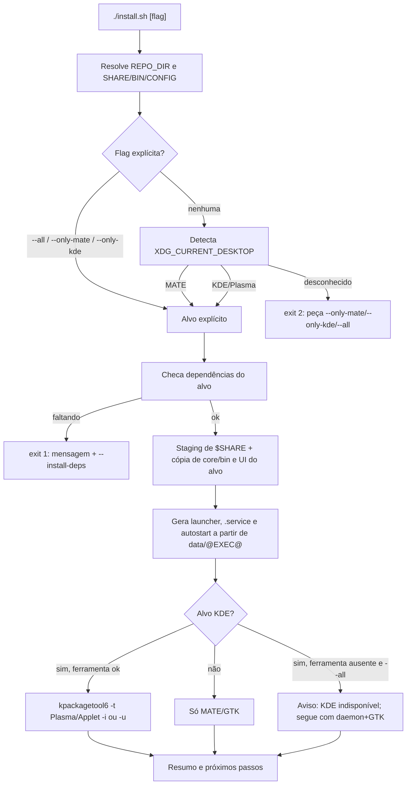

# Design: E6 — Instalador, Desinstalador, Verificação, Testes e Documentação

**Feature:** DeskAwake — E6 | **Data:** 2026-11-21 | **Status:** WIP — design em aberto; validação visual/funcional MATE executada em 21/11/2026 e ajustes pendentes registrados na §1.4
**Referência:** [`spec.md`](spec.md) (decisões 1–33, “Tarefas de implementação” 11–15, “Contratos”,
“Arquivos instalados” e checklists manuais), [`DELIVERY_MAP.md`](DELIVERY_MAP.md) §E6,
[`design_e1.md`](design_e1.md) (`config.json`), [`design_e2.md`](design_e2.md) (contrato D-Bus,
liveness, log), [`design_e3.md`](design_e3.md) (CLI e launcher), [`design_e4.md`](design_e4.md)
(autostart do widget e template), [`design_e5.md`](design_e5.md) (`kpackagetool6 -t Plasma/Applet`).

> **Escopo deste documento:** somente a E6. Ele não altera `core/`, `ui_gtk/`, `plasmoid/`, a CLI,
> o contrato D-Bus, o `config.json` nem os testes existentes; descreve os scripts, os templates, a
> consolidação de testes e os READMEs. Em caso de conflito com a `spec.md`, a `spec.md` vence.
>
> **Estado das branches (2026-11-21):** **E1–E5 mergeadas na `main`** (PRs #4, #5, #7, #8 e #10).
> A branch `feat/e6-instalador-verificacao-docs` nasce da `main` que já contém o widget GTK, os
> assets e o Plasmoid; os testes de sandbox precisam de `ui_gtk/` e `assets/` (E4).
>
> **Pendência aberta:** a validação visual/funcional da UI GTK (E4) no **MATE** foi executada em
> **21/11/2026** na máquina Mint 22.3 MATE/X11 (resultados na §1.4). Ela confirmou a maior parte do
> contrato, mas deixou **ajustes de documentação/verificação e uma decisão de produto em aberto**
> (mostrar área de trabalho). Até esses ajustes serem incorporados, este design permanece **WIP** e
> a E6 não pode declarar o MATE pronto.
>
> **Restrição de máquina:** a máquina desta sessão é **Ubuntu 26.04.1 + Plasma 6.6.7 (Wayland)**.
> Bash 5.3.9, `kpackagetool6` 2.0, `gdbus`, `systemd-inhibit` e `desktop-file-validate` presentes;
> `shellcheck` **ausente**. A validação de instalação/desinstalação no Mint/MATE e no Kubuntu é manual
> (§9.2 e §9.3) e fecha o G-E6.

---

## 1. Contexto e limite da entrega

A E6 fecha o produto para o usuário final. Até aqui existem núcleo (E1/E2), CLI (E3), widget GTK
(E4) e Plasmoid (E5), mas **não existe** nenhum caminho de instalação: não há `install.sh`,
`uninstall.sh`, `verify.sh`, templates em `data/`, autostart, `.service` de D-Bus nem README de uso.
A E6 entrega esse caminho, idempotente e tolerante a ambiente incompleto, sem empacotamento de
distro, sem `sudo` e sem instalar `pytest` para o usuário final.

**Inclui (e só isso):**

| Arquivo | Responsabilidade |
|---|---|
| `data/org.local.DeskAwake.service` | Template de ativação D-Bus; `Exec=@EXEC@ daemon` |
| `data/deskawake-daemon.desktop` | Template de autostart do daemon (MATE e KDE) |
| `data/deskawake-widget.desktop` | Template de autostart do widget GTK (só MATE; `OnlyShowIn=MATE;`) |
| `install.sh` | Seleção de alvo, checagem de deps, cópia, launcher, `.service`, autostart e Plasmoid |
| `uninstall.sh` | `Quit()` + fallback por PID, remoção idempotente, `--purge` |
| `verify.sh` | Liga/desliga e inspeciona locks, estado D-Bus, backend e órfãos |
| `tests/unit/test_scripts.py` | Contrato estático dos três scripts, templates e READMEs |
| `tests/integration/test_installer_scripts.py` | Smoke de `install.sh`/`uninstall.sh` em `HOME` isolado |
| `README.md` | pt-BR: uso, instalação, diagnóstico, limitações, testes e checklists |
| `README.en.md` | Inglês, espelhando o conteúdo normativo do pt-BR |

**Explicitamente fora da E6:**

- Qualquer mudança de decisão da spec (backend, tamanho, cores, textos, fluxo, contrato D-Bus).
- Qualquer alteração em `core/`, `ui_gtk/`, `plasmoid/`, `bin/deskawake` ou `pyproject.toml`.
- Empacotamento `.deb`/AUR/Flatpak; instalação system-wide; `sudo`.
- Testes automatizados de GUI; execução real de `verify.sh` na suíte (depende de daemon e backend).
- Instalação de `pytest` pelo `install.sh`; `pytest` continua dependência **de desenvolvimento**.
- Persistência de estado entre sessões; o estado sempre nasce `off`.
- Criação de `config.json` pelo instalador; o primeiro uso continua sendo da UI (E4).
- Remoção/alteração do `~/.config/deskawake/` sem `--purge`.
- Traduções `.po`; os READMEs são dois arquivos estáticos.

### 1.1 Decisões confirmadas pelo usuário (2026-11-21)

As quatro decisões abaixo foram confirmadas antes da gravação deste design. Nenhuma altera as
decisões 1–33 do produto; elas fixam pontos que a spec/mapa deixavam abertos.

| # | Tema | Decisão confirmada |
|---|---|---|
| 1 | `install.sh` sem flag | **Auto por desktop**: `XDG_CURRENT_DESKTOP` contendo `MATE` instala daemon+GTK; contendo `KDE`/`Plasma` instala daemon+Plasmoid; desconhecido ⇒ exit 2 com mensagem pedindo `--only-mate`, `--only-kde` ou `--all`. As flags explícitas sempre vencem a detecção. |
| 2 | Testes novos da E6 | **Estáticos + smoke em `HOME` temporário**: contrato dos scripts/templates/READMEs em `tests/unit/test_scripts.py` e execução real de `install.sh`/`uninstall.sh` com `HOME`, `XDG_DATA_HOME` e `PATH` isolados em `tests/integration/test_installer_scripts.py`. Sem daemon real, sem GUI e sem instalar no `HOME` do usuário. |
| 3 | Upgrade com daemon rodando | **Não interromper**: `install.sh` copia os arquivos e mantém a sessão atual; a versão nova entra no próximo login/reinício do daemon. `uninstall.sh` é quem encerra o daemon. |
| 4 | Estado final do `verify.sh` | **Sempre OFF**: liga, confere, desliga e confirma ausência de órfãos; um `trap` garante `off` mesmo em falha. Documentado no README. |

### 1.2 Decisões derivadas (sem alterar produto)

Estas escolhas são consequência direta da spec/mapa, do estado do código ou de restrições do
ambiente; ficam registradas para revisão, mas não são decisões de produto novas.

| Tema | Leitura adotada | Base |
|---|---|---|
| Estrutura dos scripts | Bash (`#!/usr/bin/env bash`, `set -euo pipefail`, `umask 022`); sem `sh` POSIX e sem dependências além das já declaradas | `bash -n` no gate; arrays/`[[ ]]` simplificam a matriz de alvos |
| Templates | `data/` contém `@EXEC@` como marcador do comando absoluto; `install.sh` substitui com escape de `\`, `&` e `|` | Um único template serve repo e instalação; evita duplicar conteúdo em heredocs |
| Launcher | `~/.local/bin/deskawake` é um wrapper `#!/bin/sh` com o caminho **absoluto** de `$SHARE/bin/deskawake` | Spec decisão 9 e mapa E6.3 item 7; symlink quebraria ao remover o repo |
| `$SHARE` | `${XDG_DATA_HOME:-$HOME/.local/share}/deskawake`; sem `XDG_DATA_HOME`, é o `~/.local/share/deskawake` da spec | Ativação D-Bus procura em `XDG_DATA_HOME`; o default coincide com a spec |
| Autostart e config | Caminhos literais `$HOME/.config/autostart/` e `$HOME/.config/deskawake/` (não `XDG_CONFIG_HOME`) | `core/config.py` e `ui_gtk/widget.py` usam `~/.config` literal; usar XDG no instalador separaria os arquivos da UI |
| Estado/log | `$HOME/.local/state/deskawake/` removido no `uninstall.sh` normal | Decisão 18: remover tudo exceto `~/.config/deskawake/` |
| `data/` instalado | Só `$SHARE/data/deskawake-widget.desktop` é copiado, quando o alvo GTK está ativo | `ui_gtk/widget.py` lê `ROOT/data/deskawake-widget.desktop` como template do menu; os outros dois templates são consumidos em tempo de instalação |
| Autostart do widget | Instalado sempre que o alvo GTK está ativo, com `OnlyShowIn=MATE;` | No Kubuntu/`--all` o arquivo é inerte; evita instalar um autostart que falharia em Wayland |
| Dependências | Obrigatórias: `python3`, `gi`, `dbus`, `systemd-inhibit`, `gdbus`; `kpackagetool6` é obrigatório só para o alvo KDE; `fonts-inter` é opcional | Spec decisão 9 e mapa E6.3 item 4 |
| Detecção do Plasmoid instalado | `kpackagetool6 -t Plasma/Applet -u` quando o diretório do pacote existe; senão `-i`; fallback `-i` se o `-u` falhar | E5.3 item 5 (`-i` repetido pode falhar com “already installed”) e achado do `-t Plasma/Applet` |
| Remoção do Plasmoid | `kpackagetool6 -t Plasma/Applet -r org.local.deskawake` quando a ferramenta existe; senão `rm -rf` do diretório fixo; verificar o resultado | Mapa E6.3 item 3: tolerar `kpackagetool6` ausente no Mint |
| UI GTK no uninstall | Encerrar a UI (`org.local.DeskAwake.Ui`) por PID via D-Bus, best-effort | Evita deixar um widget órfão rodando com arquivos removidos; não afeta o Plasmoid |
| `verify.sh` e backend | Detecta `MATE`/`KDE` por `XDG_CURRENT_DESKTOP`; modo genérico (só estado + `systemd-inhibit`) se desconhecido | A verificação de backend depende da sessão em que o script roda |
| `verify.sh` e `HasInhibition` | `HasInhibition(4)` é exigido `true` **durante** o ON; depois do OFF só se exige que a entrada `deskawake` suma de `ActiveInhibitions` | `HasInhibition` é global; outro app pode inibir idle e não é falha do DeskAwake |
| Teste de ausência do `kpackagetool6` | `KPKG_TOOL=${KPKG_TOOL:-kpackagetool6}` e `command -v "$KPKG_TOOL"`; os testes usam `KPKG_TOOL` inexistente | O mapa exige decisão por `command -v`; o override é só uma costura de teste, não uma flag de usuário |
| Gate de scripts | `bash -n` sempre; `shellcheck` quando existir (ausente nas máquinas validadas) | Mapa E6.3 item 12 |
| `verify.sh` no MATE | `GetInhibitors` + `mate-screensaver-command -q`; **não** exigir `IsInhibited(8)` (ausente no mate-screensaver 1.26.2) | Validação MATE de 21/11/2026; `IsInhibited` só existe no fake de testes |
| Tema `auto` no MATE | Resolver pelo nome de `gtk-theme`; `gtk-application-prefer-dark-theme` não existe em `org.mate.interface` no Mint 22.3 | Validação MATE de 21/11/2026 |
| `error` por queda de backend | Preserva o filho do `systemd-inhibit`; só falha de ativação/verificação libera tudo | `DELIVERY_MAP` item 9; a checklist da E4/spec precisa ser alinhada |

### 1.3 Estado atual e hidratação

- **Entregas anteriores (mergeadas em 2026-11-21):** E1–E5 estão na `main`; o código de E4
  (`ui_gtk/`, `assets/`, `tests/unit/test_theme.py`, `tests/unit/test_ui_assets.py`) e o de E5
  (`plasmoid/`, `tests/unit/test_plasmoid_assets.py`, `tests/integration/`) já estão no checkout.
  A branch da E6 nasce da `main` pós-merges.
- **Baseline medido na `main` pós-merges (2026-11-21):** `python3 -m pytest tests/unit -q` ⇒
  **267 passed**; `dbus-run-session -- python3 -m pytest tests/integration -q` ⇒ **34 passed,
  1 skipped** (o skip é o teste `@pytest.mark.slow`, desmarcado por `conftest.py`). Esse é o
  baseline que a E6 deve preservar; os testes novos da E6 somam a partir dele.
- **Pré-validação MATE (2026-11-21):** a UI GTK foi exercitada na máquina Mint 22.3 MATE/X11
  (gate 267 unitários; janela/hints, arrasto, spinner, estados, tema, compositor, menu, autostart,
  `Sair` e `kill -9`). Resultados e pendências na §1.4.
- **Lacunas reais:** não existem `install.sh`, `uninstall.sh`, `verify.sh`, `data/`, README.en.md nem
  testes de scripts. O `README.md` atual é bilíngue em um único arquivo e ainda diz “implementação em
  andamento”; deve ser dividido e atualizado.
- **Ferramentas nesta máquina:** `bash` 5.3.9, `kpackagetool6` 2.0, `gdbus`, `systemd-inhibit`,
  `desktop-file-validate`; `shellcheck` ausente; `XDG_CURRENT_DESKTOP=KDE`,
  `XDG_SESSION_TYPE=wayland`; `XDG_DATA_HOME`/`XDG_CONFIG_HOME` vazios.
- **`ui_gtk/widget.py` (E4) já define:** `AUTOSTART_PATH = ~/.config/autostart/deskawake-widget.desktop`,
  `TEMPLATE_PATH = ROOT/data/deskawake-widget.desktop`, `Exec` absoluto de `ROOT/bin/deskawake ui` e
  escrita atômica. A E6 deve instalar o template no `$SHARE/data/` e gerar um autostart compatível.
- **`core/daemon.py` (E2) já fixa:** `DBUS_NAME=org.local.DeskAwake`, `OBJECT_PATH=/org/local/DeskAwake`,
  `INTERFACE=org.local.DeskAwake`, `LOG_PATH=~/.local/state/deskawake/daemon.log`, rotação em 256 KB
  e `main()` sem flags. A E6 não precisa mudar nada no daemon.
- **`core/cli.py` (E3) já fixa:** `status` 0/1/3 sem auto-start, `on/off/toggle` e o launcher
  portátil em `bin/deskawake`. O wrapper instalado apenas chama esse launcher.
- **`plasmoid/` (E5) já fixa:** `kpackagetool6 -t Plasma/Applet` é obrigatório; sem `-t` o pacote vai
  para `~/.local/share/kpackage/generic/`. A E6 deve usar `-t Plasma/Applet` em `-i`, `-u` e `-r`.

### 1.4 Validação MATE executada — ajustes pendentes para a E6

A validação visual/funcional da UI GTK (E4) foi executada em **21/11/2026** na máquina
**Mint 22.3 MATE/X11** (GTK 3.24.41, Marco composto, tema `Squared`, um monitor ativo). O E5 é o
Plasmoid do Plasma e não se aplica ao MATE.

**Passou (não-destrutivo):** gate de **267 unitários**; janela `124×42` em `1772,24` sem decoração,
`UTILITY`, `SKIP_TASKBAR`/`SKIP_PAGER`/`BELOW`/`STICKY` e desktop `0xFFFFFFFF`; fora do `Alt+Tab` e
da barra; sticky no workspace 2; arrasto pelo toggle sem alternar; posição persistida; spinner no
slot 22×22 com toggle preservado/insensível; ON/OFF com `GetInhibitors` + `systemd-inhibit`; `error`
com tooltip real e recuperação; `Sair` e `kill -9` sem órfãos; menu/autostart; tema
`auto`/forçado; compositor sólido/translúcido; fallback de fonte.

**Achados que a E6 precisa incorporar/decidir:**

| # | Achado (validação 21/11/2026) | Ajuste na E6 |
|---|---|---|
| A1 | `Ctrl+Alt+D` (“mostrar área de trabalho”) adiciona `_NET_WM_STATE_HIDDEN`; o widget some enquanto o desktop está à mostra e volta ao restaurar. | Decidir entre documentar como limitação no README ou corrigir os hints no widget. A correção de `ui_gtk/` está **fora do escopo declarado da E6** (§1) e exigiria uma exceção/PR de E4. |
| A2 | `error` por queda de backend **preserva** o filho do `systemd-inhibit` (o inibidor MATE é liberado). | Alinhar spec/checklist/README ao `DELIVERY_MAP` item 9: queda de backend preserva o filho; falha de ativação/verificação libera tudo. A checklist atual diz “error libera o `systemd-inhibit`” de forma genérica. |
| A3 | `IsInhibited(8)` **não existe** no mate-screensaver 1.26.2 real. | `verify.sh` e checklists usam `org.mate.ScreenSaver.GetInhibitors` e, se existir, `mate-screensaver-command -q`; `IsInhibited` fica só no fake de testes. |
| A4 | `gtk-application-prefer-dark-theme` **não existe** em `org.mate.interface` no Mint 22.3. | Documentar que o `auto` resolve pelo nome do tema (`*Dark*`); não é bug. |
| A5 | O `idle-delay` de `org.mate.session` é lido no login; o teste de 1 min não vale a quente. | Testar em sessão nova ou registrar a confirmação do usuário de que OFF restaura o screensaver; `lock-enabled` é destrutivo/opcional. |
| A6 | Sob XTest, o submenu `Tema` às vezes fecha ao saltar o ponteiro; a seleção por teclado funcionou. | Repetir com mouse real antes de tratar como bug de produto. |
| A7 | Logout, desconexão de monitor externo e bloqueio de tela não foram exercitados. | Manter como pendências manuais no PR/README até serem executados. |

- [ ] **A1 — “Mostrar área de trabalho”:** decisão de produto acima; se for limitação, o README deve
      dizer que o widget volta ao restaurar, não que fica visível com o desktop à mostra.
- [ ] **A2 — `error` × `systemd-inhibit`:** alinhar spec/checklist/README ao `DELIVERY_MAP` item 9;
      não deixar as duas fontes se contradizerem.
- [ ] **A3 — `IsInhibited(8)`:** remover a exigência no `verify.sh`/teste estático e nas checklists;
      usar `GetInhibitors` (+ `mate-screensaver-command -q` quando disponível).
- [ ] **A4 — `auto` no MATE:** documentar a ausência do `prefer-dark` no README/spec.
- [ ] **A5 — idle/lock:** documentar o requisito de sessão nova para o delay curto e o lock opcional.
- [ ] **A6 — submenu `Tema`:** repetir com mouse real; se reproduzir, abrir achado de UI (E4).
- [ ] **A7 — pendências não executadas:** logout, monitor externo e lock no PR/README.
- [ ] **Critério de saída:** o MATE só pode ser declarado pronto quando A1–A7 estiverem
      resolvidos/documentados e a checklist da §9.2 estiver preenchida. Os testes headless (267
      unit + 34 integração) **não** substituem a validação manual; o merge da E4 **não** é prova de
      MATE validado.
- [ ] **Efeito no gate G-E6:** a linha “READMEs completos” e o aceite de instalação no Mint só fecham
      após esta pendência. O README e o PR da E6 não podem afirmar “MATE validado” enquanto a seção
      estiver aberta.

**Consequência:** o design permanece **WIP**. A branch/PR da E6 pode receber o design agora e, na
sequência, os ajustes de documentação/verificação (A2–A5), a decisão A1, os scripts, os testes e os
READMEs; a pendência acima é critério de saída, não um detalhe opcional.

---

## 2. Arquitetura

### 2.1 Fluxo de instalação



O instalador **não** inicia nem para o daemon, **não** cria `config.json`, **não** instala `pytest`,
**não** usa `sudo` e **não** toca em arquivos fora de `$SHARE`, `$HOME/.local/bin`,
`$HOME/.local/share/dbus-1/services`, `$HOME/.config/autostart` e no diretório do Plasmoid.

### 2.2 Componentes e pontos de entrada

- **`install.sh` — orquestrador de alvo**
  - Ponto de entrada único: `./install.sh`, `./install.sh --all`, `--only-mate`, `--only-kde`,
    `--install-deps`, `--help`.
  - Resolve o próprio diretório por `BASH_SOURCE[0]`; não depende do CWD.
  - Decide o alvo (flag explícita > detecção de DE), checa dependências **antes** de copiar e faz
    staging de `$SHARE` para não deixar instalação parcial.
  - Gera os arquivos personalizados (launcher, `.service`, autostart) a partir de `data/`.
  - Delega a instalação do Plasmoid ao `kpackagetool6 -t Plasma/Applet`.
- **`uninstall.sh` — removedor idempotente**
  - Ponto de entrada: `./uninstall.sh`, `./uninstall.sh --purge`, `--help`.
  - Para o daemon (`Quit()` + fallback por PID), fecha a UI GTK se aberta, remove Plasmoid,
    `$SHARE`, launcher, `.service`, autostarts e o log/estado.
  - Preserva `$HOME/.config/deskawake/` sem `--purge`; tolera ausência de qualquer item e de
    `kpackagetool6`.
- **`verify.sh` — diagnóstico de ponta a ponta**
  - Ponto de entrada: `./verify.sh` (sem flags).
  - Usa o launcher instalado (`$HOME/.local/bin/deskawake`, com fallback para `$SHARE/bin/deskawake`).
  - Liga, confere lock/estado/backend, desliga, confere ausência de órfãos; `trap` garante `off`.
- **`data/` — templates**
  - Fonte única dos textos de `.service`/`.desktop`; o `@EXEC@` é substituído pelo caminho absoluto
    do launcher em `$SHARE/bin/deskawake`.
- **`tests/` — consolidação**
  - `tests/unit/test_scripts.py`: contrato estático (tokens, flags, templates, READMEs).
  - `tests/integration/test_installer_scripts.py`: execução real dos scripts com `HOME` isolado e
    `kpackagetool6`/`gdbus` falsos.
- **`README.md`/`README.en.md` — documentação do usuário**
  - Instalação, uso, diagnóstico, limitações, setup de testes e as duas checklists manuais.
- **Consumidores externos**
  - D-Bus de sessão: descobre o `.service` em `${XDG_DATA_HOME:-~/.local/share}/dbus-1/services/`
    e executa `deskawake daemon` na primeira ação.
  - Autostart XDG: lê `$HOME/.config/autostart/*.desktop` no login; o widget é filtrado por
    `OnlyShowIn=MATE;`.
  - Plasma: lê o pacote em `~/.local/share/plasma/plasmoids/org.local.deskawake/`.

**Camadas:** os scripts são a camada de instalação/administração; não contêm regra de inibição. A
regra de negócio continua no daemon (E2), a política de acesso no CLI (E3) e a aparência nas UIs
(E4/E5). Os scripts só copiam, renderizam templates e chamam a CLI/ferramentas do sistema.

### 2.3 Matriz de alvos

`--all`, `--only-mate` e `--only-kde` são mutuamente exclusivos; combinar dois ⇒ exit 2. Sem flag,
o alvo é automático por `XDG_CURRENT_DESKTOP`.

| Alvo | `core/` + `bin/` | `ui_gtk/` + `assets/` | `data/deskawake-widget.desktop` em `$SHARE` | `.service` | Autostart daemon | Autostart widget | Plasmoid |
|---|---|---|---|---|---|---|---|
| `--only-mate` | sim | sim | sim | sim | sim | sim | não |
| `--only-kde` | sim | não | não | sim | sim | não | sim (exige ferramenta) |
| `--all` | sim | sim | sim | sim | sim | sim (`OnlyShowIn=MATE;`) | sim se a ferramenta existir; aviso se não |
| sem flag, MATE | sim | sim | sim | sim | sim | sim | não |
| sem flag, KDE/Plasma | sim | não | não | sim | sim | não | sim (exige ferramenta) |
| sem flag, desconhecido | — | — | — | — | — | — | exit 2, nada é alterado |

Regras de degradação:

- `--all` sem `kpackagetool6`: instala daemon+GTK, imprime exatamente
  `KDE indisponível: kpackagetool6 ausente`, deixa explícito que daemon+GTK foram instalados e sai
  **0**.
- `--only-kde` ou auto-KDE sem `kpackagetool6`: imprime
  `alvo KDE indisponível: kpackagetool6 ausente` e sai **1**, sem copiar nada.
- `--all`/`--only-mate`/auto-MATE com `XDG_SESSION_TYPE=wayland`: instala (decisão explícita ou
  alvo MATE detectado), mas avisa que o widget GTK exige X11 e que, no KDE, a UI suportada é o
  Plasmoid. Não falha.
- `--all` em desktop desconhecido: é uma escolha explícita de “todos os alvos”; instala
  daemon+GTK+Plasmoid (se a ferramenta existir) e o autostart do widget fica inerte fora do MATE.

### 2.4 Layout instalado

```
$HOME/.local/share/deskawake/              # $SHARE; XDG_DATA_HOME respeitado
├── core/                                  # cópia de core/
├── bin/deskawake                          # cópia executável de bin/deskawake
├── ui_gtk/                                # somente alvo GTK
├── assets/                                # somente alvo GTK
└── data/
    └── deskawake-widget.desktop           # somente alvo GTK (template do menu E4)

$HOME/.local/bin/deskawake                 # wrapper sh absoluto (755)
$HOME/.local/share/dbus-1/services/org.local.DeskAwake.service
$HOME/.config/autostart/deskawake-daemon.desktop
$HOME/.config/autostart/deskawake-widget.desktop   # alvo GTK; OnlyShowIn=MATE;
$HOME/.local/share/plasma/plasmoids/org.local.deskawake/   # alvo KDE, via kpackagetool6
```

Não são instalados: `tests/`, `docs/`, `README*`, `pyproject.toml`, `uv.lock`, `plasmoid/` fora do
pacote KPackage, `verify.sh`, `install.sh` e `uninstall.sh`. O `config.json` só nasce no primeiro
uso pela UI (E4). O log nasce quando o daemon sobe (E2).

---

## 3. Modelo de dados

### 3.1 Schema

Não há banco, tabela, migration ou schema novo. O “modelo” da E6 é o conjunto de arquivos do §2.4 e
o `config.json` intocado:

```json
// ~/.config/deskawake/config.json (E1; não criado nem alterado pela E6)
{
  "version": 1,
  "theme": "auto",
  "position": { "x": 1234, "y": 24 }
}
```

### 3.2 Migrations necessárias

Nenhuma. A E6 não migra `config.json`, não converte formato e não move dados do usuário. Um
`README.md` bilíngue existente é reescrito em dois arquivos, o que é documentação, não dado.

### 3.3 Controle de acesso aos dados

Não se aplica a multi-tenant. Tudo é por usuário:

- `$SHARE`, launcher, `.service` e autostart ficam no `HOME` do usuário; o instalador nunca escreve
  fora dele.
- O barramento é de sessão; qualquer cliente da mesma sessão pode chamar o daemon, como já ocorre
  na E2/E4/E5.
- O log do daemon é do usuário e não contém credenciais (E2).
- `uninstall.sh` remove apenas caminhos fixos derivados de `$HOME`; não aceita caminho arbitrário
  por flag. `--purge` é a única forma de remover a configuração.

---

## 4. Contratos

### 4.1 Interface comum dos scripts

```text
install.sh   [--all | --only-mate | --only-kde] [--install-deps] [--help]
uninstall.sh [--purge] [--help]
verify.sh    [--help]
```

- Shebang `#!/usr/bin/env bash`; `set -euo pipefail`; `umask 022`.
- Nenhum script chama `sudo`, `su` ou `pkexec`; nenhum script imprime a palavra `sudo`.
- Códigos de saída:

| Script | 0 | 1 | 2 |
|---|---|---|---|
| `install.sh` | instalação concluída (inclusive `--all` degradado no Mint) | dependência faltando, falha de cópia ou falha do Plasmoid | uso inválido (flag desconhecida, alvos conflitantes, DE não detectado) |
| `uninstall.sh` | remoção concluída ou nada a remover | falha de remoção (permissão/erro real) | uso inválido |
| `verify.sh` | todas as verificações passaram | qualquer verificação falhou | uso inválido |
| `--install-deps` | dependências obrigatórias do alvo presentes | alguma obrigatória ausente | uso inválido |

- Mensagens em pt-BR, uma linha por evento; caminhos sempre absolutos e entre aspas.
- `--help` sai 0 e não altera nada.

### 4.2 `install.sh` — flags e comportamento

| Flag | Comportamento exato |
|---|---|
| `--all` | Instala todos os alvos disponíveis: daemon+GTK e, se `KPKG_TOOL` existir, Plasmoid. No Mint (sem `kpackagetool6`): daemon+GTK, aviso `KDE indisponível: kpackagetool6 ausente`, mensagem explícita de que daemon+GTK foram instalados, exit 0. |
| `--only-mate` | Daemon+GTK. Nunca falha por ausência de `kpackagetool6`. |
| `--only-kde` | Daemon+Plasmoid. Se a ferramenta faltar ⇒ `alvo KDE indisponível: kpackagetool6 ausente`, exit 1, nada copiado. |
| `--install-deps` | **Opt-in**, combinável com um alvo ou sozinho. **Nunca** executa `apt`, `sudo` ou instala nada. Imprime os comandos `apt` e uma verificação final. Sem alvo, `kpackagetool6` é informativo; com `--only-kde`, é obrigatório; com `--all`/MATE, é aviso. Exit 0/1 conforme §4.1. |
| `--help` | Usage completo, exemplos e aviso de que não requer privilégios administrativos. Exit 0. |
| (nenhuma) | Detecta `XDG_CURRENT_DESKTOP` (case-insensitive): contém `MATE` ⇒ alvo MATE; contém `KDE` ou `PLASMA` ⇒ alvo KDE; senão exit 2 com `não foi possível detectar o desktop (XDG_CURRENT_DESKTOP); use --only-mate, --only-kde ou --all`. |

**Ordem de execução (obrigatória):**

1. Parse das flags e validação de conflitos.
2. Resolução de `REPO_DIR`, `SHARE`, `BIN_DIR`, `SERVICE_DIR`, `AUTOSTART_DIR`, `PLASMOID_DIR`.
3. Seleção do alvo (§2.3).
4. Checagem de dependências do alvo; se faltar obrigatória, mensagem + sugestão
   `./install.sh --install-deps`, exit 1, **sem copiar nada**.
5. Staging de `$SHARE` (copiar para `$SHARE.new.$$`; ao final `rm -rf "$SHARE"` + `mv`), com
   `core/`, `bin/deskawake` (755) e, se GTK, `ui_gtk/`, `assets/` e `data/deskawake-widget.desktop`.
   A cópia exclui `__pycache__/`, `*.py[cod]`, `.pytest_cache/`, `tests/`, `docs/` e `.venv/`.
6. Renderização de launcher, `.service` e autostarts a partir de `data/`; escrita atômica
   (`tmp` + `mv`). Verificar que nenhum `@EXEC@` sobrou.
7. Plasmoid, se o alvo for KDE: `-i` se o diretório não existe; `-u` se existe; fallback `-i` se
   `-u` falhar. Falha do Plasmoid em alvo KDE explícito ⇒ exit 1.
8. Resumo: alvo, `$SHARE`, launcher, `.service`, autostarts e Plasmoid; próximos passos por DE.

**Checagem de dependências:**

| Dependência | Verificação | Obrigatória para |
|---|---|---|
| `python3` | `command -v python3` | todos |
| `gi` (PyGObject) | `python3 -c 'import gi'` | todos |
| `dbus` (dbus-python) | `python3 -c 'import dbus'` | todos |
| `systemd-inhibit` | `command -v systemd-inhibit` | todos |
| `gdbus` | `command -v gdbus` | todos |
| `Gtk 3.0` | `python3 -c 'import gi; gi.require_version("Gtk","3.0"); from gi.repository import Gtk'` | alvo GTK |
| `kpackagetool6` | `command -v "$KPKG_TOOL"` | alvo KDE |

`KPKG_TOOL=${KPKG_TOOL:-kpackagetool6}` é uma costura de teste; o padrão é o contrato do mapa
(“detecção por `command -v kpackagetool6`”). `fonts-inter` não é verificado como dependência; é
sugestão opcional no `--install-deps` e no README.

**`--install-deps` — saída normativa (sem a palavra `sudo`):**

```text
Dependências obrigatórias (runtime):
  apt install python3-gi python3-dbus systemd libglib2.0-bin

KDE (necessário apenas para o Plasmoid):
  apt install kpackagetool6

Opcional (fonte Inter):
  apt install fonts-inter

Verificação:
  python3 ......... ok
  gi .............. ok
  dbus ............ ok
  systemd-inhibit . ok
  gdbus ........... ok
  kpackagetool6 ... ausente
```

### 4.3 Templates `data/`

**`data/org.local.DeskAwake.service`**

```ini
[D-BUS Service]
Name=org.local.DeskAwake
Exec=@EXEC@ daemon
```

**`data/deskawake-daemon.desktop`**

```ini
[Desktop Entry]
Type=Application
Name=DeskAwake Daemon
Comment=Mantém a tela e o sistema acordados quando ativado
Exec=@EXEC@ daemon
Terminal=false
NoDisplay=true
X-GNOME-Autostart-enabled=true
```

**`data/deskawake-widget.desktop`**

```ini
[Desktop Entry]
Type=Application
Name=DeskAwake
Comment=Widget DeskAwake
Exec=@EXEC@ ui
Terminal=false
NoDisplay=true
OnlyShowIn=MATE;
X-GNOME-Autostart-enabled=true
```

Contratos de renderização:

- `@EXEC@` é substituído por `$SHARE/bin/deskawake` (absoluto, com aspas se houver espaços).
- A substituição escapa `\`, `&` e `|` antes do `sed`; nenhum arquivo gerado contém `@EXEC@`.
- `Exec` aponta para `$SHARE/bin/deskawake`, **não** para o repo nem para o wrapper, para coincidir
  com o `ROOT/bin/deskawake` que a E4 calcula.
- `.service`/`.desktop` gerados são 644; o launcher e `bin/deskawake` são 755.
- O template do widget preserva `OnlyShowIn=MATE;`; a E4 o lê e mantém linhas desconhecidas ao
  ligar/desligar o “Iniciar com o sistema”.

### 4.4 Launcher `$HOME/.local/bin/deskawake`

```sh
#!/bin/sh
exec "/home/<usuario>/.local/share/deskawake/bin/deskawake" "$@"
```

- Caminho absoluto resolvido em tempo de instalação, não `$HOME` em tempo de execução.
- `chmod 755`; sobrescrito de forma idempotente.
- Se `$HOME/.local/bin` não estiver no `PATH`, o instalador avisa no resumo e o README explica como
  adicionar; não altera `.profile`/`.bashrc`.
- O wrapper **não** é symlink e **não** é cópia do launcher Python (a cópia resolveria `ROOT` para
  `~/.local/bin` e quebraria os imports).

### 4.5 `uninstall.sh` — contrato

| Etapa | Comportamento |
|---|---|
| Parse | `--purge` opcional; `--help`; qualquer outra flag ⇒ exit 2. |
| Daemon | Se `gdbus` e barramento existirem, chama `Quit()` em `org.local.DeskAwake`; espera até 3 s o nome sumir. Se ainda houver dono, obtém o PID com `GetConnectionUnixProcessID`, envia `SIGTERM`, espera até 2 s e `SIGKILL`. Nunca usa `pkill -f`. |
| UI GTK | Se `org.local.DeskAwake.Ui` tiver dono, obtém o PID e encerra (`SIGTERM` → 2 s → `SIGKILL`), best-effort; ausência não é erro. |
| Plasmoid | Se `$PLASMOID_DIR` existe e o `kpackagetool6` está disponível: `-t Plasma/Applet -r org.local.deskawake`. Se a ferramenta falta ou a remoção falha: `rm -rf` do diretório fixo; se ainda restar, reporta e exit 1. |
| Arquivos | Remove `.service`, os dois autostarts, o launcher, `$SHARE` e `$HOME/.local/state/deskawake/`. Ausência é sucesso. |
| Config | Preserva `$HOME/.config/deskawake/`; `--purge` remove também. |
| Idempotência | Segunda execução sai 0; nada é recriado. |
| Segurança | Só remove caminhos fixos derivados de `$HOME`; nunca segue symlink para fora do alvo; não remove `~/.local/share/plasma` inteiro. |
| Daemon morto/barramento ausente | `Quit`/`gdbus` falham em silêncio; a remoção de arquivos continua e o exit é 0. |
| Órfãos | Após encerrar o daemon, se `systemd-inhibit --list` ainda mostrar `DeskAwake`, imprime aviso com o comando de inspeção; **não** mata processos de terceiros. |

### 4.6 `verify.sh` — contrato

**Pré-condições:** instalação presente (`$HOME/.local/bin/deskawake` ou `$SHARE/bin/deskawake`) e
`.service` instalado. Sem instalação ⇒ mensagem `DeskAwake não instalado; rode ./install.sh` e exit 1.
Sem `gdbus` ou `systemd-inhibit` no `PATH` ⇒ mensagem `dependência de diagnóstico ausente: <nome>`
e exit 1. `mate-screensaver-command` é **opcional** (diagnóstico complementar no MATE); a ausência
dele não falha.

**Fluxo:**

1. `trap` de saída: `deskawake off` best-effort, para nunca deixar ON.
2. `deskawake off` inicial (ignora estado anterior).
3. `deskawake on`; exige stdout `on` e exit 0.
4. `systemd-inhibit --list` contém `DeskAwake` (checagem do `--who`).
5. `deskawake status` ⇒ exit 0 e stdout `on`.
6. Backend:
   - **MATE** (`XDG_CURRENT_DESKTOP` contém `MATE`): `gdbus` em `org.mate.ScreenSaver.GetInhibitors`
     contém `Application="deskawake"`. **Não** exigir `IsInhibited(8)`: o mate-screensaver 1.26.2
     não expõe esse método. Se `mate-screensaver-command` existir, `-q` deve conter
     `deskawake`/`inibida`; a ausência do comando não falha (fallback para `GetInhibitors`).
   - **KDE/Plasma**: poll de `PolicyAgent.ActiveInhibitions` por até 8 s (debounce de ~5 s) até
     conter `deskawake` **e** `DeskAwake active`; `HasInhibition(4)` ⇒ `(true,)`. Não usa
     `CanSuspend`.
   - **Desconhecido**: só as checagens genéricas (3–5), com aviso.
7. `deskawake off`; exige stdout `off` e exit 0.
8. Poll de até 3 s: `systemd-inhibit --list` sem `DeskAwake` (o filho tem até 2 s para morrer).
9. `deskawake status` ⇒ exit 1 e stdout `off`.
10. Backend:
    - **MATE**: poll até `GetInhibitors` sem `deskawake`; se `mate-screensaver-command` existir, `-q`
      não deve mais listar `deskawake`. `IsInhibited(8)` **não** é usado (ausente no 1.26.2); se uma
      versão futura expuser, é informativo e não falha sozinho.
    - **KDE**: poll até `ActiveInhibitions` sem `deskawake`; `HasInhibition(4)` é **informativo**
      depois do OFF (é global).
11. Saída final `verify: OK` (exit 0) ou `verify: FALHOU` (exit 1), com uma linha `[ok]`/`[falha]`
    por checagem.

`LC_ALL=C` no topo para estabilizar a saída de ferramentas; mensagens do script em pt-BR.

### 4.7 Contratos dos testes

**`tests/unit/test_scripts.py` (estático, stdlib + pytest):**

- `bash -n` em `install.sh`, `uninstall.sh` e `verify.sh` (subprocess; exit 0).
- Shebang `#!/usr/bin/env bash`, `set -euo pipefail` e ausência de `sudo`/`pkexec`/`su` nos três.
- `install.sh`: contém `--all`, `--only-mate`, `--only-kde`, `--install-deps`, `--help`;
  `command -v "$KPKG_TOOL"`; `kpackagetool6`/`-t Plasma/Applet` com `-i` e `-u`; mensagens exatas
  `KDE indisponível: kpackagetool6 ausente` e `alvo KDE indisponível: kpackagetool6 ausente`.
- `uninstall.sh`: contém `--purge`, `Quit`, `GetConnectionUnixProcessID`, `-t Plasma/Applet -r`,
  `~/.local/state/deskawake` e **não** contém `pkill -f`.
- `verify.sh`: contém `systemd-inhibit --list`, `GetInhibitors`, `mate-screensaver-command`,
  `ActiveInhibitions`, `HasInhibition`, `CanSuspend` **ausente**, poll de ~6–8 s e `trap`;
  **não** exige `IsInhibited` (ausente no mate-screensaver 1.26.2).
- `data/*.service` e `data/*.desktop`: parse com `configparser` (chaves case-sensitive), chaves
  obrigatórias, `@EXEC@`, `Name`/`Type`/`Exec` corretos, `OnlyShowIn=MATE;` no widget, ausência de
  caminhos `/home/<algo>` fixos.
- `README.md` e `README.en.md`: existem, começam com `# DeskAwake`, linkam um ao outro e contêm
  `--all`, `--only-mate`, `--only-kde`, `--install-deps`, `--purge`, `verify.sh`,
  `systemd-inhibit`, `daemon.log`, `python3 -m pytest`, `dbus-run-session`, `-m slow`, o aviso de
  tampa/suspensão manual, o debounce de ~5 s do KDE, a adição manual do Plasmoid e a ausência de
  `kpackagetool6` no Mint.
- `desktop-file-validate` é usado **quando existir**; ausência não falha o teste.

**`tests/integration/test_installer_scripts.py` (sandbox):**

- Fixture `sandbox(tmp_path)`:
  - `HOME=$tmp/home`, `XDG_DATA_HOME=$tmp/data`, `PATH=$tmp/bin:$PATH`.
  - `$tmp/bin/kpackagetool6` falso: registra argumentos em `$KPKG_LOG` e cria/remove
    `$XDG_DATA_HOME/plasma/plasmoids/org.local.deskawake/metadata.json` conforme `-i`/`-u`/`-r`.
  - `$tmp/bin/gdbus` falso: registra chamadas; `NameHasOwner` ⇒ `(false,)` por padrão;
    `Quit`/`GetConnectionUnixProcessID` configuráveis por arquivos de estado para o teste de
    fallback por PID.
  - Nenhum script é executado no `HOME` real; nenhuma sessão D-Bus real é usada.
- Casos:
  - `--only-mate`: instala `core/`, `bin/`, `ui_gtk/`, `assets/`, `data/deskawake-widget.desktop`,
    launcher 755, `.service`, autostart daemon e widget; nenhuma chamada ao `kpackagetool6`.
  - Reexecução de `--only-mate`: exit 0, mesmos arquivos, sem resíduo `*.new.*`/`*.tmp`.
  - `--all` com a ferramenta falsa: primeiro run `-t Plasma/Applet -i`, segundo `-u`; exit 0.
  - `--all` com `KPKG_TOOL` inexistente: exit 0, aviso, daemon+GTK instalados, sem Plasmoid.
  - `--only-kde` com `KPKG_TOOL` inexistente: exit 1 e `$SHARE` ausente (nada copiado).
  - Auto-MATE (`XDG_CURRENT_DESKTOP=MATE`) equivale a `--only-mate`; auto-KDE (`KDE`) equivale a
    `--only-kde`; auto desconhecido ⇒ exit 2.
  - Flags conflitantes (`--all --only-kde`) ⇒ exit 2; flag desconhecida ⇒ exit 2.
  - `--install-deps`: imprime os três blocos e a verificação, **não** contém `sudo`; com
    `--only-kde` e ferramenta ausente ⇒ exit 1; com `--all` ⇒ exit 0.
  - `uninstall.sh` após `--only-mate`: remove tudo, preserva `~/.config/deskawake/config.json`,
    exit 0; segunda execução exit 0; `--purge` remove a config.
  - Fallback por PID: `gdbus` falso informa um processo `sleep` real como dono; `uninstall.sh`
    envia TERM e o processo morre.
  - Plasmoid: `uninstall.sh` com ferramenta falsa chama `-t Plasma/Applet -r`; com ferramenta
    ausente e diretório existente, remove o diretório fixo.
- O teste é **headless**, não abre display, não sobe daemon e não depende de Plasma/MATE instalados.

**`verify.sh` não é executado na suíte**: depende de daemon e backend reais; a validação é manual
(§9.2/§9.3), com contrato estático em `test_scripts.py`.

### 4.8 READMEs

**Estrutura comum (pt-BR canônico; inglês espelha):**

1. `# DeskAwake` + descrição curta + link para o outro idioma.
2. Sistemas suportados (Mint 22.3 MATE/X11 e Kubuntu 26.04/Plasma 6.6/Wayland).
3. O que faz / o que não faz (tampa e suspensão manual continuam).
4. Requisitos e `--install-deps`.
5. Instalação (`./install.sh`, `--all`, `--only-mate`, `--only-kde`, o que cada uma faz; Mint
   degrada com aviso; Kubuntu adiciona o Plasmoid manualmente em “Adicionar widgets”).
6. Uso: CLI (`on/off/toggle/status/daemon/ui`, códigos 0/1/3), widget GTK e Plasmoid.
7. Diagnóstico: `verify.sh`, `status`, `GetLastError`, `daemon.log` (+ `.log.1`), `systemd-inhibit
   --list`.
8. Limitações: debounce de ~5 s no KDE; tampa/suspensão manual; Plasmoid manual; `kpackagetool6`
   ausente no Mint; GTK bloqueado em Wayland (`--force` só depuração); `Configurar` do Plasmoid sem
   categorias; `install.sh` não interrompe daemon em upgrade; `verify.sh` termina OFF.
   **MATE (validação 21/11/2026):** “Mostrar área de trabalho” (Ctrl+Alt+D) esconde o widget
   enquanto o desktop está à mostra e ele volta ao restaurar (A1); `auto` resolve pelo nome do tema
   porque `gtk-application-prefer-dark-theme` não existe no `org.mate.interface` do Mint 22.3 (A4);
   `error` por queda de backend preserva o `systemd-inhibit` e libera o inibidor MATE (A2);
   `IsInhibited(8)` não existe no mate-screensaver 1.26.2 — o diagnóstico usa `GetInhibitors` e,
   quando disponível, `mate-screensaver-command -q` (A3); o teste de idle com delay curto exige uma
   sessão nova (o delay é lido no login) e o lock é destrutivo/opcional (A5).
9. Desenvolvimento e testes: `sudo apt install python3-pytest` (aqui o `sudo` é do usuário, não do
   script), `python3 -m pytest`, `dbus-run-session -- python3 -m pytest tests/integration`,
   `python3 -m pytest tests/integration -m slow`, `bash -n`, `shellcheck` opcional.
10. Checklist manual — Linux Mint 22.3 MATE/X11 (a lista da spec, itens destrutivos marcados).
11. Checklist manual — Kubuntu 26.04/Plasma 6.6 Wayland (a lista da spec, itens destrutivos
    marcados).
12. Desinstalação (`./uninstall.sh`, `--purge`).
13. Licença MIT e link para `docs/implementation/spec.md` (documentação de desenvolvedor).

- As duas listas são **copiadas da spec sem resumir**; comandos, nomes de arquivos e avisos
  normativos ficam idênticos nos dois idiomas.
- O README pt-BR é a referência; o inglês não pode contradizer a spec nem o pt-BR.

---

## 5. Decisões técnicas (ADRs)

### ADR-01: Alvo automático por desktop, com flags explícitas vencendo

- **Contexto:** a spec documenta `--all`, `--only-mate` e `--only-kde`, mas não define o que
  `./install.sh` sem flag faz. O produto suporta exatamente dois DEs; instalar UI errada é pior que
  pedir uma flag.
- **Opções consideradas:**
  - A: sem flag = auto por `XDG_CURRENT_DESKTOP` (MATE ⇒ daemon+GTK; KDE/Plasma ⇒ daemon+Plasmoid;
    desconhecido ⇒ exit 2). **Escolhida** (decisão do usuário em 2026-11-21).
  - B: sem flag = `--all`: previsível, mas no Kubuntu instala GTK que não é a UI suportada e no Mint
    imprime um aviso de KDE em toda execução.
  - C: sem flag = só daemon: exige uma segunda execução para ter UI; pior primeira experiência.
- **Decisão:** A. Flags explícitas sempre vencem. `--all` continua sendo o caminho “instale tudo o
  que for possível”; auto-KDE não instala GTK.
- **Consequências:** `XDG_CURRENT_DESKTOP` vira entrada do instalador (apenas leitura); sessões sem
  a variável precisam de flag explícita; o teste de auto-detecção cobre MATE, KDE e desconhecido.

### ADR-02: Templates em `data/` com `@EXEC@` e renderização no install

- **Contexto:** `.service` e `.desktop` exigem caminho absoluto; o repo não sabe o `HOME` do usuário
  no momento do commit. A E4 já espera `ROOT/data/deskawake-widget.desktop` instalado.
- **Opções consideradas:**
  - A: templates versionados com `@EXEC@` e substituição segura no `install.sh`. **Escolhida.**
  - B: gerar os arquivos com heredocs no `install.sh`: duplica conteúdo entre repo e instalador e
    dificulta o teste estático.
  - C: usar `%h`/`$HOME` nos templates: o formato `.service`/`.desktop` não expande variáveis de
    ambiente de forma confiável; quebraria na ativação D-Bus.
- **Decisão:** A. `@EXEC@` é substituído por `$SHARE/bin/deskawake`, com escape de `\`, `&` e `|`;
  o instalador falha se sobrar o token. O template do widget é copiado para `$SHARE/data/` porque a
  E4 o lê em runtime; os demais são consumidos só na instalação.
- **Consequências:** um template serve repo e instalação; o teste estático valida chaves e tokens;
  caminhos com espaços são citados; caminhos com aspas/newline não são suportados (documentado).

### ADR-03: Wrapper absoluto em `~/.local/bin`, chamando `$SHARE/bin/deskawake`

- **Contexto:** o launcher Python calcula `ROOT` a partir de `__file__`; copiá-lo para
  `~/.local/bin` faria `ROOT=~/.local` e quebraria os imports. Symlink para o repo quebraria ao
  remover o repo.
- **Opções consideradas:**
  - A: wrapper `sh` com caminho absoluto para `$SHARE/bin/deskawake`. **Escolhida.**
  - B: symlink para `$SHARE/bin/deskawake`: funciona, mas o mapa pede wrapper e um symlink é mais
    frágil a `rm`/backup.
  - C: copiar `bin/deskawake` para `~/.local/bin`: quebra `sys.path` (ROOT errado).
- **Decisão:** A. O wrapper não depende de `PYTHONPATH` nem do CWD; `chmod 755`. O `.service` e os
  autostarts apontam para `$SHARE/bin/deskawake` (não para o wrapper), coincidindo com o `ROOT` que
  a E4 calcula.
- **Consequências:** remover/renomear o repo não afeta a instalação; reinstalar sobrescreve o
  wrapper; `$HOME` com espaços é citado; alterar o `HOME` depois da instalação exige reinstalar.

### ADR-04: Matriz de alvos e autostart do widget com `OnlyShowIn=MATE;`

- **Contexto:** a decisão 9 permite instalar GTK no Kubuntu em `--all`, mas o widget não roda em
  Wayland; o mapa diz autostart do widget “só MATE”.
- **Opções consideradas:**
  - A: instalar o autostart do widget sempre que o alvo GTK estiver ativo, com
    `OnlyShowIn=MATE;`. **Escolhida.**
  - B: instalar só quando `XDG_CURRENT_DESKTOP` contém MATE: no `--all` do Kubuntu o arquivo some,
    mas o alvo “todos” fica inconsistente e o teste depende ainda mais do ambiente.
  - C: não instalar autostart do widget: o menu “Iniciar com o sistema” da E4 não refletiria a
    instalação.
- **Decisão:** A. `--only-kde`/auto-KDE não instala GTK nem o autostart do widget; `--all` instala o
  arquivo inerte fora do MATE; `--only-mate` instala e ele funciona. O template carrega
  `OnlyShowIn=MATE;`.
- **Consequências:** nenhum login no Kubuntu tenta abrir GTK; a E4 continua lendo/gravando o mesmo
  arquivo; o teste de sandbox verifica a presença e a chave.

### ADR-05: Plasmoid idempotente com `-t Plasma/Applet` e `-i`/`-u`/`-r`

- **Contexto:** o `kpackagetool6` 2.0 instala como `KPackage/Generic` sem `-t`; a segunda execução
  de `-i` pode falhar com “already installed”. O Mint não tem a ferramenta.
- **Opções consideradas:**
  - A: `-t Plasma/Applet` sempre; `-i` se o diretório não existe, `-u` se existe, fallback `-i`.
    **Escolhida.**
  - B: remover e reinstalar sempre: apaga o pacote antes de saber se a cópia nova é válida.
  - C: chamar `--upgrade` sempre e ignorar falha: a primeira instalação nunca acontece.
- **Decisão:** A. No uninstall, `-t Plasma/Applet -r org.local.deskawake`; se a ferramenta faltar ou
  a remoção falhar, remover o diretório fixo e verificar. `PLASMOID_DIR` é sempre
  `${XDG_DATA_HOME:-$HOME/.local/share}/plasma/plasmoids/org.local.deskawake`.
- **Consequências:** reexecutar `--all` é idempotente; Mint degrada com aviso; um pacote
  pré-existente é atualizado, não duplicado; o teste usa um `kpackagetool6` falso para provar a
  sequência `-i` → `-u` → `-r`.

### ADR-06: Upgrade não interrompe o daemon; uninstall encerra daemon e UI

- **Contexto:** a E6 pode ser reexecutada com o daemon ligado. Parar o daemon libera ON e pode
  surpreender o usuário; deixá-lo rodando mantém código antigo em memória até o próximo login.
- **Opções consideradas:**
  - A: `install.sh` não interrompe; `uninstall.sh` encerra daemon e UI. **Escolhida** (decisão do
    usuário em 2026-11-21).
  - B: `install.sh` chama `Quit()`: garante a versão nova, mas derruba a sessão ativa.
  - C: `install.sh` chama `Quit()` e religa se estava ON: mais complexo e corre risco com a
    verificação de ~6 s do KDE.
- **Decisão:** A. O upgrade copia os arquivos e informa no resumo que o daemon em execução continua
  com a versão anterior até o próximo login/reinício. `uninstall.sh` chama `Quit()` e usa PID como
  fallback; a UI GTK é encerrada por PID via `org.local.DeskAwake.Ui`.
- **Consequências:** upgrade não perde inibição; uninstall não deixa widget órfão; o README
  documenta como reiniciar o daemon se o usuário quiser a versão nova imediatamente.

### ADR-07: `uninstall.sh` remove estado/log e preserva config até `--purge`

- **Contexto:** a decisão 18 diz “remove tudo exceto `~/.config/deskawake/`; `--purge` remove
  config”. O log em `~/.local/state/deskawake/` não é config e pode conter diagnóstico.
- **Opções consideradas:**
  - A: remover `$SHARE`, launcher, `.service`, autostarts, Plasmoid, UI e
    `$HOME/.local/state/deskawake/`; preservar config; `--purge` remove config. **Escolhida.**
  - B: preservar o log sempre: sobra estado de um app desinstalado.
  - C: `--purge` remove só a config e nunca o log: inconsistente com “tudo”.
- **Decisão:** A. O log é removido no uninstall normal; `--purge` é a única forma de apagar a
  configuração. O README lista exatamente o que fica e o que sai.
- **Consequências:** desinstalação limpa; quem quiser manter o log deve copiá-lo antes; a config
  sobrevive a reinstalações e só sai com intenção explícita.

### ADR-08: `verify.sh` em shell + `gdbus`, sempre OFF

- **Contexto:** o verify precisa checar estado D-Bus, `systemd-inhibit` e backends MATE/KDE sem
  depender de importar `core/` (que pode estar quebrado) e sem deixar o sistema inibido.
- **Opções consideradas:**
  - A: Bash + `deskawake` + `gdbus` + `systemd-inhibit`, com poll de ~6–8 s no KDE e `trap` de
    `off`. **Escolhida** (estado final confirmado pelo usuário em 2026-11-21).
  - B: script Python embutido importando `core`: acopla o diagnóstico ao código que ele diagnostica
    e exige `PYTHONPATH`.
  - C: `busctl`: menos portátil que `gdbus` no Mint/Kubuntu; `libglib2.0-bin` já é dependência.
- **Decisão:** A. `XDG_CURRENT_DESKTOP` escolhe MATE/KDE; desconhecido faz só as checagens genéricas.
  Durante o ON, MATE exige `GetInhibitors` (+ `mate-screensaver-command -q` quando existir) e KDE
  exige `ActiveInhibitions` + `HasInhibition(4)`; depois do OFF, só a ausência da entrada `deskawake`
  é obrigatória. No MATE `IsInhibited(8)` não existe no 1.26.2; `HasInhibition` é global.
- **Consequências:** o verify funciona com o daemon instalado e sem GUI; não testa `CanSuspend`;
  outro app inibindo idle não faz o DeskAwake falhar; o `trap` garante OFF mesmo em erro.

### ADR-09: Testes estáticos + sandbox, sem daemon/GUI/instalação real

- **Contexto:** a spec proíbe testes de GUI; `verify.sh` depende de backend real; instalar no
  `HOME` do desenvolvedor seria destrutivo. Ainda assim, os scripts são o principal artefato da E6.
- **Opções consideradas:**
  - A: contrato estático dos scripts/templates/READMEs + execução de `install.sh`/`uninstall.sh`
    em `HOME` isolado com `kpackagetool6`/`gdbus` falsos. **Escolhida** (decisão do usuário em
    2026-11-21).
  - B: só estático: não prova cópia, idempotência nem remoção.
  - C: executar `verify.sh` e instalar no `HOME` real: não é hermético e depende do ambiente.
- **Decisão:** A. O sandbox usa `HOME`, `XDG_DATA_HOME` e `PATH` temporários; config e autostart
  ficam em `$HOME/.config` (literal, como na E1/E4), portanto o `HOME` temporário já os isola.
  Nenhum processo real de daemon/Plasma/MATE é iniciado; `KPKG_TOOL` permite simular ausência da
  ferramenta sem mexer no sistema. `verify.sh` fica na validação manual.
- **Consequências:** a suíte roda headless nas duas distros; o teste pega regressões de flags,
  caminhos e templates; o comportamento real de autostart/login e backend continua manual.

### ADR-10: Dois READMEs com o mesmo conteúdo normativo

- **Contexto:** a decisão 20 exige `README.md` (pt-BR) e `README.en.md`; o README atual é bilíngue
  em um arquivo e ainda diz “implementação em andamento”.
- **Opções consideradas:**
  - A: dois arquivos, pt-BR canônico e inglês espelhado, com as duas checklists completas.
    **Escolhida.**
  - B: manter um arquivo bilíngue: contraria a decisão 20 e fica longo demais.
  - C: resumir as checklists no README e apontar para a spec: a spec pede as listas no README.
- **Decisão:** A. O README pt-BR é a referência; o inglês mantém comandos idênticos e traduz a
  prosa; ambos linkam um ao outro e para a spec. As checklists são copiadas sem resumir, com itens
  destrutivos marcados.
- **Consequências:** o usuário final tem instruções completas nos dois idiomas; qualquer mudança de
  comportamento exige atualizar os dois; a spec continua sendo a fonte de verdade.

---

## 6. Fluxos detalhados

### 6.1 Instalação no Mint/MATE

1. `./install.sh` sem flag: `XDG_CURRENT_DESKTOP=MATE` ⇒ alvo MATE (equivalente a `--only-mate`).
2. Checa `python3`, `gi`, `dbus`, `systemd-inhibit`, `gdbus` e `Gtk 3.0`; não checa
   `kpackagetool6`.
3. Copia `core/`, `bin/`, `ui_gtk/`, `assets/` e `data/deskawake-widget.desktop` para
   `~/.local/share/deskawake/`.
4. Gera `~/.local/bin/deskawake`, `.service`, autostart do daemon e autostart do widget.
5. Resumo: execute `deskawake ui` ou saia/entre para o autostart; o daemon sobe por autostart ou
   pelo `.service` na primeira ação.
6. `./verify.sh` liga/desliga e confere `systemd-inhibit`, `GetInhibitors` e, quando disponível,
   `mate-screensaver-command -q`.

### 6.2 Instalação no Kubuntu/Plasma

1. `./install.sh` sem flag: `XDG_CURRENT_DESKTOP=KDE` ⇒ alvo KDE (equivalente a `--only-kde`).
2. Checa as dependências universais e `kpackagetool6`; não instala GTK.
3. Copia `core/` e `bin/`; gera launcher, `.service` e autostart do daemon.
4. `kpackagetool6 -t Plasma/Applet -i ./plasmoid` (primeira vez) ou `-u` (upgrade).
5. Resumo: adicione o DeskAwake em “Adicionar widgets” do Plasma; o autostart do daemon já está
   ativo.
6. `./verify.sh`: `deskawake on`, poll de até 8 s em `ActiveInhibitions`, `HasInhibition(4)`,
   `deskawake off`, ausência da entrada `deskawake` e do lock.

### 6.3 Upgrade idempotente

1. Reexecutar o mesmo comando (`./install.sh` ou `./install.sh --all`) com o daemon possivelmente
   ligado.
2. O staging substitui `$SHARE`; launcher, `.service` e autostarts são reescritos com o mesmo
   conteúdo; o Plasmoid usa `-u`.
3. O daemon em execução **não** é interrompido; o resumo informa que a versão nova entra no próximo
   login/reinício. Nenhum `config.json` é tocado.
4. A segunda execução de `--all` no Kubuntu usa `--upgrade` e sai 0 (aceite do mapa).

### 6.4 Desinstalação

1. `./uninstall.sh`.
2. `Quit()` no daemon; se o nome continuar, PID via `GetConnectionUnixProcessID`, TERM → 2 s →
   KILL. Se a UI GTK estiver aberta, o mesmo procedimento em `org.local.DeskAwake.Ui`.
3. Remove Plasmoid (`-t Plasma/Applet -r` ou `rm -rf` do diretório fixo), `.service`, autostarts,
   launcher, `$SHARE` e `$HOME/.local/state/deskawake/`.
4. Preserva `~/.config/deskawake/`; com `--purge`, remove também.
5. Segunda execução: tudo ausente ⇒ exit 0.

### 6.5 `verify.sh` — MATE

```
[ok] daemon respondeu on
[ok] systemd-inhibit contém DeskAwake
[ok] status = on
[ok] GetInhibitors contém deskawake
[ok] mate-screensaver-command -q lista deskawake   # quando o comando existir
[ok] daemon respondeu off
[ok] sem systemd-inhibit órfão
[ok] GetInhibitors liberou deskawake
[ok] mate-screensaver-command -q sem deskawake      # quando o comando existir
verify: OK
```

`mate-screensaver-command` é opcional; quando ausente, o verify usa só `GetInhibitors`.
`IsInhibited(8)` não é usado no MATE (ausente no 1.26.2); se outro app estiver inibindo idle, o
verify não falha por isso.

### 6.6 `verify.sh` — KDE

```
[ok] daemon respondeu on
[ok] systemd-inhibit contém DeskAwake
[ok] status = on
[ok] ActiveInhibitions contém deskawake / DeskAwake active
[ok] HasInhibition(4) = true
[ok] daemon respondeu off
[ok] sem systemd-inhibit órfão
[ok] ActiveInhibitions liberou deskawake
verify: OK
```

O poll do KDE espera o debounce de ~5 s do PowerDevil; `CanSuspend` nunca é consultado.

---

## 7. Impacto em features/entregas existentes

| Área | Impacto |
|---|---|
| `core/config.py` (E1) | **Nenhum.** O instalador não cria/edita `config.json`; o uninstall preserva `~/.config/deskawake/` e `--purge` remove. |
| `core/environment.py` (E1) | **Nenhum.** O instalador detecta DE por `XDG_CURRENT_DESKTOP` em shell; não importa o módulo. |
| `core/inhibitors.py`, `core/state.py`, `core/daemon.py` (E2) | **Nenhum.** Nenhum arquivo alterado; o `.service` só chama `daemon`; o verify usa o contrato D-Bus. |
| `core/cli.py`, `bin/deskawake` (E3) | **Nenhum.** O wrapper chama o launcher como está; `status`/`on`/`off` são reutilizados. |
| `ui_gtk/*` e `assets/` (E4) | **Nenhum código alterado.** A instalação copia `ui_gtk/`, `assets/` e `data/deskawake-widget.desktop` para que `TEMPLATE_PATH` exista; o autostart gerado é compatível com `_set_autostart`. |
| `plasmoid/*` (E5) | **Nenhum código alterado.** A instalação usa `-t Plasma/Applet`; o uninstall usa `-r`; o pacote é copiado inteiro. |
| Testes existentes | **Nenhum alterado.** Apenas dois arquivos novos; `tests/conftest.py` não muda; o skip de `slow` continua. |
| `pyproject.toml` | **Nenhum.** O marker `slow` já está declarado. |
| README atual | Reescrito em `README.md` (pt-BR) + `README.en.md`; o conteúdo da spec é preservado. |
| Docs de implementação | `design_e6.md`/`tasks_e6.md` são artefatos de trabalho; não entram no PR de código. |

Áreas verificadas e confirmadas sem impacto: backend FDO/MATE/GSM, `systemd-inhibit`, cookie,
`PolicyAgent`, liveness, máquina de estados, aparência GTK/Plasmoid e contrato D-Bus.

---

## 8. Conformidade com padrões do projeto

- [x] Decisão 9 (instalador idempotente, `--all`/`--only-kde`/`--only-mate`/`--install-deps`, sem
      `sudo`, Plasmoid via `kpackagetool6`, Mint degrada com aviso, `--only-kde` falha sem a
      ferramenta, `fonts-inter` opcional).
- [x] Decisão 10 (autostart XDG: daemon nos dois DEs, widget só MATE; `.service` como fallback).
- [x] Decisão 18 (uninstall remove tudo exceto `~/.config/deskawake/`; `--purge` remove config;
      idempotente; tolera `kpackagetool6` ausente; sem `sudo`).
- [x] Decisão 19 (suíte completa, `dbus-run-session`, `@pytest.mark.slow` opt-in, sem GUI).
- [x] Decisão 20 (MIT, Python ≥ 3.10, README pt-BR + inglês, árvore do briefing).
- [x] G1 (MIT), G2 (Python ≥ 3.10), G9 (estado sempre `off`, config só tema/posição), G10 (log e
      rotação), G19 (docs em pt-BR; README.en.md espelhado).
- [x] Nenhuma dependência nova de runtime; `pytest` só em desenvolvimento; nenhum teste de GUI;
      nenhum `sudo`.
- [x] Nenhuma exceção não documentada aos padrões; os desvios de caminho (`XDG_DATA_HOME`,
      `KPKG_TOOL`, `OnlyShowIn=MATE;`) estão registrados na §1.2.
- [ ] **Pendência MATE aberta (§1.4):** a conformidade da E6 só é completa após os ajustes e a
      checklist da §9.2 na máquina Mint; os itens acima descrevem o desenho, não a validação real.
- [x] Nenhuma decisão da spec contrariada; em conflito, a spec vence.

---

## 9. Plano de verificação

### 9.1 Automático

```bash
bash -n install.sh uninstall.sh verify.sh
shellcheck install.sh uninstall.sh verify.sh    # quando disponível; ausente nas máquinas validadas

python3 -m pytest tests/unit -q
dbus-run-session -- python3 -m pytest tests/integration -q
python3 -m pytest tests/integration -m slow -q  # opt-in; no Kubuntu com PolicyAgent real

python3 -m pytest tests/unit/test_scripts.py -v
python3 -m pytest tests/integration/test_installer_scripts.py -v
```

- [ ] `bash -n` limpo nos três scripts.
- [ ] `shellcheck` limpo ou ausência documentada; nenhum desvio silencioso.
- [ ] Unitários verdes nas duas máquinas (Python 3.12.3/pytest 7.4.4 e Python 3.14.4/pytest 9.0.2).
- [ ] Integração verde em `dbus-run-session`; o slow continua skip por padrão e verde quando
      habilitado.
- [ ] `test_scripts.py` verde: `bash -n`, flags, mensagens, templates, READMEs, ausência de `sudo`.
- [ ] `test_installer_scripts.py` verde: `--only-mate`, reexecução, `--all` com/sem ferramenta,
      `--only-kde` sem ferramenta, auto-MATE/KDE/desconhecido, `--install-deps`, uninstall,
      `--purge` e fallback por PID.
- [ ] Nenhum teste universal de ownership de cookie; o teste condicional continua como está.
- [ ] Nenhum teste de GUI.

### 9.2 Manual — Mint 22.3 MATE/X11

> **Status:** **pendente de fechamento** — a UI GTK (E4) já foi pré-validada visual/funcionalmente
> em **21/11/2026** na máquina Mint 22.3 MATE/X11; resultados e achados A1–A7 na §1.4. O merge da
> E4 e os testes headless não substituem esta checklist; o MATE só é declarado validado quando os
> itens abaixo forem executados e os achados resolvidos/documentados.

1. `./install.sh --only-mate`; conferir `$SHARE`, launcher, `.service`, autostart do daemon e do
   widget, permissões 755/644.
2. `./install.sh --all` no Mint: exit 0, aviso `KDE indisponível: kpackagetool6 ausente`, mensagem
   explícita de que daemon+GTK foram instalados.
3. `./install.sh --only-kde` no Mint: exit ≠ 0 e mensagem clara; nada copiado.
4. `./install.sh --install-deps`: comandos `apt` com `fonts-inter` separado, sem `sudo` no output.
5. Reexecutar `./install.sh --all` duas vezes: exit 0, sem estado quebrado.
6. `./verify.sh`: `on` → lock + `GetState()=="on"`; `GetInhibitors` contém `deskawake`; `off` →
   lock ausente e sem órfãos. **Não** usar `IsInhibited(8)` (ausente no mate-screensaver 1.26.2);
   se `mate-screensaver-command` existir, conferir a saída de `-q`.
7. `./uninstall.sh`: remove tudo exceto `~/.config/deskawake/`; segunda execução exit 0; tolera
   `kpackagetool6` ausente; `--purge` remove a config.
8. Login novo ou `deskawake ui`: widget abre; “Iniciar com o sistema” reflete o autostart.
9. Checklists da spec (E4) copiadas no README: itens não-destrutivos obrigatórios; destrutivos
   marcados como opcionais.
10. **Achados da pré-validação (A1–A6 da §1.4):** “Mostrar área de trabalho” esconde o widget e ele
    volta ao restaurar (decidir limitação × correção de E4); `error` de queda de backend preserva o
    `systemd-inhibit` (alinhar com o mapa) e `error` de ativação/verificação libera tudo; `auto` só
    pelo nome do tema; repetir o submenu `Tema` com mouse real.
11. **Idle/lock:** o `idle-delay` é lido no login; para testar 1 min, abrir uma sessão nova ou
    registrar a confirmação do usuário de que OFF restaura o screensaver. `lock-enabled` é
    destrutivo/opcional e não bloqueia o aceite.
12. **Pendências não executadas (A7):** logout, desconexão de monitor externo e bloqueio de tela.

### 9.3 Manual — Kubuntu 26.04.1 / Plasma 6.6

1. `./install.sh` sem flag (auto-KDE) e `./install.sh --all`; conferir daemon, `.service`,
   autostart do daemon e Plasmoid em `~/.local/share/plasma/plasmoids/org.local.deskawake/`.
2. Reexecutar `--all`: usa `-t Plasma/Applet -u`, exit 0.
3. `./install.sh --only-kde` com `kpackagetool6` 2.0: exit 0; sem a ferramenta (simulada): exit ≠ 0.
4. Plasmoid aparece em “Adicionar widgets”; `preview.png` visível; checklist visual da E5.
5. `./verify.sh`: poll de ~6–8 s; `ActiveInhibitions` contém `deskawake`/`DeskAwake active`;
   `HasInhibition(4)` verdadeiro; `off` libera a entrada; sem órfãos; `CanSuspend` não é usado.
6. `./uninstall.sh`: remove o Plasmoid e o restante, preservando `~/.config/deskawake/`; segunda
   execução exit 0.
7. “Iniciar com o sistema” do GTK não aparece no Plasmoid; autostart do widget não roda no KDE.
8. Checklists da spec (E5) copiadas no README, incluindo tampa/suspensão manual (destrutivo) e o
   debounce de ~5 s.

### 9.4 Documentação

- [ ] `README.md` e `README.en.md` cobrem instalação, flags, uso, diagnóstico, limitações, setup de
      testes e as duas checklists completas.
- [ ] Nenhuma afirmação contradiz a `spec.md`; os dois idiomas são equivalentes.
- [ ] O README pt-BR aponta para `README.en.md` e vice-versa.
- [ ] `install.sh`/`uninstall.sh`/`verify.sh` não são citados como artefatos instalados (ficam no
      repo).

---

## 10. Riscos e limitações

| Risco | Onde fecha |
|---|---|
| **Ajustes/validação MATE pendentes** | **Pendência aberta da §1.4:** achados A1–A7 e checklist da §9.2 na máquina Mint; o merge da E4 e os testes headless não bastam |
| **“Mostrar área de trabalho” esconde o widget** | Achado A1 da §1.4: documentar como limitação no README ou corrigir hints em E4 (fora do escopo); não afirmar “visível com desktop à mostra” sem decisão |
| **`error` × `systemd-inhibit`** | Achado A2: alinhar spec/checklist/README ao `DELIVERY_MAP` item 9 (queda de backend preserva o filho) |
| **`IsInhibited(8)` ausente no MATE real** | Achado A3: `verify.sh` usa `GetInhibitors`/`mate-screensaver-command`; `IsInhibited` só no fake |
| **`prefer-dark` ausente no MATE 1.26** | Achado A4: `auto` pelo nome do tema; documentado no README |
| **Idle delay e lock** | Achados A5/A7: delay lido no login; testar em sessão nova; lock é opcional/destrutivo |
| **Auto-respawn do mate-screensaver** | O serviço volta via D-Bus/systemd em ~1 s; o `error` ao matar o processo é transitório; para validar tooltip é preciso mantê-lo ausente |
| `shellcheck` ausente nas máquinas validadas | `bash -n` no gate + revisão manual; README registra |
| `kpackagetool6` 2.0 com `-u`/`-r` em versões diferentes | Teste falso + validação manual no Kubuntu; fallback `-i`/`rm -rf` |
| Autostart no login não exercitado automaticamente | Checklist manual Mint/Kubuntu + README |
| `gdbus` com formato de `ActiveInhibitions` variável | Teste manual no Kubuntu; o verify procura `deskawake`/`DeskAwake active`, não a posição exata |
| Caminhos com espaços/aspas | Teste de sandbox com `tmp_path`; documentado que aspas/newline não são suportados |
| `XDG_DATA_HOME` customizado | `$SHARE` e `.service` seguem o XDG; config/autostart continuam em `$HOME/.config` (E1/E4) |
| Daemon rodando durante upgrade | Decisão de não interromper; README explica como reiniciar |
| `verify.sh` em máquina com outro inibidor global | Só a entrada `deskawake` é obrigatória após o OFF; `HasInhibition` (KDE) e `mate-screensaver-command -q` (MATE) são informativos; `IsInhibited` não é usado no MATE |
| Plasmoid em uso durante `-u`/`-r` | Plasma pode exigir reabrir o widget/reiniciar o plasmashell; documentado |
| `Configurar` do Plasmoid sem categorias | Limitação da E5, documentada no README |
| Tampa/suspensão manual continuam | Aviso destacado no README; teste destrutivo opcional no Kubuntu |

---

## 11. Próximos passos

1. Aprovar este design **WIP** e manter a §1.4 aberta (MATE).
2. **Feito em 2026-11-21:** E1–E5 mergeadas na `main` (PRs #4, #5, #7, #8 e #10); branch
   `feat/e6-instalador-verificacao-docs` criada a partir da `main` pós-merges, com este design.
3. **Pendência do usuário:** incorporar os achados A1–A7 da §1.4 (documentação/`verify.sh`/READMEs
   + decisão sobre “mostrar área de trabalho”) e completar a checklist da §9.2 na máquina Mint.
   Não fechar a E6 sem essa validação.
4. **Ajustes de documentação/verificação (E6):** alinhar spec/checklist ao `DELIVERY_MAP` item 9
   (A2), trocar `IsInhibited(8)` por `GetInhibitors`/`mate-screensaver-command` (A3), registrar
   `prefer-dark`/idle/lock (A4/A5) e a limitação de “mostrar área de trabalho” (A1) nos READMEs.
5. Gerar `docs/implementation/tasks_e6.md` com `/spec:tasks docs/implementation/` (ou implementar
   direto com `/implement docs/implementation/`).
6. Implementar na ordem: templates/READMEs estáticos → testes RED → `install.sh` →
   `uninstall.sh` → `verify.sh` → smoke de sandbox → gate automatizado → checklists manuais →
   PR.
